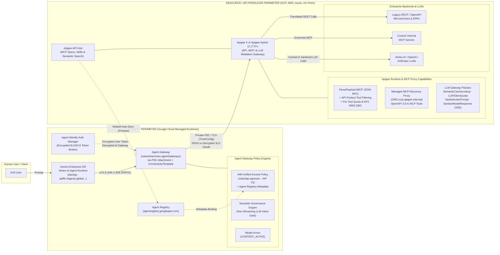

# Gemini Enterprise Agent Gateway vs. Apigee as an AI / MCP Gateway: Complete Architectural & Technical Analysis

> **Document Purpose & Verification Provenance (`Last Verified: November 6, 2026`):** An authoritative, evidence-backed technical comparison between **Gemini Enterprise Agent Platform: Agent Gateway** (`networkservices.googleapis.com` / `iap.googleapis.com`) and **Apigee API Management as an AI & MCP Gateway** (`Apigee X` and `Apigee Hybrid`). Every capability, configuration snippet, and limitation in this document has been validated against live `docs.cloud.google.com` documentation and official Google Cloud release notes through November 5, 2026.
> * **`[VERIFIED]`:** Confirmed directly against live official documentation (`HTTP 200`) or empirical product behavior cited inline.
> * **`[ASSUMPTION / INFERENCE]`:** Architectural synthesis or multi-product pattern deduced from verified component behaviors where no single end-to-end doc page states the combined claim verbatim.
> * **`[CAVEAT / UNVERIFIED]`:** Documented operational boundary or Preview / Early Preview capability that is actively evolving; always consult the linked official release notes for the latest General Availability status.

<div style="background-color: #e8f0fe; border-left: 4px solid #1a73e8; border-radius: 4px; padding: 12px 16px; margin: 14px 0; font-size: 13px; color: #202124; line-height: 1.55;">
  <strong>🔄 November 6, 2026 Validation &amp; Delta Summary (Updates Since September 2026 Baseline):</strong>
  <ul style="margin: 6px 0 0 0; padding-left: 20px;">
    <li><b>Private CA &amp; Self-Signed TLS Now Supported on Agent Gateway (with Strict Caveats):</b> Agent Gateway now supports private CAs and allowlisted self-signed server certificates for VPC destinations via <code>AgentConnectivityTemplate</code> + Certificate Manager <code>TrustConfig</code> (<code>tlsConfig.trustConfig</code>), provided <code>additionalRoots: PUBLICLY_TRUSTED_ROOTS</code> is set so <code>*.googleapis.com</code> calls do not fail (<a href="#42-traffic-topologies-deployment-models-and-private-ca-connectivity">Section 4.2</a>).</li>
    <li><b>Expanded Agent Gateway Deployment Models (1 GA, 3 Early Preview):</b> While <b>Google-Managed Agent Gateway</b> remains the only <b>GA</b> deployment model today, Google Cloud now documents three <b>Early Preview</b> self-managed models: <b>Self-Managed on GKE</b> (ambient networking + Secure Web Proxy), <b>Self-Managed on Cloud Run</b> (RXLB/RILB + Direct VPC mTLS + SWP), and <b>Cross-Cloud Envoy</b> for EKS/AKS/on-prem (<a href="#42-traffic-topologies-deployment-models-and-private-ca-connectivity">Section 4.2</a>).</li>
    <li><b>VPC Service Controls (VPC-SC) &amp; Multi-Model Semantic Governance:</b> Semantic Governance Policies gained <b>VPC-SC support in Preview</b> (Sept 25, 2026), evaluate 7 model families (Gemini, Anthropic, Claude on GEAP, OpenAI, Mistral, Llama, self-hosted vLLM), and added custom <code>denialMessage</code> overrides (Sept 29, 2026), while retaining a critical <b>non-streaming limitation</b> (<a href="#45-authorization-layer-2-service-extensions-model-armor-and-semantic-governance">Section 4.5</a>).</li>
    <li><b>Model Armor Streaming &amp; Hybrid Platform Boundaries:</b> Apigee <code>&lt;SanitizeModelResponse&gt;</code> supports <code>&lt;ContinuousScan&gt;true&lt;/ContinuousScan&gt;</code> over SSE streams (added to Apigee Hybrid <code>v1.17.3</code> on Oct 29, 2026), whereas Apigee Hybrid native Model Armor policies are <b>supported only on GCP installations</b> (not EKS/AKS/on-prem) and Agent Gateway Model Armor skips MCP Streamable HTTP/SSE and A2A streaming (<a href="#45-authorization-layer-2-service-extensions-model-armor-and-semantic-governance">Sections 4.5</a> &amp; <a href="#53-enterprise-llm-and-multimodal-gateway-multi-model-routing-pt-failover-token-quotas-dlp-and-sse-guardrails">5.3</a>).</li>
    <li><b>Stateless MCP (<code>2026-07-28</code>), Basepath Independence &amp; Default API Hub Sync:</b> Apigee X supports stateless MCP <code>2026-07-28</code> alongside stateful MCP (Apigee Hybrid <code>1.17.0+</code> is stateful-only), recognizes <code>&lt;ProxyOperationMode&gt;MCP&lt;/ProxyOperationMode&gt;</code> regardless of basepath (Nov 3, 2026), and <b>syncs API Hub MCP tools into Agent Registry by default</b> (Preview) (<a href="#51-five-enterprise-apigee-mcp-and-a2a-governance-patterns-and-protocol-matrix">Section 5.1</a>).</li>
    <li><b>Expanded Enterprise AI Workload Coverage (Multi-LLM Routing, 3P SaaS MCP Egress, Semantic Tool Discovery &amp; A2A):</b> Validated 7 AI traffic direction modes on Apigee, including multi-provider Provisioned Throughput (<code>PT</code>) spillover and schema normalization (retiring custom <code>LiteLLM</code> proxies), outbound 3P SaaS MCP credential mediation (<code>RFC 8693</code> / Encrypted KVM / <code>RFC 9728</code>), Search-then-Invoke semantic tool discovery over API Hub + Vertex AI Search, and cross-cloud/east-west <code>A2A</code> mediation (<a href="#3-comprehensive-side-by-side-technical-comparison-matrix">Sections 3</a> &amp; <a href="#5-deep-dive-2-apigee-as-an-ai-llm-mcp-and-a2a-gateway-apigee-x-and-apigee-hybrid">5</a>).</li>
    <li><b>Three Official Dual-Gateway Integration Topologies Published:</b> Added verified architectures for (1) <b>Private Southbound PSC Bridge</b> from Agent Runtime to Apigee X, (2) <b>North-South External/Multi-Cloud Fronting</b>, and (3) <b>Inline Apigee Extension Processor</b> attached directly to Agent Gateway via <code>CONTENT_AUTHZ</code> (<a href="#8-official-dual-gateway-integration-topologies-3p-firewalls-and-agentic-finops">Section 8</a>).</li>
  </ul>
</div>

---

## 1. Executive Summary & The Core Mental Model

The primary source of confusion between **Agent Gateway** and **Apigee (as an AI / MCP Gateway)** is that both products use the word *"Gateway"*, both inspect **Model Context Protocol (MCP)** JSON-RPC 2.0 traffic (`tools/list`, `tools/call`), and both integrate with **Model Armor** for prompt safety.

However, they sit on **opposite sides of the network architecture**, are owned by **different enterprise teams**, and solve **fundamentally different problems**:

1. **Agent Gateway (`Gemini Enterprise Agent Platform`) is an _Agent-Side Network & Identity Perimeter_ (Primarily an Outbound / Egress Forward Proxy for Agents).**
   - **Where it sits:** Directly attached to the VPC network interface (via a Compute Engine **Private Service Connect Network Attachment** and `AgentConnectivityTemplate`) of an AI agent running in **Vertex AI Agent Runtime** or **Gemini Enterprise** (GA), with Early Preview self-managed options emerging for GKE, Cloud Run, and cross-cloud Envoy.
   - **Core question it answers:** *"I have an AI agent running on Google Cloud. Who is this agent cryptographically (`spiffe://...`), which internal or external URLs/MCP servers/sub-agents is this specific agent allowed to reach, how do I inject user OAuth tokens without exposing raw credentials to the agent's memory, and does the tool call the agent is about to make actually match what the human user asked for in their prompt?"*
   - **What it does NOT do:** It does **not** perform multi-provider LLM traffic splitting, Provisioned Throughput (`PT`) spillover/failover, or request/response schema normalization across model vendors; it does **not** turn existing REST APIs into MCP tools or provide vector-ranked semantic tool discovery; it does **not** package tools or models into tiered `API Products`, filter `tools/list` payloads per consumer subscription, or enforce per-tool `<Quota>` (`300 calls/min`) and `<LLMTokenQuota>` budgets; it does **not** perform semantic vector caching; and its **GA** Google-managed runtime **cannot** execute inside AWS EKS, Azure AKS, OpenShift, or on-premises data centers *(cross-cloud Envoy deployment is currently in Early Preview; see [Section 4.2](#42-traffic-topologies-deployment-models-and-private-ca-connectivity))*.

2. **Apigee (`Apigee X` & `Apigee Hybrid`) is a _Full-Spectrum AI, LLM, MCP, & Agent-to-Agent (`A2A`) Traffic Mediation Gateway_ (Operating Inbound, Outbound, East-West, and Inline).**
   - **Where it sits:** Across every AI traffic boundary in the enterprise: in front of foundation models (Vertex AI Gemini, Azure OpenAI, OpenAI, Anthropic, AWS Bedrock), in front of enterprise REST APIs and internal MCP servers, on the outbound egress path to third-party SaaS MCP servers and external A2A agents, in-cluster for east-west multi-agent mediation (`Apigee Hybrid` on GKE, AWS EKS, Azure AKS, OpenShift, or on-prem), or **inline as a `CONTENT_AUTHZ` Extension Processor** attached to Cloud Service Mesh or Agent Gateway ([Section 8.1](#81-three-official-dual-gateway-integration-topologies)).
   - **Core questions it answers across four AI workload pillars:**
     1. **Enterprise Multi-LLM & Multimodal Model Gateway:** *"How do we consolidate self-managed `LiteLLM` proxy containers onto a managed enterprise LLM gateway that routes across Vertex AI, Azure OpenAI, OpenAI, Anthropic, and Bedrock; spills over cleanly from dedicated **Provisioned Throughput (`PT`)** to **PayGo** or secondary regions on `HTTP 429`/`5xx` with circuit breaking; normalizes OpenAI-compatible schemas; injects short-lived credentials (`<GoogleAuthentication>` / Encrypted KVM); enforces real-time `<LLMTokenQuota>` and `<PromptTokenLimit>` budgets; caches semantically equivalent prompts in Vertex AI Vector Search (`<SemanticCacheLookup>`); tokenizes PII via **Cloud DLP** Format-Preserving Encryption (`FPE`); scans streaming SSE tokens (`<ContinuousScan>true</ContinuousScan>`); and governs multimodal payloads safely?"*
     2. **Universal Inbound & Outbound MCP Gateway + Semantic Tool Discovery:** *"How do we expose legacy OpenAPI/REST backends as MCP tools without rewriting code (`Managed MCP Discovery Proxy 1.17.0+` / `apigee-go-gen`), filter `tools/list` dynamically and enforce per-tool `<Quota>` (`300/min` read vs. `3/min` write) via `API Products`, govern **developer IDEs and multi-cloud agents calling external 3P SaaS MCP servers** (`RFC 8693` OBO exchange, Encrypted KVM API key swap, or `RFC 9728` 1-click OAuth pass-through), and provide **Search-then-Invoke semantic tool discovery** so agents do not stuff 100+ tool schemas into LLM context windows?"*
     3. **Cross-Cloud, Consumer & In-Cluster Agent-to-Agent (`A2A`) Mediation:** *"How do we govern North-South consumer/partner agent calls (replacing custom BFF token-exchange glue), cross-cloud `A2A` Agent Card (`/.well-known/agent.json`) and JSON-RPC/SSE task calls, sub-millisecond in-cluster Kubernetes agent traffic, and emergency runaway-agent circuit breakers?"*
     4. **Inline `CONTENT_AUTHZ` Extension Processor:** *"How do we execute Apigee AI, quota, and payload policies synchronously inline on Cloud Service Mesh or Agent Gateway without changing agent target URLs or hitting Agent Gateway's 4-policy egress limit?"*
   - **What it does NOT do:** It does **not** mint Google-managed SPIFFE workload identities (`spiffe://agents.global...`) for Vertex AI agents, it does **not** attach as a transparent PSC network interface to `Gemini Enterprise` managed runtimes, and it does **not** have a built-in LLM "intent gate" (`Semantic Governance Policy Engine`) that compares an agent's internal multi-turn chat history against natural-language business constraints before allowing a tool call.

### The Real-World Analogy

Think of an AI Agent like a **corporate employee working on a company-issued laptop**, and your enterprise backends, SaaS tools, and foundation models like **bank vaults, partner exchanges, and shared AI compute utilities**:

* **Agent Gateway is the Secure Corporate Laptop VPN, Zero-Trust Egress Firewall, and Password Manager (1Password) attached to the employee's laptop.**
  * It gives the employee a cryptographic corporate badge (`Agent Identity` SPIFFE cert).
  * It controls which websites and MCP servers the employee's laptop is allowed to connect out to (`Agent-to-Anywhere` IAM Unified Access Policies).
  * It auto-fills the user's OAuth token at the network edge so the agent code never sees the raw password (`Agent Identity Auth Manager`).
  * It watches the employee's screen and blocks them if a phishing email tricks them into wiring money when their boss only asked them to check the calendar (`Semantic Governance Policy Engine`).
* **Apigee is the Central Switchboard, Protocol Translator, Multi-Model Traffic Controller, and Vault Gatekeeper for All AI Workloads.**
  * Any caller (whether a Gemini Enterprise agent, VS Code / Cursor / Claude Desktop, a mobile consumer app, a B2B partner, or an AWS/Azure agent) connects through Apigee.
  * For **LLM calls**, Apigee balances traffic across Vertex AI Provisioned Throughput, PayGo, Azure OpenAI, and Anthropic with automatic `429` failover, schema translation, `<LLMTokenQuota>` FinOps caps, Cloud DLP tokenization, SSE Model Armor scanning, and `<SemanticCacheLookup>` vector caching.
  * For **MCP and A2A calls** (both inbound to internal REST/MCP systems and outbound to 3P SaaS MCP servers or cross-cloud agents), Apigee translates REST to MCP, brokers `RFC 8693` or KVM credentials so raw SaaS keys never live on developer laptops, serves entitlement-filtered semantic tool discovery, hides unauthorized tools from `tools/list`, and enforces per-tool `<Quota>` limits.

---

## 2. Visual End-to-End Architecture Comparison

### How Agent Gateway and Apigee Fit Together in an Enterprise Architecture



---

## 3. Comprehensive Side-by-Side Technical Comparison Matrix

| Dimension | Gemini Enterprise Agent Platform: Agent Gateway | Apigee as an AI / MCP Gateway (`Apigee X` & `Apigee Hybrid`) |
| :--- | :--- | :--- |
| **Primary Architectural Role** | **Agent-Side Network & Identity Perimeter** (principally an outbound/egress forward proxy attached to an agent's runtime, plus ingress for `Agent Runtime`). | **Full-Spectrum AI, LLM, MCP, & A2A Mediation Gateway** (multi-LLM router & failover hub, inbound/outbound MCP & REST-to-MCP gateway, cross-cloud/east-west A2A mediator, semantic tool discovery front door, and inline `ext_proc` extension). |
| **Underlying GCP Service & APIs** | `networkservices.googleapis.com` (`agentGateways`, `agentConnectivityTemplates`, `authzExtensions`), `networksecurity.googleapis.com` (`authzPolicies`), `compute.googleapis.com` (`networkAttachments`), `certificatemanager.googleapis.com` (`trustConfigs`), `iap.googleapis.com`, `agentregistry.googleapis.com`. | `apigee.googleapis.com`, `apihub.googleapis.com` (Apigee API Hub with `MCP` API style, Agent Registry sync, signed skills registry, and Semantic Search), plus Apigee Message Processors (`apigee-runtime`) and `apigee-mcp-server`. |
| **Traffic Direction Modes** | 1. **`Agent-to-Anywhere` (Egress):** Agent calling outbound MCP servers, other agents (`A2A`), LLMs, or HTTP endpoints.<br>2. **`Client-to-Agent` (Ingress):** Clients calling `query` / `streamQuery` on `Agent Runtime` *(Note: `"Anywhere-to-MCP"` is not an official mode name)*. | **7 AI Traffic Modes:**<br>1. **North-South External Consumer / Partner -> Enterprise MCP or Agent** (edge WAF + OIDC -> inline `RFC 8693` replacing custom BFF code).<br>2. **Internal App / Developer IDE (`VS Code`, `Cursor`, `Claude`) -> Internal & REST-Backed MCP.**<br>3. **Outbound Egress Proxy: Agent / IDE -> External 3P SaaS MCP** (`RFC 8693`, Encrypted KVM key swap, or `RFC 9728` OAuth pass-through).<br>4. **Search-then-Invoke Semantic Tool Discovery (`/mcp/discover` -> API Hub + Vertex AI Search).**<br>5. **Cross-Cloud & In-Cluster East-West `A2A` / Agentic Workflow Mediation** (`/.well-known/agent.json` + JSON-RPC/SSE).<br>6. **Enterprise Multi-LLM & Multimodal Gateway** (PT/PayGo spillover, failover, schema normalization, DLP, caching).<br>7. **Inline `CONTENT_AUTHZ` Extension** (`Apigee Extension Processor` on Cloud Service Mesh or Agent Gateway). |
| **Supported Agent Runtimes & Deployment Models** | • **Google-Managed (GA):** `Agent Runtime` (`Agent-to-Anywhere` + `Client-to-Agent`; supports ADK/supported Python frameworks) and `Gemini Enterprise` (**`Agent-to-Anywhere` ONLY**; ingress unsupported).<br>• **Self-Managed Early Preview (`[CAVEAT]`):** Non-ADK agents (`Claude Agent SDK`, `LangGraph`) run on GKE or Cloud Run and can register in Agent Registry / bind to Early Preview GKE (ambient + SWP), Cloud Run (RXLB/RILB + SWP), or Cross-Cloud Envoy gateways. | **Runtime- & Framework-Agnostic (GA):** Works in production GA today with **any** agent framework, IDE, or HTTP/MCP/A2A client anywhere (Gemini Enterprise, Vertex AI, non-ADK Claude Agent SDK / LangGraph on GKE or Cloud Run, Cursor, Claude Desktop, AWS Bedrock, Azure OpenAI, mobile/partner apps). |
| **Cryptographic Identity Model** | **Google-Managed Agent Identity (SPIFFE):**<br>`spiffe://agents.global.org-<ORG_ID>.system.id.goog/resources/<service>/<path>`<br>Uses auto-rotated 24-hour X.509 certificates, **mTLS** to the gateway, and **DPoP** (Demonstrating Proof of Possession) beyond the gateway. Requires `identity_type="AGENT_IDENTITY"` at agent creation time. | **Consumer App, Human OBO & Enterprise Identity:**<br>Validates incoming OAuth 2.0 / OIDC JWTs (`<VerifyJWT>`, `<OAuthV2>`), API Keys (`<VerifyAPIKey>`), mTLS client certs, SAML, executes **RFC 8693 OAuth 2.0 Token Exchange (OBO)**, and serves **RFC 9728** `.well-known/oauth-protected-resource` metadata. |
| **Outbound Credential Vault / Broker** | **Agent Identity Auth Manager:** Stores 3LO (user-delegated OAuth) and 2LO/API Key credentials. For Gemini Enterprise + Agent Gateway, user credentials are encrypted by Auth Manager and decrypted at the gateway so the agent never sees the raw token. | **Apigee Encrypted KVM, Secret Manager & OAuth Mediation:** Stores backend secrets in encrypted Key Value Maps (KVMs) or Secret Manager and exchanges/injects backend tokens via `<OAuthV2>`, `<AssignMessage>`, and `<ServiceCallout>`. |
| **REST-to-MCP Protocol Translation & MCP Versions** | **No Protocol Translation.** Strictly a passthrough proxy for HTTP, MCP, and A2A traffic; cannot convert a REST API into an MCP tool. | **Yes (Core Capability):**<br>1. **Managed Apigee MCP Discovery Proxy** (`<ORG>.mcp.apigee.internal`) + API Hub exposes OpenAPI 3.0.x specs as MCP tools. Supports **Stateless (`2026-07-28`) + Stateful (`2025-11-25`..`2024-11-05`)** concurrently on Apigee X, and **Stateful MCP** on Hybrid `1.17.0+`. Recognizes `<ProxyOperationMode>MCP</ProxyOperationMode>` on any basepath (`1-18-0-apigee-8`).<br>2. **`apigee-go-gen`** statically compiles OpenAPI specs into MCP proxy bundles. |
| **Catalog, Skills & Discovery Sync** | **Agent Registry (`agentregistry.googleapis.com`):** Discovers `Agent Runtime` agents, Cloud Run MCP servers, and API Hub MCP servers; allows custom endpoint registration (up to 5,000 resources per gateway). Gemini Enterprise apps bind to a single regional registry (`us-central1` for `global`/`us`, `europe-west1` for `eu`). | **Apigee API Hub (`apihub.googleapis.com`) & Developer Portal:** Catalogs REST APIs, OpenAPI specs, MCP servers (`MCP` style), and Ed25519-signed agentic `.skill` bundles (`distribute-agentic-skills`), with `/semanticSearch`. **Automatically syncs MCP tools/servers to Agent Registry by default (Preview)**. |
| **Deterministic Authorization Engine** | 1. **IAM Unified Access Policies (IAM v3 + IAP V2):** `iap.googleapis.com/resources.egressViaIAP` (role `roles/iap.egressor`, mandatory `iapPolicyVersion: "V2"`) with CEL on `destination.agent_registry.*` or `destination.unregistered.*`, Allow + Deny rules, and `DRY_RUN` mode.<br>2. **Network Security `authzPolicies`:** Native `httpRules.to.operations.mcp` matching (`tools/list`, `tools/call`). | 1. **API Products + `<ParsePayload>`:** Extracts `parsepayload.<name>.operation` (e.g., `tools/call/get_stock_price`) and enforces entitlement per Developer App.<br>2. **External Callout (`<ExternalCallout>`):** gRPC callout to Open Policy Agent (OPA) or custom engines for fine-grained JSON-RPC argument RBAC/ABAC. |
| **MCP Tool Annotation Awareness** | **Yes:** IAM Unified Access Policies evaluate CEL rules against MCP tool annotations (`read_only_hint`, `destructive_hint`, `idempotent_hint`, `open_world_hint`) registered in Agent Registry. | **Via Custom Policy / OPA:** Inspects arbitrary JSON-RPC payloads, OpenAPI metadata, or headers via JavaScript/Python/Java callouts or OPA `<ExternalCallout>`, though not natively bound to Agent Registry annotations. |
| **Dynamic `tools/list` Response Filtering** | **No:** Allows or denies `tools/list` or specific `tools/call` methods, but does not rewrite/filter the JSON array inside a `tools/list` response payload per consumer tier. | **Yes (Native):** When `<ParsePayload>` is paired with an API Product in Request and Response flows, Apigee automatically strips unauthorized tools from `tools/list` responses per consumer app. |
| **Per-Tool Rate Limiting & LLM Token Quotas** | **No:** Does not provide per-MCP-tool rate limiting or token quota enforcement at the gateway *(GEAP added GA `Inference request metadata logging` via `x-goog-agent-platform-observability-label-` headers on Oct 30, 2026 for passive cost attribution)*. | **Yes (Native):** API Products + `<Quota>` enforce independent rate limits per MCP tool (`tools/call/<tool_name>`), while **`<LLMTokenQuota>`** (`EnforceOnly`/`CountOnly`, SSE `<EventFlow>`, excluding `<SemanticCacheLookup>` hits as of Nov 3, 2026) and **`<PromptTokenLimit>`** enforce real-time token budgets. |
| **LLM-Based "Intent Gate" (Prompt vs. Action Alignment)** | **Yes, Semantic Governance Policies (Preview):** Evaluates **Natural Language Constraints (NLC)** + user intent across **7 model families** (Gemini, Anthropic, Claude on GEAP, OpenAI, Mistral, Llama, vLLM), with VPC-SC Preview support (Sept 25, 2026) and custom `denialMessage` overrides. **Does NOT support streamed model responses (`:streamGenerateContent`, `"stream": true`)**. | **No Native Multi-Turn Intent Gate:** Apigee provides `<SanitizeUserPrompt>` (`<FunctionResponseSource>`) and `<SanitizeModelResponse>` (`<FunctionCallSource>` + `<ContinuousScan>true</ContinuousScan>` SSE streaming), plus 3P AI firewalls, but does not run a native NLC LLM engine over multi-turn chat history. |
| **Model Armor Coverage & Streaming Nuances** | • **Ingress:** Sanitizes **only `reasoningEngines.streamQuery` for ADK agents** (`asyncQuery` and non-ADK frameworks pass unsanitized).<br>• **Egress:** Sanitizes non-streaming OpenAI, MCP `tools/call` + `prompts/get`, and A2A `SendMessage`; **skips MCP `tools/list`, `resources/*`, MCP Streamable HTTP/SSE, and A2A streaming**. Payloads exceeding `65,536` tokens (`130,000` SDP; `4 MB`) return `EXECUTION_SKIPPED` and **pass through**. | • **Unary & SSE Streaming:** `<SanitizeModelResponse>` supports `<ContinuousScan>true</ContinuousScan>` inside SSE `<EventFlow>`s across Gemini, OpenAI, and Anthropic (Apigee X & Hybrid `v1.17.3+`), counting the entire stream as **1** Model Armor request with **no total response token limit** (SDP redacted text is not rewritten in streaming mode).<br>• **Hybrid Platform Caveat:** Native Model Armor policies in Apigee Hybrid are **supported only on GCP clusters** (use `<ServiceCallout>` REST API or 3P AI firewalls on EKS/AKS/on-prem). |
| **LLM Semantic Caching** | **No.** | **Yes (Native):** `<SemanticCacheLookup>` and `<SemanticCachePopulate>` generate embeddings via Vertex AI Embeddings API and query Vertex AI Vector Search (`DOT_PRODUCT_DISTANCE`, `COSINE_DISTANCE`, `SQUARED_L2_DISTANCE`, `L1_DISTANCE` over REST or PSC gRPC). |
| **Multi-LLM Routing, PT Spillover & Schema Normalization** | **No:** Passes LLM calls through to the target URL without multi-provider load balancing, `HTTP 429` Provisioned Throughput (`PT`)-to-PayGo spillover, circuit breaking, or request/response schema translation across model families. | **Yes (Replaces Custom `LiteLLM` Servers):** Conditional `RouteRules`, weighted `TargetServers`, `<GoogleAuthentication>`, and cache-backed circuit breakers route across **Vertex AI Gemini (PT -> PayGo spillover), Azure OpenAI, OpenAI, Anthropic, and AWS Bedrock** with automatic `429`/`5xx` failover and canonical OpenAI-compatible schema translation. |
| **Agent-to-Agent (`A2A`), Semantic Tool Discovery & Multimodal Payloads** | • Governs outbound/inbound `A2A` (`SendMessage` unary Model Armor; skips `SendStreamingMessage` & gRPC).<br>• No vector-ranked semantic tool discovery or Claim-Check payload mediation. | • Mediates cross-cloud & in-cluster `A2A` (`/.well-known/agent.json` caching, JSON-RPC/SSE tasks, runaway-agent circuit breakers).<br>• **Search-then-Invoke** semantic tool discovery over API Hub + Vertex AI Search prevents 50+ tool context bloat.<br>• **Cloud DLP** `FPE` tokenization + Pre-Signed URL **Claim-Check** / SSE streaming for multimodal payloads. |
| **Hybrid & Multi-Cloud Execution** | **Google-Managed SaaS Only for GA:** Runs on Google Cloud's managed Envoy data plane in the same region as the agent *(Self-Managed GKE, Cloud Run, and Cross-Cloud Envoy for EKS/AKS/on-prem are in **Early Preview**)* . | **Production GA Anywhere (`Apigee Hybrid 1.17.0+`):** Runs the full API runtime (`apigee-runtime`) and Managed MCP Server (`apigee-mcp-server`) inside customer GKE, AWS EKS, Azure AKS, Red Hat OpenShift, or on-prem clusters. Request traffic never leaves the cluster. |
| **TLS Certificate Support for Backends** | **Public CAs by Default + Private CA via `TrustConfig`:** Supports private CAs and allowlisted self-signed certs for VPC targets via `AgentConnectivityTemplate` + Certificate Manager `TrustConfig` (`tlsConfig`), **requiring `additionalRoots: PUBLICLY_TRUSTED_ROOTS`** if calling `*.googleapis.com`, manual PEM rotation, and template replacement on updates *(custom FQDN `authzExtensions` do not validate server certs)*. | **Full Enterprise PKI & Two-Way mTLS Control:** Supports custom private CA truststores, keystores, self-signed backend certs, two-way mTLS `TargetServer` definitions, SNI overrides, and automated rotation without recreating gateway bindings. |
| **Scale, Quotas & VPC-SC** | • Max **5,000** registered resources per gateway; max **4** `authzPolicies` on egress (requires multi-gateway sharding across business units); max **1** `CONTENT_AUTHZ` policy on ingress; `1,500`-byte MTU.<br>• **VPC-SC supported** for gateways created **after Sept 8, 2026** with `vpcEgress: ALL_TRAFFIC` + private DNS to `restricted.googleapis.com` (`199.36.153.4/30`). | • Up to **1,000** MCP tools per org in Apigee X (SaaS) via Managed MCP Proxy.<br>• Up to **~10,000** MCP tools per org in Apigee Hybrid `1.17.0+` (bounded by `3 MiB` OAS, `50 MiB` bundle, `10 MiB` default / `30 MiB` max `tools/list`, and `100` hostnames/envgroup), with **no 4-policy cap** across API Products or `Apigee Extension Processor`. Full **VPC-SC** support on Apigee X. |

---

## 4. Deep Dive 1: Gemini Enterprise Agent Platform: Agent Gateway

### 4.1 What Agent Gateway Actually Is Under the Hood

According to the [Agent Gateway overview](https://docs.cloud.google.com/gemini-enterprise-agent-platform/govern/gateways/agent-gateway-overview#core-governance-components), [Set up Agent Gateway](https://docs.cloud.google.com/gemini-enterprise-agent-platform/govern/gateways/set-up-agent-gateway), and [Set up Agent Gateway with VPC connectivity](https://docs.cloud.google.com/gemini-enterprise-agent-platform/govern/gateways/set-up-vpc-connectivity#how-it-works), Agent Gateway is a network and security proxy provisioned via the **Network Services API** (`networkservices.googleapis.com/v1alpha1` / `v1`) that attaches directly to an agent runtime via a **Compute Engine Private Service Connect (PSC) Network Attachment** (`compute.googleapis.com`) and an **`AgentConnectivityTemplate`** (`networkservices.agentConnectivityTemplates`).

> *"Agent Gateway is a managed proxy service that provides a centralized enforcement point to help secure, govern, and monitor all network traffic for your AI agents. It mediates connections to and from agents deployed in Agent Runtime and Gemini Enterprise, helping to ensure that interactions with users, other agents, and external tools adhere to your organization's security standards."*
> ([Agent Gateway overview](https://docs.cloud.google.com/gemini-enterprise-agent-platform/govern/gateways/agent-gateway-overview))

When you provision an Agent Gateway, seven Google Cloud subsystems collaborate:

1. **Compute Engine Network Attachment (`compute.networkAttachments`):** Placed in a dedicated subnet (`connection-preference=ACCEPT_AUTOMATIC`, minimum `/28` CIDR) in the same region as your agent. It bridges the Google-managed agent runtime VPC to your consumer VPC and the Agent Gateway data plane.
2. **Agent Connectivity Template (`networkservices.agentConnectivityTemplates`):** Encapsulates VPC egress mode (`PRIVATE_RANGES_ONLY` default vs. `ALL_TRAFFIC` for VPC-SC or Cloud NAT static egress), Cloud DNS peering domains (`dnsPeeringConfig`, without chained DNS peering), and custom private CA trust anchors (`tlsConfig.trustConfig` referencing Certificate Manager `TrustConfig`).
3. **Network Services Agent Gateway (`networkservices.agentGateways`):** The Envoy-based proxy instance configured with `"protocols": ["MCP"]`, a `googleManaged.governedAccessPath` (`AGENT_TO_ANYWHERE` or `CLIENT_TO_AGENT`), and an optional `networkConfig.egress` reference.
4. **Agent Identity (`spiffe://...`):** Cryptographic workload identity automatically provisioned at creation time (`identity_type="AGENT_IDENTITY"`) for agents in `Agent Runtime`, `Gemini Enterprise`, and `Cloud Run`.
5. **Agent Registry (`agentregistry.googleapis.com`):** A central inventory of agents (`AGENT`), MCP servers (`MCP_SERVER`), skills (`SKILL`), and endpoints (`ENDPOINT`) linked to the gateway via `"registries"`.
6. **IAM Unified Access Policies (`iam.googleapis.com` v3 + `iap.googleapis.com`):** Evaluates identity-and-destination CEL policies (`iap.googleapis.com/resources.egressViaIAP`, role `roles/iap.egressor`, with mandatory `iapPolicyVersion: "V2"` on the `iap.googleapis.com` extension) on every outbound call.
7. **Network Security Authorization Policies & Service Extensions (`networksecurity.authzPolicies` + `networkservices.authzExtensions`):** Hooks into the Envoy data plane (`ext_proc` in `FULL_DUPLEX_STREAMED` mode) for `REQUEST_AUTHZ` and `CONTENT_AUTHZ` (delegating to **Model Armor**, the **Semantic Governance Policy Engine**, **Apigee Extension Processor**, or **15 named ISV security partners**).

---

### 4.2 Traffic Topologies, Deployment Models, and Private CA Connectivity

Agent Gateway operates in two mutually exclusive governance modes per gateway instance (`governedAccessPath`):

#### 1. `AGENT_TO_ANYWHERE` (Outbound / Egress Governance)
* **How it works:** The Agent Gateway acts as an **outbound forward proxy** for an agent. **100% of outbound traffic** the agent makes (calling an MCP server via `tools/list` or `tools/call`, invoking a sub-agent over Agent-to-Agent `A2A`, calling an LLM API, or reaching Google Cloud telemetry/storage APIs) traverses the Agent Gateway.
* **Supported Runtimes (GA):**
  * **Vertex AI Agent Runtime (`aiplatform.googleapis.com` Reasoning Engine):** Bound during deployment via `"pscInterfaceConfig"` and `"agentGatewayConfig": {"agentToAnywhereConfig": {"agentGateway": "..."}}`. Supports cross-project governance (an agent in Project A can use an `Agent-to-Anywhere` gateway in Project B as long as both are in the **same region**; configured via REST/gcloud using a Google security group with `roles/networkservices.viewer` to scale across service projects).
  * **Gemini Enterprise (`discoveryengine.googleapis.com`):** Bound at the engine level by patching `features.agent-Session-agent-gateway` and setting `agentGatewaySetting.defaultEgressAgentGateway`.
* **Routing Destinations & VPC Egress Modes ([`set-up-vpc-connectivity#vpc-egress-modes`](https://docs.cloud.google.com/gemini-enterprise-agent-platform/govern/gateways/set-up-vpc-connectivity#vpc-egress-modes)):**
  * `PRIVATE_RANGES_ONLY` (Default): Routes RFC 1918 / privately used public IPs and peered Cloud DNS private zones into your VPC while sending public internet traffic directly via Google's edge.
  * `ALL_TRAFFIC`: Forces **all** outbound agent traffic (both private and public, including `restricted.googleapis.com` at `199.36.153.4/30`) into your VPC, enabling customer Cloud NAT static IP allowlisting, Cloud NGFW inspection, and **VPC Service Controls (VPC-SC)** compliance.

#### 2. `CLIENT_TO_AGENT` (Inbound / Ingress Governance)
* **How it works:** The Agent Gateway acts as an **inbound reverse proxy** in front of an agent deployed in `Agent Runtime` (`query` and `streamQuery` methods only; `asyncQuery` is unsupported), protecting the agent from external callers and applying inbound `CONTENT_AUTHZ`.
* **Supported Runtimes:**
  * **Vertex AI Agent Runtime ONLY** (must be in the **same project and same region** as the Agent Gateway).
  * **Explicitly Unsupported on Gemini Enterprise:** As stated in [Set up Agent Gateway](https://docs.cloud.google.com/gemini-enterprise-agent-platform/govern/gateways/set-up-agent-gateway#choose-runtime-region):
    > *"For Gemini Enterprise: Client-to-Agent mode is not supported."*

#### 3. Official Agent Gateway Deployment Models: 1 GA vs. 3 Early Preview (`[VERIFIED]` + `[CAVEAT]`)
As documented in [Agent Gateway overview: Deployment models](https://docs.cloud.google.com/gemini-enterprise-agent-platform/govern/gateways/agent-gateway-overview#deployment-models), Google Cloud now defines **four deployment models** under a unified control plane (though **only the Google-managed model is GA today**):

| Deployment Model | Launch Stage | Underlying Data Plane Mechanics | Supported Access Paths |
| :--- | :--- | :--- | :--- |
| **1. Google-Managed Agent Gateway** ([`#managed-agw`](https://docs.cloud.google.com/gemini-enterprise-agent-platform/govern/gateways/agent-gateway-overview#managed-agw)) | **GA** | Google-managed Envoy proxy attached via PSC Network Attachment in Google Cloud. | `Agent Runtime`: Ingress + Egress<br>`Gemini Enterprise`: Egress ONLY |
| **2. Self-Managed on GKE** ([`#gke-agw`](https://docs.cloud.google.com/gemini-enterprise-agent-platform/govern/gateways/agent-gateway-overview#gke-agw)) | **Early Preview** *("Coming soon")* | **Ingress:** GKE Gateway API (Regional Application Load Balancer).<br>**Egress:** GKE ambient networking (sidecar-less) routing pod egress to a customer-managed **Secure Web Proxy (`SWP`)**, plus L7 per-namespace ambient proxies for pod-to-pod A2A/MCP calls. | `Client-to-Agent` + `Agent-to-Anywhere` |
| **3. Self-Managed on Cloud Run** ([`#cloud-run-agw`](https://docs.cloud.google.com/gemini-enterprise-agent-platform/govern/gateways/agent-gateway-overview#cloud-run-agw)) | **Early Preview** *("Coming soon")* | **Ingress:** Regional External or Internal Application Load Balancer (`RXLB` / `RILB`).<br>**Egress:** Cloud Run ambient networking over Direct VPC egress mTLS tunnel to a customer-managed **Secure Web Proxy (`SWP`)**. | `Client-to-Agent` + `Agent-to-Anywhere` |
| **4. Agent Gateway for Cross-Cloud** ([`#cross-cloud-agw`](https://docs.cloud.google.com/gemini-enterprise-agent-platform/govern/gateways/agent-gateway-overview#cross-cloud-agw)) | **Early Preview** *("Coming soon")* | Customer-deployed lightweight Envoy-based Agent Gateway running inside **Amazon EKS, Azure AKS, OpenShift, or on-premises Kubernetes**. Data plane traffic stays local while control plane (WIF -> Agent Identity, Agent Registry, Model Armor callouts, observability) connects to Google Cloud. | `Client-to-Agent` + `Agent-to-Anywhere` |

#### 4. Private CAs & Self-Signed Certificates via `TrustConfig` (`[VERIFIED]` Correction)
Earlier Agent Gateway releases required publicly trusted CAs for all destinations. Per [Set up Agent Gateway with VPC connectivity: TLS certificate requirements](https://docs.cloud.google.com/gemini-enterprise-agent-platform/govern/gateways/set-up-vpc-connectivity#tls-certificate-requirements), Agent Gateway **now supports private CAs and allowlisted self-signed server certificates** for VPC destinations via Certificate Manager `TrustConfig` (`tlsConfig.trustConfig`), subject to **three mandatory engineering guardrails**:

> *"Private CAs and self-signed certificates: If your target destination (agents, tools, or MCP servers in your VPC network) uses a private CA or internal PKI, you can configure custom trust anchors using the tlsConfig setting in your connectivity template. By referencing a Certificate Manager TrustConfig resource, you can configure Agent Gateway to trust only specific private CAs, or combine private root CAs with publicly trusted CAs (PUBLICLY_TRUSTED_ROOTS)... If your agents connect to Google Cloud APIs (*.googleapis.com) or other public HTTPS endpoints, you must set additionalRoots to PUBLICLY_TRUSTED_ROOTS; without this setting, Agent Gateway doesn't trust Google-signed certificates for googleapis.com."*
> ([Set up Agent Gateway with VPC connectivity](https://docs.cloud.google.com/gemini-enterprise-agent-platform/govern/gateways/set-up-vpc-connectivity#tls-certificate-requirements))

1. **Always Set `additionalRoots: PUBLICLY_TRUSTED_ROOTS`:** Omitting or setting `NO_ADDITIONAL_ROOTS` breaks outbound agent calls to `*.googleapis.com` (Vertex AI Gemini, Cloud Logging, Telemetry).
2. **Manual PEM Rotation Only:** Automated PEM rotation via Google Cloud Secret Manager is unsupported on `TrustConfig`; certificates must be rotated manually.
3. **Immutability Requires Template Replacement:** `trustConfig` and `networkAttachment` are **immutable** once attached. Updating `tlsConfig`, `dnsPeeringConfig`, or `vpcEgress` requires creating a **new** `AgentConnectivityTemplate` and updating the gateway reference ([`#updating-egress-settings`](https://docs.cloud.google.com/gemini-enterprise-agent-platform/govern/gateways/set-up-vpc-connectivity#updating-egress-settings)).

---

### 4.3 Cryptographic Agent Identity (`SPIFFE`, `mTLS`, and `DPoP`) & Auth Manager

One of the most important differentiators of the Gemini Enterprise Agent Platform is **Agent Identity** ([Agent Identity overview](https://docs.cloud.google.com/gemini-enterprise-agent-platform/govern/agent-identity-overview)):

1. **SPIFFE ID Structure & Creation-Time Requirement:**
   When you deploy an agent in `Agent Runtime`, `Gemini Enterprise`, or `Cloud Run` with `identity_type="AGENT_IDENTITY"`, Google Cloud automatically provisions a cryptographic workload identity in the format:
   ```
   spiffe://agents.global.org-<ORG_ID>.system.id.goog/resources/<SERVICE_NAME>/<RESOURCE_PATH>
   ```
   *(In IAM policies, this is referenced as `principal://agents.global.org-<ORG_ID>.system.id.goog/resources/<SERVICE>/<PATH>` or across an entire project via `principalSet://agents.global.org-<ORG_ID>.system.id.goog/cloudresourcemanager.googleapis.com/projects/<PROJECT_NUMBER>`. Note: `identity_type="AGENT_IDENTITY"` **must be set when creating the agent**; you cannot retrofit an existing service-account-based Reasoning Engine after creation).*
2. **Lifecycle & Zero-Key Security:**
   * Backed by Google-managed X.509 certificates with a **24-hour validity period** that are rotated automatically.
   * Unlike IAM Service Accounts, **there are no user-managed keys to download, store, or leak**, and users cannot impersonate an Agent Identity from a local laptop.
   * Remains traceable to the specific agent resource across hops (avoiding the "confused deputy" problem where multiple agents share a single IAM service account).
3. **Two-Hop Cryptographic Verification (`mTLS` + `DPoP`):**
   * **Agent to Agent Gateway (`mTLS`):** The agent authenticates to the Agent Gateway using mutual TLS (`mTLS`) with its SPIFFE X.509 certificate.
   * **Agent Gateway to Destination (`DPoP`):** Beyond the gateway, Agent Identity uses **Demonstrating Proof of Possession (DPoP)** via Context-Aware Access so downstream Google Cloud resources can cryptographically verify that the token belongs to the specific agent and was not stolen or replayed *(agents calling downstream targets that do not accept certificate-bound tokens can opt out via [`auth-agent-own-identity#opt-out-caa`](https://docs.cloud.google.com/iam/docs/auth-agent-own-identity#opt-out-caa))*.
4. **Agent Identity Auth Manager (Secure Outbound Token Broker):**
   * Documented in [Agent Identity overview](https://docs.cloud.google.com/gemini-enterprise-agent-platform/govern/agent-identity-overview#agent-auth-manager), **Agent Identity Auth Manager** manages outbound authentication to external tools using either:
     * **User-delegated authority:** 3-legged OAuth (3LO), where the human user consents on an OAuth screen.
     * **Agent's own authority:** Agent Identity, 2-legged OAuth (2LO), API keys, or HTTP basic auth.
   * **End-to-End Token Encryption at the Gateway:**
     > *"When used with Agent Gateway and Gemini Enterprise, end-user credentials are encrypted by auth manager and decrypted at the gateway, so the agent never handles raw credentials."*

---

### 4.4 Authorization Layer 1: IAM Unified Access Policies (`iap.googleapis.com/resources.egressViaIAP`)

Documented in [IAM Unified Access Policies overview](https://docs.cloud.google.com/gemini-enterprise-agent-platform/govern/policies/iam-overview-uap) and [Create IAM Unified Access Policies](https://docs.cloud.google.com/gemini-enterprise-agent-platform/govern/policies/configure-iam-policies-uap), Agent Gateway integrates with **IAM v3 Unified Access Policies** (powered by Identity-Aware Proxy V2) to enforce deterministic outbound access control.

* **Core Permission, Predefined Role & Extension Metadata:** Permission `iap.googleapis.com/resources.egressViaIAP` (granted via predefined role **`roles/iap.egressor`**). When binding the `iap.googleapis.com` `authzExtension`, setting `metadata.iapPolicyVersion: "V2"` is **mandatory** ([`delegate-authorization#combine-iap-ma`](https://docs.cloud.google.com/gemini-enterprise-agent-platform/govern/gateways/delegate-authorization#combine-iap-ma)).
* **Allow + Deny + Dry-Run in a Single Policy:** Unlike traditional IAM bindings that only support `ALLOW`, Unified Access Policies support `"effect": "ALLOW"` and `"effect": "DENY"` rules inside the same policy file, plus **dry-run (`iamEnforcementMode: "DRY_RUN"`)** alongside enforced (`ENFORCE`) rules for zero-downtime policy discovery in Cloud Audit Logs.
* **Organization Policy Prerequisite:** For organizations created after March 4, 2026, you must disable `constraints/iam.managed.disableAccessPolicyBindings` before binding Unified Access Policies.
* **CEL Attribute Matching on Registered vs. Unregistered Resources:**
  * **Registered Resources (in `Agent Registry`):** You can write CEL conditions against canonical metadata discovered in Agent Registry without hardcoding IP addresses or URLs:
    * `destination.agent_registry.resource_type` (`'AGENT'`, `'ENDPOINT'`, `'MCP_SERVER'`, `'SKILL'`)
    * `destination.agent_registry.mcp_server.name` (e.g., `'projects/123456/locations/us-central1/mcpServers/apihub:bigquery-mcp'`)
    * `destination.agent_registry.mcp_server.method` (e.g., `'tools/call'`, `'tools/list'`)
    * `destination.agent_registry.mcp_server.tool.name` (e.g., `'execute_sql'`)
    * **MCP Tool Annotations:**
      * `destination.agent_registry.mcp_server.tool.annotations.read_only_hint` (`bool`)
      * `destination.agent_registry.mcp_server.tool.annotations.destructive_hint` (`bool`)
      * `destination.agent_registry.mcp_server.tool.annotations.idempotent_hint` (`bool`)
      * `destination.agent_registry.mcp_server.tool.annotations.open_world_hint` (`bool`)
  * **Unregistered Resources (Arbitrary HTTP/MCP Endpoints):**
    * `destination.unregistered.host` (e.g., `'api.github.com'`)
    * `destination.unregistered.path` (e.g., `'/v1/QueryData'`)
    * `destination.unregistered.method` (e.g., `'GET'`, `'POST'`)

#### Verified Example: IAM Unified Access Policy Blocking Destructive MCP Tools
```json
{
  "details": {
    "rules": [
      {
        "description": "Allow agent to call read-only tools on registered MCP servers",
        "Effect": "ALLOW",
        "principals": [
          "principal://agents.global.org-987654321.system.id.goog/resources/aiplatform/projects/123456789/locations/us-central1/reasoningEngines/555555"
        ],
        "permissions": ["iap.googleapis.com/resources.egressViaIAP"],
        "condition": {
          "title": "AllowReadOnlyMcpTools",
          "expression": "destination.agent_registry.resource_type == 'MCP_SERVER' && destination.agent_registry.mcp_server.tool.annotations.read_only_hint == true"
        }
      },
      {
        "description": "Deny destructive MCP tools",
        "Effect": "DENY",
        "principals": [
          "principal://agents.global.org-987654321.system.id.goog/resources/aiplatform/projects/123456789/locations/us-central1/reasoningEngines/555555"
        ],
        "permissions": ["iap.googleapis.com/resources.egressViaIAP"],
        "condition": {
          "title": "BlockDestructiveMcpTools",
          "expression": "destination.agent_registry.resource_type == 'MCP_SERVER' && destination.agent_registry.mcp_server.tool.annotations.destructive_hint == true"
        }
      }
    ]
  }
}
```

---

### 4.5 Authorization Layer 2: Service Extensions, Model Armor, and Semantic Governance

As documented in [Delegate authorization with Service Extensions](https://docs.cloud.google.com/gemini-enterprise-agent-platform/govern/gateways/delegate-authorization), Agent Gateway supports **Network Security Authorization Policies (`networksecurity.authzPolicies`)** paired with **Service Extensions (`networkservices.authzExtensions`)** using Envoy's `ext_proc` protocol in `FULL_DUPLEX_STREAMED` mode.

It supports two distinct extension stages:
1. **`REQUEST_AUTHZ` (Header & Method Inspection):** Evaluates HTTP headers and native MCP protocol operations (`httpRules.to.operations.mcp` with `baseProtocolMethodsOption: MATCH_BASE_PROTOCOL_METHODS`, `methods: ["tools/call"]`, `params.exact: "bigquery_query"`). Note: Always set `baseProtocolMethodsOption: MATCH_BASE_PROTOCOL_METHODS` on `ALLOW` rules so base MCP RPCs (`initialize`, `ping`, `notifications`) are not blocked.
2. **`CONTENT_AUTHZ` (Deep Payload & Prompt Inspection):** Streams request and response payloads to **Model Armor**, the **Semantic Governance Policy Engine**, the **Apigee Extension Processor** ([Section 8.1](#81-three-official-dual-gateway-integration-topologies)), or a custom/3P `ext_proc` service.

#### Semantic Governance "Intent Gate": Multi-Provider Coverage & Streaming Caveats (`[VERIFIED]`)
Documented in [Semantic governance policies overview](https://docs.cloud.google.com/gemini-enterprise-agent-platform/govern/policies/semantic-governance-overview) and [GEAP release notes](https://docs.cloud.google.com/gemini-enterprise-agent-platform/release-notes#October_26_2026):
> *"Semantic governance policies use a large language model (LLM) to evaluate agent traffic against natural language rules at runtime... Semantic governance acts as an intent gate. It evaluates whether the proposed action aligns with the user's original prompt and complies with the defined natural language constraints."*

When an agent proposes a tool call through an `Agent-to-Anywhere` gateway, Semantic Governance inspects **five runtime inputs**: (1) **Current User Prompt**, (2) **Natural Language Constraints (NLC)** (e.g., *"Accept refund requests only where the amount is `$80` or less"*), (3) **Tools Manifest**, (4) **Chat History**, and (5) **Suggested Tool Invocations**. It then enforces two checks:
* **Check 1 (User Intent Alignment / Defeating Indirect Prompt Injection):** Blocks `gmail_send_email` when the user only asked *"Summarize my calendar for today"*, even if the agent holds IAM permission for Gmail *(administrators can optionally disable Check 1 while keeping NLC rules active by setting `sgpUserIntentMatching: DISABLED` on `authzExtensions`, logged in `sgpUserIntentMatchingMode` as of Oct 26, 2026)*.
* **Check 2 (Natural Language Business Compliance):** Blocks `issue_refund(amount=250)` against plain-English constraints (`$80` cap).
* **Supported Model Providers ([`#supported-providers`](https://docs.cloud.google.com/gemini-enterprise-agent-platform/govern/policies/semantic-governance-overview#supported-providers)):** Evaluates tool calls generated by **Gemini (`:generateContent`)**, **Anthropic Messages API (`/v1/messages`)**, **Claude on GEAP (`:rawPredict`)**, **OpenAI Chat Completions**, **Mistral AI**, **GEAP OpenAI-compatible endpoints (including Llama)**, and **self-hosted vLLM**.
* **VPC-SC Support (Launched Sept 25, 2026):** Semantic Governance Policies **now support VPC Service Controls in Preview** ([`release-notes#September_25_2026`](https://docs.cloud.google.com/gemini-enterprise-agent-platform/release-notes#September_25_2026)).
* **Two Critical Semantic Governance Guardrails (`[CAVEAT]`):**
  1. **Streamed Model Responses Are NOT Supported:** Calls using `:streamGenerateContent`, `:streamRawPredict`, or `"stream": true` are **not evaluated** by Semantic Governance, meaning tool calls emitted inside streamed LLM responses will bypass the intent gate unless unary responses are used.
  2. **Policy Leakage in Default Denial Rationales:** By default, denial responses quote the violated NLC text back to the agent/caller (exposing internal thresholds like `$80`). Configure `agentResponseCustomization.denialMessage` (up to `1,000` characters, launched Sept 29, 2026) to return a generic denial string in production.

#### Model Armor on Agent Gateway: Exact Payload & Token Boundaries ([`configure-model-armor#supported-unsupported-payloads`](https://docs.cloud.google.com/gemini-enterprise-agent-platform/govern/configure-model-armor#supported-unsupported-payloads))
* **Ingress (`Client-to-Agent`):** Sanitizes **only `reasoningEngines.streamQuery` for ADK agents**. Non-ADK frameworks (e.g., LangChain) and `asyncQuery` pass through **unsanitized**.
* **Egress (`Agent-to-Anywhere`):** Sanitizes **non-streaming** OpenAI API calls, **non-streaming** MCP `tools/call`, `prompts/get`, and tool error payloads, and A2A v1 `SendMessage` (JSON-RPC/REST). It **allows without sanitization**: MCP `tools/list`, MCP `resources/*`, **MCP Streamable HTTP / SSE streaming**, A2A `SendStreamingMessage`, and A2A gRPC protobuf.
* **Unary Token Limits (`EXECUTION_SKIPPED` Pass-Through):** Payloads exceeding **`65,536` tokens** for Prompt Injection / Jailbreak / RAI / CSAM (`130,000` tokens for SDP; `4 MB` max payload) return `EXECUTION_SKIPPED` and **are allowed through**. *(Note: Direct Vertex AI `generateContent` Model Armor floor/template integration via [`model-armor-vertex-integration#limitations`](https://docs.cloud.google.com/model-armor/model-armor-vertex-integration#limitations) also **fails open** on internal Model Armor errors and blocks rather than returning SDP redacted text).*

---

### 4.6 Documented Scope Boundaries & Operational Considerations for Agent Gateway

From [Agent Gateway overview](https://docs.cloud.google.com/gemini-enterprise-agent-platform/govern/gateways/agent-gateway-overview#limitations), [Set up Agent Gateway with VPC connectivity](https://docs.cloud.google.com/gemini-enterprise-agent-platform/govern/gateways/set-up-vpc-connectivity#vpc-sc-compliance), and [Route Agent Runtime traffic through Agent Gateway](https://docs.cloud.google.com/gemini-enterprise-agent-platform/scale/runtime/agent-gateway-runtime-deploy#restrict-ae):
* **No Protocol Translation, API Products, or Per-Tool Rate Limits:** Agent Gateway cannot convert REST/OpenAPI backends into MCP tools, dynamically strip unauthorized tools from `tools/list` JSON arrays, or enforce tiered per-tool `<Quota>` / `<LLMTokenQuota>` budgets.
* **Default-Deny `HTTP 498` Startup Failure & Exact Hostname Matching (No Wildcards):** Because **100% of outbound traffic** from a gateway-bound agent routes through Agent Gateway, an empty IAM UAP blocks essential platform calls (`logging.googleapis.com`, `monitoring.googleapis.com`, `telemetry.googleapis.com`, `storage.googleapis.com`, `aiplatform.googleapis.com`) with `HTTP 498`. Moreover, Agent Registry endpoint matching is **exact** (`*.googleapis.com` wildcards are unsupported): you must register the **standard, `.mtls.`, and `.rep.` hostname variants** (or start IAP in `iamEnforcementMode: "DRY_RUN"` first; see [`register-endpoints#google-apis-endpoint`](https://docs.cloud.google.com/agent-registry/register-endpoints#google-apis-endpoint)).
* **VPC-SC Cutoff & Configuration Requirements:** Agent Gateway enforces VPC Service Controls **only for gateways created after September 8, 2026** using an `AgentConnectivityTemplate` with `vpcEgress: ALL_TRAFFIC` + private Cloud DNS peering mapping `googleapis.com.` to `restricted.googleapis.com` (`199.36.153.4/30`) + Shared VPC host/DNS projects inside the same perimeter.
* **Agent Runtime Binding & Lifecycle Constraints:**
  * Cannot bind to Reasoning Engines created **before April 29, 2026**, or engines created without `identity_type="AGENT_IDENTITY"`.
  * **Single Gateway Binding per Project & Region:** All `Agent Runtime` agents in the same GCP project and region must bind to the **exact same** egress and ingress Agent Gateway instances (you cannot bind `agent-A` to `egress-gw-1` and `agent-B` to `egress-gw-2` in one project/region).
  * **Irreversible Revision Archiving:** Changing an Agent Gateway binding on an existing Reasoning Engine **irreversibly archives all pre-existing revisions** (only allowed when 100% of traffic is on the latest revision).
  * **SCC Threat Detection Mutual Exclusion:** Security Command Center *Agent Engine Threat Detection* is **unavailable** when Agent Gateway is enabled on an agent.
* **Gemini Enterprise Regional Registry Rule (Oct 28, 2026):** A Gemini Enterprise app connects to a **single regional Agent Registry** (`us-central1` for `global` or `us` multi-region apps; `europe-west1` for `eu` multi-region apps) and has **no `Client-to-Agent` ingress** support.
* **Scale, Policy & Network Quotas:** Max **5,000 registered resources** per gateway; max **4 `authzPolicies`** on egress (execution order across same-profile policies is **not guaranteed**); max **1 `CONTENT_AUTHZ` policy** on ingress; max **`1,500`-byte MTU** on PSC network attachments (jumbo frames unsupported); custom FQDN `authzExtensions` use TLS on port `443` **without validating the server certificate** (keep custom extension endpoints inside private VPCs).

---

## 5. Deep Dive 2: Apigee as an AI, LLM, MCP, and A2A Gateway (Apigee X and Apigee Hybrid)

Whereas Agent Gateway governs **the Google Cloud agent's outbound network connection**, **Apigee** governs **AI traffic across your foundation models, enterprise APIs, internal and external MCP servers, and cross-cloud agents** for *any* consuming agent, developer IDE, or application.

### 5.1 Five Enterprise Apigee MCP and A2A Governance Patterns and Protocol Matrix

#### Pattern 1: REST-to-MCP Wrapper Proxy (`REST / OpenAPI` to `MCP`)
Most enterprises have thousands of existing REST APIs documented in OpenAPI 3.0 specifications, not native MCP servers. Apigee provides two ways to expose existing REST APIs as MCP servers (`tools/list`, `tools/call`) **without writing or hosting custom MCP server code**:

1. **Managed Apigee MCP Discovery Proxy (`<ORG_NAME>.mcp.apigee.internal`) + API Hub:**
   * Documented in [Model Context Protocol (MCP) in Apigee overview](https://docs.cloud.google.com/apigee/docs/api-platform/apigee-mcp/apigee-mcp-overview) and [Manage MCP proxies in API Hub](https://docs.cloud.google.com/apigee/docs/apihub/manage-mcp-proxies), available in **Apigee X** and **Apigee Hybrid 1.17.0+**.
   * When you register an OpenAPI 3.0.x spec on an existing Apigee proxy in **API Hub** and click **Configure MCP tools**, API Hub automatically creates an `MCP` API-style entry (ID: `apigee-managed-mcp-api`) and generates `MCP Tool` specifications for every REST operation.
   * You then deploy a **Managed MCP Discovery Proxy** (`MCPProxy` template) whose `<HTTPTargetConnection><URL>` points to `http://<ORG_NAME>.mcp.apigee.internal` (or `https://<ORG_NAME>.mcp.apigee.internal` with `<SSLInfo><Enabled>true</Enabled></SSLInfo>` in Apigee Hybrid `1.17.0+`).
   * **Basepath Independence (`1-18-0-apigee-8`, Nov 3, 2026):** Per [Apigee release notes](https://docs.cloud.google.com/apigee/docs/release-notes#November_03_2026), proxies declaring `<ProxyOperationMode>MCP</ProxyOperationMode>` are recognized as MCP proxies regardless of basepath (no longer restricted to `/mcp`).
   * **Stateless (`2026-07-28`) vs. Stateful MCP Protocol Matrix ([`apigee-mcp-overview#supported-protocol-versions`](https://docs.cloud.google.com/apigee/docs/api-platform/apigee-mcp/apigee-mcp-overview#supported-protocol-versions)):**
     * **Apigee X (SaaS):** Serves **both** the modern **Stateless MCP protocol (`2026-07-28`: `server/discover`, `tools/list`, `tools/call`)** and **Stateful MCP protocols (`2025-11-25`, `2025-06-18`, `2025-03-26`, `2024-11-05`)** concurrently on the same endpoint. Apigee selects the protocol from `params._meta["io.modelcontextprotocol/protocolVersion"]` in the JSON-RPC body (not the `MCP-Protocol-Version` header alone), requires matching `MCP-Protocol-Version`, `Mcp-Method`, and `Mcp-Name` headers on stateless calls, and forwards OpenTelemetry `traceparent`, `tracestate`, and `baggage` from `params._meta` to backends as HTTP headers.
     * **Apigee Hybrid (`1.17.0+`):** Supports the **stateful MCP protocol versions only** (`2026-07-28` stateless MCP is supported on Apigee X SaaS only).
   * **Default API Hub -> Agent Registry Auto-Sync (Preview, [`manage-agent-registry-integration`](https://docs.cloud.google.com/apigee/docs/apihub/manage-agent-registry-integration)):** API Hub (`API hub > Settings > Actions > Sync to Agent Registry`) **automatically synchronizes MCP tools and server metadata to Agent Registry by default**. *(Caveats: does not sync APIs whose style was manually set to `MCP`, does not sync deployments linked to multiple API versions because Agent Registry is unversioned, and toggling sync `Off` deletes all previously synced API Hub records from Agent Registry).* API Hub can also act as an Ed25519-signed agentic `.skill` registry backed by Cloud Storage ([`distribute-agentic-skills`](https://docs.cloud.google.com/apigee/docs/apihub/tutorials/distribute-agentic-skills)).
2. **Build-Time Static Proxy Generation (`apigee-go-gen`):**
   * Uses the [`apigee-go-gen` MCP generator](https://apigee.github.io/apigee-go-gen/render/mcp/) (`apigee-go-gen transform oas-to-mcp`) CLI to compile an OpenAPI 3.0 specification into a self-contained Apigee proxy bundle (`apiproxy/`) using `<AssignMessage>` and JavaScript policies (`check-req.js`, `transform-oas-mcp.js`) to translate MCP JSON-RPC calls into backend REST calls on any Apigee X or Hybrid version.

#### Pattern 2: Internal Native & Consumer-Facing MCP Server Governance Proxy (`MCP` to `MCP`)
When engineering teams build custom native MCP servers (e.g., FastMCP on Cloud Run, GKE, or EKS using Streamable HTTP or SSE), Apigee acts as an inbound reverse proxy in front of them across both internal workforce IDEs and external consumer/B2B channels:
* **RFC 9728 OAuth 2.0 Protected Resource Metadata Discovery:** Serving `GET /.well-known/oauth-protected-resource` so MCP clients (like Gemini Enterprise, VS Code, Claude Code, or Cursor) dynamically discover the Authorization Server, supported scopes, and resource identifiers.
* **Offline JWT Verification (`<VerifyJWT>`) vs. Online IdP Introspection (`[ASSUMPTION / INFERENCE]`):** Validating OAuth 2.0 access tokens locally against cached JWKS keys at Apigee (`< 2 ms`) avoids online IdP `/introspect` round-trips (`80-150 ms+`) that trigger IdP rate limits when tens of thousands of autonomous agent tool calls fire concurrently. Pair with corporate IdP Device Posture policies and JWT `azp` / `client_id` allowlisting so only approved enterprise agent surfaces and managed developer workstations can invoke internal MCP tools.
* **North-South Consumer & Partner Token Exchange (`RFC 8693`):** For consumer mobile or B2B partner apps invoking enterprise MCP tools or agents over `600s+` SSE connections, Apigee validates the external OIDC JWT at the edge (fronted by Cloud Armor / WAF) and executes inline **RFC 8693 OAuth 2.0 Token Exchange** (`grant_type=urn:ietf:params:oauth:grant-type:token-exchange`) via `<ServiceCallout>`, eliminating bespoke Backend-for-Frontend (BFF) token-mediation microservices.
* **Fine-Grained OPA Policy Enforcement (`<ExternalCallout>`):** Streaming the parsed MCP JSON-RPC request and JWT claims over gRPC to an Open Policy Agent (OPA) service (e.g., evaluating GitOps-managed `allow_all_except` tool denylists or argument-level ABAC rules). *(Operational guardrail for Apigee Hybrid: never inject third-party mutating-webhook sidecars into Google-managed `apigee-runtime` pods; deploy OPA in a dedicated namespace or node-local `DaemonSet` with `internalTrafficPolicy: Local`).*

#### Pattern 3: Outbound Third-Party SaaS MCP Server Egress Proxy (`Agent / IDE` to `External SaaS MCP`) `[ASSUMPTION / INFERENCE]`
When developer IDEs (`VS Code`, `Cursor`, `Claude Desktop`) or autonomous agents connect to external third-party SaaS MCP servers (e.g., source control, ticketing, observability, or design SaaS platforms), routing through Apigee over **Split-Horizon DNS** (combined with enterprise MDM MCP registry distribution and disabling direct unproxied SaaS MCP access where supported) enforces **three outbound credential mediation patterns**:
1. **Encrypted KVM / Vault API Key Swap:** Callers authenticate to Apigee with short-lived corporate OIDC tokens; Apigee strips the inbound token and injects the enterprise-managed SaaS credential from an **Encrypted KVM** or Secret Manager so raw third-party API keys never sit on developer laptops.
2. **RFC 8693 On-Behalf-Of (`OBO`) Token Exchange:** Apigee exchanges the caller's corporate JWT for a narrowly scoped downstream OAuth token carrying both `sub` (human user) and `act` (agent workload) claims for end-to-end auditability.
3. **RFC 9728 1-Click OAuth Pass-Through & Protocol-Aware Error Semantics:** Where the external SaaS MCP server requires interactive 3LO per user, Apigee proxies `/.well-known/oauth-protected-resource` and **preserves `HTTP 401` + `WWW-Authenticate` headers** on expired credentials (plus `HTTP 403` transport blocks and `HTTP 429` `Retry-After` headers), while returning **`HTTP 200` with a JSON-RPC `-32000` error envelope** when blocking an individual disallowed `tools/call` mid-session so MCP IDEs display a clean policy denial to the LLM instead of entering an infinite OAuth re-login loop.

#### Pattern 4: "Search-then-Invoke" Semantic Tool Discovery (`/mcp/discover` over API Hub + Vertex AI Search) `[ASSUMPTION / INFERENCE]`
When an enterprise catalog grows past **15 to 20 MCP tools** (`50 to 1,000+` tools), returning every tool's full JSON Schema inside a monolithic `tools/list` response bloats the LLM prompt context window, inflates input-token spend on every turn, and degrades tool-selection accuracy:
* **How Apigee + API Hub solves it:** Expose a lightweight discovery endpoint (or meta-tool) on Apigee fronting **Apigee API Hub** (`apihub.googleapis.com` semantic search) or a **Vertex AI Search** vector index synced from API Hub tool specifications.
* **Entitlement-Filtered Vector Retrieval:** Apigee extracts the caller's JWT claims / API Product entitlements first, filters the vector query at search time so the agent only discovers tools it is authorized to invoke, and returns only the **top 2 to 3 semantically relevant MCP tool schemas** for the current task. *(API Hub query note: when querying API Hub `:searchResources` programmatically in mixed catalogs, intersect results with `apis.list?filter=api_style.enum_values.values.id="mcp"` because `:searchResources` filters by top-level `resource_type` rather than `api_style`).*

#### Pattern 5: Cross-Cloud & In-Cluster Agent-to-Agent (`A2A`) & Orchestration Boundary Mediation `[ASSUMPTION / INFERENCE]`
In multi-agent architectures combining Google ADK, non-ADK frameworks (`Claude Agent SDK`, `LangGraph`), and durable workflow engines (such as Temporal), Apigee governs **inter-domain, cross-cloud, and high-trust east-west agent boundaries** (while keeping chattier intradomain microservice RPCs on the local service mesh):
* **A2A Protocol & Agent Card Governance:** Proxies `GET /.well-known/agent.json` (with optional Apigee response caching to offload discovery bursts) and governs JSON-RPC `message/send` and SSE task streams across GKE, EKS, AKS, and Vertex AI, ensuring structured A2A/MCP JSON-RPC payloads undergo schema, quota, and DLP/threat inspection rather than bypassing guardrails that only watch LLM endpoints.
* **Sub-Millisecond In-Cluster Kubernetes East-West Routing (`Apigee Hybrid`):** For in-cluster agents calling co-located Apigee Hybrid gateways without cloud hairpinning, map internal agent hostnames via Kubernetes CoreDNS `rewrite name exact` to a stable `ClusterIP` fronting `apigee-ingressgateway` (preserving TLS SNI via `<SSLInfo><ServerName>`) for sub-1ms network hop overhead.
* **High-Risk Administrative Action Gating & Multi-Layer Kill Switch:** Gate destructive or state-rollback agent operations behind separate high-privilege API Products and step-up scopes, backed by instant gateway credential/operation revocation if an autonomous loop exceeds expected bounds.

---

### 5.2 Per-Tool Productization, Dynamic `tools/list` Filtering, and Granular Quotas (`<ParsePayload>`)

A core producer-side capability of Apigee, complementing Agent Gateway's agent-egress focus, is **commercial and multi-tenant MCP tool productization**, documented in [Manage MCP tool access with API products](https://docs.cloud.google.com/apigee/docs/api-platform/apigee-mcp/manage-mcp-tool-access).

Because MCP multiplexes all tool calls over a single HTTP endpoint (`POST /mcp`) using JSON-RPC 2.0 payloads (`{"jsonrpc": "2.0", "method": "tools/call", "params": {"name": "get_stock_price"}}`), traditional path-based API gateways only see `POST /mcp`. Apigee solves this with the **`<ParsePayload>`** policy combined with **API Products**:

#### Step 1: Parse the MCP JSON-RPC Payload (`<ParsePayload>`)
```xml
<ParsePayload name="Parse-MCP-Request">
  <PayloadType>JSON-RPC-2.0</PayloadType>
  <Protocol>MCP</Protocol>
</ParsePayload>
```
When `<ParsePayload>` executes on an MCP request, Apigee inspects the JSON-RPC body and populates the flow variable `parsepayload.Parse-MCP-Request.operation`:
* For `tools/list`, it sets `parsepayload.Parse-MCP-Request.operation = "tools/list"`.
* For `tools/call` on tool `get_stock_price`, it sets `parsepayload.Parse-MCP-Request.operation = "tools/call/get_stock_price"`.

#### Step 2: Bind Per-Tool Operations & Quotas in an Apigee API Product
In your Apigee **API Product** (`payloadOperationGroup`), you grant access to specific MCP tools and assign **independent rate limits per tool**:
```json
{
  "name": "financial-agent-gold-product",
  "displayName": "Financial Agent Gold Product",
  "approvalType": "auto",
  "payloadOperationGroup": {
    "operationConfigs": [
      {
        "apiSource": "mcp-financial-proxy",
        "operations": [
          { "operation": "tools/list" },
          { "operation": "tools/call/get_stock_price" }
        ],
        "quota": {
          "limit": "300",
          "interval": "1",
          "timeUnit": "minute"
        }
      },
      {
        "apiSource": "mcp-financial-proxy",
        "operations": [
          { "operation": "tools/call/execute_trade" }
        ],
        "quota": {
          "limit": "3",
          "interval": "1",
          "timeUnit": "minute"
        }
      }
    ]
  }
}
```

#### Step 3: Automatic `tools/list` Response Filtering & Per-Tool `<Quota>` Enforcement
When you attach `<VerifyAPIKey>` (or `<OAuthV2>` `VerifyAccessToken`) with `<Operations><Operation>parsepayload.Parse-MCP-Request.operation</Operation></Operations>` and `<Quota>` (`<UseQuotaConfigInAPIProduct stepName="Verify-API-Key"/>`):
1. **Dynamic `tools/list` Filtering in the Response Flow:** When `<ParsePayload>` is attached to the **Response Flow** as well, Apigee intercepts the backend MCP server's `tools/list` JSON response and **automatically removes any tool not listed in the caller's API Product**. A Bronze-tier agent and a Gold-tier agent calling the exact same `/mcp` endpoint will receive different `tools/list` schemas tailored to their entitlements.
2. **Per-Tool Quota Enforcement:** Calling `get_stock_price` is throttled at `300 calls/minute`, while calling `execute_trade` on the same MCP connection is throttled at `3 calls/minute`.

---

### 5.3 Enterprise LLM and Multimodal Gateway: Multi-Model Routing, PT Failover, Token Quotas, DLP, and SSE Guardrails

Unlike Agent Gateway (which governs agent connectivity and intent rather than acting as a multi-provider model router), Apigee serves as a full-lifecycle **Enterprise LLM & Multimodal Gateway** in front of **Vertex AI Gemini, Azure OpenAI, OpenAI, Anthropic, AWS Bedrock, and self-hosted vLLM endpoints**, allowing enterprises to retire self-managed open-source `LiteLLM` proxy servers:

1. **Multi-Provider Routing, Provisioned Throughput (`PT`) Spillover, Circuit Breaking & Schema Normalization (`[VERIFIED]` + `[ASSUMPTION / INFERENCE]`):**
   * **PT-First Routing with PayGo & Cross-Region Spillover:** Using conditional `RouteRules`, weighted `TargetServer` health checks, and `<ServiceCallout>` ([`service-callout-policy`](https://docs.cloud.google.com/apigee/docs/api-platform/reference/policies/service-callout-policy)) or cache-backed circuit breakers (e.g., tripping open after 3 consecutive upstream failures), Apigee routes priority workloads to dedicated regional [Vertex AI Provisioned Throughput (`PT`)](https://docs.cloud.google.com/gemini-enterprise-agent-platform/models/provisioned-throughput) endpoints (`X-Vertex-AI-LLM-Request-Type: dedicated`) and automatically spills over to **Pay-As-You-Go (`PayGo`)** (`shared`), secondary GCP regions, or fallback providers (Azure OpenAI / Anthropic) on `HTTP 429` or `5xx` responses without dropping agent turns.
   * **Zero-Key Upstream Auth Injection & Canonical Schema Translation:** Apigee mints short-lived Google OAuth/OIDC tokens natively via [`<GoogleAuthentication>`](https://docs.cloud.google.com/apigee/docs/api-platform/security/google-auth/overview) for Vertex AI and injects third-party provider keys from **Encrypted KVMs** or external vaults, while translating canonical OpenAI Chat Completions schemas to and from provider-native payloads via lightweight JavaScript/Python policies so application teams code against a single unified LLM interface.
2. **Semantic Response Caching (`<SemanticCacheLookup>` & `<SemanticCachePopulate>`) (`[VERIFIED]`):**
   * Documented in [SemanticCacheLookup policy](https://docs.cloud.google.com/apigee/docs/api-platform/reference/policies/semantic-cache-lookup-policy) and [SemanticCachePopulate policy](https://docs.cloud.google.com/apigee/docs/api-platform/reference/policies/semantic-cache-populate-policy).
   * Extracts the user prompt via JSONPath (`<UserPromptSource>{jsonPath('$.contents[-1].parts[-1].text',request.content,true)}</UserPromptSource>`), generates vector embeddings using the **Vertex AI Embeddings API** (`<Embeddings><VertexAI><URL>...`), and queries a **Vertex AI Vector Search** index (`<SimilaritySearch>`) over either REST (`:findNeighbors`) or low-latency **Private Service Connect gRPC** (`grpc://{TARGET_HOST}:10000`).
   * Supports `DOT_PRODUCT_DISTANCE` (default threshold `0.9`), `COSINE_DISTANCE`, `SQUARED_L2_DISTANCE`, and `L1_DISTANCE` (available in Apigee `1-18-0-apigee-4+` and Apigee Hybrid `1.17.0+`).
   * On a cache hit (`SemanticCacheLookup.<name>.cache_hit == true`), Apigee returns `SemanticCacheLookup.<name>.cached_llm_response` in milliseconds, bypassing the LLM call entirely and saving 100% of output token cost.
3. **Real-Time LLM Token Quotas & Spike Smoothing (`<LLMTokenQuota>` & `<PromptTokenLimit>`) (`[VERIFIED]`):**
   * Documented in [LLMTokenQuota policy](https://docs.cloud.google.com/apigee/docs/api-platform/reference/policies/llm-token-quota-policy) and [PromptTokenLimit policy](https://docs.cloud.google.com/apigee/docs/api-platform/reference/policies/prompt-token-limit-policy).
   * **`<LLMTokenQuota>`** pairs an `EnforceOnly` step in the Request Flow with a `CountOnly` step in the Response Flow (or SSE `<EventFlow>`), enforcing token budgets per API Product (`<UseQuotaConfigInAPIProduct>`), developer app, or business unit across Gemini, OpenAI, and Anthropic responses. Per [Apigee release notes (`1-18-0-apigee-8`, Nov 3, 2026)](https://docs.cloud.google.com/apigee/docs/release-notes#November_03_2026), responses served from `<SemanticCacheLookup>` are **automatically excluded** from token quota deduction.
   * **`<PromptTokenLimit>`** acts as a token-rate spike arrest (`<UseEffectiveCount>true</UseEffectiveCount>`) to protect regional Vertex AI Provisioned Throughput (`PT`) commitments from sudden prompt-token bursts.
4. **Prompt, Tool-Output & Streaming SSE Sanitization (`<SanitizeUserPrompt>`, `<SanitizeModelResponse>` & Hybrid Guardrail Placement):**
   * Documented in [SanitizeUserPrompt policy](https://docs.cloud.google.com/apigee/docs/api-platform/reference/policies/sanitize-user-prompt-policy), [SanitizeModelResponse policy](https://docs.cloud.google.com/apigee/docs/api-platform/reference/policies/sanitize-llm-response-policy#streaming-sse), and [Get started with Apigee Model Armor policies](https://docs.cloud.google.com/apigee/docs/api-platform/tutorials/using-model-armor-policies#limitations).
   * **Tool Call & Tool Output Scanning (`[VERIFIED]`):** `<SanitizeUserPrompt>` includes `<FunctionResponseSource>` (`$.contents[-1].parts[-1].functionResponse.response`) to sanitize untrusted tool returns before feeding them back to the LLM, while `<SanitizeModelResponse>` includes `<FunctionCallSource>` (`$.candidates[-1].content.parts[-1].functionCall.args`) to inspect LLM-generated tool arguments. *(Field tuning tip `[ASSUMPTION / INFERENCE]`: enable `pi_and_jailbreak` detection on **input/tool-output templates** rather than model-output templates to avoid false-positive blocks when an LLM legitimately explains security concepts in its answer, and set SDP confidence thresholds to `LIKELY` or `VERY_LIKELY`).*
   * **Streaming SSE Sanitization (`<ContinuousScan>true</ContinuousScan>`, `[VERIFIED]`):** Unlike Agent Gateway's unary-only Semantic Governance, `<SanitizeModelResponse>` runs inside SSE `<EventFlow>`s (`streamGenerateContent?alt=sse`, OpenAI, and Anthropic; added to **Apigee Hybrid `v1.17.3`** on Oct 29, 2026). Setting `<ContinuousScan>true</ContinuousScan>` evaluates each SSE chunk alongside all prior chunks as a single Model Armor stream (**1** Model Armor quota request per stream, **no total response token limit**; note that SDP redacted text replacement is not delivered when `<ContinuousScan>true</ContinuousScan>` is enabled, and default project quota is `1,200 QPM` / `20 QPS`).
   * **Critical Apigee Hybrid Platform Boundary & Latency Placement (`[VERIFIED]` + `[ASSUMPTION / INFERENCE]`):**
     > *"In Apigee hybrid installations, support for the Model Armor policies is limited to installations on Google Cloud Platform."*
     > ([Get started with Apigee Model Armor policies: Limitations](https://docs.cloud.google.com/apigee/docs/api-platform/tutorials/using-model-armor-policies#limitations))
     *(For multi-cloud Apigee Hybrid clusters on AWS EKS, Azure AKS, or OpenShift, avoid `150-300 ms` cross-cloud guardrail hairpinning by enforcing fast `< 5 ms` deterministic auth/quota/regex checks at Apigee and co-locating deep LLM guardrail inspection in the same cloud region as the target model or invoking Model Armor's REST API via `<ServiceCallout>`).*
5. **Sensitive Data Protection (`Cloud DLP`) Tokenization & Safe Debug Governance (`[VERIFIED]` + `[ASSUMPTION / INFERENCE]`):**
   * Invoking [Sensitive Data Protection (`content:deidentify`)](https://docs.cloud.google.com/sensitive-data-protection/docs/deidentify-sensitive-data) from Apigee Shared Flows / [Flow Hooks](https://docs.cloud.google.com/apigee/docs/api-platform/fundamentals/flow-hooks) enables two complementary patterns: **(a) Synchronous Inline Format-Preserving Encryption (`FPE`)** that replaces PII/account numbers with deterministic surrogate tokens before prompts leave for external LLMs (and optionally re-identifies authorized responses), and **(b) Zero-Latency (`0 ms` client impact) Asynchronous Redaction** in `PostClientFlow` before writing prompts and completions to analytics/SIEM sinks. Pair with IAM CEL conditions restricting `apigee.tracesessions.create` in production so unredacted prompts cannot be captured via ad-hoc debug sessions.
6. **Multimodal Payload Governance (`Claim-Check`) & OpenTelemetry Trace Propagation (`[ASSUMPTION / INFERENCE]`):**
   * Because Apigee buffers non-streamed message bodies up to **`10 MB`**, Rhino JavaScript `.content` string parsing beyond **`64 KB`** risks Message Processor heap pressure, and gRPC `<ExternalCallout>` enforces a **`4 MB`** default message frame cap (set `with.request.content=false` when only header/JWT metadata is needed), structure multimodal AI traffic across three tiers: **(Tier 1)** inline JSON payloads `<= 2 MB`, **(Tier 2)** `response.streaming.enabled=true` (`request.streaming.enabled=true`) for large SSE/media streams that bypass payload-buffering policies, and **(Tier 3)** the **Cloud Storage / S3 Pre-Signed URL Claim-Check pattern** where clients upload 10 MB to multi-GB audio/video/PDF artifacts directly to object storage and pass lightweight `gs://` or pre-signed HTTPS URI references through Apigee to the LLM or MCP tool.
   * **End-to-End Trace Continuity Without Double-Sampling:** Propagate incoming W3C `traceparent` / `tracestate` headers across Apigee to downstream models and MCP servers, and inject `X-B3-Sampled: 0` when `PostClientFlow` already exports 100% of structured AI telemetry so downstream service meshes do not duplicate span storage.

---

### 5.4 Apigee Hybrid (`1.17.0+`): Multi-Cloud Execution, Hard Capacity Limits & Network Hardening

A critical architectural boundary for regulated enterprises (financial services, healthcare, defense, telecom) is **where the GA data plane executes**:
* **Agent Gateway (GA)** runs on Google Cloud's managed SaaS network plane (`networkservices.googleapis.com`), with self-managed GKE, Cloud Run, and Cross-Cloud Envoy models currently in **Early Preview**.
* **Apigee Hybrid `1.17.0+` (GA; recommend `v1.17.3+` per official Apigee hybrid release notes)** runs both the API runtime (`app=apigee-runtime`) and the Managed MCP Server (`app=apigee-mcp-server`) **entirely inside your own Kubernetes cluster** (GKE, AWS EKS, Azure AKS, OpenShift, or bare-metal on-premises):
  > *"MCP request traffic stays inside your cluster. MCP clients hit your existing Apigee ingress at the same URL they would use for any other Apigee proxy. Your Message Processor then routes the request to the MCP data plane in the same cluster. No MCP request or response crosses the boundary to Google Cloud at request time."*
  > ([Model Context Protocol (MCP) in Apigee overview](https://docs.cloud.google.com/apigee/docs/api-platform/apigee-mcp/apigee-mcp-overview#hybrid-architecture))

#### Mandatory Apigee Hybrid `1.17.0+` MCP Operational & Security Controls ([`enable-mcp`](https://docs.cloud.google.com/apigee/docs/api-platform/apigee-mcp/enable-mcp))
1. **Separate `watcher_identities` Control-Plane Grant:** Setting top-level `enableMcpServer: true` in `overrides.yaml` requires a one-time `PATCH` to `organizations/{org}/controlPlaneAccess?update_mask=watcher_identities` adding `serviceAccount:${WATCHER_SA}` (separate from `synchronizer_identities`; omitting it causes `404 Not Found` config pulls and unready MCP pods) and triggers a **staged canary release** of Message Processor pods during maintenance windows.
2. **Four Hard Capacity Limits (`~10,000` Tools Typical vs. `1,000` in Apigee X):**
   * **OpenAPI Spec Upload Size:** `3 MiB` max per spec.
   * **Compiled MCP Bundle Size:** `50 MiB` max per environment.
   * **`tools/list` Response Payload:** `10 MiB` default (`30 MiB` maximum).
   * **Environment Group Hostnames:** `100` hostnames max per environment group.
3. **In-Cluster Trust Boundary & Mandatory Kubernetes `NetworkPolicy` ([`enable-mcp#restrict-inbound-access`](https://docs.cloud.google.com/apigee/docs/api-platform/apigee-mcp/enable-mcp#restrict-inbound-access)):** Because the in-cluster `apigee-mcp-server` trusts callers inside the Kubernetes network without re-authenticating requests, **you must apply a Kubernetes `NetworkPolicy`** restricting ingress on TCP `443` of `app=apigee-mcp-server` exclusively to `app=apigee-runtime` pods in the Apigee namespace (implicitly blocking unauthenticated health port TCP `15021` from non-runtime pods) and alert on `apigee.googleapis.com/mcp/config_refresh/consecutive_failures >= 3` over `5` minutes.

---

## 6. Concrete Scenarios: What Happens on the Wire in Each Gateway?

To make the difference unmistakable, let's trace **six concrete scenarios**:

### Scenario A: "We have 200 legacy REST APIs (OpenAPI 3.0) and want our AI agents to use them as MCP tools without writing custom MCP servers."
* **Can Agent Gateway do this?** **No.** Agent Gateway is a passthrough proxy. If your backend only speaks REST (`GET /v1/accounts/{id}`) and your agent speaks MCP (`POST /mcp` with `method: "tools/call"`), Agent Gateway cannot translate between them.
* **How Apigee solves it:** You upload the OpenAPI specs to **Apigee API Hub**, click **Configure MCP tools**, and deploy the **Managed Apigee MCP Discovery Proxy** (`<ORG>.mcp.apigee.internal`). Apigee automatically exposes all 200 REST APIs as standard MCP tools (`tools/list`, `tools/call`), syncs their metadata into **Agent Registry** by default, and translates every MCP JSON-RPC call into the corresponding backend REST request.

### Scenario B: "An attacker sends our user an email containing a hidden prompt injection. When the user asks their Gemini Enterprise agent to 'Summarize my unread emails', the poisoned email tricks the agent into calling `transfer_funds(amount=5000)` on an MCP server the agent is normally authorized to use."
* **Can Apigee alone prevent this?** Apigee's `<SanitizeUserPrompt>` (`<FunctionResponseSource>`) can scan tool outputs for known prompt-injection signatures, and Apigee's `<Quota>` can rate-limit `transfer_funds` to 3 calls/minute. However, if the poisoned email evades signature detection and the agent issues a syntactically valid `tools/call` for `transfer_funds(amount=5000)`, Apigee does **not** see the agent's internal multi-turn chat history or original user prompt (`"Summarize my unread emails"`), so to Apigee it looks like a valid, authenticated tool call.
* **How Agent Gateway solves it:** Because **Agent Gateway** is attached to the agent's outbound network interface and runs the **Semantic Governance Policy Engine** (`CONTENT_AUTHZ`), it inspects all 5 runtime inputs together (**Current User Prompt** = *"Summarize my unread emails"*, **Chat History**, **Tools Manifest**, **Natural Language Constraints**, and **Suggested Tool Invocation** = `transfer_funds(5000)`). For **non-streaming** model calls across Gemini, Claude, OpenAI, Mistral, Llama, or vLLM, the Semantic Governance LLM intent gate recognizes that `transfer_funds` has zero alignment with *"Summarize my unread emails"* and blocks the outbound `tools/call` before it ever leaves the agent's perimeter *(remember: disable LLM streaming or pair with deterministic Apigee controls because `:streamGenerateContent` / `"stream": true` is not evaluated by Semantic Governance today)*.

### Scenario C: "We want to expose a single Financial MCP Server to 50 different internal teams and external partners, where Tier-1 apps only see 5 read-only tools at 300 calls/min, and Tier-2 apps see all 25 tools (including write tools) at 10 calls/min."
* **Can Agent Gateway do this?** **No.** Agent Gateway has no concept of API Products, developer subscriptions, dynamic `tools/list` payload filtering, or per-tool rate limit quotas.
* **How Apigee solves it:** You place **Apigee** in front of the Financial MCP Server with `<ParsePayload>` (`<Protocol>MCP</Protocol>`), `<VerifyAPIKey>` / `<OAuthV2>`, and `<Quota>`. You create two **API Products** (`Tier-1` and `Tier-2`). When a Tier-1 client calls `tools/list`, Apigee dynamically strips the 20 write tools from the JSON response and enforces the `300 calls/min` quota on the 5 allowed tools.

### Scenario D: "Our Gemini Enterprise agent needs to call an internal MCP server using the human user's 3-legged OAuth (3LO) credentials, and we must ensure the agent's Python code can never log or exfiltrate the user's raw OAuth access token."
* **How Agent Gateway + Agent Identity Auth Manager solves it:** You configure the OAuth provider in **Agent Identity Auth Manager** and attach **Agent Gateway** (`Agent-to-Anywhere`) to **Gemini Enterprise**. Auth Manager encrypts the end-user's OAuth token when handing it to the runtime, and **Agent Gateway decrypts the token at the outbound proxy edge** right as the request leaves the gateway. The agent's code and LLM context never see the raw user credential.

### Scenario E: "Teams stood up custom `LiteLLM` proxy containers to route across Vertex AI Provisioned Throughput (`PT`), PayGo spillover, Azure OpenAI, and Anthropic, enforce department token caps, and tokenize PII before prompts leave our network. How do we standardize that on a managed enterprise gateway?"
* **Can Agent Gateway do this?** **No.** Agent Gateway passes outbound model calls through to a single target URL without PT-to-PayGo spillover, cross-vendor schema translation, `<LLMTokenQuota>` enforcement, or inline `FPE` tokenization.
* **How Apigee solves it:** **Apigee** replaces self-managed `LiteLLM` servers with a single enterprise LLM Gateway: it normalizes incoming OpenAI-compatible payloads, runs **Cloud DLP** `FPE` tokenization and `<SemanticCacheLookup>`, checks `<PromptTokenLimit>` and `<LLMTokenQuota>`, routes primary traffic to dedicated **Vertex AI Provisioned Throughput (`PT`)** via `<GoogleAuthentication>` with automatic `HTTP 429`/`5xx` spillover to **PayGo** or secondary model providers, and scans streamed SSE completions continuously via `<SanitizeModelResponse>` (`<ContinuousScan>true</ContinuousScan>`).

### Scenario F: "Thousands of developers in `VS Code`, `Cursor`, and `Claude Desktop` plus agents in AWS/Azure need governed access to 300+ internal MCP tools, external 3P SaaS MCP servers, and cross-cloud `A2A` agents without leaking SaaS API keys onto laptops or stuffing 300 schemas into every prompt."
* **Can Agent Gateway alone do this?** **No.** GA Google-managed Agent Gateway governs Vertex AI Agent Runtime and Gemini Enterprise (not developer desktop IDEs), does not swap encrypted KVM keys or execute custom `RFC 8693` flows for non-Google callers, and does not provide vector-ranked tool search.
* **How Apigee + API Hub solves it:** Enterprise MDM configures developer IDEs and cross-cloud agents to route through **Apigee**: (1) `/mcp/discover` runs entitlement-filtered **Search-then-Invoke** vector lookup over **API Hub + Vertex AI Search** so the LLM loads only the top 2 to 3 relevant tool schemas; (2) outbound calls to 3P SaaS MCP servers swap short-lived corporate JWTs for **Encrypted KVM** credentials or **RFC 8693** OBO tokens (returning `HTTP 200` JSON-RPC `-32000` on mid-session tool blocks so IDEs never enter infinite OAuth loops); and (3) cross-cloud **A2A** calls (`/.well-known/agent.json`, JSON-RPC/SSE) traverse Apigee with instant API Product kill-switch control.

---

## 7. Decision Framework: When to Use Which (and When to Use Both)

### Choose **Agent Gateway (`Gemini Enterprise Agent Platform`)** when:
1. You are deploying agents on **Vertex AI Agent Runtime** or **Gemini Enterprise** (or evaluating Early Preview GKE / Cloud Run / Cross-Cloud deployments) and need **cryptographic workload identity (`spiffe://...`)** with 24-hour auto-rotated X.509 certificates, mTLS, and DPoP.
2. You need **agent-centric outbound egress control (`Agent-to-Anywhere`)** using **IAM Unified Access Policies** (`iap.googleapis.com/resources.egressViaIAP`, role `roles/iap.egressor`) and **Agent Registry** metadata (e.g., *"This specific agent principal can only call MCP tools where `read_only_hint == true`"*).
3. You want **Semantic Governance Policies (LLM Intent Gate)** on non-streaming LLM calls to prevent indirect prompt injection by verifying at runtime that every proposed `tools/call` aligns with the human user's original prompt and natural-language business rules.
4. You want **zero-trust 3LO credential injection** via **Agent Identity Auth Manager**, where end-user OAuth tokens are encrypted in the agent runtime and only decrypted at the Agent Gateway edge.

### Choose **Apigee (`Apigee X` or `Apigee Hybrid`)** when:
1. You need an **Enterprise Multi-LLM & Multimodal Gateway** across Vertex AI Gemini, Azure OpenAI, OpenAI, Anthropic, and Bedrock (retiring custom `LiteLLM` servers) with **Provisioned Throughput (`PT`)-to-PayGo spillover**, `429`/`5xx` failover and circuit breaking, canonical schema normalization, **`<LLMTokenQuota>` / `<PromptTokenLimit>`**, **`<SemanticCacheLookup>`**, **Cloud DLP `FPE` tokenization**, **streaming SSE `<SanitizeModelResponse>` (`<ContinuousScan>true</ContinuousScan>`)**, and Claim-Check multimodal governance.
2. You want to **convert existing REST / OpenAPI 3.0 services into MCP tools** (`Managed Apigee MCP Discovery Proxy` or `apigee-go-gen`), **package MCP tools into tiered `API Products`** with dynamic `tools/list` filtering and per-tool `<Quota>`, or provide **Search-then-Invoke semantic tool discovery** over 50 to 1,000+ tools in API Hub.
3. Your callers include **developer IDEs (`VS Code`, `Cursor`, `Claude Desktop`), consumer/partner apps, non-ADK agents (`Claude Agent SDK`, `LangGraph`), or multi-cloud agents**, or you need **outbound 3P SaaS MCP egress** (`RFC 8693` OBO token exchange, Encrypted KVM key swap, `RFC 9728` OAuth pass-through) and **cross-cloud / east-west `A2A` mediation**.
4. You require **production GA hybrid or multi-cloud data-plane residency** (`Apigee Hybrid 1.17.0+` running inside your own GKE, EKS, AKS, OpenShift, or on-premises Kubernetes clusters), full two-way mTLS and automated PKI rotation without `TrustConfig` immutability constraints, or inline policy execution (`Apigee Extension Processor`) without a 4-`authzPolicies` egress cap.

### The Enterprise "Better Together" Reference Pattern
In a mature Google Cloud enterprise architecture, **Agent Gateway and Apigee are complementary layers, not mutually exclusive**:
* **Agent Gateway sits on the _Agent Side_ (Egress from Gemini Enterprise / Agent Runtime):** Providing cryptographic `Agent Identity` (`spiffe://...`), decrypting end-user 3LO credentials at the edge, enforcing IAM Unified Access Policies on which destinations the agent may reach, and running the **Semantic Governance** intent gate to verify that proposed tool calls align with user intent.
* **Apigee sits on the _Resource / API Producer Side_ (Ingress to Enterprise Backends & LLMs, or Inline as an Extension Processor):** Receiving the outbound MCP request from Agent Gateway (as well as from third-party/IDE agents), enforcing **API Product** entitlements, per-tool `<Quota>`, and `<LLMTokenQuota>` limits, dynamically filtering `tools/list`, translating MCP `tools/call` requests into backend **REST/OpenAPI** calls via the Managed MCP Discovery Proxy, and caching LLM responses via `<SemanticCacheLookup>`.

### Requirements-by-Requirement Quick Selector (`R1` to `R13`)

| # | Customer Requirement / Use Case Driver | Primary Fit | Role of **Agent Gateway** (`Gemini Enterprise Agent Platform`) | Role of **Apigee + API Hub** (`Apigee X` / `Apigee Hybrid`) | When **BOTH** Are in Play: Who Does What? |
| :--- | :--- | :--- | :--- | :--- | :--- |
| **R1** | **Cryptographic Workload Identity for Google Cloud Agents (`spiffe://`)**<br>*Need short-lived (24h auto-rotated) X.509 mTLS / DPoP workload identity bound to each Vertex AI Agent Runtime or Gemini Enterprise agent.* | **Agent Gateway** | Issues and verifies managed `spiffe://` agent identities (`Agent Identity`, requiring `identity_type="AGENT_IDENTITY"` at creation time) with automatic 24-hour X.509 rotation, mTLS termination, and DPoP proof-of-possession. | Validates inbound client mTLS certificates (`<VerifyJWT>` / client cert headers) at the API producer edge, but does not issue SPIFFE identities to Vertex AI Agent Runtime. | **Agent Gateway** attaches the cryptographic `spiffe://` identity and client cert on egress; **Apigee** verifies the upstream identity and maps it to an enterprise `API Product` subscription. |
| **R2** | **Preventing Indirect Prompt Injection via Multi-Turn Conversation Intent Alignment**<br>*Need to block a compromised agent from calling a destructive tool (`transfer_funds`) when the user only asked to `"Summarize my unread emails"`.* | **Agent Gateway** | Runs the **Semantic Governance Policy Engine (`CONTENT_AUTHZ` LLM Intent Gate, Preview)** across 7 model families (Gemini, Anthropic, Claude on GEAP, OpenAI, Mistral, Llama, vLLM), with VPC-SC Preview support and custom `denialMessage` overrides *(Caveat: **does not support streamed model responses** such as `:streamGenerateContent` or `"stream": true`)*. | Cannot see the agent's internal multi-turn chat history or original user prompt when receiving an isolated `tools/call` JSON-RPC request at the producer perimeter. | **Agent Gateway** enforces **Contextual Intent Alignment** on non-streaming agent egress; **Apigee** enforces **Deterministic Payload, Quota & Schema Security** on tool ingress (or inline via `Apigee Extension Processor`). |
| **R3** | **Zero-Trust 3-Legged OAuth (3LO) User Token Injection (Agent Code Never Sees Raw Token)**<br>*Need end-user OAuth tokens encrypted in the agent runtime and decrypted only at the network edge.* | **Agent Gateway** | **Agent Identity Auth Manager** encrypts the 3LO token inside the agent runtime; **Agent Gateway** decrypts and injects the raw `Authorization: Bearer` token at the outbound proxy edge. | Receives the decrypted OAuth token (or exchanges it via **RFC 8693 Token Exchange**) to authorize backend API execution. | **Agent Gateway** prevents the Python/ADK agent code from logging or exfiltrating the user's raw 3LO token; **Apigee** validates the token against corporate IdP JWKS (`Okta`/`Entra`) or exchanges it for a backend-scoped token. |
| **R4** | **On-Behalf-Of (OBO) Token Exchange (`RFC 8693`) & Third-Party SaaS Credential Brokering**<br>*Need to exchange an inbound corporate JWT for a downstream-scoped token or inject encrypted SaaS API keys (GitHub, ServiceNow, Salesforce) from a vault/KVM.* | **Apigee + API Hub** | Supports Google Cloud IAM / Auth Manager 3LO for GEAP agents, but does not execute arbitrary custom OAuth 2.0 `RFC 8693` token-exchange mediation flows or KVM credential mapping for non-Google agents. | Natively executes `<OAuthV2>` / `<ServiceCallout>` **RFC 8693 Token Exchange** (preserving both `sub` human identity and `act` agent identity) and injects third-party credentials from **Encrypted KVMs** per user/tool. | **Agent Gateway** authenticates the GEAP agent and passes the user identity; **Apigee** performs the **RFC 8693 OBO exchange** or **Encrypted KVM lookup** before calling the target REST/MCP backend. |
| **R5** | **Converting Existing Enterprise REST / OpenAPI Services into MCP Servers (`REST-to-MCP`)**<br>*Customer has hundreds of existing REST APIs and wants to expose them as standard MCP tools (`tools/list`, `tools/call`) without rewriting backend code.* | **Apigee + API Hub** | **Not Supported.** Agent Gateway is a pass-through governance proxy for existing MCP endpoints; it cannot translate MCP JSON-RPC `tools/call` requests into REST/OpenAPI HTTP calls. | **Core Capability:** Google's **Managed Apigee MCP Discovery Proxy (`1.17.0+` + API Hub `Configure MCP tools`)** (Stateless `2026-07-28` + Stateful on X; Stateful on Hybrid `1.17.0+`; `<ProxyOperationMode>MCP</ProxyOperationMode>` on any basepath) and OSS **`apigee-go-gen`** automatically expose OpenAPI 3.0 / REST backends as MCP servers. | **Apigee + API Hub** converts the enterprise REST APIs into governed MCP servers; **Agent Gateway** sits in front of the GEAP agent consuming those Apigee-hosted MCP servers over Private Service Connect ([Topology 1](#81-three-official-dual-gateway-integration-topologies)). |
| **R6** | **Tiered MCP Tool Productization, Dynamic `tools/list` Filtering & Per-Tool Rate Limits (`<Quota>`)**<br>*Need one MCP server URL where Tier-1 apps see 5 read-only tools at `300 calls/min`, and Tier-2 apps see all 25 tools at `10 calls/min`.* | **Apigee + API Hub** | Enforces binary IAM allow/deny (`roles/iap.egressor` / `egressViaIAP` + CEL `read_only_hint == true`), but has **no API Products, no dynamic `tools/list` payload filtering, and no per-tool rate limit quotas**. | **Core Capability:** `<ParsePayload>` (`<Protocol>MCP</Protocol>`) + **API Products** dynamically strips unauthorized tools from `tools/list` JSON responses and enforces granular per-tool `<Quota>` and `<SpikeArrest>`. | **Agent Gateway** controls which GEAP agents can reach the MCP server; **Apigee** dynamically filters `tools/list` per consumer tier and enforces per-tool rate limits (`300/min` vs. `10/min`) to protect backend databases. |
| **R7** | **Serving External, Third-Party, and Multi-Cloud AI Agents (Claude, Cursor IDE, AWS Bedrock, LangGraph)**<br>*Customer builds agents outside Vertex AI (e.g., AWS EKS, Azure, developer IDEs) that need governed access to enterprise MCP tools and LLMs.* | **Apigee + API Hub** | `Agent-to-Anywhere` (egress) governs **Vertex AI Agent Runtime** and **Gemini Enterprise** (GA). **`Client-to-Agent` (ingress)** governs **only `Agent Runtime` `query` / `streamQuery`** in the same project/region using IAM/WIF (unsupported on Gemini Enterprise). | **Universal Producer Perimeter:** Governs traffic from **any** MCP/AI client anywhere (Cursor IDE, Claude Desktop, AWS Bedrock, LangGraph on EKS, partner apps, or Gemini Enterprise) with RFC 9728 OAuth discovery and custom IdPs. | **Agent Gateway** governs the Google Cloud native agents (`Vertex AI` / `Gemini Enterprise`); **Apigee** provides the unified, client-agnostic enterprise doorway for **all** agents (and can also front `Client-to-Agent` for external non-WIF callers; see [Topology 2](#81-three-official-dual-gateway-integration-topologies)). |
| **R8** | **Multi-Cloud & On-Premises Runtime Execution (`AWS EKS`, `Azure AKS`, `Red Hat OpenShift`, `GDC`)**<br>*Customer mandates that the gateway runtime execute inside their private AWS, Azure, or on-premises data center network to avoid cloud hairpinning.* | **Apigee + API Hub (`Apigee Hybrid`)** | **Google-Managed SaaS Only for GA:** Runs on Google Cloud (`networkservices.googleapis.com`), supporting private VPC CAs via `TrustConfig` (`additionalRoots: PUBLICLY_TRUSTED_ROOTS`). *(Self-Managed GKE, Cloud Run, and Cross-Cloud Envoy for EKS/AKS/on-prem are in **Early Preview**).* | **Production GA (`Apigee Hybrid 1.17.0+`, recommend `v1.17.3+`):** Deploys the full Envoy ingress (`apigee-ingressgateway`), Message Processors, and in-cluster `apigee-mcp-server` directly inside customer **EKS, AKS, OpenShift, or GKE** clusters. | **Apigee Hybrid** executes locally in production GA inside the customer's AWS/Azure/OpenShift cluster right next to their private backends and in-cluster agents; **Agent Gateway** governs cloud-hosted GEAP agents calling into Apigee. |
| **R9** | **Prompt, Tool Output & Streaming SSE Sanitization (`Model Armor` + Enterprise DLP / 3P AI Firewalls)**<br>*Need to scan unary and streaming SSE responses and MCP tool payloads for prompt injection, jailbreaks, PII/PCI leakage, and OWASP API threats.* | **Both (Defense-in-Depth)** | Invokes **Model Armor** or **15 named ISV security partners** (`agw-partners`) via `CONTENT_AUTHZ` *(Caveat: skips MCP Streamable HTTP/SSE, `tools/list`, `resources/*`, A2A streaming, non-ADK ingress, and payloads `> 65,536` tokens via `EXECUTION_SKIPPED`)*. | Invokes **Model Armor** via `<SanitizeUserPrompt>` (`<FunctionResponseSource>`) and **`<SanitizeModelResponse>` (`<FunctionCallSource>` + `<ContinuousScan>true</ContinuousScan>` in SSE `<EventFlow>`s)**, **Cloud DLP**, and 3P firewalls *(Caveat: native Model Armor policies in Apigee Hybrid require GCP clusters; use `<ServiceCallout>` REST API or 3P firewalls on EKS/AKS)*. | **Agent Gateway** protects the **Agent Brain** on unary MCP/OpenAI/A2A calls; **Apigee** protects **Enterprise Systems of Record & Shared LLMs** (including **full SSE streaming LLM responses** with zero total response token cap). |
| **R10** | **Semantic Response Caching (`<SemanticCacheLookup>`) & Real-Time LLM Token Quotas / FinOps**<br>*Need vector similarity caching to cut LLM latency/cost and in-flight token quota enforcement + department chargeback.* | **Apigee + API Hub** | Does not perform semantic vector caching or gateway-enforced token quotas *(GEAP added passive 1-second `Inference request metadata logging` GA on Oct 30, 2026 via `x-goog-agent-platform-observability-label-` headers)*. | Natively executes `<SemanticCacheLookup>` / `<SemanticCachePopulate>`, enforces in-flight **`<LLMTokenQuota>`** (automatically excluding semantic cache hits as of Nov 3, 2026) and **`<PromptTokenLimit>`**, and streams token telemetry in `PostClientFlow`. | **Agent Gateway** routes outbound model/tool calls; **Apigee** serves cached semantic hits in milliseconds, enforces hard `<LLMTokenQuota>` budgets, and pairs with GEAP observability labels + ADK BigQuery Agent Analytics (`BQAA`) for multi-turn workflow attribution. |
| **R11** | **Enterprise Catalog, Skills & Developer Portal Discovery (`API Hub` vs. `Agent Registry`)**<br>*Need a centralized registry of all APIs, MCP tools, OpenAPI specs, agentic skills, and agents for governance and developer onboarding.* | **Both (Federated & Auto-Synced)** | **Agent Registry** provides a runtime directory of active **agents, endpoints, skills, and MCP servers** (up to `5,000` per gateway; single regional registry `us-central1` or `europe-west1` for Gemini Enterprise) for IAM UAP policy binding. | **Apigee API Hub** serves as the enterprise-wide **design-time and runtime catalog** for REST APIs, OpenAPI specs, MCP servers, Ed25519-signed `.skill` archives (`distribute-agentic-skills`), and Developer Portals, with **default-enabled auto-sync of MCP tools/servers to Agent Registry (Preview)**. | **API Hub** is the enterprise source of truth for **API, Skill & MCP Tool Producers** (versioning, specs, `Configure MCP tools`) and **automatically syncs MCP metadata into Agent Registry** so **GEAP Agents** bind to governed Apigee endpoints seamlessly. |
| **R12** | **Multi-Provider LLM Routing, Provisioned Throughput (`PT`) Spillover, `429`/`5xx` Failover & Canonical Schema Normalization**<br>*Need one governed LLM gateway across Vertex AI Gemini, Azure OpenAI, OpenAI, Anthropic, and AWS Bedrock with PT-to-PayGo spillover, automatic regional failover, zero-key auth injection, and OpenAI-compatible schema translation (retiring custom `LiteLLM` servers).* | **Apigee + API Hub** | **Not Supported.** Agent Gateway governs outbound connectivity and Semantic Governance intent checks, but does **not** perform multi-provider LLM traffic splitting, `429` PT-to-PayGo failover, circuit breaking, or request/response schema translation across model vendors. | **Core Capability:** Conditional `RouteRules`, weighted `TargetServer` pools, and `<ServiceCallout>` / cache-backed circuit breakers route prioritized apps to dedicated **Vertex AI Provisioned Throughput (`PT`)** endpoints with automatic spillover to **PayGo** or cross-region/cross-provider fallbacks on `HTTP 429`/`5xx`, inject short-lived tokens (`<GoogleAuthentication>` / Encrypted KVM), and normalize OpenAI-style schemas to native provider APIs. | **Agent Gateway** governs the calling GEAP agent's outbound identity and intent; **Apigee** serves as the **Enterprise Multi-LLM Router & Resiliency Layer** (eliminating standalone self-managed `LiteLLM` proxy containers). |
| **R13** | **Outbound 3P SaaS MCP Egress, Cross-Cloud Agent-to-Agent (`A2A`) Mediation & Semantic Tool Discovery at Scale (`50–1,000+` Tools)**<br>*Need developer IDEs (`VS Code`, `Cursor`, `Claude`) and multi-cloud agents to call external 3P SaaS MCP servers and cross-cloud A2A agents safely, and discover the top 2–3 relevant tools semantically without overloading LLM context windows.* | **Both (By Caller Footprint)** | Governs outbound MCP and A2A calls from **Vertex AI Agent Runtime** and **Gemini Enterprise** (GA; GKE/Cloud Run/Cross-Cloud in Early Preview; max `4` `authzPolicies` per egress gateway). Does not provide vector-ranked tool search over API catalogs. | Governs **outbound 3P SaaS MCP egress** from any IDE or multi-cloud agent (via Split-Horizon DNS + Encrypted KVM key swap, **RFC 8693** OBO exchange, or **RFC 9728** 1-click OAuth pass-through), mediates **cross-cloud & in-cluster A2A (`/.well-known/agent.json`, JSON-RPC/SSE)** with runaway-agent circuit breakers, and exposes **Search-then-Invoke Semantic Tool Discovery** over API Hub + Vertex AI Search. | **Agent Gateway** governs Google-hosted GEAP agent egress; **Apigee + API Hub** governs enterprise-wide **3P SaaS MCP egress**, **cross-cloud/B2B A2A boundaries**, and **entitlement-filtered semantic tool discovery** across hundreds of enterprise tools. |

---

## 8. Official Dual-Gateway Integration Topologies, 3P Firewalls, and Agentic FinOps

### 8.1 Three Official Dual-Gateway Integration Topologies

`[VERIFIED]` Google Cloud now documents **three distinct architectural topologies** for combining **Agent Gateway / Agent Runtime** with **Apigee**:

```mermaid
flowchart TB
    subgraph T1["Topology 1: Southbound Private PSC Bridge (Agent Side -> Producer Side)"]
        A1["Agent Runtime / Gemini Enterprise"] --> AG1["Agent Gateway (Egress)"]
        AG1 -->|"PSC Attachment + Private DNS\n(TrustConfig OR Internal ALB + PSC NEG)"| AP1["Apigee X / Hybrid\n(Managed MCP + API Products + SemanticCache)"]
        AP1 --> B1["Enterprise REST, MCP & LLMs"]
    end

    subgraph T2["Topology 2: North-South External & Multi-Cloud Fronting"]
        EXT["External Partner / Mobile / Bedrock Agent\n(OAuth / OIDC / API Key, Non-WIF)"] --> AP2["Apigee X / Hybrid\n(VerifyJWT + Quota + DLP + RFC 8693)"]
        AP2 -->|"Southbound PSC / WIF"| AG2["Agent Gateway (Client-to-Agent)\n+ Vertex AI Agent Runtime"]
    end

    subgraph T3["Topology 3: Inline Authorization Extension (ext_proc Callout)"]
        A3["Agent Runtime"] --> AG3["Agent Gateway (AGENT_TO_ANYWHERE)"]
        AG3 <-->|"CONTENT_AUTHZ AuthzExtension\nover PSC (No-Target Proxy Verdict)"| EP["Apigee Extension Processor\n(apigee-service-extension-enabled=true)"]
        AG3 -->|"Original Request Forwarded\nIf Verdict = ALLOW"| DEST["Target LLM / Tool / MCP Server"]
    end
```



#### Topology 1: Southbound Private PSC Bridge (`Agent Runtime -> Agent Gateway -> Apigee X`)
Documented in [Access Apigee privately from Gemini Enterprise Agent Platform](https://docs.cloud.google.com/apigee/docs/api-platform/system-administration/private-access-from-agent-runtime#architecture), this pattern bridges Google-managed `Agent Runtime` to Google-managed `Apigee X` over Private Service Connect without traversing the public internet:
* **How it works:** Agent Runtime / Agent Gateway egresses via a PSC `networkAttachment` (minimum `/28` subnet) and Cloud DNS peering into a consumer VPC, resolving the Apigee Environment Group hostname to a PSC Forwarding Rule targeting the Apigee instance's `serviceAttachment` (with `SERVICE_PROJECT_ID` added to Apigee's `consumerAcceptList`).
* **Important TLS Certificate Consideration (`[VERIFIED]`):**
  > *"Note: The pattern described in this document uses a Private Service Connect endpoint directly. TLS is terminated at the Apigee instance ingress, which presents a self-signed certificate to clients that connect over the Private Service Connect endpoint. If your client requires a publicly trusted certificate on the private path, use an internal Application Load Balancer with a Private Service Connect network endpoint group (NEG) in front of the service attachment."*
  > ([Access Apigee privately from Gemini Enterprise Agent Platform](https://docs.cloud.google.com/apigee/docs/api-platform/system-administration/private-access-from-agent-runtime#overview))
  * **`[ASSUMPTION / INFERENCE]` Cross-Stack Resolution:** When `Agent Gateway` sits on this path, you have two clean choices: **(Option A)** place an Internal ALB + PSC NEG with a Certificate Manager / private CA certificate in front of Apigee, or **(Option B)** configure `tlsConfig.trustConfig` (with `additionalRoots: PUBLICLY_TRUSTED_ROOTS`) on the Agent Gateway's `AgentConnectivityTemplate` ([Section 4.2](#42-traffic-topologies-deployment-models-and-private-ca-connectivity)).

#### Topology 2: North-South External, Partner & Non-WIF Ingress Fronting (`External Client -> Apigee -> Agent Gateway / Runtime`) `[ASSUMPTION / INFERENCE]`
Because `Client-to-Agent` Agent Gateway requires callers to authenticate with Google Cloud IAM / Workforce Identity Federation (WIF) and is unsupported on Gemini Enterprise, external B2B partners, consumer mobile apps, and non-WIF enterprise callers should hit **Apigee** first. Apigee enforces custom OIDC/JWT validation, commercial `<Quota>`, WAF/Cloud Armor edge protection, and payload transformation before invoking `Agent Runtime` (directly over PSC or through a `Client-to-Agent` Agent Gateway).

#### Topology 3: Official Inline Authorization Extension (`Agent Gateway -> Apigee Extension Processor`) (`[VERIFIED]`)
Documented in [Connect the Apigee extension processor to an Agent Gateway](https://docs.cloud.google.com/apigee/docs/api-platform/service-extensions/extension-processor-agent-gateway), Agent Gateway can invoke **Apigee synchronously inline as a `CONTENT_AUTHZ` extension** without changing the agent's target URLs.
* **How it works:** Because Agent Gateway is not a Cloud Load Balancer, it uses an `AuthzPolicy` (`policyProfile: CONTENT_AUTHZ`, `action: CUSTOM`) + `AuthzExtension` pointing over PSC + private Cloud DNS (`apigee-extproc.<domain>`) to a **no-target proxy** in a dedicated Apigee environment (`apigee-service-extension-enabled=true`). Apigee executes policies on `request.content` and `response.content` and returns an allow/deny verdict (plus header/body mutations) while Agent Gateway forwards the approved traffic to the destination.
* **Verified `AuthzExtension` Configuration ([`extension-processor-agent-gateway#create-authz-ext`](https://docs.cloud.google.com/apigee/docs/api-platform/service-extensions/extension-processor-agent-gateway#create-authz-ext)):**
  ```yaml
  name: projects/PROJECT_ID/locations/REGION/authzExtensions/apigee-authz-extension
  authority: apigee-extproc.internal.example.com
  service: apigee-extproc.internal.example.com
  timeout: 5s
  metadata:
    apigee-extension-processor: extproc-authz-proxy
    apigee-request-body: 'true'
    apigee-response-body: 'true'
  ```
  *(Without `apigee-request-body: 'true'` and `apigee-response-body: 'true'`, `request.content` and `response.content` are empty inside Apigee.)*
* **Four Critical Operational Caveats for Inline Extension Processor (`[VERIFIED]`):**
  1. **Scope `httpRules` Narrowly:** Matching `prefix: "/"` sends **every** agent session and telemetry request to Apigee; scope `to.operations.paths` or CEL `when` to only the LLM/MCP traffic you intend to govern.
  2. **Export Before Importing Gateway YAML:** Importing an Agent Gateway YAML **replaces the entire resource** (omitting `protocols` or `registries` deletes them; always export first).
  3. **Unsupported Policies in Extension Processor Environments ([`extension-processor-overview#limitations`](https://docs.cloud.google.com/apigee/docs/api-platform/service-extensions/extension-processor-overview#limitations)):** Dedicated Extension Processor environments **do not support** `<ExternalCallout>`, `<ServiceCallout>`, `<IntegrationCallout>`, `<SetIntegrationRequest>`, `<PublishMessage>`, `<MessageLogging>`, or `<GenerateJWT>` (and max `1` environment per envgroup, max `50` proxies). If you need OPA `<ExternalCallout>`, RFC 8693 `<ServiceCallout>` token exchange, or REST-to-MCP translation, use **Topology 1 (Reverse Proxy)** instead.
  4. **Service Extensions `ext_proc` Body Cap ([`callouts-overview#limitations_with_body_processing`](https://docs.cloud.google.com/service-extensions/docs/callouts-overview#limitations_with_body_processing)):** gRPC `ProcessingResponse` messages from `ext_proc` callouts cannot exceed **`128 kB`** (`RESOURCE_EXHAUSTED`).

---

### 8.2 Third-Party AI Security Partners (`agw-partners`) & End-to-End Confused-Deputy Prevention

* **15 Named Agent Gateway ISV Security Partners ([`agw-partners`](https://docs.cloud.google.com/gemini-enterprise-agent-platform/govern/gateways/agw-partners)):** Via `ext_proc` Service Extensions (`FULL_DUPLEX_STREAMED`), Agent Gateway supports validated integrations with **15 ISVs** across AI runtime security, network inspection, and identity: **Acuvity**, **Airia**, **Check Point**, **Cisco**, **CrowdStrike**, **CyberArk**, **F5**, **Fortinet**, **Lakera**, **Netskope**, **Oasis Security**, **Okta**, **Palo Alto Networks**, **Proofpoint**, and **WitnessAI**. *(Note: Check Point, F5 AI Guardrails / CalypsoAI, Lakera, and Palo Alto Prisma AIRS can also be invoked from Apigee proxies when governing multi-cloud or Hybrid traffic).*
* **Three-Identity Confused-Deputy Prevention (`ID1` Human + `ID2` Agent + `ID3` Scoped Tool Credential) `[ASSUMPTION / INFERENCE]`:**
  * Static service accounts shared across agents create severe privilege-escalation risks. Combining **Agent Gateway** and **Apigee** preserves distinct cryptographic provenance at every hop:
    1. **`ID1` (Human Principal):** Authenticated at ingress (`sub` claim in corporate OIDC / Workforce Identity).
    2. **`ID2` (Agent Workload):** Authenticated via Google-managed `spiffe://...` X.509 mTLS to Agent Gateway and DPoP downstream.
    3. **`ID3` (Downstream Tool Credential):** Either decrypted at the Agent Gateway edge via Auth Manager 3LO **or** exchanged at Apigee via **RFC 8693 OAuth 2.0 Token Exchange** (`act` claim = `spiffe://` agent, `sub` claim = human user) so backend audit logs record *both* which human initiated the request and which agent executed it.

---

### 8.3 Honest Agentic FinOps: `<LLMTokenQuota>` vs. GEAP Metadata Logging vs. ADK `BQAA`

Enterprise FinOps teams frequently ask where to enforce token budgets and department chargeback:
1. **Real-Time Hard Enforcement at the Model Edge (`Apigee`):** Only **Apigee** enforces synchronous token budgets (`<LLMTokenQuota>`) and token-burst smoothing (`<PromptTokenLimit>`) in-flight across Vertex AI, OpenAI, and Anthropic, while saving token spend via `<SemanticCacheLookup>` (with cache hits excluded from `<LLMTokenQuota>` deduction as of Nov 3, 2026).
2. **Passive 1-Second Cloud Monitoring Attribution (`GEAP`, GA Oct 30, 2026):** Per [GEAP release notes (`#October_30_2026`)](https://docs.cloud.google.com/gemini-enterprise-agent-platform/release-notes#October_30_2026), **Inference request metadata logging** is GA, enabling custom `x-goog-agent-platform-observability-label-<key>` headers on Gemini requests to break down Provisioned Throughput (PT) and PayGo token consumption at 1-second granularity in Cloud Monitoring.
3. **Multi-Turn Workflow & Sub-Agent Attribution (`ADK BigQuery Agent Analytics` + OpenTelemetry) `[ASSUMPTION / INFERENCE]`:** Neither gateway inherently links 15 autonomous sub-agent LLM turns and tool retries back to a single business workflow ID unless correlation headers (`x-correlation-id`, W3C `traceparent`, or `x-goog-agent-platform-observability-label-*`) are propagated by the agent framework (such as ADK's BigQuery Agent Analytics plugin + OpenTelemetry) through Agent Gateway and Apigee `PostClientFlow` analytics.

---

## 9. Production Readiness Checklist, BYOC Root CA Injection & Anti-Sprawl Org Policies

Before promoting a combined **Agent Gateway + Apigee** architecture to production, verify these five controls:

1. **Enforce Anti-Sprawl Custom Organization Policies on `ReasoningEngine` ([`agent-gateway-runtime-deploy#restrict-ae`](https://docs.cloud.google.com/gemini-enterprise-agent-platform/scale/runtime/agent-gateway-runtime-deploy#restrict-ae)):** Prevent developers from deploying ungoverned `Agent Runtime` agents that bypass your approved Agent Gateways by enforcing custom constraints on `CREATE` and `UPDATE` (takes up to 15 minutes to propagate):
   ```yaml
   name: organizations/ORGANIZATION_ID/customConstraints/custom.allowlistedEgressAgentGatewaysForAgentEngine
   resource_types:
     - aiplatform.googleapis.com/ReasoningEngine
   condition: >-
     has(resource.spec.deploymentSpec.agentGatewayConfig.agentToAnywhereConfig.agentGateway) &&
     resource.spec.deploymentSpec.agentGatewayConfig.agentToAnywhereConfig.agentGateway != '' &&
     (resource.spec.deploymentSpec.agentGatewayConfig.agentToAnywhereConfig.agentGateway in [
       'projects/GATEWAY_PROJECT_ID/locations/REGION/agentGateways/APPROVED_EGRESS_GATEWAY'
     ])
   method_types:
     - CREATE
     - UPDATE
   action_type: ALLOW
   display_name: Restrict Reasoning Engine Egress to Approved Agent Gateways
   ```
   *(Pair with the matching `custom.allowlistedIngressAgentGatewaysForAgentEngine` constraint on `clientToAgentConfig.agentGateway` for inbound governance).*
2. **Bake `agentGatewayCard.rootCertificates` into Custom Container (`BYOC`) Agents ([`agent-gateway-runtime-deploy#configure-byoc`](https://docs.cloud.google.com/gemini-enterprise-agent-platform/scale/runtime/agent-gateway-runtime-deploy#configure-byoc)):** Because Agent Gateway performs outbound TLS decryption/inspection, source-based deployments inject the gateway CA automatically, whereas **BYOC Dockerfiles must explicitly install `agentGatewayCard.rootCertificates`** via `update-ca-certificates` and set `SSL_CERT_FILE`, `REQUESTS_CA_BUNDLE`, and `GRPC_DEFAULT_SSL_ROOTS_FILE_PATH` to `/etc/ssl/certs/ca-certificates.crt`.
3. **Start IAP Unified Access Policies in `DRY_RUN` & Register Exact Platform Endpoints:** Prevent unintended `HTTP 498` startup blocks by auditing outbound calls in `iamEnforcementMode: "DRY_RUN"` first and registering exact standard, `.mtls.`, and `.rep.` Google API hostnames (`*.googleapis.com` wildcards do not match).
4. **Harden Apigee Hybrid `1.17.0+` MCP Clusters:** Apply `watcher_identities` before Helm upgrade, schedule the Message Processor staged canary rollout in a maintenance window, enforce the Kubernetes `NetworkPolicy` isolating TCP `443` / blocking TCP `15021` on `app=apigee-mcp-server`, and alert on `consecutive_failures >= 3`.
5. **Two-Tier SOC Emergency Kill Switch (`[ASSUMPTION / INFERENCE]`):**
   * **Compromised Agent Kill Switch (`Agent Gateway`):** Add an explicit `"Effect": "DENY"` rule for the offending `principal://agents.global...` SPIFFE ID in your IAM Unified Access Policy (`egressViaIAP`) to immediately sever all outbound network access for that agent without tearing down shared infrastructure.
   * **Compromised Consumer App or Backend Tool Kill Switch (`Apigee`):** Revoke the Developer App credential or remove the specific `tools/call/<tool_name>` operation from the **Apigee API Product** to halt invocations across *all* internal, IDE, and external callers simultaneously.

---

## 10. Verified Official Documentation References

### Gemini Enterprise Agent Platform: Agent Gateway, Identity & Governance (`HTTP 200` Verified)
1. [Agent Gateway overview (`#governed-access-paths`, `#deployment-models`, `#limitations`)](https://docs.cloud.google.com/gemini-enterprise-agent-platform/govern/gateways/agent-gateway-overview)
2. [Set up Agent Gateway (`#choose-mode`, `#choose-runtime-region`, `#route-traffic`)](https://docs.cloud.google.com/gemini-enterprise-agent-platform/govern/gateways/set-up-agent-gateway)
3. [Set up Agent Gateway with VPC connectivity (`#vpc-egress-modes`, `#tls-certificate-requirements`, `#set-up-tls-trust-config`, `#vpc-sc-compliance`)](https://docs.cloud.google.com/gemini-enterprise-agent-platform/govern/gateways/set-up-vpc-connectivity)
4. [Route Agent Runtime traffic through Agent Gateway (`#essential_platform_endpoints`, `#configure-byoc`, `#restrict-ae`)](https://docs.cloud.google.com/gemini-enterprise-agent-platform/scale/runtime/agent-gateway-runtime-deploy)
5. [Delegate authorization with Service Extensions (`#combine-iap-ma`, `#mcp-attributes`, `#limitations`)](https://docs.cloud.google.com/gemini-enterprise-agent-platform/govern/gateways/delegate-authorization)
6. [Agent Gateway ISV partners (15 validated security & identity partners)](https://docs.cloud.google.com/gemini-enterprise-agent-platform/govern/gateways/agw-partners)
7. [Agent Identity overview (`#spiffe-identity`, `#agent-auth-manager`)](https://docs.cloud.google.com/gemini-enterprise-agent-platform/govern/agent-identity-overview) · [Authenticate using an agent's own identity (`#opt-out-caa`)](https://docs.cloud.google.com/iam/docs/auth-agent-own-identity) · [Agent Identity locations](https://docs.cloud.google.com/iam/docs/agent-identity-locations)
8. [Agent Registry overview](https://docs.cloud.google.com/gemini-enterprise-agent-platform/govern/agent-registry) · [Register endpoints (`#google-apis-endpoint`)](https://docs.cloud.google.com/agent-registry/register-endpoints)
9. [IAM Unified Access Policies overview (`#cel-attributes`)](https://docs.cloud.google.com/gemini-enterprise-agent-platform/govern/policies/iam-overview-uap) · [Create IAM Unified Access Policies](https://docs.cloud.google.com/gemini-enterprise-agent-platform/govern/policies/configure-iam-policies-uap)
10. [Semantic governance policies overview (`#supported-providers`, `#natural-language-constraints-nlc`)](https://docs.cloud.google.com/gemini-enterprise-agent-platform/govern/policies/semantic-governance-overview)
11. [Configure Model Armor on a gateway (`#supported-unsupported-payloads`, `#quotas-limits`)](https://docs.cloud.google.com/gemini-enterprise-agent-platform/govern/configure-model-armor) · [Integrate Model Armor with GEAP (`#configure-floor-settings`, `#limitations`)](https://docs.cloud.google.com/model-armor/model-armor-vertex-integration)
12. [Service Extensions callouts overview (`#limitations_with_body_processing`)](https://docs.cloud.google.com/service-extensions/docs/callouts-overview) · [Gemini Enterprise Agent Platform release notes](https://docs.cloud.google.com/gemini-enterprise-agent-platform/release-notes)

### Apigee as an AI, LLM, & MCP Gateway (`HTTP 200` Verified)
1. [Model Context Protocol (MCP) in Apigee overview (`#hybrid-architecture`, `#supported-protocol-versions`, `#protocol-selection`)](https://docs.cloud.google.com/apigee/docs/api-platform/apigee-mcp/apigee-mcp-overview)
2. [Enable Model Context Protocol (MCP) in Apigee hybrid (`#step-1-edit-overrides`, `#step-2-grant-watcher-cp-access`, `#tool-capacity-hard-limits`, `#restrict-inbound-access`)](https://docs.cloud.google.com/apigee/docs/api-platform/apigee-mcp/enable-mcp)
3. [Get started with Apigee and MCP (`#list-tools-stateless`)](https://docs.cloud.google.com/apigee/docs/api-platform/apigee-mcp/apigee-mcp-quickstart) · [Manage MCP proxies in API Hub](https://docs.cloud.google.com/apigee/docs/apihub/manage-mcp-proxies)
4. [Manage MCP tool access with API products (`#configure-parse-payload`, `#per-tool-quotas`, `#tool-filtering`)](https://docs.cloud.google.com/apigee/docs/api-platform/apigee-mcp/manage-mcp-tool-access)
5. [Connect the Apigee extension processor to an Agent Gateway (`#configure-ext-proc`, `#connect-gateway`, `#configure-authz-ext`)](https://docs.cloud.google.com/apigee/docs/api-platform/service-extensions/extension-processor-agent-gateway) · [Apigee Extension Processor overview (`#limitations`)](https://docs.cloud.google.com/apigee/docs/api-platform/service-extensions/extension-processor-overview)
6. [Access Apigee privately from Gemini Enterprise Agent Platform (`#overview`, `#architecture`)](https://docs.cloud.google.com/apigee/docs/api-platform/system-administration/private-access-from-agent-runtime)
7. [Manage Agent Registry integration in API Hub (`#limitations`)](https://docs.cloud.google.com/apigee/docs/apihub/manage-agent-registry-integration) · [Distribute agentic skills with API Hub](https://docs.cloud.google.com/apigee/docs/apihub/tutorials/distribute-agentic-skills)
8. [LLMTokenQuota policy](https://docs.cloud.google.com/apigee/docs/api-platform/reference/policies/llm-token-quota-policy) · [PromptTokenLimit policy](https://docs.cloud.google.com/apigee/docs/api-platform/reference/policies/prompt-token-limit-policy)
9. [SemanticCacheLookup policy](https://docs.cloud.google.com/apigee/docs/api-platform/reference/policies/semantic-cache-lookup-policy) · [SemanticCachePopulate policy](https://docs.cloud.google.com/apigee/docs/api-platform/reference/policies/semantic-cache-populate-policy)
10. [SanitizeUserPrompt policy (`#functionresponsesource`)](https://docs.cloud.google.com/apigee/docs/api-platform/reference/policies/sanitize-user-prompt-policy) · [SanitizeModelResponse policy (`#streaming-sse`, `#functioncallsource`, `#continuousscan`)](https://docs.cloud.google.com/apigee/docs/api-platform/reference/policies/sanitize-llm-response-policy) · [Get started with Apigee Model Armor policies (`#limitations`)](https://docs.cloud.google.com/apigee/docs/api-platform/tutorials/using-model-armor-policies)
11. [Vertex AI Provisioned Throughput](https://docs.cloud.google.com/gemini-enterprise-agent-platform/models/provisioned-throughput) · [Apigee GoogleAuthentication](https://docs.cloud.google.com/apigee/docs/api-platform/security/google-auth/overview) · [ServiceCallout policy](https://docs.cloud.google.com/apigee/docs/api-platform/reference/policies/service-callout-policy) · [Flow Hooks](https://docs.cloud.google.com/apigee/docs/api-platform/fundamentals/flow-hooks) · [Sensitive Data Protection (`deidentify`)](https://docs.cloud.google.com/sensitive-data-protection/docs/deidentify-sensitive-data)
12. [Open-Source `apigee-go-gen` MCP Generator Documentation](https://apigee.github.io/apigee-go-gen/render/mcp/) · [Apigee release notes](https://docs.cloud.google.com/apigee/docs/release-notes) · [Apigee hybrid release notes](https://docs.cloud.google.com/apigee/docs/hybrid/release-notes)

