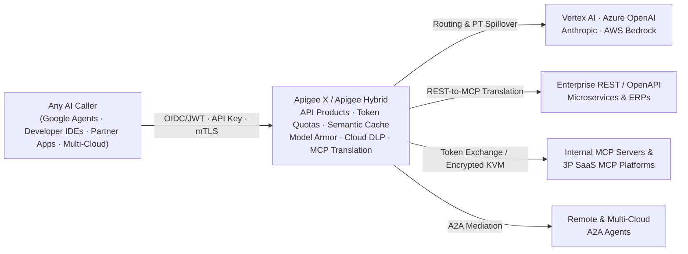

# Apigee as an Enterprise AI, LLM, MCP & Agentic Gateway

<div class="subnav">
  <span class="current">Apigee AI Gateway</span>
  <a href="/ai-gateway/agent-gateway-comparison">Compare &amp; Combine: Agent Gateway</a>
  <a href="/ai-gateway/agent-gateway-architecture">Agent Gateway Deep Dive</a>
</div>

Engineering guide to **Apigee X** and **[Apigee Hybrid](https://docs.cloud.google.com/apigee/docs/hybrid/release-notes) (1.17.0+)** as a centralized gateway for LLMs, multimodal payloads, [Model Context Protocol (MCP)](https://modelcontextprotocol.io/introduction) tools, and [Agent-to-Agent (A2A)](https://a2a-protocol.org/latest/) traffic. Validated against Google Cloud documentation and release notes through November 5, 2026 *(last reviewed November 6, 2026)*.

<details>
<summary>Recent Platform Updates Covered in This Guide (Late October – November 2026)</summary>
<div markdown="1">

* **Continuous SSE Model Armor:** [Streaming model response scanning](https://docs.cloud.google.com/apigee/docs/api-platform/reference/policies/sanitize-llm-response-policy#streaming-sse) works on both Apigee X and Apigee Hybrid on GCP (`v1.17.3+`, October 29, 2026).
* **Any-basepath MCP routing & cache-aware token quotas:** MCP-enabled proxies match on any basepath rather than `/mcp` alone, and hits served from [semantic cache](https://docs.cloud.google.com/apigee/docs/api-platform/reference/policies/semantic-cache-lookup-policy) no longer count against [LLM token quotas](https://docs.cloud.google.com/apigee/docs/api-platform/reference/policies/llm-token-quota-policy) ([November 3, 2026 release notes](https://docs.cloud.google.com/apigee/docs/release-notes#November_03_2026)).
* **Stateless MCP & Agent Registry auto-sync:** Apigee X serves stateless (`2026-07-28`) alongside stateful MCP versions, while [API Hub syncs MCP catalogs to Agent Registry](https://docs.cloud.google.com/apigee/docs/apihub/manage-agent-registry-integration) by default in Preview.

</div>
</details>

<div class="toc-box" markdown="1">

**On This Page**

* [1. Architectural Role & Seven AI Traffic Patterns](#1-architectural-role--seven-ai-traffic-patterns)
* [2. Enterprise Multi-LLM & Multimodal Gateway](#2-enterprise-multi-llm--multimodal-gateway)
  * [2.1 Multi-Provider Routing, PT Spillover & Schema Normalization](#21-multi-provider-routing-pt-spillover--schema-normalization)
  * [2.2 Semantic Response Caching](#22-semantic-response-caching)
  * [2.3 Real-Time Token Quotas & Spike Smoothing](#23-real-time-token-quotas--spike-smoothing)
  * [2.4 Prompt, Tool & Streaming SSE Guardrails](#24-prompt-tool--streaming-sse-guardrails)
  * [2.5 Multimodal Payloads & OpenTelemetry Continuity](#25-multimodal-payloads--opentelemetry-continuity)
* [3. Five Enterprise MCP & A2A Governance Patterns](#3-five-enterprise-mcp--a2a-governance-patterns)
  * [Pattern 1: Expose REST APIs as MCP Tools](#pattern-1-expose-rest-apis-as-mcp-tools)
  * [Pattern 2: Govern Internal & Consumer-Facing MCP Servers](#pattern-2-govern-internal--consumer-facing-mcp-servers)
  * [Pattern 3: Broker Outbound Access to Third-Party SaaS MCP Servers](#pattern-3-broker-outbound-access-to-third-party-saas-mcp-servers)
  * [Pattern 4: Search-then-Invoke Semantic Tool Discovery](#pattern-4-search-then-invoke-semantic-tool-discovery)
  * [Pattern 5: Cross-Cloud & In-Cluster Agent-to-Agent Mediation](#pattern-5-cross-cloud--in-cluster-agent-to-agent-mediation)
* [4. Per-Tool Productization, Dynamic `tools/list` Filtering & Quotas](#4-per-tool-productization-dynamic-toolslist-filtering--quotas)
* [5. Apigee Hybrid (1.17.0+): Multi-Cloud Execution, Limits & Network Hardening](#5-apigee-hybrid-1170-multi-cloud-execution-limits--network-hardening)
* [6. Compare & Combine with Gemini Enterprise Agent Gateway](#6-compare--combine-with-gemini-enterprise-agent-gateway)
* [7. Official Apigee AI & MCP Documentation References](#7-official-apigee-ai--mcp-documentation-references)

**Companion Guides**

* [Compare & Combine: Agent Gateway vs. Apigee ->](agent-gateway-comparison.md)
* [Agent Gateway Architecture Deep Dive ->](agent-gateway-architecture.md)

</div>

---

## 1. Architectural Role & Seven AI Traffic Patterns

While **Gemini Enterprise Agent Gateway** provides an [agent-side network and identity perimeter](agent-gateway-architecture.md) for agents hosted on Google Cloud, **Apigee X and Apigee Hybrid** act as a **centralized AI, LLM, MCP, and A2A mediation gateway** across every caller and backend. One control plane serves Gemini Enterprise agents, developer IDEs (VS Code, Cursor, Claude Desktop), customer-facing and partner apps, and workloads running on AWS, Azure, GKE, or OpenShift.



In production deployments, Apigee handles seven core AI traffic paths:

1. **External consumers reaching enterprise MCP or agent endpoints:** Terminates WAF and external OIDC tokens at the edge and executes inline [OAuth 2.0 token exchange (`RFC 8693`)](https://datatracker.ietf.org/doc/html/rfc8693), removing the need for custom token-broker services ([Pattern 2](#pattern-2-govern-internal--consumer-facing-mcp-servers)).
2. **Internal apps and developer IDEs calling MCP servers:** Validates corporate tokens locally against cached JWKS keys without IdP round-trips, [filters `tools/list` per subscription tier, and applies per-tool rate limits](#4-per-tool-productization-dynamic-toolslist-filtering--quotas).
3. **Agents or IDEs calling third-party SaaS MCP servers:** Uses [split-horizon DNS and gateway credential brokering](#pattern-3-broker-outbound-access-to-third-party-saas-mcp-servers) via encrypted KVMs, On-Behalf-Of tokens, or [OAuth metadata discovery (`RFC 9728`)](https://datatracker.ietf.org/doc/html/rfc9728) so raw SaaS keys never sit on developer laptops.
4. **Search-then-Invoke semantic tool discovery:** Combines [Apigee API Hub](https://docs.cloud.google.com/apigee/docs/apihub/what-is-api-hub) and vector search with entitlement filtering so agents only receive schemas for the tools relevant to the task ([Pattern 4](#pattern-4-search-then-invoke-semantic-tool-discovery)).
5. **Cross-cloud and in-cluster A2A mediation:** Governs [Agent-to-Agent](https://a2a-protocol.org/latest/) Agent Card discovery, task calls, and SSE task streams, including local cluster routing via CoreDNS on Apigee Hybrid ([Pattern 5](#pattern-5-cross-cloud--in-cluster-agent-to-agent-mediation)).
6. **Multi-provider LLM and multimodal routing:** Consolidates bespoke proxies such as LiteLLM onto Apigee with [Provisioned Throughput spillover](#21-multi-provider-routing-pt-spillover--schema-normalization), [semantic caching](#22-semantic-response-caching), [token quotas](#23-real-time-token-quotas--spike-smoothing), and [Model Armor / Cloud DLP guardrails](#24-prompt-tool--streaming-sse-guardrails).
7. **Inline content authorization via `Apigee Extension Processor`:** Attaches synchronously to Agent Gateway or Cloud Service Mesh over Envoy's external processing hook without altering destination URLs ([Topology 3](agent-gateway-comparison.md#topology-3-inline-authorization-extension)).

---

## 2. Enterprise Multi-LLM & Multimodal Gateway

At the model layer, Apigee fronts Vertex AI Gemini, Azure OpenAI, OpenAI, Anthropic, AWS Bedrock, and self-hosted vLLM endpoints so platform teams can retire standalone LLM router containers in favor of standard API governance.

### 2.1 Multi-Provider Routing, PT Spillover & Schema Normalization

Using conditional route rules, weighted target servers, and the [ServiceCallout policy](https://docs.cloud.google.com/apigee/docs/api-platform/reference/policies/service-callout-policy) or cache-backed circuit breakers, Apigee routes priority traffic to regional [Vertex AI Provisioned Throughput](https://docs.cloud.google.com/gemini-enterprise-agent-platform/models/provisioned-throughput) (`PT`) endpoints. When reserved capacity saturates or an upstream model returns `HTTP 429` or `5xx`, the proxy spills over automatically to Pay-As-You-Go, a secondary region, or a fallback model vendor without breaking active agent sessions.

To keep model credentials out of application code, Apigee mints short-lived Google OAuth tokens directly via [Google authentication on TargetEndpoints](https://docs.cloud.google.com/apigee/docs/api-platform/security/google-auth/overview) for Vertex AI and injects third-party API keys from Encrypted KVMs or Secret Manager. Lightweight JavaScript or Python policies normalize OpenAI-compatible Chat Completions payloads to and from each provider's native schema so application teams build against one contract.

### 2.2 Semantic Response Caching

Instead of forwarding every prompt variation to an LLM, Apigee can answer semantically similar requests directly from [Vertex AI Vector Search](https://docs.cloud.google.com/vertex-ai/docs/vector-search/overview) using the [SemanticCacheLookup](https://docs.cloud.google.com/apigee/docs/api-platform/reference/policies/semantic-cache-lookup-policy) and [SemanticCachePopulate](https://docs.cloud.google.com/apigee/docs/api-platform/reference/policies/semantic-cache-populate-policy) policies (supported on Apigee X and [Apigee Hybrid 1.17.0+](https://docs.cloud.google.com/apigee/docs/hybrid/release-notes)).

On each request, Apigee extracts the prompt via JSONPath, generates an embedding through the [Vertex AI Embeddings API](https://docs.cloud.google.com/vertex-ai/generative-ai/docs/embeddings/get-text-embeddings), and queries Vector Search over REST or [Private Service Connect](https://docs.cloud.google.com/vpc/docs/private-service-connect) gRPC using dot-product (default `0.9` threshold), cosine, Euclidean, or Manhattan similarity. A cache hit returns the stored completion immediately, cutting response latency and eliminating downstream output token cost.

### 2.3 Real-Time Token Quotas & Spike Smoothing

Apigee enforces token budgets directly against model usage rather than counting raw HTTP requests alone. The [LLMTokenQuota policy](https://docs.cloud.google.com/apigee/docs/api-platform/reference/policies/llm-token-quota-policy) enforces budgets in the request flow and deducts unary or streamed response token counts per API Product, developer app, or department across Gemini, OpenAI, and Anthropic, while automatically skipping deduction on semantic cache hits ([November 3, 2026 release](https://docs.cloud.google.com/apigee/docs/release-notes#November_03_2026)). Alongside it, the [PromptTokenLimit policy](https://docs.cloud.google.com/apigee/docs/api-platform/reference/policies/prompt-token-limit-policy) smooths prompt-token bursts so sudden spikes do not overwhelm Provisioned Throughput reservations.

### 2.4 Prompt, Tool & Streaming SSE Guardrails

Apigee integrates natively with [Model Armor](https://docs.cloud.google.com/model-armor/overview) via the [SanitizeUserPrompt](https://docs.cloud.google.com/apigee/docs/api-platform/reference/policies/sanitize-user-prompt-policy) and [SanitizeModelResponse](https://docs.cloud.google.com/apigee/docs/api-platform/reference/policies/sanitize-llm-response-policy#streaming-sse) policies, paired with [Cloud DLP de-identification](https://docs.cloud.google.com/sensitive-data-protection/docs/deidentify-sensitive-data) across both unary and streaming traffic:

* **Tool arguments and tool outputs:** **SanitizeUserPrompt** inspects [external tool outputs](https://docs.cloud.google.com/apigee/docs/api-platform/reference/policies/sanitize-user-prompt-policy#functionresponsesource) before they re-enter the prompt context, while **SanitizeModelResponse** validates [model-generated function-call arguments](https://docs.cloud.google.com/apigee/docs/api-platform/reference/policies/sanitize-llm-response-policy#functioncallsource) before execution.
* **Continuous SSE stream scanning:** Unlike Agent Gateway's unary-only intent gate, **SanitizeModelResponse** runs inside SSE response pipelines across Gemini, OpenAI, and Anthropic on Apigee X and Apigee Hybrid (`v1.17.3+`). With continuous scanning enabled, Apigee evaluates each streamed chunk together with prior chunks as a single Model Armor stream—consuming one Model Armor quota request with no total response token cap (note that inline sensitive-data redaction is skipped in continuous mode, and default Model Armor quota is `1,200 QPM` / `20 QPS`).
* **Cloud DLP tokenization and safe logging:** Shared Flows and [Flow Hooks](https://docs.cloud.google.com/apigee/docs/api-platform/fundamentals/flow-hooks) can apply Format-Preserving Encryption (`FPE`) synchronously before prompts leave your network, or redact logs asynchronously in `PostClientFlow` after the client response completes so security logging adds zero client latency. Restrict debug trace creation permissions in production IAM so troubleshooting traces cannot capture raw prompts.

<details>
<summary>Field Tuning Notes &amp; Apigee Hybrid Model Armor Boundary</summary>
<div markdown="1">

* **Reducing false positives:** Enable prompt-injection and jailbreak checks on input and tool-output templates rather than model-output templates so legitimate educational or defensive discussions are not blocked, and tune sensitive-data thresholds to high confidence.
* **Apigee Hybrid GCP-only boundary:**
  > *"In Apigee hybrid installations, support for the Model Armor policies is limited to installations on Google Cloud Platform."*
  > ([Get started with Apigee Model Armor policies](https://docs.cloud.google.com/apigee/docs/api-platform/tutorials/using-model-armor-policies#limitations))
  On AWS EKS, Azure AKS, or Red Hat OpenShift clusters, enforce fast local authentication, quotas, and payload limits at the Hybrid ingress and call Model Armor's regional REST API via a [ServiceCallout policy](https://docs.cloud.google.com/apigee/docs/api-platform/reference/policies/service-callout-policy) (or a co-located AI firewall) near the target model endpoint to avoid cross-cloud hairpinning.

</div>
</details>

### 2.5 Multimodal Payloads & OpenTelemetry Continuity

Apigee buffers standard non-streamed payloads up to **`10 MB`**, while the gRPC [ExternalCallout policy](https://docs.cloud.google.com/apigee/docs/api-platform/reference/policies/external-callout-policy) defaults to **`4 MB`** (skip forwarding message bodies when a callout only evaluates headers or JWT claims). For multimodal workloads, split traffic into three tiers: keep normal text prompts inline, enable [HTTP streaming](https://docs.cloud.google.com/apigee/docs/api-platform/develop/enabling-streaming) on large SSE or media streams that should bypass buffering policies, and use a **Claim-Check pattern** above `10 MB` where clients upload audio, video, or PDF files straight to Cloud Storage or S3 using [signed URLs](https://docs.cloud.google.com/storage/docs/access-control/signed-urls) and send lightweight object URIs through the gateway.

For end-to-end observability, propagate W3C `traceparent` and `tracestate` headers to backends, and suppress downstream mesh sampling where appropriate when `PostClientFlow` already exports structured AI audit telemetry.

---

## 3. Five Enterprise MCP & A2A Governance Patterns

### Pattern 1: Expose REST APIs as MCP Tools

Most enterprises operate hundreds of REST APIs described by OpenAPI 3.0 specs rather than native MCP servers. Apigee provides two supported paths to expose those APIs as governed MCP tools without rewriting backend services:

1. **Managed Apigee MCP Discovery Proxy + API Hub:** Available on Apigee X and Apigee Hybrid (`1.17.0+`) ([MCP in Apigee overview](https://docs.cloud.google.com/apigee/docs/api-platform/apigee-mcp/apigee-mcp-overview), [Manage MCP proxies in API Hub](https://docs.cloud.google.com/apigee/docs/apihub/manage-mcp-proxies)). Register OpenAPI 3.0 specs in API Hub, run **Configure MCP tools** to generate the managed MCP entry, and deploy the discovery proxy targeting your org's internal MCP service (with backend TLS enabled in Hybrid `1.17.0+`). As of November 3, 2026, MCP proxies serve on any basepath rather than `/mcp` alone.
2. **Build-time static proxy generation (`apigee-go-gen`):** The open-source [`apigee-go-gen` MCP renderer](https://apigee.github.io/apigee-go-gen/render/mcp/) compiles an OpenAPI 3.0 spec into a self-contained Apigee proxy bundle at build time, giving teams full inline JavaScript/policy customization across any Apigee X or Hybrid release.

<details>
<summary>Stateless vs. Stateful MCP Protocol Support &amp; Default API Hub Sync</summary>
<div markdown="1">

* **Stateless vs. Stateful MCP support ([supported protocol versions](https://docs.cloud.google.com/apigee/docs/api-platform/apigee-mcp/apigee-mcp-overview#supported-protocol-versions)):**
  * **Apigee X:** Serves stateless MCP (`2026-07-28`: `server/discover`, `tools/list`, `tools/call`) concurrently alongside stateful MCP versions (`2025-11-25`, `2025-06-18`, `2025-03-26`, `2024-11-05`) on the same endpoint, reading the MCP protocol version from request metadata (`MCP-Protocol-Version`, `Mcp-Method`, `Mcp-Name` headers required on stateless calls) and forwarding OpenTelemetry trace headers downstream.
  * **Apigee Hybrid (`1.17.0+`):** Supports stateful MCP protocol versions only; stateless `2026-07-28` MCP is Apigee X only.
* **Default API Hub to Agent Registry sync (`Preview`, [API Hub Agent Registry integration](https://docs.cloud.google.com/apigee/docs/apihub/manage-agent-registry-integration)):** API Hub mirrors MCP tools and servers to Agent Registry by default, with three caveats: APIs manually labeled as style `MCP` do not sync, deployments spanning multiple API versions are skipped because Agent Registry is unversioned, and turning sync off deletes previously synced records. API Hub can also distribute Ed25519-signed [agentic `.skill` archives](https://docs.cloud.google.com/apigee/docs/apihub/tutorials/distribute-agentic-skills) backed by Cloud Storage.

</div>
</details>

### Pattern 2: Govern Internal & Consumer-Facing MCP Servers

When platform teams deploy custom MCP servers (such as Python FastMCP or TypeScript servers on Cloud Run, GKE, or EKS over Streamable HTTP or SSE), Apigee acts as the consistent external and internal policy boundary:

* **OAuth discovery (`RFC 9728`):** Serves [OAuth Protected Resource Metadata](https://datatracker.ietf.org/doc/html/rfc9728) at `/.well-known/oauth-protected-resource` so compliant MCP clients (Gemini Enterprise, VS Code, Claude Code, Cursor) automatically discover the Authorization Server, scopes, and resource URI.
* **Local JWKS validation:** The [VerifyJWT policy](https://docs.cloud.google.com/apigee/docs/api-platform/reference/policies/verify-jwt-policy) validates bearer tokens in memory against cached JWKS keys instead of hitting the IdP introspection endpoint on every call, preventing IdP rate-limit storms during agent bursts alongside device-posture and client allowlists.
* **Inline On-Behalf-Of exchange (`RFC 8693`):** Validates external OIDC tokens behind Cloud Armor and executes [RFC 8693 token exchange](https://datatracker.ietf.org/doc/html/rfc8693) via a [ServiceCallout policy](https://docs.cloud.google.com/apigee/docs/api-platform/reference/policies/service-callout-policy) over long-lived (`600s+`) SSE connections without extra exchange microservices.
* **Policy-as-code authorization ([Runnable Reference Example ->](../examples/mcp-opa-callout/README.md)):** Enterprises adopting MCP quickly hit a wall with gateway-only controls when they want Apigee to handle traffic, identity, and enforcement while delegating user-, role-, and argument-level tool authorization to their existing Policy Decision Point (`OPA`) without embedding complex business logic inside the AI gateway. Apigee's gRPC [ExternalCallout policy](https://docs.cloud.google.com/apigee/docs/api-platform/reference/policies/external-callout-policy) evaluates parsed MCP tool calls and caller claims against OPA for dynamic tool denylists and argument-level ABAC. On Apigee Hybrid, deploy OPA in its own namespace or node-local daemonset rather than injecting third-party sidecars into Google-managed runtime pods.

### Pattern 3: Broker Outbound Access to Third-Party SaaS MCP Servers

When developers in VS Code, Cursor, or Claude Desktop—or autonomous agents—connect to third-party SaaS MCP platforms (source control, ticketing, observability), routing egress through Apigee via split-horizon DNS and enterprise MDM keeps vendor credentials off endpoints using three patterns:

1. **Encrypted KVM / Secret Manager key swap:** Callers authenticate to Apigee with short-lived corporate OIDC tokens; the proxy strips the corporate JWT and injects the enterprise SaaS key before calling the vendor.
2. **On-Behalf-Of token exchange ([`RFC 8693`](https://datatracker.ietf.org/doc/html/rfc8693)):** Exchanges the caller's token for a scoped downstream token carrying both human (`sub`) and agent (`act`) identity claims for clean downstream audit logs.
3. **[OAuth pass-through](https://docs.cloud.google.com/apigee/docs/api-platform/security/oauth/oauth-home) with MCP-safe errors:** Preserves `HTTP 401` + `WWW-Authenticate` when credentials expire (`HTTP 403` for transport blocks, `HTTP 429` for throttling), while returning **`HTTP 200` with a JSON-RPC `-32000` error** when blocking a single disallowed tool call mid-session so MCP IDEs display a clear refusal instead of looping on OAuth sign-in.

### Pattern 4: Search-then-Invoke Semantic Tool Discovery

Once an enterprise catalog grows past roughly 15–20 tools into dozens or hundreds of operations, returning every tool's full JSON Schema on `tools/list` bloats prompt token usage on every turn and hurts LLM tool-selection accuracy.

Putting a semantic discovery endpoint in front of [Apigee API Hub](https://docs.cloud.google.com/apigee/docs/apihub/what-is-api-hub) and [Vertex AI Vector Search](https://docs.cloud.google.com/vertex-ai/docs/vector-search/overview) avoids context bloat cleanly: Apigee checks the caller's JWT claims and API Product entitlements first, runs the vector search strictly within allowed MCP APIs, and returns only the top few relevant tool schemas (filtering explicitly for MCP API styles since API Hub resource search spans both REST and MCP assets).

### Pattern 5: Cross-Cloud & In-Cluster Agent-to-Agent Mediation

Across multi-agent stacks spanning Google ADK, LangGraph, Claude Agent SDK, or Temporal, Apigee governs cross-domain, cross-cloud, and trust-boundary [Agent-to-Agent (`A2A`)](https://a2a-protocol.org/latest/) traffic while leaving tight local RPC loops inside the cluster mesh:

* **Agent Cards and task streams:** Proxies A2A Agent Card discovery, JSON-RPC task submission, and SSE status streams across GKE, EKS, AKS, and Vertex AI so structured inter-agent messages pass through the same quota, audit, and DLP gates as LLM calls.
* **Local Kubernetes east-west routing on Hybrid:** Mapping internal agent hostnames via CoreDNS to a cluster-local service fronting `apigee-ingressgateway` (preserving backend TLS SNI) keeps cluster-local A2A hops inside the Kubernetes cluster without external cloud hairpinning.
* **Coarse emergency shutoff:** Place destructive or state-changing agent operations on separate privileged API Products so operators can revoke high-risk capabilities instantly without disrupting read-only agents.

---

## 4. Per-Tool Productization, Dynamic `tools/list` Filtering & Quotas

Because MCP sends all tool discovery and invocations to a single `POST` endpoint via JSON-RPC, traditional URL-path authorization cannot tell tools apart. Documented in [Manage MCP tool access with API products](https://docs.cloud.google.com/apigee/docs/api-platform/apigee-mcp/manage-mcp-tool-access), Apigee bridges this cleanly in three steps:

1. **Parse the MCP operation:** The [ParsePayload policy](https://docs.cloud.google.com/apigee/docs/api-platform/reference/policies/parse-payload-policy) extracts `"tools/list"` or `"tools/call/<tool_name>"` from each JSON-RPC message.
2. **Assign per-tool quotas inside an API Product:** Package read-only tools at higher limits and sensitive write tools at strict limits under payload operation groups.
3. **Filter `tools/list` automatically in the Response Flow:** Attaching **ParsePayload** to the response flow strips any unauthorized tool from `tools/list` before the client ever sees it. Pair the [VerifyAPIKey policy](https://docs.cloud.google.com/apigee/docs/api-platform/reference/policies/verify-api-key-policy) or [OAuthV2 policy](https://docs.cloud.google.com/apigee/docs/api-platform/reference/policies/oauthv2-policy) with a [Quota policy](https://docs.cloud.google.com/apigee/docs/api-platform/reference/policies/quota-policy) targeting the parsed operation variable so each tool is metered independently.

<details>
<summary>Example ParsePayload Policy XML &amp; API Product JSON</summary>
<div markdown="1">

#### Step 1: Parse the MCP JSON-RPC Payload
```xml
<ParsePayload name="Parse-MCP-Request">
  <PayloadType>JSON-RPC-2.0</PayloadType>
  <Protocol>MCP</Protocol>
</ParsePayload>
```
Populates flow variable `parsepayload.Parse-MCP-Request.operation` (`"tools/list"` or `"tools/call/get_stock_price"`).

#### Step 2: Bind Per-Tool Operations & Quotas in an API Product
```json
{
  "name": "financial-agent-gold-product",
  "displayName": "Financial Agent Gold Product",
  "approvalType": "auto",
  "payloadOperationGroup": {
    "operationConfigs": [
      {
        "apiSource": "mcp-financial-proxy",
        "operations": [
          { "operation": "tools/list" },
          { "operation": "tools/call/get_stock_price" }
        ],
        "quota": {
          "limit": "300",
          "interval": "1",
          "timeUnit": "minute"
        }
      },
      {
        "apiSource": "mcp-financial-proxy",
        "operations": [
          { "operation": "tools/call/execute_trade" }
        ],
        "quota": {
          "limit": "3",
          "interval": "1",
          "timeUnit": "minute"
        }
      }
    ]
  }
}
```

</div>
</details>

---

## 5. Apigee Hybrid (1.17.0+): Multi-Cloud Execution, Limits & Network Hardening

For regulated financial, healthcare, public-sector, and telecom workloads, execution locality matters. **[Apigee Hybrid](https://docs.cloud.google.com/apigee/docs/hybrid/release-notes) (`1.17.0+`, recommending `v1.17.3+`)** runs both API Message Processors and the Managed MCP Server directly inside your Kubernetes cluster on GKE, AWS EKS, Azure AKS, OpenShift, or on-premises infrastructure:

> *"MCP request traffic stays inside your cluster. MCP clients hit your existing Apigee ingress at the same URL they would use for any other Apigee proxy. Your Message Processor then routes the request to the MCP data plane in the same cluster. No MCP request or response crosses the boundary to Google Cloud at request time."*
> ([MCP in Apigee overview](https://docs.cloud.google.com/apigee/docs/api-platform/apigee-mcp/apigee-mcp-overview#hybrid-architecture))

Three operational controls are mandatory when turning on Managed MCP in Hybrid ([Enable MCP in Apigee hybrid](https://docs.cloud.google.com/apigee/docs/api-platform/apigee-mcp/enable-mcp)):

1. **Grant watcher control-plane access before upgrading:** Enabling the MCP server component requires granting the Hybrid watcher service account read access on the Apigee org prior to rollout (separate from the existing synchronizer binding; missing this step stalls pod readiness with `404` config-sync errors) and planning Message Processor canary updates during maintenance windows.
2. **Size-based tool limits (~`10,000` tools typical vs. Apigee X's `1,000`-tool org cap):** While Apigee X caps Managed MCP tools at `1,000` per org, Apigee Hybrid drops the hard count limit in favor of payload/bundle bounds (`3 MiB` per OpenAPI spec, `50 MiB` decompressed proxy bundle, `10 MiB` default / `30 MiB` max `tools/list` response per hostname, and `100` hostnames per environment group)—supporting roughly `10,000` tools per org at default settings.
3. **Lock down in-cluster access with a Kubernetes `NetworkPolicy` ([restrict inbound access](https://docs.cloud.google.com/apigee/docs/api-platform/apigee-mcp/enable-mcp#restrict-inbound-access)):** Because the in-cluster MCP container trusts callers inside the cluster network without re-authenticating requests, enforce a `NetworkPolicy` allowing TCP `443` exclusively from Apigee runtime pods in the Apigee namespace (implicitly blocking external access to health port `15021`), and alert on sustained MCP config-refresh failures.

---

## 6. Compare & Combine with Gemini Enterprise Agent Gateway

While **Apigee** governs **LLM routing, APIs, MCP tools, developer IDEs, and cross-cloud A2A infrastructure**, Google Cloud's **Gemini Enterprise Agent Gateway** attaches directly to a **Google-hosted agent's VPC edge**—issuing per-agent cryptographic identity ([SPIFFE](https://spiffe.io/) certificates, mutual TLS, and DPoP), enforcing agent-centric egress access policies, decrypting 3LO OAuth tokens at the boundary, and checking non-streaming Semantic Governance intent.

| Layer | **Apigee X / Apigee Hybrid** | **Agent Gateway (Gemini Enterprise)** |
| :--- | :--- | :--- |
| **Core boundary** | Enterprise API, Multi-LLM, MCP, & A2A mediation across all callers and clouds | Agent-side identity and outbound egress perimeter for Vertex AI Agent Runtime & Gemini Enterprise |
| **Distinctive capabilities** | API Products, [`tools/list` filtering](#4-per-tool-productization-dynamic-toolslist-filtering--quotas), REST-to-MCP, [Provisioned Throughput spillover](https://docs.cloud.google.com/gemini-enterprise-agent-platform/models/provisioned-throughput), [semantic caching](https://docs.cloud.google.com/apigee/docs/api-platform/reference/policies/semantic-cache-lookup-policy), [LLM token quotas](https://docs.cloud.google.com/apigee/docs/api-platform/reference/policies/llm-token-quota-policy), [Cloud DLP](https://docs.cloud.google.com/sensitive-data-protection/docs/deidentify-sensitive-data), [continuous SSE Model Armor](https://docs.cloud.google.com/apigee/docs/api-platform/reference/policies/sanitize-llm-response-policy#streaming-sse) | Per-agent cryptographic workload identity (`SPIFFE`), [IAM Unified Access Policies](agent-gateway-architecture.md#4-iam-unified-access-policies), Auth Manager 3-legged OAuth decryption, unary Semantic Governance intent gate |

**Continue to the Comparison & Integration Pages:**
* **[Compare & Combine: Agent Gateway vs. Apigee ->](agent-gateway-comparison.md)** — Visual end-to-end architecture, domain comparison matrices, requirements selector, real-world scenarios, three dual-gateway topologies, 15 ISV security partners, FinOps attribution, and production readiness checklist.
* **[Agent Gateway Architecture Deep Dive ->](agent-gateway-architecture.md)** — Underlying GCP APIs, deployment models (`1 GA`, `3 Early Preview`), private CA `TrustConfig`, `SPIFFE` / Auth Manager, IAM Unified Access Policies + CEL, Semantic Governance, Model Armor payload limits, and scope quotas.

---

## 7. Official Apigee AI & MCP Documentation References

1. [Model Context Protocol (MCP) in Apigee overview](https://docs.cloud.google.com/apigee/docs/api-platform/apigee-mcp/apigee-mcp-overview) · [Enable MCP in Apigee hybrid](https://docs.cloud.google.com/apigee/docs/api-platform/apigee-mcp/enable-mcp) · [Runnable Example: MCP Tool ABAC (`ExternalCallout` gRPC + OPA)](../examples/mcp-opa-callout/README.md)
2. [Get started with Apigee and MCP](https://docs.cloud.google.com/apigee/docs/api-platform/apigee-mcp/apigee-mcp-quickstart) · [Manage MCP proxies in API Hub](https://docs.cloud.google.com/apigee/docs/apihub/manage-mcp-proxies)
3. [Manage MCP tool access with API products](https://docs.cloud.google.com/apigee/docs/api-platform/apigee-mcp/manage-mcp-tool-access) ([ParsePayload policy](https://docs.cloud.google.com/apigee/docs/api-platform/reference/policies/parse-payload-policy) · [VerifyAPIKey policy](https://docs.cloud.google.com/apigee/docs/api-platform/reference/policies/verify-api-key-policy) · [OAuthV2 policy](https://docs.cloud.google.com/apigee/docs/api-platform/reference/policies/oauthv2-policy) · [Quota policy](https://docs.cloud.google.com/apigee/docs/api-platform/reference/policies/quota-policy))
4. [Connect the Apigee extension processor to an Agent Gateway](https://docs.cloud.google.com/apigee/docs/api-platform/service-extensions/extension-processor-agent-gateway) · [Apigee Extension Processor overview](https://docs.cloud.google.com/apigee/docs/api-platform/service-extensions/extension-processor-overview) · [Private access from Gemini Enterprise Agent Platform](https://docs.cloud.google.com/apigee/docs/api-platform/system-administration/private-access-from-agent-runtime)
5. [Manage Agent Registry integration in API Hub](https://docs.cloud.google.com/apigee/docs/apihub/manage-agent-registry-integration) · [Distribute agentic skills with API Hub](https://docs.cloud.google.com/apigee/docs/apihub/tutorials/distribute-agentic-skills)
6. [LLMTokenQuota policy](https://docs.cloud.google.com/apigee/docs/api-platform/reference/policies/llm-token-quota-policy) · [PromptTokenLimit policy](https://docs.cloud.google.com/apigee/docs/api-platform/reference/policies/prompt-token-limit-policy) · [SemanticCacheLookup policy](https://docs.cloud.google.com/apigee/docs/api-platform/reference/policies/semantic-cache-lookup-policy) · [SemanticCachePopulate policy](https://docs.cloud.google.com/apigee/docs/api-platform/reference/policies/semantic-cache-populate-policy)
7. [SanitizeUserPrompt policy](https://docs.cloud.google.com/apigee/docs/api-platform/reference/policies/sanitize-user-prompt-policy) · [SanitizeModelResponse policy](https://docs.cloud.google.com/apigee/docs/api-platform/reference/policies/sanitize-llm-response-policy) · [Get started with Apigee Model Armor policies](https://docs.cloud.google.com/apigee/docs/api-platform/tutorials/using-model-armor-policies)
8. [Vertex AI Provisioned Throughput](https://docs.cloud.google.com/gemini-enterprise-agent-platform/models/provisioned-throughput) · [Apigee Google authentication](https://docs.cloud.google.com/apigee/docs/api-platform/security/google-auth/overview) · [ServiceCallout policy](https://docs.cloud.google.com/apigee/docs/api-platform/reference/policies/service-callout-policy) · [ExternalCallout policy](https://docs.cloud.google.com/apigee/docs/api-platform/reference/policies/external-callout-policy) · [Cloud DLP de-identification](https://docs.cloud.google.com/sensitive-data-protection/docs/deidentify-sensitive-data)
9. [Open-source `apigee-go-gen` MCP Generator](https://apigee.github.io/apigee-go-gen/render/mcp/) · [Apigee release notes](https://docs.cloud.google.com/apigee/docs/release-notes) · [Apigee hybrid release notes](https://docs.cloud.google.com/apigee/docs/hybrid/release-notes)

---

[← Back to All Repository Guides](../README.md) · [Next: Compare & Combine with Agent Gateway ->](agent-gateway-comparison.md)
