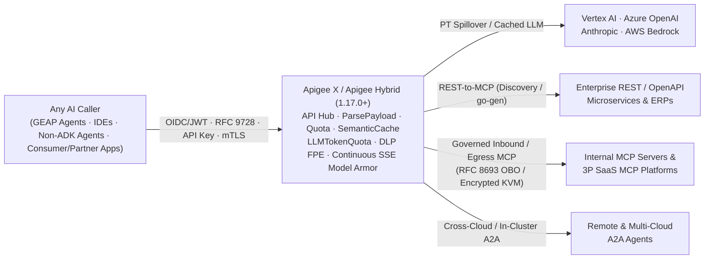

# Apigee as an Enterprise AI, LLM, MCP & Agentic Gateway

<div class="subnav">
  <span class="current">Apigee AI Gateway</span>
  <a href="agent-gateway-comparison.md">Compare &amp; Combine: Agent Gateway</a>
  <a href="agent-gateway-architecture.md">Agent Gateway Deep Dive</a>
</div>

> **Architectural Scope & Verification Provenance (`Last Verified: November 6, 2026`):** Detailed engineering reference covering **Apigee (`Apigee X` and `Apigee Hybrid 1.17.0+`)** as an enterprise **Multi-LLM, Multimodal, MCP, and Agent-to-Agent (`A2A`) Gateway**. Validated against live `docs.cloud.google.com` documentation and official release notes through November 5, 2026.

<details markdown="1">
<summary>🔄 Provenance Key &amp; November 2026 Apigee AI / MCP Updates (Click to expand)</summary>

* **`[VERIFIED]`:** Confirmed directly against live official documentation (`HTTP 200`) or empirical product behavior cited inline.
* **`[ASSUMPTION / INFERENCE]`:** Architectural synthesis or multi-product pattern deduced from verified component behaviors where no single end-to-end doc page states the combined claim verbatim.
* **`[CAVEAT / UNVERIFIED]`:** Documented operational boundary or Preview / Early Preview capability that is actively evolving; always consult the linked official release notes for General Availability status.

**Recent Validated Enhancements Covered Below:**
* **Continuous SSE Model Armor (`v1.17.3`, Oct 29, 2026):** `<SanitizeModelResponse>` supports `<ContinuousScan>true</ContinuousScan>` over SSE streams on both Apigee X and Apigee Hybrid (GCP clusters).
* **Basepath Independence & Cache-Excluded Token Quotas (`1-18-0-apigee-8`, Nov 3, 2026):** Proxies declaring `<ProxyOperationMode>MCP</ProxyOperationMode>` are recognized on any basepath (no longer restricted to `/mcp`), and `<SemanticCacheLookup>` cache hits are automatically excluded from `<LLMTokenQuota>` deduction.
* **Stateless MCP (`2026-07-28`) & Default API Hub -> Agent Registry Sync:** Apigee X serves Stateless (`2026-07-28`) + Stateful MCP concurrently, while API Hub synchronizes MCP tools and servers to Agent Registry by default (Preview).

</details>

<div class="toc-box" markdown="1">

**On This Page (Jump to Section)**

* [1. Architectural Role & Seven AI Traffic Direction Modes](#1-architectural-role--seven-ai-traffic-direction-modes)
* [2. Enterprise Multi-LLM & Multimodal Gateway](#2-enterprise-multi-llm--multimodal-gateway)
  * [2.1 Multi-Provider Routing, PT Spillover & Schema Normalization](#21-multi-provider-routing-pt-spillover--schema-normalization)
  * [2.2 Semantic Response Caching (`<SemanticCacheLookup>`)](#22-semantic-response-caching-semanticcachelookup)
  * [2.3 Real-Time Token Quotas & Spike Smoothing (`<LLMTokenQuota>`)](#23-real-time-token-quotas--spike-smoothing-llmtokenquota)
  * [2.4 Prompt, Tool & Streaming SSE Guardrails (Model Armor + Cloud DLP)](#24-prompt-tool--streaming-sse-guardrails-model-armor--cloud-dlp)
  * [2.5 Multimodal Payloads (`Claim-Check`) & OpenTelemetry Continuity](#25-multimodal-payloads-claim-check--opentelemetry-continuity)
* [3. Five Enterprise MCP & A2A Governance Patterns](#3-five-enterprise-mcp--a2a-governance-patterns)
  * [Pattern 1: REST-to-MCP Wrapper (`Managed Discovery Proxy` & `apigee-go-gen`)](#pattern-1-rest-to-mcp-wrapper-proxy-rest--openapi-to-mcp)
  * [Pattern 2: Internal Native & Consumer MCP Proxy (`RFC 9728`, `RFC 8693`, OPA)](#pattern-2-internal-native--consumer-facing-mcp-server-governance-proxy-mcp-to-mcp)
  * [Pattern 3: Outbound Third-Party SaaS MCP Egress (`Agent / IDE` to `SaaS MCP`)](#pattern-3-outbound-third-party-saas-mcp-server-egress-proxy-agent--ide-to-external-saas-mcp)
  * [Pattern 4: "Search-then-Invoke" Semantic Tool Discovery (`50–1,000+` Tools)](#pattern-4-search-then-invoke-semantic-tool-discovery-mcpdiscover)
  * [Pattern 5: Cross-Cloud & In-Cluster Agent-to-Agent (`A2A`) Mediation](#pattern-5-cross-cloud--in-cluster-agent-to-agent-a2a--orchestration-mediation)
* [4. Per-Tool Productization, Dynamic `tools/list` Filtering & `<Quota>` (`<ParsePayload>`)](#4-per-tool-productization-dynamic-toolslist-filtering--quota-parsepayload)
* [5. Apigee Hybrid (`1.17.0+`): Multi-Cloud Execution, Hard Limits & Network Hardening](#5-apigee-hybrid-1170-multi-cloud-execution-hard-limits--network-hardening)
* [6. Compare & Combine with Gemini Enterprise Agent Gateway](#6-compare--combine-with-gemini-enterprise-agent-gateway)
* [7. Verified Official Apigee AI & MCP Documentation References](#7-verified-official-apigee-ai--mcp-documentation-references)

**Companion Pages in `/ai-gateway/`**

* [Compare & Combine: Agent Gateway vs. Apigee (`R1`–`R13`, Scenarios `A`–`F`, Dual-Gateway Topologies & Checklist) ->](agent-gateway-comparison.md)
* [Agent Gateway Architecture Deep Dive (`SPIFFE`, `egressViaIAP`, `TrustConfig`, Semantic Governance) ->](agent-gateway-architecture.md)

</div>

---

## 1. Architectural Role & Seven AI Traffic Direction Modes

Whereas **Gemini Enterprise Agent Gateway** acts as an **agent-side identity and egress perimeter** for Google Cloud hosted agents, **Apigee (`Apigee X` and `Apigee Hybrid`)** operates as a **full-spectrum AI, LLM, MCP, and Agent-to-Agent (`A2A`) traffic mediation gateway** across *every* enterprise boundary and for *any* caller—including Gemini Enterprise agents, developer IDEs (`VS Code`, `Cursor`, `Claude Desktop`), consumer/partner mobile apps, and multi-cloud workloads (`AWS Bedrock`, `Azure OpenAI`, `GKE`, `EKS`, `OpenShift`).



In production AI architectures, Apigee spans **seven distinct AI traffic direction modes**:

1. **North-South External Consumer / Partner -> Enterprise MCP or Agent:** Terminates edge WAF (`Cloud Armor`) + external OIDC JWTs and executes inline **RFC 8693 Token Exchange**, retiring bespoke Backend-for-Frontend (BFF) token-mediation microservices.
2. **Internal App / Developer IDE (`VS Code`, `Cursor`, `Claude`) -> Internal & REST-Backed MCP:** Exposes internal native MCP servers and legacy OpenAPI services with offline JWKS verification (`< 2 ms`), dynamic `tools/list` filtering, and per-tool `<Quota>`.
3. **Outbound Egress Proxy: Agent / IDE -> External 3P SaaS MCP `[ASSUMPTION / INFERENCE]`:** Enforces Split-Horizon DNS + corporate JWT swap to **Encrypted KVM** credentials, **RFC 8693 OBO**, or **RFC 9728** OAuth pass-through so raw SaaS API keys never reside on developer laptops.
4. **Search-then-Invoke Semantic Tool Discovery (`/mcp/discover`) `[ASSUMPTION / INFERENCE]`:** Combines **Apigee API Hub** + **Vertex AI Search** with entitlement filtering so agents retrieve only the top 2–3 relevant tools instead of bloating context windows with 50–1,000+ tool schemas.
5. **Cross-Cloud & In-Cluster East-West `A2A` / Workflow Mediation `[ASSUMPTION / INFERENCE]`:** Governs `GET /.well-known/agent.json`, JSON-RPC `message/send`, SSE task streams, and sub-1ms CoreDNS-routed Kubernetes agent hops (`Apigee Hybrid`).
6. **Enterprise Multi-LLM & Multimodal Gateway:** Replaces standalone self-managed `LiteLLM` proxy containers with PT-to-PayGo spillover, cross-provider failover, canonical schema translation, semantic caching, `<LLMTokenQuota>`, Cloud DLP `FPE`, and SSE Model Armor.
7. **Inline `CONTENT_AUTHZ` Extension Processor (`Apigee Extension Processor`):** Attaches synchronously to **Agent Gateway** or Cloud Service Mesh via `ext_proc` without changing target URLs ([Topology 3](agent-gateway-comparison.md#topology-3-official-inline-authorization-extension-agent-gateway---apigee-extension-processor-verified)).

---

## 2. Enterprise Multi-LLM & Multimodal Gateway

Unlike agent-side connectivity proxies, Apigee acts as a full-lifecycle **Enterprise LLM & Multimodal Gateway** in front of **Vertex AI Gemini, Azure OpenAI, OpenAI, Anthropic, AWS Bedrock, and self-hosted vLLM endpoints**—enabling platform teams to consolidate and retire custom open-source `LiteLLM` proxy containers.

### 2.1 Multi-Provider Routing, PT Spillover & Schema Normalization

* **PT-First Routing with PayGo & Cross-Region Spillover (`[VERIFIED]` + `[ASSUMPTION / INFERENCE]`):** Using conditional `RouteRules`, weighted `TargetServer` health checks, and [`<ServiceCallout>`](https://docs.cloud.google.com/apigee/docs/api-platform/reference/policies/service-callout-policy) or cache-backed circuit breakers (e.g., tripping open after 3 consecutive upstream failures), Apigee routes priority workloads to dedicated regional [Vertex AI Provisioned Throughput (`PT`)](https://docs.cloud.google.com/gemini-enterprise-agent-platform/models/provisioned-throughput) endpoints (`X-Vertex-AI-LLM-Request-Type: dedicated`) and automatically spills over to **Pay-As-You-Go (`PayGo`)** (`shared`), secondary GCP regions, or fallback providers (Azure OpenAI / Anthropic) on `HTTP 429` or `5xx` responses without dropping agent turns.
* **Zero-Key Upstream Auth Injection & Canonical Schema Translation:** Apigee mints short-lived Google OAuth/OIDC tokens natively via [`<GoogleAuthentication>`](https://docs.cloud.google.com/apigee/docs/api-platform/security/google-auth/overview) for Vertex AI and injects third-party provider keys from **Encrypted KVMs** or external vaults, while translating canonical OpenAI Chat Completions schemas to and from provider-native payloads via lightweight JavaScript/Python policies so application teams code against a single unified LLM interface.

### 2.2 Semantic Response Caching (`<SemanticCacheLookup>`)

Documented in [`<SemanticCacheLookup>`](https://docs.cloud.google.com/apigee/docs/api-platform/reference/policies/semantic-cache-lookup-policy) and [`<SemanticCachePopulate>`](https://docs.cloud.google.com/apigee/docs/api-platform/reference/policies/semantic-cache-populate-policy) (`[VERIFIED]`):

* **Vector Lookup Flow:** Extracts the user prompt via JSONPath (`<UserPromptSource>{jsonPath('$.contents[-1].parts[-1].text',request.content,true)}</UserPromptSource>`), generates vector embeddings via **Vertex AI Embeddings API** (`<Embeddings><VertexAI><URL>...`), and queries a **Vertex AI Vector Search** index (`<SimilaritySearch>`) over REST (`:findNeighbors`) or low-latency **Private Service Connect gRPC** (`grpc://{TARGET_HOST}:10000`).
* **Distance Metrics & Availability:** Supports `DOT_PRODUCT_DISTANCE` (default threshold `0.9`), `COSINE_DISTANCE`, `SQUARED_L2_DISTANCE`, and `L1_DISTANCE` (Apigee `1-18-0-apigee-4+` and Apigee Hybrid `1.17.0+`).
* **Cost & Latency Impact:** On a cache hit (`SemanticCacheLookup.<name>.cache_hit == true`), Apigee returns `SemanticCacheLookup.<name>.cached_llm_response` in milliseconds, bypassing the LLM call entirely and saving 100% of output token cost.

### 2.3 Real-Time Token Quotas & Spike Smoothing (`<LLMTokenQuota>`)

Documented in [`<LLMTokenQuota>`](https://docs.cloud.google.com/apigee/docs/api-platform/reference/policies/llm-token-quota-policy) and [`<PromptTokenLimit>`](https://docs.cloud.google.com/apigee/docs/api-platform/reference/policies/prompt-token-limit-policy) (`[VERIFIED]`):

* **`<LLMTokenQuota>`:** Pairs an `EnforceOnly` step in the Request Flow with a `CountOnly` step in the Response Flow (or SSE `<EventFlow>`), enforcing token budgets per API Product (`<UseQuotaConfigInAPIProduct>`), developer app, or business unit across Gemini, OpenAI, and Anthropic responses. Per [Apigee release notes (`1-18-0-apigee-8`, Nov 3, 2026)](https://docs.cloud.google.com/apigee/docs/release-notes#November_03_2026), responses served from `<SemanticCacheLookup>` are **automatically excluded** from token quota deduction.
* **`<PromptTokenLimit>`:** Acts as a token-rate spike arrest (`<UseEffectiveCount>true</UseEffectiveCount>`) to protect regional Vertex AI Provisioned Throughput (`PT`) commitments from sudden prompt-token bursts.

### 2.4 Prompt, Tool & Streaming SSE Guardrails (Model Armor + Cloud DLP)

Documented in [`<SanitizeUserPrompt>`](https://docs.cloud.google.com/apigee/docs/api-platform/reference/policies/sanitize-user-prompt-policy), [`<SanitizeModelResponse>`](https://docs.cloud.google.com/apigee/docs/api-platform/reference/policies/sanitize-llm-response-policy#streaming-sse), [`using-model-armor-policies`](https://docs.cloud.google.com/apigee/docs/api-platform/tutorials/using-model-armor-policies#limitations), and [`content:deidentify`](https://docs.cloud.google.com/sensitive-data-protection/docs/deidentify-sensitive-data):

* **Tool Call & Tool Output Scanning (`[VERIFIED]`):** `<SanitizeUserPrompt>` includes `<FunctionResponseSource>` (`$.contents[-1].parts[-1].functionResponse.response`) to sanitize untrusted tool returns before feeding them back to the LLM, while `<SanitizeModelResponse>` includes `<FunctionCallSource>` (`$.candidates[-1].content.parts[-1].functionCall.args`) to inspect LLM-generated tool arguments.
* **Streaming SSE Sanitization (`<ContinuousScan>true</ContinuousScan>`, `[VERIFIED]`):** Unlike Agent Gateway's unary-only Semantic Governance, `<SanitizeModelResponse>` runs inside SSE `<EventFlow>`s (`streamGenerateContent?alt=sse`, OpenAI, and Anthropic; added to **Apigee Hybrid `v1.17.3`** on Oct 29, 2026). Setting `<ContinuousScan>true</ContinuousScan>` evaluates each SSE chunk alongside all prior chunks as a single Model Armor stream (**1** Model Armor quota request per stream, **no total response token limit**; note that SDP redacted text replacement is not delivered when `<ContinuousScan>true</ContinuousScan>` is enabled, and default project quota is `1,200 QPM` / `20 QPS`).
* **Sensitive Data Protection (`Cloud DLP`) Tokenization & Safe Debug Governance (`[VERIFIED]` + `[ASSUMPTION / INFERENCE]`):** Invoking `content:deidentify` from Apigee Shared Flows / [Flow Hooks](https://docs.cloud.google.com/apigee/docs/api-platform/fundamentals/flow-hooks) enables:
  * **(a) Synchronous Inline Format-Preserving Encryption (`FPE`):** Replaces PII/account numbers with deterministic surrogate tokens before prompts leave for external LLMs (and optionally re-identifies authorized responses).
  * **(b) Zero-Latency (`0 ms` client impact) Asynchronous Redaction:** Scrubs prompts/completions in `PostClientFlow` before writing to analytics/SIEM sinks. Pair with IAM CEL conditions restricting `apigee.tracesessions.create` in production so unredacted prompts cannot be captured via ad-hoc debug sessions.

<details markdown="1">
<summary>⚙️ Field Tuning Notes &amp; Apigee Hybrid GCP-Only Model Armor Boundary (Click to expand)</summary>

* **Field Tuning Tip (`[ASSUMPTION / INFERENCE]`):** Enable `pi_and_jailbreak` detection on **input/tool-output templates** rather than model-output templates to avoid false-positive blocks when an LLM legitimately explains security concepts in its answer, and set SDP confidence thresholds to `LIKELY` or `VERY_LIKELY`.
* **Critical Apigee Hybrid Platform Boundary & Latency Placement (`[VERIFIED]` + `[ASSUMPTION / INFERENCE]`):**
  > *"In Apigee hybrid installations, support for the Model Armor policies is limited to installations on Google Cloud Platform."*
  > ([Get started with Apigee Model Armor policies: Limitations](https://docs.cloud.google.com/apigee/docs/api-platform/tutorials/using-model-armor-policies#limitations))
  *(For multi-cloud Apigee Hybrid clusters on AWS EKS, Azure AKS, or OpenShift, avoid `150-300 ms` cross-cloud guardrail hairpinning by enforcing fast `< 5 ms` deterministic auth/quota/regex checks at Apigee and co-locating deep LLM guardrail inspection in the same cloud region as the target model or invoking Model Armor's REST API via `<ServiceCallout>`).*

</details>

### 2.5 Multimodal Payloads (`Claim-Check`) & OpenTelemetry Continuity

* **Three-Tier Multimodal Payload Pattern (`[ASSUMPTION / INFERENCE]`):** Because Apigee buffers non-streamed message bodies up to **`10 MB`**, Rhino JavaScript `.content` string parsing beyond **`64 KB`** risks Message Processor heap pressure, and gRPC `<ExternalCallout>` enforces a **`4 MB`** default message frame cap (set `with.request.content=false` when only header/JWT metadata is needed):
  * **Tier 1:** Inline JSON payloads `<= 2 MB` (normal buffering and policy inspection).
  * **Tier 2:** `response.streaming.enabled=true` (`request.streaming.enabled=true`) for large SSE/media streams bypassing payload-buffering policies.
  * **Tier 3 (`Claim-Check`):** Clients upload `10 MB` to multi-GB audio/video/PDF artifacts directly to Cloud Storage / S3 via Pre-Signed URLs and pass lightweight `gs://` or HTTPS URI references through Apigee to the LLM or MCP tool.
* **End-to-End Trace Continuity Without Double-Sampling:** Propagate incoming W3C `traceparent` / `tracestate` headers across Apigee to downstream models and MCP servers, and inject `X-B3-Sampled: 0` when `PostClientFlow` already exports 100% of structured AI telemetry so downstream service meshes do not duplicate span storage.

---

## 3. Five Enterprise MCP & A2A Governance Patterns

### Pattern 1: REST-to-MCP Wrapper Proxy (`REST / OpenAPI` to `MCP`)

Most enterprises have thousands of existing REST APIs documented in OpenAPI 3.0 specifications, not native MCP servers. Apigee provides two ways to expose existing REST APIs as MCP servers (`tools/list`, `tools/call`) **without writing or hosting custom MCP server code**:

1. **Managed Apigee MCP Discovery Proxy (`<ORG_NAME>.mcp.apigee.internal`) + API Hub:**
   * Documented in [Model Context Protocol (MCP) in Apigee overview](https://docs.cloud.google.com/apigee/docs/api-platform/apigee-mcp/apigee-mcp-overview) and [Manage MCP proxies in API Hub](https://docs.cloud.google.com/apigee/docs/apihub/manage-mcp-proxies) (**Apigee X** and **Apigee Hybrid `1.17.0+`**).
   * Registering an OpenAPI 3.0.x spec in **API Hub** and clicking **Configure MCP tools** creates an `MCP` API-style entry (`apigee-managed-mcp-api`) and generates `MCP Tool` specifications for every REST operation.
   * Deploy a **Managed MCP Discovery Proxy** (`MCPProxy` template) whose `<HTTPTargetConnection><URL>` points to `http://<ORG_NAME>.mcp.apigee.internal` (or `https://<ORG_NAME>.mcp.apigee.internal` with `<SSLInfo><Enabled>true</Enabled></SSLInfo>` in Apigee Hybrid `1.17.0+`).
   * **Basepath Independence (`1-18-0-apigee-8`, Nov 3, 2026):** Per [Apigee release notes](https://docs.cloud.google.com/apigee/docs/release-notes#November_03_2026), proxies declaring `<ProxyOperationMode>MCP</ProxyOperationMode>` are recognized as MCP proxies regardless of basepath (no longer restricted to `/mcp`).
2. **Build-Time Static Proxy Generation (`apigee-go-gen`):**
   * Uses the [`apigee-go-gen` MCP generator](https://apigee.github.io/apigee-go-gen/render/mcp/) (`apigee-go-gen transform oas-to-mcp`) CLI to compile an OpenAPI 3.0 specification into a self-contained Apigee proxy bundle (`apiproxy/`) using `<AssignMessage>` and JavaScript policies (`check-req.js`, `transform-oas-mcp.js`) on any Apigee X or Hybrid version.

<details markdown="1">
<summary>📡 Stateless (`2026-07-28`) vs. Stateful MCP Matrix &amp; Default API Hub -&gt; Agent Registry Sync</summary>

* **Stateless (`2026-07-28`) vs. Stateful MCP Protocol Matrix ([`apigee-mcp-overview#supported-protocol-versions`](https://docs.cloud.google.com/apigee/docs/api-platform/apigee-mcp/apigee-mcp-overview#supported-protocol-versions)):**
  * **Apigee X (SaaS):** Serves **both** the modern **Stateless MCP protocol (`2026-07-28`: `server/discover`, `tools/list`, `tools/call`)** and **Stateful MCP protocols (`2025-11-25`, `2025-06-18`, `2025-03-26`, `2024-11-05`)** concurrently on the same endpoint. Apigee selects the protocol from `params._meta["io.modelcontextprotocol/protocolVersion"]` in the JSON-RPC body (not the `MCP-Protocol-Version` header alone), requires matching `MCP-Protocol-Version`, `Mcp-Method`, and `Mcp-Name` headers on stateless calls, and forwards OpenTelemetry `traceparent`, `tracestate`, and `baggage` from `params._meta` to backends as HTTP headers.
  * **Apigee Hybrid (`1.17.0+`):** Supports the **stateful MCP protocol versions only** (`2026-07-28` stateless MCP is supported on Apigee X SaaS only).
* **Default API Hub -> Agent Registry Auto-Sync (Preview, [`manage-agent-registry-integration`](https://docs.cloud.google.com/apigee/docs/apihub/manage-agent-registry-integration)):** API Hub (`API hub > Settings > Actions > Sync to Agent Registry`) **automatically synchronizes MCP tools and server metadata to Agent Registry by default**. *(Caveats: does not sync APIs whose style was manually set to `MCP`, does not sync deployments linked to multiple API versions because Agent Registry is unversioned, and toggling sync `Off` deletes all previously synced API Hub records from Agent Registry).* API Hub can also act as an Ed25519-signed agentic `.skill` registry backed by Cloud Storage ([`distribute-agentic-skills`](https://docs.cloud.google.com/apigee/docs/apihub/tutorials/distribute-agentic-skills)).

</details>

### Pattern 2: Internal Native & Consumer-Facing MCP Server Governance Proxy (`MCP` to `MCP`)

When engineering teams build custom native MCP servers (e.g., FastMCP on Cloud Run, GKE, or EKS using Streamable HTTP or SSE), Apigee acts as an inbound reverse proxy in front of them across both internal workforce IDEs and external consumer/B2B channels:

* **RFC 9728 OAuth 2.0 Protected Resource Metadata Discovery:** Serves `GET /.well-known/oauth-protected-resource` so MCP clients (Gemini Enterprise, VS Code, Claude Code, Cursor) dynamically discover the Authorization Server, supported scopes, and resource identifiers.
* **Offline JWT Verification (`<VerifyJWT>`) vs. Online IdP Introspection (`[ASSUMPTION / INFERENCE]`):** Validates OAuth 2.0 access tokens locally against cached JWKS keys (`< 2 ms`) instead of online IdP `/introspect` round-trips (`80-150 ms+`) that hit IdP rate limits under concurrent agent load. Pair with corporate IdP Device Posture policies and JWT `azp` / `client_id` allowlisting.
* **North-South Consumer & Partner Token Exchange (`RFC 8693`):** Validates external OIDC JWTs at the edge (fronted by Cloud Armor / WAF) and executes inline **RFC 8693 OAuth 2.0 Token Exchange** (`grant_type=urn:ietf:params:oauth:grant-type:token-exchange`) via `<ServiceCallout>` over `600s+` SSE connections, eliminating bespoke BFF microservices.
* **Fine-Grained OPA Policy Enforcement (`<ExternalCallout>`):** Streams parsed MCP JSON-RPC requests and JWT claims over gRPC to Open Policy Agent (OPA) for GitOps-managed `allow_all_except` tool denylists or argument-level ABAC rules. *(Apigee Hybrid guardrail: never inject third-party mutating-webhook sidecars into Google-managed `apigee-runtime` pods; deploy OPA in a dedicated namespace or node-local `DaemonSet` with `internalTrafficPolicy: Local`).*

### Pattern 3: Outbound Third-Party SaaS MCP Server Egress Proxy (`Agent / IDE` to `External SaaS MCP`)

`[ASSUMPTION / INFERENCE]` When developer IDEs (`VS Code`, `Cursor`, `Claude Desktop`) or autonomous agents connect to external third-party SaaS MCP servers (source control, ticketing, observability, or design SaaS platforms), routing through Apigee over **Split-Horizon DNS** (paired with enterprise MDM MCP registry distribution and disabling unproxied SaaS MCP access where supported) enforces **three outbound credential mediation patterns**:

1. **Encrypted KVM / Vault API Key Swap:** Callers authenticate to Apigee with short-lived corporate OIDC tokens; Apigee strips the inbound token and injects the enterprise-managed SaaS credential from an **Encrypted KVM** or Secret Manager so raw third-party API keys never sit on developer laptops.
2. **RFC 8693 On-Behalf-Of (`OBO`) Token Exchange:** Exchanges the caller's corporate JWT for a narrowly scoped downstream OAuth token carrying both `sub` (human user) and `act` (agent workload) claims for end-to-end auditability.
3. **RFC 9728 1-Click OAuth Pass-Through & Protocol-Aware Error Semantics:** Proxies `/.well-known/oauth-protected-resource` and **preserves `HTTP 401` + `WWW-Authenticate` headers** on expired credentials (plus `HTTP 403` transport blocks and `HTTP 429` `Retry-After` headers), while returning **`HTTP 200` with a JSON-RPC `-32000` error envelope** when blocking an individual disallowed `tools/call` mid-session so MCP IDEs display a clean policy denial to the LLM instead of entering an infinite OAuth re-login loop.

### Pattern 4: "Search-then-Invoke" Semantic Tool Discovery (`/mcp/discover`)

`[ASSUMPTION / INFERENCE]` When an enterprise catalog grows past **15 to 20 MCP tools** (`50 to 1,000+` tools), returning every tool's full JSON Schema inside a monolithic `tools/list` response bloats the LLM prompt context window, inflates input-token spend on every turn, and degrades tool-selection accuracy:

* **Apigee + API Hub + Vertex AI Search Solution:** Expose a lightweight discovery endpoint (or meta-tool) on Apigee fronting **Apigee API Hub** (`apihub.googleapis.com` semantic search) or a **Vertex AI Search** vector index synced from API Hub tool specifications.
* **Entitlement-Filtered Vector Retrieval:** Apigee extracts the caller's JWT claims / API Product entitlements first, filters the vector query at search time so the agent only discovers tools it is authorized to invoke, and returns only the **top 2 to 3 semantically relevant MCP tool schemas** for the current task. *(API Hub query note: when querying API Hub `:searchResources` programmatically in mixed catalogs, intersect results with `apis.list?filter=api_style.enum_values.values.id="mcp"` because `:searchResources` filters by top-level `resource_type` rather than `api_style`).*

### Pattern 5: Cross-Cloud & In-Cluster Agent-to-Agent (`A2A`) & Orchestration Mediation

`[ASSUMPTION / INFERENCE]` In multi-agent architectures combining Google ADK, non-ADK frameworks (`Claude Agent SDK`, `LangGraph`), and durable workflow engines (such as Temporal), Apigee governs **inter-domain, cross-cloud, and high-trust east-west agent boundaries** (while keeping chattier intradomain microservice RPCs on the local service mesh):

* **A2A Protocol & Agent Card Governance:** Proxies `GET /.well-known/agent.json` (with optional Apigee response caching to offload discovery bursts) and governs JSON-RPC `message/send` and SSE task streams across GKE, EKS, AKS, and Vertex AI, ensuring structured A2A/MCP JSON-RPC payloads undergo schema, quota, and DLP/threat inspection rather than bypassing guardrails that only watch LLM endpoints.
* **Sub-Millisecond In-Cluster Kubernetes East-West Routing (`Apigee Hybrid`):** Maps internal agent hostnames via Kubernetes CoreDNS `rewrite name exact` to a stable `ClusterIP` fronting `apigee-ingressgateway` (preserving TLS SNI via `<SSLInfo><ServerName>`) for sub-1ms network hop overhead without cloud hairpinning.
* **High-Risk Administrative Action Gating & Multi-Layer Kill Switch:** Gates destructive or state-rollback agent operations behind separate high-privilege API Products and step-up scopes, backed by instant gateway credential/operation revocation if an autonomous loop exceeds expected bounds.

---

## 4. Per-Tool Productization, Dynamic `tools/list` Filtering & `<Quota>` (`<ParsePayload>`)

A core producer-side capability of Apigee is **commercial and multi-tenant MCP tool productization**, documented in [Manage MCP tool access with API products](https://docs.cloud.google.com/apigee/docs/api-platform/apigee-mcp/manage-mcp-tool-access).

Because MCP multiplexes all tool calls over a single HTTP endpoint (`POST /mcp`) using JSON-RPC 2.0 payloads (`{"jsonrpc": "2.0", "method": "tools/call", "params": {"name": "get_stock_price"}}`), path-based gateways only see `POST /mcp`. Apigee solves this in three steps:

1. **Parse JSON-RPC (`<ParsePayload>`):** Populates `parsepayload.Parse-MCP-Request.operation` as `"tools/list"` or `"tools/call/get_stock_price"`.
2. **Bind Per-Tool Operations & Quotas in an API Product:** Assigns independent access and quotas per tool (`300/min` on read-only `get_stock_price` vs. `3/min` on high-risk `execute_trade`).
3. **Automatic `tools/list` Filtering & Quota Enforcement:**
   * **Response Flow Filtering:** When `<ParsePayload>` is attached to the **Response Flow** as well, Apigee intercepts the backend MCP server's `tools/list` JSON response and **automatically strips any tool not listed in the caller's API Product**. A Bronze-tier agent and a Gold-tier agent calling the exact same `/mcp` endpoint receive tailored `tools/list` toolsets.
   * **Per-Tool Quotas:** Attach `<VerifyAPIKey>` (or `<OAuthV2>` `VerifyAccessToken`) with `<Operations><Operation>parsepayload.Parse-MCP-Request.operation</Operation></Operations>` and `<Quota>` (`<UseQuotaConfigInAPIProduct stepName="Verify-API-Key"/>`).

<details markdown="1">
<summary>📄 Verified `&lt;ParsePayload&gt;` Policy XML &amp; `API Product` JSON Configuration</summary>

#### Step 1: Parse the MCP JSON-RPC Payload (`<ParsePayload>`)
```xml
<ParsePayload name="Parse-MCP-Request">
  <PayloadType>JSON-RPC-2.0</PayloadType>
  <Protocol>MCP</Protocol>
</ParsePayload>
```
Populates flow variable `parsepayload.Parse-MCP-Request.operation` (`"tools/list"` or `"tools/call/get_stock_price"`).

#### Step 2: Bind Per-Tool Operations & Quotas in an Apigee API Product
```json
{
  "name": "financial-agent-gold-product",
  "displayName": "Financial Agent Gold Product",
  "approvalType": "auto",
  "payloadOperationGroup": {
    "operationConfigs": [
      {
        "apiSource": "mcp-financial-proxy",
        "operations": [
          { "operation": "tools/list" },
          { "operation": "tools/call/get_stock_price" }
        ],
        "quota": {
          "limit": "300",
          "interval": "1",
          "timeUnit": "minute"
        }
      },
      {
        "apiSource": "mcp-financial-proxy",
        "operations": [
          { "operation": "tools/call/execute_trade" }
        ],
        "quota": {
          "limit": "3",
          "interval": "1",
          "timeUnit": "minute"
        }
      }
    ]
  }
}
```

</details>

---

## 5. Apigee Hybrid (`1.17.0+`): Multi-Cloud Execution, Hard Limits & Network Hardening

A critical architectural boundary for regulated enterprises (financial services, healthcare, defense, telecom) is **where the GA data plane executes**:

* **Apigee Hybrid `1.17.0+` (GA; recommend `v1.17.3+` per official Apigee hybrid release notes)** runs both the API runtime (`app=apigee-runtime`) and the Managed MCP Server (`app=apigee-mcp-server`) **entirely inside your own Kubernetes cluster** (GKE, AWS EKS, Azure AKS, OpenShift, or bare-metal on-premises):
  > *"MCP request traffic stays inside your cluster. MCP clients hit your existing Apigee ingress at the same URL they would use for any other Apigee proxy. Your Message Processor then routes the request to the MCP data plane in the same cluster. No MCP request or response crosses the boundary to Google Cloud at request time."*
  > ([Model Context Protocol (MCP) in Apigee overview](https://docs.cloud.google.com/apigee/docs/api-platform/apigee-mcp/apigee-mcp-overview#hybrid-architecture))

#### Mandatory Apigee Hybrid `1.17.0+` MCP Operational & Security Controls ([`enable-mcp`](https://docs.cloud.google.com/apigee/docs/api-platform/apigee-mcp/enable-mcp))

1. **Separate `watcher_identities` Control-Plane Grant:** Setting top-level `enableMcpServer: true` in `overrides.yaml` requires a one-time `PATCH` to `organizations/{org}/controlPlaneAccess?update_mask=watcher_identities` adding `serviceAccount:${WATCHER_SA}` (separate from `synchronizer_identities`; omitting it causes `404 Not Found` config pulls and unready MCP pods) and triggers a **staged canary release** of Message Processor pods during maintenance windows.
2. **Four Hard Capacity Limits (`~10,000` Tools Typical vs. `1,000` in Apigee X):**
   * **OpenAPI Spec Upload Size:** `3 MiB` max per spec.
   * **Compiled MCP Bundle Size:** `50 MiB` max per environment.
   * **`tools/list` Response Payload:** `10 MiB` default (`30 MiB` maximum).
   * **Environment Group Hostnames:** `100` hostnames max per environment group.
3. **In-Cluster Trust Boundary & Mandatory Kubernetes `NetworkPolicy` ([`enable-mcp#restrict-inbound-access`](https://docs.cloud.google.com/apigee/docs/api-platform/apigee-mcp/enable-mcp#restrict-inbound-access)):** Because the in-cluster `apigee-mcp-server` trusts callers inside the Kubernetes network without re-authenticating requests, **you must apply a Kubernetes `NetworkPolicy`** restricting ingress on TCP `443` of `app=apigee-mcp-server` exclusively to `app=apigee-runtime` pods in the Apigee namespace (implicitly blocking unauthenticated health port TCP `15021` from non-runtime pods) and alert on `apigee.googleapis.com/mcp/config_refresh/consecutive_failures >= 3` over `5` minutes.

---

## 6. Compare & Combine with Gemini Enterprise Agent Gateway

While **Apigee** governs **your AI models, APIs, MCP tools, developer IDEs, and cross-cloud A2A infrastructure**, Google Cloud's **Gemini Enterprise Agent Platform: Agent Gateway** governs the **agent runtime's own cryptographic `SPIFFE` identity (`mTLS` + `DPoP`), outbound egress perimeter (`Agent-to-Anywhere`), zero-trust 3LO token decryption, and non-streaming Semantic Governance intent checks**.

| Question | **Apigee (`X` / `Hybrid`)** | **Agent Gateway (`Gemini Enterprise`)** |
| :--- | :--- | :--- |
| **Core Boundary** | Multi-LLM, MCP, & A2A mediation across *all* callers and backends | Agent-side identity & egress perimeter attached to `Agent Runtime` / `Gemini Enterprise` |
| **Where They Combine ("Better Together")** | Producer edge: `API Products`, `tools/list` filtering, REST-to-MCP, `PT` spillover, `<LLMTokenQuota>`, Cloud DLP, SSE Model Armor | Agent edge: `spiffe://` identity, `egressViaIAP`, Auth Manager 3LO decryption, unary Semantic Governance intent gate |

**Continue to the Comparison & Integration Pages:**
* **[Compare & Combine: Agent Gateway vs. Apigee ->](agent-gateway-comparison.md)** — Visual end-to-end architecture, domain comparison matrices, `R1`–`R13` requirements quick selector, wire scenarios (`A`–`F`), three official dual-gateway topologies (`Private PSC Bridge`, `North-South Fronting`, inline `Apigee Extension Processor`), `15` ISV security partners, FinOps attribution, and production checklist.
* **[Agent Gateway Architecture Deep Dive ->](agent-gateway-architecture.md)** — Seven GCP subsystems, `4` deployment models (`1 GA`, `3 Early Preview`), Private CA `TrustConfig`, `SPIFFE` / Auth Manager, IAM `egressViaIAP` + CEL, Semantic Governance, Model Armor bounds, and scope quotas.

---

## 7. Verified Official Apigee AI & MCP Documentation References

1. [Model Context Protocol (MCP) in Apigee overview (`#hybrid-architecture`, `#supported-protocol-versions`, `#protocol-selection`)](https://docs.cloud.google.com/apigee/docs/api-platform/apigee-mcp/apigee-mcp-overview)
2. [Enable Model Context Protocol (MCP) in Apigee hybrid (`#step-1-edit-overrides`, `#step-2-grant-watcher-cp-access`, `#tool-capacity-hard-limits`, `#restrict-inbound-access`)](https://docs.cloud.google.com/apigee/docs/api-platform/apigee-mcp/enable-mcp)
3. [Get started with Apigee and MCP (`#list-tools-stateless`)](https://docs.cloud.google.com/apigee/docs/api-platform/apigee-mcp/apigee-mcp-quickstart) · [Manage MCP proxies in API Hub](https://docs.cloud.google.com/apigee/docs/apihub/manage-mcp-proxies)
4. [Manage MCP tool access with API products (`#configure-parse-payload`, `#per-tool-quotas`, `#tool-filtering`)](https://docs.cloud.google.com/apigee/docs/api-platform/apigee-mcp/manage-mcp-tool-access)
5. [Connect the Apigee extension processor to an Agent Gateway (`#configure-ext-proc`, `#connect-gateway`, `#configure-authz-ext`)](https://docs.cloud.google.com/apigee/docs/api-platform/service-extensions/extension-processor-agent-gateway) · [Apigee Extension Processor overview (`#limitations`)](https://docs.cloud.google.com/apigee/docs/api-platform/service-extensions/extension-processor-overview)
6. [Access Apigee privately from Gemini Enterprise Agent Platform (`#overview`, `#architecture`)](https://docs.cloud.google.com/apigee/docs/api-platform/system-administration/private-access-from-agent-runtime)
7. [Manage Agent Registry integration in API Hub (`#limitations`)](https://docs.cloud.google.com/apigee/docs/apihub/manage-agent-registry-integration) · [Distribute agentic skills with API Hub](https://docs.cloud.google.com/apigee/docs/apihub/tutorials/distribute-agentic-skills)
8. [LLMTokenQuota policy](https://docs.cloud.google.com/apigee/docs/api-platform/reference/policies/llm-token-quota-policy) · [PromptTokenLimit policy](https://docs.cloud.google.com/apigee/docs/api-platform/reference/policies/prompt-token-limit-policy)
9. [SemanticCacheLookup policy](https://docs.cloud.google.com/apigee/docs/api-platform/reference/policies/semantic-cache-lookup-policy) · [SemanticCachePopulate policy](https://docs.cloud.google.com/apigee/docs/api-platform/reference/policies/semantic-cache-populate-policy)
10. [SanitizeUserPrompt policy (`#functionresponsesource`)](https://docs.cloud.google.com/apigee/docs/api-platform/reference/policies/sanitize-user-prompt-policy) · [SanitizeModelResponse policy (`#streaming-sse`, `#functioncallsource`, `#continuousscan`)](https://docs.cloud.google.com/apigee/docs/api-platform/reference/policies/sanitize-llm-response-policy) · [Get started with Apigee Model Armor policies (`#limitations`)](https://docs.cloud.google.com/apigee/docs/api-platform/tutorials/using-model-armor-policies)
11. [Vertex AI Provisioned Throughput](https://docs.cloud.google.com/gemini-enterprise-agent-platform/models/provisioned-throughput) · [Apigee GoogleAuthentication](https://docs.cloud.google.com/apigee/docs/api-platform/security/google-auth/overview) · [ServiceCallout policy](https://docs.cloud.google.com/apigee/docs/api-platform/reference/policies/service-callout-policy) · [Flow Hooks](https://docs.cloud.google.com/apigee/docs/api-platform/fundamentals/flow-hooks) · [Sensitive Data Protection (`deidentify`)](https://docs.cloud.google.com/sensitive-data-protection/docs/deidentify-sensitive-data)
12. [Open-Source `apigee-go-gen` MCP Generator Documentation](https://apigee.github.io/apigee-go-gen/render/mcp/) · [Apigee release notes](https://docs.cloud.google.com/apigee/docs/release-notes) · [Apigee hybrid release notes](https://docs.cloud.google.com/apigee/docs/hybrid/release-notes)

---

[← Back to All Repository Guides](../README.md) · [Next: Compare & Combine with Agent Gateway ->](agent-gateway-comparison.md)
