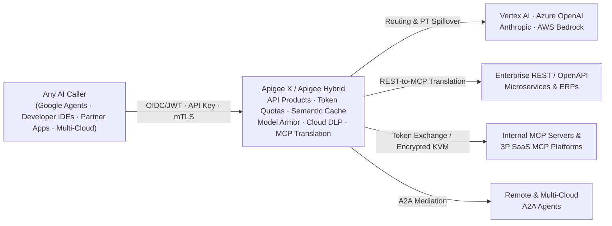

# Apigee as an Enterprise AI, LLM, MCP & Agentic Gateway

<div class="subnav">
  <span class="current">Apigee AI Gateway</span>
  <a href="/ai-gateway/agent-gateway-comparison">Compare &amp; Combine: Agent Gateway</a>
  <a href="/ai-gateway/agent-gateway-architecture">Agent Gateway Deep Dive</a>
</div>

Engineering guide to **Apigee X** and **Apigee Hybrid (1.17.0+)** as a centralized gateway for LLMs, multimodal payloads, Model Context Protocol (MCP) tools, and Agent-to-Agent (A2A) traffic. Validated against Google Cloud documentation and release notes through November 5, 2026 *(last reviewed November 6, 2026)*.

<details>
<summary>Recent Platform Updates Covered in This Guide (Late October – November 2026)</summary>
<div markdown="1">

* **Continuous SSE Model Armor:** [Streaming SSE model response scanning](https://docs.cloud.google.com/apigee/docs/api-platform/reference/policies/sanitize-llm-response-policy#streaming-sse) is supported on both Apigee X and Apigee Hybrid (GCP clusters; Hybrid `v1.17.3`, October 29, 2026).
* **Basepath independence & cache-excluded token quotas:** Proxies declaring MCP operation mode are recognized on any basepath rather than `/mcp` alone, and responses served from [semantic cache](https://docs.cloud.google.com/apigee/docs/api-platform/reference/policies/semantic-cache-lookup-policy) are excluded from [LLM token quota](https://docs.cloud.google.com/apigee/docs/api-platform/reference/policies/llm-token-quota-policy) deduction automatically (Apigee `1-18-0-apigee-8`, November 3, 2026).
* **Stateless MCP & Agent Registry auto-sync:** Apigee X serves Stateless (`2026-07-28`) and Stateful MCP concurrently, while Apigee API Hub synchronizes MCP tools and servers to Agent Registry by default in Preview.

</div>
</details>

<div class="toc-box" markdown="1">

**On This Page**

* [1. Architectural Role & Seven AI Traffic Patterns](#1-architectural-role--seven-ai-traffic-patterns)
* [2. Enterprise Multi-LLM & Multimodal Gateway](#2-enterprise-multi-llm--multimodal-gateway)
  * [2.1 Multi-Provider Routing, PT Spillover & Schema Normalization](#21-multi-provider-routing-pt-spillover--schema-normalization)
  * [2.2 Semantic Response Caching](#22-semantic-response-caching)
  * [2.3 Real-Time Token Quotas & Spike Smoothing](#23-real-time-token-quotas--spike-smoothing)
  * [2.4 Prompt, Tool & Streaming SSE Guardrails](#24-prompt-tool--streaming-sse-guardrails)
  * [2.5 Multimodal Payloads & OpenTelemetry Continuity](#25-multimodal-payloads--opentelemetry-continuity)
* [3. Five Enterprise MCP & A2A Governance Patterns](#3-five-enterprise-mcp--a2a-governance-patterns)
  * [Pattern 1: Expose REST APIs as MCP Tools](#pattern-1-expose-rest-apis-as-mcp-tools)
  * [Pattern 2: Govern Internal & Consumer-Facing MCP Servers](#pattern-2-govern-internal--consumer-facing-mcp-servers)
  * [Pattern 3: Broker Outbound Access to Third-Party SaaS MCP Servers](#pattern-3-broker-outbound-access-to-third-party-saas-mcp-servers)
  * [Pattern 4: Search-then-Invoke Semantic Tool Discovery](#pattern-4-search-then-invoke-semantic-tool-discovery)
  * [Pattern 5: Cross-Cloud & In-Cluster Agent-to-Agent Mediation](#pattern-5-cross-cloud--in-cluster-agent-to-agent-mediation)
* [4. Per-Tool Productization, Dynamic `tools/list` Filtering & Quotas](#4-per-tool-productization-dynamic-toolslist-filtering--quotas)
* [5. Apigee Hybrid (1.17.0+): Multi-Cloud Execution, Limits & Network Hardening](#5-apigee-hybrid-1170-multi-cloud-execution-limits--network-hardening)
* [6. Compare & Combine with Gemini Enterprise Agent Gateway](#6-compare--combine-with-gemini-enterprise-agent-gateway)
* [7. Official Apigee AI & MCP Documentation References](#7-official-apigee-ai--mcp-documentation-references)

**Companion Guides**

* [Compare & Combine: Agent Gateway vs. Apigee ->](agent-gateway-comparison.md)
* [Agent Gateway Architecture Deep Dive ->](agent-gateway-architecture.md)

</div>

---

## 1. Architectural Role & Seven AI Traffic Patterns

While **Gemini Enterprise Agent Gateway** provides an **agent-side network and identity perimeter** for agents hosted on Google Cloud, **Apigee X and Apigee Hybrid** act as a **centralized AI, LLM, MCP, and A2A mediation gateway** across all callers and backends. It serves Gemini Enterprise agents, developer IDEs (VS Code, Cursor, Claude Desktop), consumer and partner apps, and workloads running on AWS Bedrock, Azure OpenAI, GKE, EKS, or OpenShift.



In production deployments, Apigee covers seven distinct AI traffic paths:

1. **External consumers and partners reaching enterprise MCP or agent endpoints:** Terminates Cloud Armor WAF and external OIDC JWTs at the edge and performs inline [OAuth 2.0 On-Behalf-Of (OBO) Token Exchange (`RFC 8693`)](#pattern-2-govern-internal--consumer-facing-mcp-servers), eliminating custom Backend-for-Frontend token-mediation services.
2. **Internal apps and developer IDEs calling internal or REST-backed MCP servers:** Verifies corporate tokens locally against cached JWKS keys without remote IdP round-trips, [filters `tools/list` per API Product, and enforces per-tool rate limits](#4-per-tool-productization-dynamic-toolslist-filtering--quotas).
3. **Outbound egress from agents or IDEs to third-party SaaS MCP servers:** Uses [split-horizon DNS and corporate JWT exchange](#pattern-3-broker-outbound-access-to-third-party-saas-mcp-servers)—via encrypted Key Value Maps (KVMs), On-Behalf-Of tokens, or OAuth metadata pass-through—so raw SaaS API keys never sit on developer laptops.
4. **Search-then-Invoke semantic tool discovery:** Combines [Apigee API Hub (`apihub.googleapis.com` `:searchResources`) and Vertex AI Search](#pattern-4-search-then-invoke-semantic-tool-discovery) with entitlement filtering so agents load only the few relevant tools instead of stuffing hundreds of schemas into every prompt.
5. **Cross-cloud and in-cluster Agent-to-Agent (A2A) mediation:** Governs [A2A Agent Card discovery (`GET /.well-known/agent.json`), JSON-RPC `message/send`, SSE task streams, and local Kubernetes hops](#pattern-5-cross-cloud--in-cluster-agent-to-agent-mediation) via CoreDNS on Apigee Hybrid.
6. **Multi-provider LLM and multimodal routing:** Consolidates standalone self-managed proxies such as LiteLLM onto Apigee with [Provisioned Throughput spillover and failover](#21-multi-provider-routing-pt-spillover--schema-normalization), [semantic caching](#22-semantic-response-caching), [token quotas](#23-real-time-token-quotas--spike-smoothing), and [Cloud DLP / SSE Model Armor](#24-prompt-tool--streaming-sse-guardrails).
7. **Inline content authorization via `Apigee Extension Processor`:** Attaches synchronously to Agent Gateway or Cloud Service Mesh using Envoy's `ext_proc` interface without changing target URLs (see [Inline Extension Processor Topology](agent-gateway-comparison.md#topology-3-inline-authorization-extension)).

---

## 2. Enterprise Multi-LLM & Multimodal Gateway

On the model tier, Apigee fronts Vertex AI Gemini, Azure OpenAI, OpenAI, Anthropic, AWS Bedrock, and self-hosted vLLM endpoints, allowing platform teams to retire bespoke LLM proxy containers in favor of standard API governance policies.

### 2.1 Multi-Provider Routing, PT Spillover & Schema Normalization

Using conditional `RouteRules`, weighted `TargetServer` health checks, and `<ServiceCallout>` or cache-backed circuit breakers, Apigee routes priority traffic to regional [Vertex AI Provisioned Throughput (`PT`)](https://docs.cloud.google.com/gemini-enterprise-agent-platform/models/provisioned-throughput) endpoints (`X-Vertex-AI-LLM-Request-Type: dedicated`). When capacity saturates or upstream calls return `HTTP 429` or `5xx`, Apigee automatically spills over to Pay-As-You-Go (`shared`), secondary regions, or fallback model providers without dropping active agent turns.

To keep upstream credentials out of application code, Apigee mints short-lived Google OAuth tokens natively via [`<GoogleAuthentication>`](https://docs.cloud.google.com/apigee/docs/api-platform/security/google-auth/overview) for Vertex AI and injects third-party API keys from **Encrypted KVMs** or Secret Manager. Lightweight JavaScript or Python policies can normalize OpenAI-compatible Chat Completions payloads to and from provider-specific schemas so client teams build against one contract.

### 2.2 Semantic Response Caching

Native semantic caching pairs [`<SemanticCacheLookup>`](https://docs.cloud.google.com/apigee/docs/api-platform/reference/policies/semantic-cache-lookup-policy) and [`<SemanticCachePopulate>`](https://docs.cloud.google.com/apigee/docs/api-platform/reference/policies/semantic-cache-populate-policy) to serve semantically equivalent prompts directly from vector similarity search:

* Extracts the prompt via JSONPath, generates an embedding through the Vertex AI Embeddings API, and queries Vertex AI Vector Search (`:findNeighbors`) over REST or Private Service Connect gRPC.
* Supports `DOT_PRODUCT_DISTANCE` (default similarity threshold `0.9`), `COSINE_DISTANCE`, `SQUARED_L2_DISTANCE`, and `L1_DISTANCE` on Apigee X (`1-18-0-apigee-4+`) and Apigee Hybrid (`1.17.0+`).
* Returns the cached response directly on a semantic match, bypassing the LLM backend and saving 100% of downstream output token cost.

### 2.3 Real-Time Token Quotas & Spike Smoothing

Apigee enforces token budgets directly against model usage via [`<LLMTokenQuota>`](https://docs.cloud.google.com/apigee/docs/api-platform/reference/policies/llm-token-quota-policy) and [`<PromptTokenLimit>`](https://docs.cloud.google.com/apigee/docs/api-platform/reference/policies/prompt-token-limit-policy):

* **`<LLMTokenQuota>`** enforces token budgets in the request flow and tallies streamed or unary response token usage per API Product, developer app, or department across Gemini, OpenAI, and Anthropic. As of the [November 3, 2026 Apigee release](https://docs.cloud.google.com/apigee/docs/release-notes#November_03_2026), responses served from semantic cache are excluded from token quota deduction automatically.
* **`<PromptTokenLimit>`** acts as a prompt-token spike arrest to shield Provisioned Throughput reservations from sudden traffic bursts.

### 2.4 Prompt, Tool & Streaming SSE Guardrails

Native Model Armor policies — [`<SanitizeUserPrompt>`](https://docs.cloud.google.com/apigee/docs/api-platform/reference/policies/sanitize-user-prompt-policy) and [`<SanitizeModelResponse>`](https://docs.cloud.google.com/apigee/docs/api-platform/reference/policies/sanitize-llm-response-policy#streaming-sse) — combine with [Cloud DLP (`content:deidentify`)](https://docs.cloud.google.com/sensitive-data-protection/docs/deidentify-sensitive-data) across both unary and streaming model calls:

* **Tool argument and tool output inspection:** `<SanitizeUserPrompt>` supports [tool output scanning](https://docs.cloud.google.com/apigee/docs/api-platform/reference/policies/sanitize-user-prompt-policy#functionresponsesource) (`<FunctionResponseSource>`) before external tool results re-enter the prompt, while `<SanitizeModelResponse>` supports [tool argument inspection](https://docs.cloud.google.com/apigee/docs/api-platform/reference/policies/sanitize-llm-response-policy#functioncallsource) (`<FunctionCallSource>`) on model-generated function calls.
* **Continuous SSE stream scanning:** Unlike Agent Gateway's unary-only Semantic Governance, `<SanitizeModelResponse>` operates inside SSE `<EventFlow>` pipelines across Gemini, OpenAI, and Anthropic (supported on Apigee X and Apigee Hybrid `v1.17.3+`). Setting `<ContinuousScan>true</ContinuousScan>` evaluates each streamed chunk together with prior chunks as one Model Armor stream—counting as a single Model Armor quota request with no total response token cap. Note that SDP redacted-text replacement is not applied in continuous streaming mode, and default Model Armor quota is `1,200 QPM` (`20 QPS`).
* **Cloud DLP tokenization and safe debug logging:** Shared Flows and [Flow Hooks](https://docs.cloud.google.com/apigee/docs/api-platform/fundamentals/flow-hooks) can call `content:deidentify` synchronously for Format-Preserving Encryption (`FPE`) before prompts leave your trust boundary, or asynchronously in `PostClientFlow` after the client response has already been sent so redaction adds no client-facing latency before analytics/SIEM export. Restrict production `apigee.tracesessions.create` permissions via IAM conditions so ad-hoc debug traces cannot capture unredacted prompts.

<details>
<summary>Field Tuning Notes &amp; Apigee Hybrid Model Armor Boundary</summary>
<div markdown="1">

* **Reducing false positives:** Enable prompt-injection and jailbreak checks on input and tool-output templates rather than model-output templates so educational or defensive answers about security are not blocked unnecessarily, and tune SDP thresholds to `LIKELY` or `VERY_LIKELY`.
* **Apigee Hybrid GCP-only boundary:**
  > *"In Apigee hybrid installations, support for the Model Armor policies is limited to installations on Google Cloud Platform."*
  > ([Get started with Apigee Model Armor policies: Limitations](https://docs.cloud.google.com/apigee/docs/api-platform/tutorials/using-model-armor-policies#limitations))
  For Hybrid clusters running on AWS EKS, Azure AKS, or Red Hat OpenShift, enforce fast local authentication, quota, and payload checks at the Hybrid ingress and invoke Model Armor's regional REST API via `<ServiceCallout>` (or a co-located AI security firewall) near the target model endpoint to avoid unnecessary cross-cloud hairpinning.

</div>
</details>

### 2.5 Multimodal Payloads & OpenTelemetry Continuity

Apigee buffers standard non-streamed message payloads up to **`10 MB`**, while gRPC `<ExternalCallout>` enforces a **`4 MB`** default message limit (set `with.request.content=false` when a callout only needs headers or JWT claims). For mixed AI workloads, separate traffic into three tiers: keep normal JSON prompts inline, enable `request.streaming.enabled=true` / `response.streaming.enabled=true` for large SSE or media streams that should bypass buffering policies, and use a **Claim-Check pattern** above `10 MB` where clients upload audio, video, or PDF files directly to Cloud Storage or S3 via pre-signed URLs and pass URI references through Apigee.

For distributed tracing, propagate incoming W3C `traceparent` and `tracestate` headers to downstream backends. If `PostClientFlow` already exports structured AI audit logs, inject `X-B3-Sampled: 0` downstream where appropriate to avoid duplicate mesh trace storage.

---

## 3. Five Enterprise MCP & A2A Governance Patterns

### Pattern 1: Expose REST APIs as MCP Tools

Enterprises typically run hundreds or thousands of REST APIs described by OpenAPI 3.0 specifications rather than native MCP servers. Apigee offers two supported ways to expose those APIs as MCP servers (`tools/list`, `tools/call`) without writing custom server code:

1. **Managed Apigee MCP Discovery Proxy + API Hub:** Documented in [MCP in Apigee overview](https://docs.cloud.google.com/apigee/docs/api-platform/apigee-mcp/apigee-mcp-overview) and [Manage MCP proxies in API Hub](https://docs.cloud.google.com/apigee/docs/apihub/manage-mcp-proxies) (Apigee X and Apigee Hybrid `1.17.0+`). Register an OpenAPI `3.0.x` spec in API Hub, run **Configure MCP tools** to generate the managed MCP API entry and tool specs, and deploy the MCP proxy targeting `http://<ORG_NAME>.mcp.apigee.internal` (with backend TLS enabled in Hybrid `1.17.0+`). Proxies configured with MCP operation mode work on any basepath rather than `/mcp` alone ([November 3, 2026 release notes](https://docs.cloud.google.com/apigee/docs/release-notes#November_03_2026)).
2. **Build-time static proxy generation (`apigee-go-gen`):** The open-source [`apigee-go-gen` MCP renderer](https://apigee.github.io/apigee-go-gen/render/mcp/) (`apigee-go-gen transform oas-to-mcp`) compiles an OpenAPI 3.0 spec into a self-contained Apigee proxy bundle (`check-req.js`, `transform-oas-mcp.js`) compatible with any Apigee X or Hybrid version.

<details>
<summary>Stateless vs. Stateful MCP Protocol Matrix &amp; Default API Hub Auto-Sync</summary>
<div markdown="1">

* **Stateless vs. Stateful MCP support ([`apigee-mcp-overview#supported-protocol-versions`](https://docs.cloud.google.com/apigee/docs/api-platform/apigee-mcp/apigee-mcp-overview#supported-protocol-versions)):**
  * **Apigee X:** Serves Stateless MCP (`2026-07-28`: `server/discover`, `tools/list`, `tools/call`) concurrently alongside Stateful MCP versions (`2025-11-25`, `2025-06-18`, `2025-03-26`, `2024-11-05`) on the same endpoint. Protocol selection reads `params._meta["io.modelcontextprotocol/protocolVersion"]` in the JSON-RPC payload (not the HTTP header alone), requires matching `MCP-Protocol-Version`, `Mcp-Method`, and `Mcp-Name` headers on stateless calls, and forwards OpenTelemetry `traceparent`, `tracestate`, and `baggage` fields from `params._meta` to backends as HTTP headers.
  * **Apigee Hybrid (`1.17.0+`):** Supports Stateful MCP protocol versions only; stateless `2026-07-28` MCP is Apigee X only.
* **Default API Hub to Agent Registry synchronization (`Preview`, [`manage-agent-registry-integration`](https://docs.cloud.google.com/apigee/docs/apihub/manage-agent-registry-integration)):** API Hub (`API hub > Settings > Actions > Sync to Agent Registry`) automatically mirrors MCP tools and servers to Agent Registry by default. Note three current caveats: APIs manually labeled as style `MCP` do not sync, deployments spanning multiple API versions do not sync because Agent Registry is unversioned, and disabling sync deletes all previously synchronized API Hub records from Agent Registry. API Hub can also serve as an Ed25519-signed agentic `.skill` distribution registry backed by Cloud Storage ([`distribute-agentic-skills`](https://docs.cloud.google.com/apigee/docs/apihub/tutorials/distribute-agentic-skills)).

</div>
</details>

### Pattern 2: Govern Internal & Consumer-Facing MCP Servers

When teams build native MCP servers (such as Python `FastMCP` or TypeScript servers on Cloud Run, GKE, or EKS over Streamable HTTP or SSE), Apigee fronts them for both internal developer tools and external partners:

* **OAuth Protected Resource Metadata Discovery (`RFC 9728`):** Serves `GET /.well-known/oauth-protected-resource` so compliant MCP clients (Gemini Enterprise, VS Code, Claude Code, Cursor) automatically discover the Authorization Server, supported scopes, and resource identifiers.
* **Local JWKS validation instead of remote introspection:** `<VerifyJWT>` verifies incoming OAuth access tokens in-memory against cached JWKS keys rather than making a per-request network round-trip to the IdP's `/introspect` endpoint, preventing IdP rate-limit bottlenecks under concurrent agent bursts. Pair token verification with IdP device-posture rules and `azp` / `client_id` allowlisting.
* **On-Behalf-Of (OBO) token exchange (`RFC 8693`):** Validates external OIDC tokens at the Cloud Armor edge and executes inline `RFC 8693` token exchange (`grant_type=urn:ietf:params:oauth:grant-type:token-exchange`) via `<ServiceCallout>` over long-lived (`600s+`) SSE sessions, replacing custom Backend-for-Frontend exchange services.
* **Fine-grained OPA policy enforcement (`<ExternalCallout>`):** Streams parsed MCP JSON-RPC requests and JWT claims over gRPC to Open Policy Agent (OPA) for GitOps-managed tool denylists or argument-level ABAC rules. On Apigee Hybrid, never inject third-party webhook sidecars into Google-managed `apigee-runtime` pods; run OPA in its own namespace or a node-local `DaemonSet` with `internalTrafficPolicy: Local`.

### Pattern 3: Broker Outbound Access to Third-Party SaaS MCP Servers

When developer IDEs (VS Code, Cursor, Claude Desktop) or autonomous agents call third-party SaaS MCP servers (source control, ticketing, observability, design), routing outbound traffic through Apigee over **split-horizon DNS**—paired with enterprise MDM MCP configuration—keeps raw SaaS credentials off developer machines using one of three mediation modes:

1. **Encrypted KVM / Secret Manager key swap:** Callers authenticate to Apigee with short-lived corporate OIDC tokens; Apigee strips the corporate JWT and injects the enterprise SaaS key on egress.
2. **On-Behalf-Of (OBO) token exchange (`RFC 8693`):** Exchanges the caller's corporate token for a narrowly scoped downstream OAuth token containing both human (`sub`) and agent (`act`) claims for audit attribution.
3. **OAuth pass-through with MCP-safe denial semantics:** Proxies `/.well-known/oauth-protected-resource` and preserves `HTTP 401` + `WWW-Authenticate` when credentials expire (`HTTP 403` for transport blocks, `HTTP 429` + `Retry-After` for throttling), while returning **`HTTP 200` with a JSON-RPC `-32000` error payload** when blocking an individual disallowed `tools/call` mid-session. That distinction lets MCP IDEs display a clean policy denial to the model instead of triggering an endless OAuth re-login loop.

### Pattern 4: Search-then-Invoke Semantic Tool Discovery

Once an enterprise MCP catalog grows beyond roughly 15–20 tools into dozens or hundreds of operations, returning every tool's full JSON Schema on `tools/list` inflates input token cost on every turn and degrades LLM tool selection.

Exposing a dedicated discovery endpoint or meta-tool on Apigee backed by **Apigee API Hub (`apihub.googleapis.com` `:searchResources`)** or a **Vertex AI Search** index solves context bloat cleanly: Apigee evaluates the caller's JWT claims and API Product entitlements first, filters the vector search to tools the caller is allowed to use, and returns only the top few relevant tool schemas. When querying API Hub `:searchResources` across mixed REST/MCP catalogs, intersect results with `apis.list?filter=api_style.enum_values.values.id="mcp"` because `:searchResources` filters by resource type rather than API style.

### Pattern 5: Cross-Cloud & In-Cluster Agent-to-Agent Mediation

In multi-agent environments spanning Google ADK, LangGraph, Claude Agent SDK, or durable engines such as Temporal, Apigee governs inter-domain, cross-cloud, and high-trust east-west A2A boundaries while leaving high-frequency local RPCs to the cluster service mesh:

* **Agent Card and task stream governance:** Proxies A2A Agent Card discovery (`GET /.well-known/agent.json`, optionally cached at Apigee), JSON-RPC `message/send`, and SSE task streams across GKE, EKS, AKS, and Vertex AI so structured agent-to-agent traffic undergoes quota and DLP checks rather than bypassing LLM-only guardrails.
* **Local Kubernetes east-west routing on Apigee Hybrid:** Using Kubernetes CoreDNS `rewrite name exact` to map internal agent hostnames to a `ClusterIP` fronting `apigee-ingressgateway` (preserving TLS SNI via `<SSLInfo><ServerName>`) avoids external cloud hairpinning and keeps traffic inside the cluster.
* **Administrative gating & emergency shutoff:** Segregate destructive or state-changing agent operations behind high-privilege API Products and step-up scopes so operations can be halted immediately without tearing down read-only agents.

---

## 4. Per-Tool Productization, Dynamic `tools/list` Filtering & Quotas

Documented in [Manage MCP tool access with API products](https://docs.cloud.google.com/apigee/docs/api-platform/apigee-mcp/manage-mcp-tool-access), Apigee lets platform teams govern and productize individual tools inside a shared MCP server—even though MCP sends every call to a single `POST /mcp` HTTP path using JSON-RPC (`"method": "tools/call"`):

1. **Extract the logical MCP operation (`<ParsePayload>`):** Resolves each JSON-RPC payload to `"tools/list"` or `"tools/call/<tool_name>"` (see the example policy configuration below).
2. **Assign per-tool operations and quotas in an API Product:** Bind read-only tools at higher limits and sensitive write tools at tighter limits inside `payloadOperationGroup`.
3. **Filter `tools/list` automatically in the Response Flow:** Attach `<ParsePayload>` to the response flow as well so Apigee strips any tool absent from the caller's API Product before the client sees `tools/list`. Pair `<VerifyAPIKey>` or `<OAuthV2>` with `<Quota>` referencing that parsed operation variable to throttle each tool independently.

<details>
<summary>Example <code>&lt;ParsePayload&gt;</code> Policy XML &amp; API Product JSON</summary>
<div markdown="1">

#### Step 1: Parse the MCP JSON-RPC Payload
```xml
<ParsePayload name="Parse-MCP-Request">
  <PayloadType>JSON-RPC-2.0</PayloadType>
  <Protocol>MCP</Protocol>
</ParsePayload>
```
Populates flow variable `parsepayload.Parse-MCP-Request.operation` (`"tools/list"` or `"tools/call/get_stock_price"`).

#### Step 2: Bind Per-Tool Operations & Quotas in an API Product
```json
{
  "name": "financial-agent-gold-product",
  "displayName": "Financial Agent Gold Product",
  "approvalType": "auto",
  "payloadOperationGroup": {
    "operationConfigs": [
      {
        "apiSource": "mcp-financial-proxy",
        "operations": [
          { "operation": "tools/list" },
          { "operation": "tools/call/get_stock_price" }
        ],
        "quota": {
          "limit": "300",
          "interval": "1",
          "timeUnit": "minute"
        }
      },
      {
        "apiSource": "mcp-financial-proxy",
        "operations": [
          { "operation": "tools/call/execute_trade" }
        ],
        "quota": {
          "limit": "3",
          "interval": "1",
          "timeUnit": "minute"
        }
      }
    ]
  }
}
```

</div>
</details>

---

## 5. Apigee Hybrid (1.17.0+): Multi-Cloud Execution, Limits & Network Hardening

For regulated financial, healthcare, public-sector, and telecom workloads, execution locality matters. **Apigee Hybrid (`1.17.0+`, recommending `v1.17.3+` per official Hybrid release notes)** runs both `app=apigee-runtime` and the Managed MCP Server (`app=apigee-mcp-server`) **directly inside your Kubernetes cluster** on GKE, AWS EKS, Azure AKS, OpenShift, or on-premises hardware:

> *"MCP request traffic stays inside your cluster. MCP clients hit your existing Apigee ingress at the same URL they would use for any other Apigee proxy. Your Message Processor then routes the request to the MCP data plane in the same cluster. No MCP request or response crosses the boundary to Google Cloud at request time."*
> ([MCP in Apigee overview](https://docs.cloud.google.com/apigee/docs/api-platform/apigee-mcp/apigee-mcp-overview#hybrid-architecture))

Three operational controls are mandatory when enabling MCP on Apigee Hybrid ([`enable-mcp`](https://docs.cloud.google.com/apigee/docs/api-platform/apigee-mcp/enable-mcp)):

1. **Grant `watcher_identities` control-plane access before upgrade:** Setting `enableMcpServer: true` in `overrides.yaml` requires a one-time `PATCH` to `organizations/{org}/controlPlaneAccess?update_mask=watcher_identities` adding `serviceAccount:${WATCHER_SA}` (separate from `synchronizer_identities`; omitting it produces `404 Not Found` sync failures and unready MCP pods) and triggers a staged canary rollout of Message Processors during maintenance windows.
2. **Size-based Managed MCP tool capacity (~`10,000` tools typical vs. Apigee X's `1,000`-tool org cap):** Unlike Apigee X (which enforces a fixed limit of `1,000` Managed MCP tools per org), Apigee Hybrid removes the fixed tool-count cap and instead bounds OpenAPI-to-MCP capacity by size (`3 MiB` per uploaded OpenAPI spec, `50 MiB` decompressed bundle per MCP Discovery Proxy, `10 MiB` default / `30 MiB` max `tools/list` response per hostname, and `100` hostnames per environment group)—typically fitting around `10,000` tools per org at default settings.
3. **Apply the mandatory Kubernetes `NetworkPolicy` ([`enable-mcp#restrict-inbound-access`](https://docs.cloud.google.com/apigee/docs/api-platform/apigee-mcp/enable-mcp#restrict-inbound-access)):** Because the in-cluster `apigee-mcp-server` trusts callers inside the cluster network without re-authenticating requests, apply a `NetworkPolicy` restricting TCP `443` on `app=apigee-mcp-server` exclusively to `app=apigee-runtime` pods in the Apigee namespace (implicitly isolating health port `15021`), and monitor `apigee.googleapis.com/mcp/config_refresh/consecutive_failures >= 3` over 5 minutes.

---

## 6. Compare & Combine with Gemini Enterprise Agent Gateway

While **Apigee** governs **LLM routing, APIs, MCP tools, developer IDEs, and cross-cloud A2A infrastructure**, Google Cloud's **Gemini Enterprise Agent Gateway** sits directly on the **Google-hosted agent's network edge**, governing per-agent cryptographic identity (short-lived X.509 certificates using the `SPIFFE` standard, `mTLS`, and `DPoP`), outbound egress access policies, zero-trust OAuth token decryption, and non-streaming Semantic Governance intent checks.

| Layer | **Apigee X / Apigee Hybrid** | **Agent Gateway (Gemini Enterprise)** |
| :--- | :--- | :--- |
| **Core boundary** | Enterprise API, Multi-LLM, MCP, & A2A mediation across all callers and clouds | Agent-side identity and outbound egress perimeter for Vertex AI Agent Runtime & Gemini Enterprise |
| **Distinctive capabilities** | API Products, [`tools/list` filtering](#4-per-tool-productization-dynamic-toolslist-filtering--quotas), REST-to-MCP, [Provisioned Throughput spillover](https://docs.cloud.google.com/gemini-enterprise-agent-platform/models/provisioned-throughput), [semantic caching](https://docs.cloud.google.com/apigee/docs/api-platform/reference/policies/semantic-cache-lookup-policy), [LLM token quotas](https://docs.cloud.google.com/apigee/docs/api-platform/reference/policies/llm-token-quota-policy), [Cloud DLP](https://docs.cloud.google.com/sensitive-data-protection/docs/deidentify-sensitive-data), [continuous SSE Model Armor](https://docs.cloud.google.com/apigee/docs/api-platform/reference/policies/sanitize-llm-response-policy#streaming-sse) | Per-agent cryptographic workload identity (`SPIFFE`), [IAM Unified Access Policies](agent-gateway-architecture.md#4-iam-unified-access-policies), Auth Manager 3-legged OAuth decryption, unary Semantic Governance intent gate |

**Continue to the Comparison & Integration Pages:**
* **[Compare & Combine: Agent Gateway vs. Apigee ->](agent-gateway-comparison.md)** — Visual end-to-end architecture, domain comparison matrices, requirements selector, real-world scenarios, three dual-gateway topologies, 15 ISV security partners, FinOps attribution, and production readiness checklist.
* **[Agent Gateway Architecture Deep Dive ->](agent-gateway-architecture.md)** — Underlying GCP APIs, deployment models (`1 GA`, `3 Early Preview`), private CA `TrustConfig`, `SPIFFE` / Auth Manager, IAM Unified Access Policies + CEL, Semantic Governance, Model Armor payload limits, and scope quotas.

---

## 7. Official Apigee AI & MCP Documentation References

1. [Model Context Protocol (MCP) in Apigee overview (`#hybrid-architecture`, `#supported-protocol-versions`, `#protocol-selection`)](https://docs.cloud.google.com/apigee/docs/api-platform/apigee-mcp/apigee-mcp-overview)
2. [Enable Model Context Protocol (MCP) in Apigee hybrid (`#step-1-edit-overrides`, `#step-2-grant-watcher-cp-access`, `#tool-capacity-hard-limits`, `#restrict-inbound-access`)](https://docs.cloud.google.com/apigee/docs/api-platform/apigee-mcp/enable-mcp)
3. [Get started with Apigee and MCP (`#list-tools-stateless`)](https://docs.cloud.google.com/apigee/docs/api-platform/apigee-mcp/apigee-mcp-quickstart) · [Manage MCP proxies in API Hub](https://docs.cloud.google.com/apigee/docs/apihub/manage-mcp-proxies)
4. [Manage MCP tool access with API products (`#configure-parse-payload`, `#per-tool-quotas`, `#tool-filtering`)](https://docs.cloud.google.com/apigee/docs/api-platform/apigee-mcp/manage-mcp-tool-access)
5. [Connect the Apigee extension processor to an Agent Gateway (`#configure-ext-proc`, `#connect-gateway`, `#configure-authz-ext`)](https://docs.cloud.google.com/apigee/docs/api-platform/service-extensions/extension-processor-agent-gateway) · [Apigee Extension Processor overview (`#limitations`)](https://docs.cloud.google.com/apigee/docs/api-platform/service-extensions/extension-processor-overview)
6. [Access Apigee privately from Gemini Enterprise Agent Platform (`#overview`, `#architecture`)](https://docs.cloud.google.com/apigee/docs/api-platform/system-administration/private-access-from-agent-runtime)
7. [Manage Agent Registry integration in API Hub (`#limitations`)](https://docs.cloud.google.com/apigee/docs/apihub/manage-agent-registry-integration) · [Distribute agentic skills with API Hub](https://docs.cloud.google.com/apigee/docs/apihub/tutorials/distribute-agentic-skills)
8. [LLMTokenQuota policy](https://docs.cloud.google.com/apigee/docs/api-platform/reference/policies/llm-token-quota-policy) · [PromptTokenLimit policy](https://docs.cloud.google.com/apigee/docs/api-platform/reference/policies/prompt-token-limit-policy)
9. [SemanticCacheLookup policy](https://docs.cloud.google.com/apigee/docs/api-platform/reference/policies/semantic-cache-lookup-policy) · [SemanticCachePopulate policy](https://docs.cloud.google.com/apigee/docs/api-platform/reference/policies/semantic-cache-populate-policy)
10. [SanitizeUserPrompt policy (`#functionresponsesource`)](https://docs.cloud.google.com/apigee/docs/api-platform/reference/policies/sanitize-user-prompt-policy) · [SanitizeModelResponse policy (`#streaming-sse`, `#functioncallsource`, `#continuousscan`)](https://docs.cloud.google.com/apigee/docs/api-platform/reference/policies/sanitize-llm-response-policy) · [Get started with Apigee Model Armor policies (`#limitations`)](https://docs.cloud.google.com/apigee/docs/api-platform/tutorials/using-model-armor-policies)
11. [Vertex AI Provisioned Throughput](https://docs.cloud.google.com/gemini-enterprise-agent-platform/models/provisioned-throughput) · [Apigee GoogleAuthentication](https://docs.cloud.google.com/apigee/docs/api-platform/security/google-auth/overview) · [ServiceCallout policy](https://docs.cloud.google.com/apigee/docs/api-platform/reference/policies/service-callout-policy) · [Flow Hooks](https://docs.cloud.google.com/apigee/docs/api-platform/fundamentals/flow-hooks) · [Sensitive Data Protection (`deidentify`)](https://docs.cloud.google.com/sensitive-data-protection/docs/deidentify-sensitive-data)
12. [Open-Source `apigee-go-gen` MCP Generator Documentation](https://apigee.github.io/apigee-go-gen/render/mcp/) · [Apigee release notes](https://docs.cloud.google.com/apigee/docs/release-notes) · [Apigee hybrid release notes](https://docs.cloud.google.com/apigee/docs/hybrid/release-notes)

---

[← Back to All Repository Guides](../README.md) · [Next: Compare & Combine with Agent Gateway ->](agent-gateway-comparison.md)
