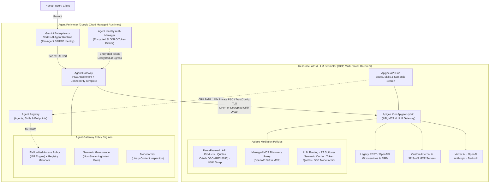
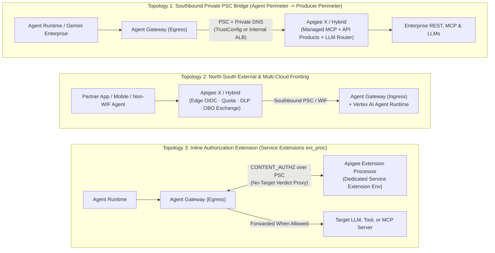

# Gemini Enterprise Agent Gateway vs. Apigee: Comparison & Dual-Gateway Integration

<div class="subnav">
  <a href="/ai-gateway/">Apigee AI Gateway</a>
  <span class="current">Compare &amp; Combine: Agent Gateway</span>
  <a href="/ai-gateway/agent-gateway-architecture">Agent Gateway Deep Dive</a>
</div>

Architectural comparison and integration guide for **Gemini Enterprise Agent Gateway** and **Apigee X / Apigee Hybrid**, validated against official Google Cloud documentation and release notes through November 5, 2026 *(last reviewed November 6, 2026)*.

<details>
<summary>Recent Platform Updates Covered in This Analysis (Through November 5, 2026)</summary>
<div markdown="1">

1. **Private CA & self-signed TLS on Agent Gateway:** Supported for VPC targets through [Certificate Manager TrustConfig](agent-gateway-architecture.md#private-cas--self-signed-certificates-via-trustconfig) when publicly trusted roots stay enabled.
2. **Expanded Agent Gateway deployment models (`1 GA`, `3 Early Preview`):** Google-managed Agent Gateway is GA; self-managed GKE, Cloud Run, and cross-cloud Envoy options are in Early Preview ([deployment models](agent-gateway-architecture.md#deployment-models-1-ga-vs-3-early-preview)).
3. **VPC-SC & multi-model Semantic Governance:** [VPC Service Controls](https://docs.cloud.google.com/gemini-enterprise-agent-platform/release-notes#September_25_2026) support is in Preview, evaluating 7 model families with custom denial messages on non-streaming requests ([Semantic Governance](agent-gateway-architecture.md#5-service-extensions-model-armor--semantic-governance)).
4. **Model Armor SSE streaming & Hybrid boundary:** Apigee's [SanitizeModelResponse policy](https://docs.cloud.google.com/apigee/docs/api-platform/reference/policies/sanitize-llm-response-policy#streaming-sse) scans streaming SSE responses on Apigee X and Apigee Hybrid on GCP (`v1.17.3+`; [AI Gateway Guardrails](README.md#24-prompt-tool--streaming-sse-guardrails)).
5. **Stateless MCP, custom basepaths & API Hub sync:** Apigee X serves stateless (`2026-07-28`) alongside stateful MCP (`Hybrid 1.17.0+` is stateful-only), supports custom MCP basepaths ([November 3, 2026 release](https://docs.cloud.google.com/apigee/docs/release-notes#November_03_2026)), and mirrors API Hub MCP catalogs to Agent Registry by default in Preview ([Apigee MCP Patterns](README.md#pattern-1-expose-rest-apis-as-mcp-tools)).
6. **Full-spectrum Apigee AI mediation:** Covers Multi-LLM routing with Provisioned Throughput spillover (replacing standalone LiteLLM containers), outbound SaaS MCP brokering, semantic tool discovery, and cross-cloud A2A governance ([Apigee AI Gateway](README.md)).
7. **Three official dual-gateway topologies:** Private Southbound PSC Bridge, North-South External Fronting, and inline `Apigee Extension Processor` ([Section 6](#6-three-official-dual-gateway-topologies)).

</div>
</details>

<div class="toc-box" markdown="1">

**On This Page**

* [1. Executive Summary & Core Mental Model](#1-executive-summary--core-mental-model)
* [2. End-to-End Dual-Gateway Architecture](#2-end-to-end-dual-gateway-architecture)
* [3. Side-by-Side Comparison Matrices](#3-side-by-side-comparison-matrices)
* [4. Decision Framework & Requirement Fit](#4-decision-framework--requirement-fit)
* [5. Real-World Integration Scenarios](#5-real-world-integration-scenarios)
* [6. Three Official Dual-Gateway Topologies](#6-three-official-dual-gateway-topologies)
  * [Topology 1: Southbound Private PSC Bridge](#topology-1-southbound-private-psc-bridge)
  * [Topology 2: North-South External & Multi-Cloud Fronting](#topology-2-north-south-external--multi-cloud-fronting)
  * [Topology 3: Inline Authorization Extension (`Apigee Extension Processor`)](#topology-3-inline-authorization-extension)
* [7. ISV Security Partners, End-to-End Delegation & FinOps](#7-isv-security-partners-end-to-end-delegation--finops)
* [8. Production Readiness Checklist & Organization Policies](#8-production-readiness-checklist--organization-policies)

**Related Guides**

* [Apigee as an Enterprise AI, LLM, MCP & A2A Gateway ->](README.md)
* [Agent Gateway Architecture Deep Dive ->](agent-gateway-architecture.md)

</div>

---

## 1. Executive Summary & Core Mental Model

Both **Gemini Enterprise Agent Gateway** and **Apigee** inspect [Model Context Protocol (MCP)](https://modelcontextprotocol.io/introduction) calls and integrate with [Model Armor](https://docs.cloud.google.com/model-armor/overview), yet they sit on opposite halves of the network and solve distinct architectural problems.

**Agent Gateway is the agent-side network and identity perimeter.** Built on Cloud Network Services and IAP, it attaches via [Private Service Connect](https://docs.cloud.google.com/vpc/docs/private-service-connect) directly to agents running in Vertex AI Agent Runtime or Gemini Enterprise. It assigns each agent an [un-impersonatable SPIFFE identity](agent-gateway-architecture.md#3-cryptographic-agent-identity-spiffe-mtls-dpop--auth-manager) backed by 24-hour rotating X.509 certificates, enforces [outbound access policies via IAM Unified Access Policies](agent-gateway-architecture.md#4-iam-unified-access-policies), decrypts end-user OAuth tokens at egress so agent code never handles raw credentials, and checks whether a [proposed tool call matches user intent](agent-gateway-architecture.md#5-service-extensions-model-armor--semantic-governance).

**Apigee (Apigee X and Apigee Hybrid) is the centralized AI, LLM, MCP, and A2A mediation gateway.** It sits across foundation model providers, internal REST and MCP backends, third-party SaaS MCP targets, cross-cloud [A2A agents](https://a2a-protocol.org/latest/), and inline Service Extension callouts. One gateway plane serves developer IDEs, partner apps, multi-cloud runtimes, and Google-hosted agents—handling [Multi-LLM routing and Provisioned Throughput spillover](README.md#21-multi-provider-routing-pt-spillover--schema-normalization), [semantic response caching](README.md#22-semantic-response-caching), [real-time token quotas](README.md#23-real-time-token-quotas--spike-smoothing), [Cloud DLP tokenization and continuous SSE Model Armor](README.md#24-prompt-tool--streaming-sse-guardrails), [REST-to-MCP conversion](README.md#pattern-1-expose-rest-apis-as-mcp-tools), [API Product tool filtering and per-tool quotas](README.md#4-per-tool-productization-dynamic-toolslist-filtering--quotas), and [On-Behalf-Of user token exchange](README.md#pattern-3-broker-outbound-access-to-third-party-saas-mcp-servers).

<details>
<summary>Analogy: Corporate Laptop VPN vs. Enterprise Central Switchboard</summary>
<div markdown="1">

Think of an AI agent as an employee working on a company-issued laptop, and your enterprise backends, SaaS platforms, and LLMs as vaults and shared utilities:

* **Agent Gateway acts like the laptop's hardware security chip, zero-trust VPN, and edge credential manager:**
  * Issues each agent its own rotating cryptographic badge (Agent Identity via [SPIFFE](https://spiffe.io/)).
  * Controls which endpoints and MCP servers the agent may call (IAM Unified Access Policies).
  * Injects end-user OAuth tokens at the outbound edge so agent code never sees raw secrets (Auth Manager).
  * Flags if a proposed tool call contradicts what the human user asked for (Semantic Governance).
* **Apigee acts like the enterprise's central switchboard, protocol translator, and API vault gatekeeper:**
  * Serves every caller (Google-hosted agents, VS Code, Cursor, Claude Desktop, customer/partner apps, and AWS/Azure workloads).
  * Balances LLM traffic across [Vertex AI Provisioned Throughput](https://docs.cloud.google.com/gemini-enterprise-agent-platform/models/provisioned-throughput), Pay-As-You-Go, Azure OpenAI, and Anthropic with failover, schema normalization, [token budgets](https://docs.cloud.google.com/apigee/docs/api-platform/reference/policies/llm-token-quota-policy), [semantic caching](https://docs.cloud.google.com/apigee/docs/api-platform/reference/policies/semantic-cache-lookup-policy), [Cloud DLP](https://docs.cloud.google.com/sensitive-data-protection/docs/deidentify-sensitive-data), and [continuous SSE Model Armor](https://docs.cloud.google.com/apigee/docs/api-platform/reference/policies/sanitize-llm-response-policy#streaming-sse).
  * Exposes legacy REST APIs as MCP tools, filters `tools/list` per consumer tier, enforces per-tool rate limits, handles OAuth On-Behalf-Of exchange and KVM key swaps, and powers entitlement-filtered tool search via [Apigee API Hub](https://docs.cloud.google.com/apigee/docs/apihub/what-is-api-hub).

</div>
</details>

---

## 2. End-to-End Dual-Gateway Architecture



---

## 3. Side-by-Side Comparison Matrices

### At-a-Glance Comparison

| Capability Axis | Gemini Enterprise Agent Gateway | Apigee AI & MCP Gateway (`X` / `Hybrid`) |
| :--- | :--- | :--- |
| **Primary architectural role** | **Agent-side network and identity perimeter** (outbound forward proxy plus Vertex AI Agent Runtime ingress) | **Enterprise API, Multi-LLM, MCP, and A2A gateway** across all callers, clouds, and backends |
| **Caller & runtime reach** | **GA:** Vertex AI Agent Runtime (ingress + egress) & Gemini Enterprise (egress only)<br>**Early Preview:** GKE, Cloud Run, Cross-Cloud Envoy | **GA everywhere:** Developer IDEs (VS Code, Cursor, Claude Desktop), non-Google agents (LangGraph, AWS Bedrock), customer/B2B apps, Kubernetes |
| **Identity & delegation model** | [Per-agent cryptographic workload identity](agent-gateway-architecture.md#3-cryptographic-agent-identity-spiffe-mtls-dpop--auth-manager) (24h `SPIFFE` X.509 mTLS + `DPoP`) and Auth Manager 3LO decryption | OAuth/OIDC JWTs, mTLS, API Keys, SAML, [On-Behalf-Of Token Exchange (`RFC 8693`)](README.md#pattern-3-broker-outbound-access-to-third-party-saas-mcp-servers), [OAuth discovery (`RFC 9728`)](README.md#pattern-2-govern-internal--consumer-facing-mcp-servers), Encrypted KVM |
| **REST-to-MCP translation** | None (passthrough proxy only) | Yes: [Managed MCP Discovery Proxy](README.md#pattern-1-expose-rest-apis-as-mcp-tools) (Stateless + Stateful on X; Stateful on Hybrid `1.17.0+`) and [`apigee-go-gen`](https://apigee.github.io/apigee-go-gen/render/mcp/) |
| **Tool authorization & filtering** | [IAM Unified Access Policies](agent-gateway-architecture.md#4-iam-unified-access-policies) (CEL rules over MCP hints) and up to 4 egress authorization policies | [API Products + MCP payload parsing](https://docs.cloud.google.com/apigee/docs/api-platform/apigee-mcp/manage-mcp-tool-access) (automatic `tools/list` filtering per tier), per-tool quotas, and [OPA gRPC callouts](README.md#pattern-2-govern-internal--consumer-facing-mcp-servers) |
| **Guardrails & intent checking** | [Semantic Governance intent gate](agent-gateway-architecture.md#5-service-extensions-model-armor--semantic-governance) across 7 model families (non-streaming only) + unary Model Armor (`<= 65k` tokens) | [Streaming SSE Model Armor](https://docs.cloud.google.com/apigee/docs/api-platform/reference/policies/sanitize-llm-response-policy#streaming-sse), [tool payload sanitization](https://docs.cloud.google.com/apigee/docs/api-platform/reference/policies/sanitize-user-prompt-policy), [Cloud DLP tokenization](https://docs.cloud.google.com/sensitive-data-protection/docs/deidentify-sensitive-data), and 3P AI firewalls |
| **Multi-LLM routing, caching & FinOps** | None in gateway (1-second GEAP observability metadata headers only) | Yes (retires custom LiteLLM proxies): [Provisioned Throughput spillover](https://docs.cloud.google.com/gemini-enterprise-agent-platform/models/provisioned-throughput), failover, schema normalization, [semantic caching](https://docs.cloud.google.com/apigee/docs/api-platform/reference/policies/semantic-cache-lookup-policy), [token quotas](https://docs.cloud.google.com/apigee/docs/api-platform/reference/policies/llm-token-quota-policy) |
| **Hybrid / multi-cloud & PKI** | GA SaaS on GCP + [Certificate Manager TrustConfig private CAs](agent-gateway-architecture.md#private-cas--self-signed-certificates-via-trustconfig) (manual PEM rotation) | [Production GA (`Hybrid 1.17.0+`)](README.md#5-apigee-hybrid-1170-multi-cloud-execution-limits--network-hardening): runs API and MCP planes inside EKS, AKS, OpenShift, GKE, or on-prem with full PKI |

### Detailed Technical Comparison (Expandable by Domain)

<details>
<summary>Platform Scope, Control-Plane APIs, Hybrid Execution &amp; Catalog Sync</summary>
<div markdown="1">

| Dimension | Gemini Enterprise Agent Gateway | Apigee X & Apigee Hybrid |
| :--- | :--- | :--- |
| **Primary architectural role** | Outbound forward proxy and identity perimeter attached to an agent runtime, plus Vertex AI Agent Runtime ingress. | Enterprise mediation hub for LLMs, internal/external MCP, REST-to-MCP translation, cross-cloud A2A, semantic tool discovery, and inline Service Extension callouts. |
| **Control-plane Google Cloud services** | [Cloud Network Services](https://docs.cloud.google.com/gemini-enterprise-agent-platform/govern/gateways/agent-gateway-overview), Network Security authorization policies, Compute Engine network attachments, [Certificate Manager](https://docs.cloud.google.com/certificate-manager/docs/trust-configs), IAP, and [Agent Registry](https://docs.cloud.google.com/gemini-enterprise-agent-platform/govern/agent-registry). | Apigee API Management, [Apigee API Hub](https://docs.cloud.google.com/apigee/docs/apihub/what-is-api-hub) (MCP proxies, Agent Registry sync, signed skills distribution, and resource search), plus Hybrid runtime and MCP data-plane pods. |
| **Traffic directions** | 1. **Outbound egress:** Agents calling MCP servers, A2A agents, LLMs, or HTTP APIs.<br>2. **Inbound ingress:** Callers hitting Vertex AI Agent Runtime query/stream endpoints (unsupported on Gemini Enterprise). | 1. Consumer/partner inbound (WAF, OIDC, inline OBO).<br>2. Internal app/IDE to REST-backed or native MCP.<br>3. Outbound 3P SaaS MCP mediation.<br>4. Search-then-Invoke tool discovery.<br>5. Cross-cloud and in-cluster A2A.<br>6. Multi-LLM & multimodal routing.<br>7. Inline Extension Processor (`ext_proc`). |
| **Supported runtimes & deployment models** | **GA:** Google-managed proxy for Agent Runtime (ingress + egress) and Gemini Enterprise (egress only).<br>**Early Preview:** Self-managed GKE, Cloud Run, and Cross-Cloud Envoy. | **GA everywhere:** Works in production with any runtime, client, or model vendor—Gemini Enterprise, ADK, LangGraph, Claude Agent SDK, developer IDEs, AWS Bedrock, Azure OpenAI, and partner apps. |
| **Hybrid & multi-cloud execution** | Google-managed SaaS in GA; self-managed Kubernetes/Cloud Run/Cross-Cloud options are Early Preview. | **Production GA (`Hybrid 1.17.0+`):** Runs both API Message Processors and the Managed MCP Server inside GKE, AWS EKS, Azure AKS, OpenShift, or on-prem clusters with zero request traffic leaving the cluster. |
| **Catalog, skills & discovery sync** | [Agent Registry](https://docs.cloud.google.com/gemini-enterprise-agent-platform/govern/agent-registry) tracks deployed agents, Cloud Run MCP servers, endpoints (up to 5,000 per gateway), and API Hub exports; Gemini Enterprise binds to one regional registry (`us-central1` or `europe-west1`). | [Apigee API Hub](https://docs.cloud.google.com/apigee/docs/apihub/what-is-api-hub) catalogs OpenAPI specs, MCP servers, Developer Portals, and Ed25519-signed [agentic skills](https://docs.cloud.google.com/apigee/docs/apihub/tutorials/distribute-agentic-skills); mirrors MCP assets into Agent Registry by default in Preview. |

</div>
</details>

<details>
<summary>Identity, Credential Brokers, REST-to-MCP Translation &amp; Authorization</summary>
<div markdown="1">

| Dimension | Gemini Enterprise Agent Gateway | Apigee X & Apigee Hybrid |
| :--- | :--- | :--- |
| **Cryptographic identity model** | **Per-agent [SPIFFE](https://spiffe.io/) identity:** Google-managed X.509 certificates rotated every 24h (`mTLS` to gateway, `DPoP` downstream); must be enabled when creating the agent. | **Consumer, human OBO, and API-edge identity:** Validates OIDC/OAuth JWTs ([VerifyJWT](https://docs.cloud.google.com/apigee/docs/api-platform/reference/policies/verify-jwt-policy), [OAuthV2](https://docs.cloud.google.com/apigee/docs/api-platform/reference/policies/oauthv2-policy)), API Keys ([VerifyAPIKey](https://docs.cloud.google.com/apigee/docs/api-platform/reference/policies/verify-api-key-policy)), mTLS certs, and SAML; executes [RFC 8693 OBO exchange](https://datatracker.ietf.org/doc/html/rfc8693); serves [RFC 9728 OAuth metadata](https://datatracker.ietf.org/doc/html/rfc9728). |
| **Credential vault / token broker** | **Agent Identity Auth Manager:** Encrypts end-user 3LO tokens (plus 2LO/API keys) so Gemini Enterprise / Agent Runtime code never sees raw secrets; Agent Gateway injects decrypted tokens at egress. | **Encrypted KVM, Secret Manager & OAuth mediation:** Strips inbound corporate JWTs and injects encrypted backend keys or exchanged OAuth tokens via [OAuthV2](https://docs.cloud.google.com/apigee/docs/api-platform/reference/policies/oauthv2-policy), [AssignMessage](https://docs.cloud.google.com/apigee/docs/api-platform/reference/policies/assign-message-policy), and [ServiceCallout](https://docs.cloud.google.com/apigee/docs/api-platform/reference/policies/service-callout-policy). |
| **REST-to-MCP conversion & protocol versions** | **None:** Passthrough proxy only; cannot convert REST APIs into MCP tools. | [Managed MCP Discovery Proxy](https://docs.cloud.google.com/apigee/docs/api-platform/apigee-mcp/apigee-mcp-overview) via API Hub serves stateless (`2026-07-28`) alongside stateful MCP (`2025-11-25`..`2024-11-05`) on Apigee X, stateful MCP on Hybrid (`1.17.0+`), and custom basepaths ([Nov 3 release](https://docs.cloud.google.com/apigee/docs/release-notes#November_03_2026)). [`apigee-go-gen`](https://apigee.github.io/apigee-go-gen/render/mcp/) also builds static bundles. |
| **Deterministic authorization engine** | 1. [IAM Unified Access Policies](agent-gateway-architecture.md#4-iam-unified-access-policies): IAP egress checks with CEL on Agent Registry metadata or hosts, Allow + Deny rules, and dry-run audit mode.<br>2. Network Security authorization policies matching MCP operations. | 1. **API Products + [ParsePayload policy](https://docs.cloud.google.com/apigee/docs/api-platform/reference/policies/parse-payload-policy):** Extracts the MCP operation and enforces entitlements per Developer App.<br>2. **gRPC [ExternalCallout policy](https://docs.cloud.google.com/apigee/docs/api-platform/reference/policies/external-callout-policy):** Calls [Open Policy Agent](https://www.openpolicyagent.org/) or custom engines for fine-grained JSON-RPC authorization. |
| **MCP tool annotations & `tools/list` filtering** | Evaluates CEL rules against registered MCP tool hints (read-only, destructive, idempotent, open-world); binary allow/deny rather than rewriting `tools/list`. | Combining the **ParsePayload** policy in Request and Response flows with API Products **automatically strips unauthorized tools from `tools/list`** per consumer tier. |

</div>
</details>

<details>
<summary>Guardrails, Multi-LLM Routing, Semantic Caching, Quotas, TLS &amp; Scale</summary>
<div markdown="1">

| Dimension | Gemini Enterprise Agent Gateway | Apigee X & Apigee Hybrid |
| :--- | :--- | :--- |
| **Per-tool rate limits & token budgets** | No gateway rate limiting or token quota enforcement (passive 1-second observability metadata headers are GA for cost attribution). | Enforces per-tool [Quota](https://docs.cloud.google.com/apigee/docs/api-platform/reference/policies/quota-policy) limits alongside real-time [LLMTokenQuota](https://docs.cloud.google.com/apigee/docs/api-platform/reference/policies/llm-token-quota-policy) (automatically skipping semantic cache hits) and [PromptTokenLimit](https://docs.cloud.google.com/apigee/docs/api-platform/reference/policies/prompt-token-limit-policy) spike smoothing. |
| **Prompt-to-action intent alignment** | **Semantic Governance (Preview):** LLM evaluates natural-language rules and prompt alignment across 7 model families (Gemini, Anthropic, Claude on GEAP, OpenAI, Mistral, Llama, vLLM), with Preview VPC-SC and custom denials. **Non-streaming only.** | No multi-turn NLC LLM intent engine; focuses on fast payload guardrails, continuous streaming Model Armor, Cloud DLP tokenization, and deterministic schema/OPA checks. |
| **Model Armor & streaming coverage** | **Ingress:** Streaming queries on Vertex AI ADK agents only.<br>**Egress:** Non-streaming OpenAI, MCP tool calls/prompts, and unary A2A calls. Skips `tools/list`, SSE/streaming calls, and payloads over `65,536` tokens (`130,000` SDP / `4 MB`). | [SanitizeUserPrompt](https://docs.cloud.google.com/apigee/docs/api-platform/reference/policies/sanitize-user-prompt-policy) and [SanitizeModelResponse](https://docs.cloud.google.com/apigee/docs/api-platform/reference/policies/sanitize-llm-response-policy#streaming-sse) inspect tool inputs, tool outputs, and **continuous SSE streams** as one quota call with no response token limit (GCP Hybrid only; call REST via [ServiceCallout](https://docs.cloud.google.com/apigee/docs/api-platform/reference/policies/service-callout-policy) or 3P AI firewalls on EKS/AKS/on-prem). |
| **Semantic caching & Multi-LLM routing** | No semantic caching, provider failover, PT-to-PayGo spillover, or schema normalization. | Native [SemanticCacheLookup](https://docs.cloud.google.com/apigee/docs/api-platform/reference/policies/semantic-cache-lookup-policy) / [SemanticCachePopulate](https://docs.cloud.google.com/apigee/docs/api-platform/reference/policies/semantic-cache-populate-policy) via Vertex AI Vector Search, conditional routing, weighted target pools, [Google target auth](https://docs.cloud.google.com/apigee/docs/api-platform/security/google-auth/overview), and schema translation—retiring standalone `LiteLLM` servers. |
| **A2A, semantic tool search & large files** | Governs unary A2A Model Armor checks; no vector tool search or Claim-Check pattern. | Governs [A2A](https://a2a-protocol.org/latest/) discovery/tasks/SSE streams, powers Search-then-Invoke discovery over API Hub + Vector Search, and handles Cloud DLP `FPE` + [signed URL Claim-Check transfers](https://docs.cloud.google.com/storage/docs/access-control/signed-urls). |
| **Backend TLS & private CAs** | Uses Certificate Manager `TrustConfig`, requiring publicly trusted roots stay enabled so Google APIs work, manual PEM rotation, and connectivity-template replacement on edits. | Full custom truststores and keystores, self-signed backend certs, two-way mTLS targets, SNI overrides, and automated rotation without rebuilding gateway bindings. |
| **Scale, policy caps & VPC-SC** | Max **5,000** registered resources/gateway; max **4** egress authorization policies; max **1** ingress content policy; `1,500`-byte PSC MTU. VPC-SC requires post-Sept 8, 2026 gateways in all-traffic mode. | Fixed **1,000** Managed MCP tools/org on Apigee X; **Hybrid `1.17.0+`** scales by size (**~10,000** tools typical: `3 MiB` OAS, `50 MiB` bundle, `10 MiB`/`30 MiB` `tools/list`, `100` hostnames/envgroup), with **no 4-policy cap** and full VPC-SC on Apigee X. |

</div>
</details>

---

## 4. Decision Framework & Requirement Fit

### Choose Agent Gateway When
1. Your agents run on **Vertex AI Agent Runtime** or **Gemini Enterprise** and need un-impersonatable **per-agent cryptographic identity** (24-hour rotating [SPIFFE](https://spiffe.io/) certificates with mTLS and DPoP) instead of shared Service Accounts.
2. You need **agent-centric outbound egress rules** via IAM Unified Access Policies evaluating Agent Registry metadata (such as read-only tool hints).
3. You want **Semantic Governance (an LLM intent gate)** on non-streaming model calls to stop indirect prompt injection from triggering unauthorized tool invocations.
4. You want **zero-trust 3-legged OAuth injection** via Auth Manager so end-user credentials stay encrypted inside the runtime until decrypted at the gateway edge.

### Choose Apigee When
1. You want an **Enterprise Multi-LLM & Multimodal Gateway** across Vertex AI Gemini, Azure OpenAI, OpenAI, Anthropic, and AWS Bedrock—retiring custom LiteLLM containers—with [Provisioned Throughput spillover](https://docs.cloud.google.com/gemini-enterprise-agent-platform/models/provisioned-throughput), failover, [real-time token quotas](https://docs.cloud.google.com/apigee/docs/api-platform/reference/policies/llm-token-quota-policy), [semantic caching](https://docs.cloud.google.com/apigee/docs/api-platform/reference/policies/semantic-cache-lookup-policy), [Cloud DLP Format-Preserving Encryption](https://docs.cloud.google.com/sensitive-data-protection/docs/deidentify-sensitive-data), and [continuous SSE Model Armor](https://docs.cloud.google.com/apigee/docs/api-platform/reference/policies/sanitize-llm-response-policy#streaming-sse).
2. You want to **convert existing REST/OpenAPI services into MCP tools** ([Managed Discovery Proxy](https://docs.cloud.google.com/apigee/docs/api-platform/apigee-mcp/apigee-mcp-overview) or [`apigee-go-gen`](https://apigee.github.io/apigee-go-gen/render/mcp/)), package tools into **API Products** with dynamic `tools/list` filtering and per-tool quotas, or add Search-then-Invoke semantic discovery across large catalogs.
3. Callers include **developer IDEs (VS Code, Cursor, Claude Desktop), partner/mobile apps, or non-Google agents**, or you need outbound SaaS MCP credential brokering (`RFC 8693` OBO, Encrypted KVM, `RFC 9728`) and cross-cloud A2A mediation.
4. You require **GA hybrid/multi-cloud execution** inside GKE, EKS, AKS, OpenShift, or on-prem clusters (`Apigee Hybrid 1.17.0+`), automated two-way mTLS rotation, or more than four authorization policies without gateway sharding.

### Why Enterprises Combine Both
In a mature Google Cloud deployment, both layers carry distinct responsibilities: **Agent Gateway** locks down Google-hosted agents' identity, outbound egress, 3LO decryption, and non-streaming intent alignment; **Apigee** receives traffic from Agent Gateway alongside developer IDEs and external callers to govern API Products, MCP translation, semantic tool search, multi-LLM routing, token budgets, DLP tokenization, and continuous streaming guardrails.

### Requirements Quick Selector

| Requirement / Architectural Driver | Primary Fit | Agent Gateway Role | Apigee + API Hub Role | Combined Pattern |
| :--- | :--- | :--- | :--- | :--- |
| **Per-agent cryptographic workload identity** (no shared Service Accounts) | **Agent Gateway** | Provisions 24h auto-rotated SPIFFE X.509 mTLS + DPoP identity | Validates inbound mTLS or JWT at the API edge | Agent Gateway proves agent identity on egress; Apigee maps it to an API Product ([Identity](agent-gateway-architecture.md#3-cryptographic-agent-identity-spiffe-mtls-dpop--auth-manager)) |
| **Indirect prompt-injection intent gate** (align tool call to prompt) | **Agent Gateway** | [Semantic Governance LLM](agent-gateway-architecture.md#5-service-extensions-model-armor--semantic-governance) checks tool call against prompt + NLC (non-streaming) | Inspects individual payloads/tool outputs without agent chat history | Agent Gateway guards intent at runtime edge; Apigee enforces schemas and quotas ([Scenario](#scenario-blocking-prompt-injected-tool-calls)) |
| **Zero-trust 3LO token decryption** (no raw user secrets in agent code) | **Agent Gateway** | [Auth Manager](agent-gateway-architecture.md#3-cryptographic-agent-identity-spiffe-mtls-dpop--auth-manager) encrypts 3LO token; gateway decrypts into Bearer header at egress | Receives decrypted token or exchanges it onward | Agent Gateway hides raw secret from agent code; Apigee brokers backend scope ([Scenario](#scenario-zero-trust-3lo-token-injection)) |
| **On-Behalf-Of token exchange (`RFC 8693`) & SaaS key swap** | **Apigee + API Hub** | Handles Auth Manager 3LO for Google agents; no custom OBO/KVM swap | Native OAuth and [ServiceCallout token exchange](https://docs.cloud.google.com/apigee/docs/api-platform/reference/policies/service-callout-policy) (`sub`+`act`) and Encrypted KVM | Agent Gateway passes user/agent context; Apigee brokers scoped SaaS tokens ([SaaS Egress](README.md#pattern-3-broker-outbound-access-to-third-party-saas-mcp-servers)) |
| **Convert legacy REST / OpenAPI specs into MCP tools** | **Apigee + API Hub** | Not supported (passthrough only) | [Managed MCP Discovery Proxy + API Hub](README.md#pattern-1-expose-rest-apis-as-mcp-tools) or `apigee-go-gen` | Apigee converts REST to MCP and syncs to Agent Registry; Agent Gateway governs egress ([Scenario](#scenario-exposing-legacy-rest-apis-as-mcp-tools)) |
| **Tiered `tools/list` filtering & per-tool quotas** | **Apigee + API Hub** | Binary IAM allow/deny; does not filter tools from JSON payload or enforce per-tool quotas | [API Products and ParsePayload](https://docs.cloud.google.com/apigee/docs/api-platform/apigee-mcp/manage-mcp-tool-access#configure-parse-payload) strip unauthorized tools and enforce [per-tool quotas](https://docs.cloud.google.com/apigee/docs/api-platform/apigee-mcp/manage-mcp-tool-access#per-tool-quotas) | Agent Gateway controls which agents reach MCP; Apigee tailors tool visibility and rate limits ([Scenario](#scenario-tiered-toolslist-filtering-and-quotas)) |
| **External consumers, developer IDEs & multi-cloud callers** | **Apigee + API Hub** | GA covers Vertex AI / Gemini Enterprise runtimes (`Client-to-Agent` excludes GE) | Client-agnostic edge with [OAuth discovery (`RFC 9728`)](README.md#pattern-2-govern-internal--consumer-facing-mcp-servers) and custom IdPs | Agent Gateway governs Google-hosted agents; Apigee fronts IDEs, partners, and AWS/Azure workloads ([Topology 2](#topology-2-north-south-external--multi-cloud-fronting)) |
| **GA Hybrid / multi-cloud data-plane execution** | **Apigee Hybrid** | GA is Google-managed SaaS (GKE / Cloud Run / Cross-Cloud in Early Preview) | [GA `Apigee Hybrid 1.17.0+`](https://docs.cloud.google.com/apigee/docs/hybrid/release-notes) keeps API and MCP traffic inside customer clusters | Apigee Hybrid keeps regional/cluster workloads local; Agent Gateway governs GCP agents ([Hybrid Guide](README.md#5-apigee-hybrid-1170-multi-cloud-execution-limits--network-hardening)) |
| **Prompt, tool output, SSE streaming & Cloud DLP guardrails** | **Both (layered)** | Unary Model Armor or 15 ISV partners (skips SSE streams and `>65k` tokens) | [Prompt inspection](https://docs.cloud.google.com/apigee/docs/api-platform/reference/policies/sanitize-user-prompt-policy), [continuous SSE Model Armor](https://docs.cloud.google.com/apigee/docs/api-platform/reference/policies/sanitize-llm-response-policy#streaming-sse), and [Cloud DLP tokenization](https://docs.cloud.google.com/sensitive-data-protection/docs/deidentify-sensitive-data) | Agent Gateway guards unary tool calls; Apigee scans full SSE streams and tokenizes PII |
| **Semantic response caching & token FinOps limits** | **Apigee + API Hub** | Passive 1s Cloud Monitoring metadata labels only; no gateway cache or token cap | [Semantic caching](https://docs.cloud.google.com/apigee/docs/api-platform/reference/policies/semantic-cache-lookup-policy), [real-time LLM token quotas](https://docs.cloud.google.com/apigee/docs/api-platform/reference/policies/llm-token-quota-policy), and [prompt-token spike limits](https://docs.cloud.google.com/apigee/docs/api-platform/reference/policies/prompt-token-limit-policy) | Agent Gateway emits metadata labels; Apigee enforces token budgets and serves cached hits ([FinOps](#honest-agentic-finops)) |
| **Unified API, MCP tool, `.skill` & agent catalog** | **Both (federated)** | [Agent Registry](https://docs.cloud.google.com/gemini-enterprise-agent-platform/govern/agent-registry) indexes live agents & MCP endpoints | [API Hub](https://docs.cloud.google.com/apigee/docs/apihub/what-is-api-hub) catalogs OAS/MCP specs & signed skills, syncing to Agent Registry | API Hub is producer catalog of record and feeds Agent Registry ([API Hub Sync](README.md#pattern-1-expose-rest-apis-as-mcp-tools)) |
| **Multi-LLM routing, PT spillover & schema normalization** | **Apigee + API Hub** | Single-target passthrough; no provider spillover or schema translation | Routes across [Vertex AI PT/PayGo, Azure OpenAI, Anthropic, and Bedrock](README.md#21-multi-provider-routing-pt-spillover--schema-normalization) (replaces `LiteLLM`) | Agent Gateway governs agent egress; Apigee handles resilient model routing ([Scenario](#scenario-consolidating-custom-litellm-proxies)) |
| **Cross-cloud A2A & semantic tool search** | **Both (by scope)** | Governs Google agent outbound A2A (`4`-policy cap); no vector tool search | Governs [cross-cloud A2A](README.md#pattern-5-cross-cloud--in-cluster-agent-to-agent-mediation) + [Search-then-Invoke discovery](README.md#pattern-4-search-then-invoke-semantic-tool-discovery) | Agent Gateway secures Google agent egress; Apigee handles wide-enterprise discovery and A2A ([Scenario](#scenario-developer-ides-saas-mcp-and-a2a)) |

---

## 5. Real-World Integration Scenarios

Expand any scenario below to see how the two gateways behave on the wire:

<details>
<summary id="scenario-exposing-legacy-rest-apis-as-mcp-tools">Exposing 200 Legacy REST APIs as MCP Tools (Apigee + API Hub)</summary>
<div markdown="1">

*"We have 200 OpenAPI 3.0 REST services and want agents to use them as MCP tools without writing custom MCP servers."*

* **Can Agent Gateway do this alone?** No. Agent Gateway is a passthrough proxy; it cannot translate an MCP tool invocation into a backend REST call.
* **How Apigee solves it:** Register the OpenAPI specs in [Apigee API Hub](https://docs.cloud.google.com/apigee/docs/apihub/manage-mcp-proxies), enable **Configure MCP tools**, and deploy the Managed MCP Discovery Proxy. Apigee exposes the REST operations as MCP tools, syncs them into [Agent Registry](https://docs.cloud.google.com/apigee/docs/apihub/manage-agent-registry-integration) automatically for Agent Gateway IAM bindings, and translates each tool invocation back to REST.

</div>
</details>

<details>
<summary id="scenario-blocking-prompt-injected-tool-calls">Blocking a Poisoned Email Prompt Injection (Agent Gateway)</summary>
<div markdown="1">

*"A hidden prompt injection inside an email tricks a Gemini Enterprise agent into calling `transfer_funds(amount=5000)` when the user only asked it to summarize unread emails."*

* **Can Apigee alone stop this?** Apigee's [SanitizeUserPrompt policy](https://docs.cloud.google.com/apigee/docs/api-platform/reference/policies/sanitize-user-prompt-policy#functionresponsesource) can scan email tool outputs for known injection signatures and a [Quota policy](https://docs.cloud.google.com/apigee/docs/api-platform/reference/policies/quota-policy) can rate-limit `transfer_funds`. However, if an attack evades signature detection and the agent sends an authenticated call for `transfer_funds`, Apigee does not see the agent's multi-turn chat history or original prompt (`"Summarize my unread emails"`).
* **How Agent Gateway solves it:** Agent Gateway's [Semantic Governance Policy Engine](https://docs.cloud.google.com/gemini-enterprise-agent-platform/govern/policies/semantic-governance-overview) evaluates the original user prompt, chat history, Natural Language Constraints, tools manifest, and proposed `transfer_funds` call together on non-streaming model calls—catching the mismatch and blocking the call before it leaves the agent perimeter *(pair non-streaming enforcement with deterministic quotas/approvals, since streamed model responses bypass Semantic Governance today)*.

</div>
</details>

<details>
<summary id="scenario-tiered-toolslist-filtering-and-quotas">Tiered MCP Catalog Filtering &amp; Per-Tool Quotas (Apigee)</summary>
<div markdown="1">

*"We want one Financial MCP Server to serve 50 internal teams and partners—standard apps see 5 read-only tools at higher limits, while privileged apps see all 25 tools including write actions at stricter limits."*

* **Can Agent Gateway do this?** No. Agent Gateway does not model API Products, consumer tiers, JSON `tools/list` payload stripping, or per-tool rate limits.
* **How Apigee solves it:** Place **Apigee** in front of the MCP server using the [ParsePayload policy](https://docs.cloud.google.com/apigee/docs/api-platform/reference/policies/parse-payload-policy) in both Request and Response flows, [VerifyAPIKey](https://docs.cloud.google.com/apigee/docs/api-platform/reference/policies/verify-api-key-policy) or [OAuthV2](https://docs.cloud.google.com/apigee/docs/api-platform/reference/policies/oauthv2-policy), and [Quota](https://docs.cloud.google.com/apigee/docs/api-platform/reference/policies/quota-policy) policies bound to API Products. When a Tier-1 client requests `tools/list`, Apigee strips the 20 privileged tools automatically and enforces independent quotas on the 5 allowed tools.

</div>
</details>

<details>
<summary id="scenario-zero-trust-3lo-token-injection">Zero-Trust 3-Legged OAuth Injection Without Exposing Secrets (Agent Gateway)</summary>
<div markdown="1">

*"Our Gemini Enterprise agent calls internal MCP servers on the signed-in user's behalf, and the agent's Python code must never be able to inspect or log the raw user OAuth token."*

* **How Agent Gateway solves it:** Configure the OAuth provider in [Agent Identity Auth Manager](https://docs.cloud.google.com/gemini-enterprise-agent-platform/govern/agent-identity-overview#agent-auth-manager) and attach Agent Gateway in egress mode to Gemini Enterprise. Auth Manager keeps user tokens encrypted inside the runtime, and Agent Gateway decrypts and attaches the Bearer credential only as the outbound request leaves the gateway edge.

</div>
</details>

<details>
<summary id="scenario-consolidating-custom-litellm-proxies">Consolidating Custom LiteLLM Proxies onto an Enterprise LLM Gateway (Apigee)</summary>
<div markdown="1">

*"Product teams spun up separate LiteLLM containers to handle Vertex AI Provisioned Throughput spillover, Azure OpenAI/Anthropic failover, token budgets, and PII redaction. How do we standardize on one managed gateway?"*

* **Can Agent Gateway do this?** No. Agent Gateway forwards model calls to a single target URL without PT-to-PayGo spillover, schema translation, LLM token quotas, or inline Format-Preserving Encryption.
* **How Apigee solves it:** Apigee replaces custom LiteLLM servers with unified OpenAI-compatible schema translation, synchronous [Cloud DLP tokenization](https://docs.cloud.google.com/sensitive-data-protection/docs/deidentify-sensitive-data), [SemanticCacheLookup](https://docs.cloud.google.com/apigee/docs/api-platform/reference/policies/semantic-cache-lookup-policy) vector caching, [PromptTokenLimit](https://docs.cloud.google.com/apigee/docs/api-platform/reference/policies/prompt-token-limit-policy) and [LLMTokenQuota](https://docs.cloud.google.com/apigee/docs/api-platform/reference/policies/llm-token-quota-policy) enforcement, [Provisioned Throughput routing](https://docs.cloud.google.com/apigee/docs/api-platform/security/google-auth/overview) with automatic `HTTP 429`/`5xx` failover to PayGo or backup vendors, and [continuous SSE Model Armor inspection](https://docs.cloud.google.com/apigee/docs/api-platform/reference/policies/sanitize-llm-response-policy#streaming-sse).

</div>
</details>

<details>
<summary id="scenario-developer-ides-saas-mcp-and-a2a">Developer IDEs, External SaaS MCP, Cross-Cloud A2A &amp; Large Tool Catalogs (Apigee + API Hub)</summary>
<div markdown="1">

*"Developers in VS Code, Cursor, and Claude Desktop plus AWS/Azure agents need access to hundreds of internal MCP tools, third-party SaaS MCP servers, and cross-cloud A2A agents—without storing SaaS API keys on laptops or bloating prompts with hundreds of tool schemas."*

* **Can Agent Gateway do this alone?** No. GA Agent Gateway attaches to Vertex AI Agent Runtime and Gemini Enterprise rather than developer laptops, does not swap Encrypted KVM credentials or execute custom token-exchange mediation, and does not provide semantic tool search.
* **How Apigee + API Hub solves it:** Enterprise MDM points developer IDEs and multi-cloud agents to Apigee:
  1. **Search-then-Invoke discovery** backed by [API Hub](https://docs.cloud.google.com/apigee/docs/apihub/what-is-api-hub) and [Vertex AI Vector Search](https://docs.cloud.google.com/vertex-ai/docs/vector-search/overview) filters by JWT entitlements and returns only the top few relevant tool schemas.
  2. **Outbound 3P SaaS MCP mediation** swaps corporate JWTs for Encrypted KVM secrets or [`RFC 8693` OBO tokens](https://datatracker.ietf.org/doc/html/rfc8693), returning `HTTP 200` JSON-RPC `-32000` errors on disallowed tool calls so IDEs display clear refusals instead of looping on OAuth sign-in.
  3. **Cross-cloud [A2A mediation](https://a2a-protocol.org/latest/)** governs Agent Card discovery and JSON-RPC/SSE task streams under central API Product kill switches.

</div>
</details>

---

## 6. Three Official Dual-Gateway Topologies

Google Cloud documents three patterns for composing **Agent Gateway** and **Apigee** together:



### Topology 1: Southbound Private PSC Bridge

Documented in [Access Apigee privately from Gemini Enterprise Agent Platform](https://docs.cloud.google.com/apigee/docs/api-platform/system-administration/private-access-from-agent-runtime#architecture), this keeps all traffic between Google-managed agents and Apigee inside [Private Service Connect](https://docs.cloud.google.com/vpc/docs/private-service-connect):

Agent Gateway egresses through a PSC network attachment (minimum `/28` subnet) and Cloud DNS peering into your VPC, resolving the Apigee environment group hostname to a PSC forwarding rule fronting Apigee's service attachment. Because Apigee's direct PSC endpoint serves a self-signed certificate ([private access overview](https://docs.cloud.google.com/apigee/docs/api-platform/system-administration/private-access-from-agent-runtime#overview)), either front it with an **Internal Application Load Balancer + PSC NEG** bearing a trusted cert, or configure the Apigee CA inside Certificate Manager [TrustConfig](agent-gateway-architecture.md#private-cas--self-signed-certificates-via-trustconfig) (with publicly trusted roots enabled so Google APIs continue to verify).

### Topology 2: North-South External & Multi-Cloud Fronting

Because Agent Gateway's inbound ingress mode requires Google Cloud IAM or Workforce Identity Federation credentials and does not support Gemini Enterprise, place **Apigee** in front for B2B partners, mobile apps, and multi-cloud callers. Apigee terminates Cloud Armor WAF, validates third-party OIDC tokens or API Keys, enforces commercial quotas, and bridges into Vertex AI Agent Runtime over PSC or an ingress Agent Gateway.

### Topology 3: Inline Authorization Extension

Documented in [Connect the Apigee extension processor to an Agent Gateway](https://docs.cloud.google.com/apigee/docs/api-platform/service-extensions/extension-processor-agent-gateway), Agent Gateway invokes Apigee synchronously inline over PSC and private DNS to a **no-target proxy** in a dedicated Service Extension environment. Apigee inspects request and response payloads and returns an allow/deny verdict or body mutation without rewriting the agent's destination URLs.

<details>
<summary>AuthzExtension YAML &amp; Four Operational Caveats for Inline Extension Processor</summary>
<div markdown="1">

**Sample `AuthzExtension` configuration ([create AuthzExtension](https://docs.cloud.google.com/apigee/docs/api-platform/service-extensions/extension-processor-agent-gateway#create-authz-ext)):**
```yaml
name: projects/PROJECT_ID/locations/REGION/authzExtensions/apigee-authz-extension
authority: apigee-extproc.internal.example.com
service: apigee-extproc.internal.example.com
timeout: 5s
metadata:
  apigee-extension-processor: extproc-authz-proxy
  apigee-request-body: 'true'
  apigee-response-body: 'true'
```
*(Without enabling body metadata forwarding, request and response content arrive empty inside Apigee.)*

**Four operational limits to account for:**
1. **Scope URL matching tightly:** Broad path prefixes send every agent session and telemetry request through Apigee; restrict rules to target LLM or MCP paths.
2. **Export before importing Agent Gateway YAML:** Importing replaces the entire gateway resource (omitting protocol or registry arrays drops them).
3. **Unsupported policies in Extension Processor environments ([extension processor limitations](https://docs.cloud.google.com/apigee/docs/api-platform/service-extensions/extension-processor-overview#limitations)):** Extension Processor environments disallow the ExternalCallout, ServiceCallout, IntegrationCallout, SetIntegrationRequest, PublishMessage, MessageLogging, and GenerateJWT policies (max `1` environment per envgroup, `50` proxies max). Use **Topology 1 (Southbound Private PSC Bridge)** whenever you need OPA external callouts, `RFC 8693` service callouts, or REST-to-MCP conversion.
4. **Service Extensions payload limit ([callout body limits](https://docs.cloud.google.com/service-extensions/docs/callouts-overview#limitations_with_body_processing)):** gRPC response messages back from `ext_proc` extensions cannot exceed **`128 kB`**.

</div>
</details>

---

## 7. ISV Security Partners, End-to-End Delegation & FinOps

**15 named ISV security partners ([Agent Gateway ISV partners](https://docs.cloud.google.com/gemini-enterprise-agent-platform/govern/gateways/agw-partners)):** Through full-duplex Service Extensions, Agent Gateway integrates out of the box with **Acuvity**, **Airia**, **Check Point**, **Cisco**, **CrowdStrike**, **CyberArk**, **F5**, **Fortinet**, **Lakera**, **Netskope**, **Oasis Security**, **Okta**, **Palo Alto Networks**, **Proofpoint**, and **WitnessAI** *(with Check Point, F5 AI Guardrails / CalypsoAI, Lakera, and Palo Alto Prisma AIRS also available from Apigee proxies for multi-cloud and Hybrid enforcement)*.

**End-to-end confused-deputy prevention (Human + Agent + Tool Credential):** Combining both gateways preserves cryptographic provenance across every hop rather than flattening callers into a shared Service Account:
1. **Human caller:** Authenticated with corporate OIDC or Workforce Identity (`sub` claim).
2. **Agent workload:** Authenticated to Agent Gateway with its 24h [SPIFFE](https://spiffe.io/) X.509 certificate (`mTLS`) and bound downstream via `DPoP`.
3. **Downstream tool credential:** Either decrypted at Agent Gateway by Auth Manager, or exchanged at Apigee via [`RFC 8693` On-Behalf-Of exchange](https://datatracker.ietf.org/doc/html/rfc8693) carrying both human (`sub`) and agent (`act`) claims for backend audit attribution.

#### Honest Agentic FinOps

1. **In-flight budget enforcement (Apigee):** Only Apigee enforces [real-time token limits](https://docs.cloud.google.com/apigee/docs/api-platform/reference/policies/llm-token-quota-policy) and [prompt burst smoothing](https://docs.cloud.google.com/apigee/docs/api-platform/reference/policies/prompt-token-limit-policy) across Vertex AI, OpenAI, and Anthropic while serving free cache hits via [semantic caching](https://docs.cloud.google.com/apigee/docs/api-platform/reference/policies/semantic-cache-lookup-policy).
2. **Passive 1-second metadata attribution (GEAP):** [GEAP inference request metadata logging](https://docs.cloud.google.com/gemini-enterprise-agent-platform/release-notes#October_30_2026) supports observability headers for 1-second Cloud Monitoring cost breakdowns across Provisioned Throughput and Pay-As-You-Go usage.
3. **Multi-turn workflow attribution:** Neither gateway correlates multi-step retries across sub-agents into one business transaction automatically unless the agent framework propagates correlation headers (such as ADK's BigQuery Agent Analytics with OpenTelemetry) through both Agent Gateway and Apigee `PostClientFlow` logs.

---

## 8. Production Readiness Checklist & Organization Policies

1. **[Enforce anti-sprawl Org Policies on Reasoning Engines](https://docs.cloud.google.com/gemini-enterprise-agent-platform/scale/runtime/agent-gateway-runtime-deploy#restrict-ae):** Block creation or updates of Vertex AI Agent Runtime engines that omit your approved Agent Gateways (allow up to 15 minutes for Org Policy propagation).
2. **[Bake gateway CAs into custom container (`BYOC`) agents](https://docs.cloud.google.com/gemini-enterprise-agent-platform/scale/runtime/agent-gateway-runtime-deploy#configure-byoc):** Source-based agent deployments trust Agent Gateway automatically; custom Docker images must install the gateway card root certificates via system trust stores and point Python/gRPC SSL environment variables at them.
3. **Start IAP Unified Access Policies in dry-run & [register exact Google API hosts](https://docs.cloud.google.com/agent-registry/register-endpoints#google-apis-endpoint):** Avoid `HTTP 498` startup outages on logging and telemetry calls by auditing in dry-run mode first and registering exact standard, mTLS, and regional Google API hostnames (wildcards do not match).
4. **Harden Apigee Hybrid `1.17.0+` MCP clusters:** Grant watcher permissions prior to upgrade, stage Message Processor canary rollouts in maintenance windows, apply the [Kubernetes NetworkPolicy](https://docs.cloud.google.com/apigee/docs/api-platform/apigee-mcp/enable-mcp#restrict-inbound-access) isolating TCP `443` and blocking port `15021`, and alert on config-refresh failures.
5. **Maintain independent kill switches on both layers:** Revoke a compromised agent immediately via an explicit Deny rule on its SPIFFE principal in Agent Gateway's IAP policy, and halt compromised apps or specific backend tools across all callers simultaneously through Apigee credentials or API Products.

<details>
<summary>Custom Organization Policy YAML: Restrict Reasoning Engine Egress to Approved Agent Gateways</summary>
<div markdown="1">

```yaml
name: organizations/ORGANIZATION_ID/customConstraints/custom.allowlistedEgressAgentGatewaysForAgentEngine
resource_types:
  - aiplatform.googleapis.com/ReasoningEngine
condition: >-
  has(resource.spec.deploymentSpec.agentGatewayConfig.agentToAnywhereConfig.agentGateway) &&
  resource.spec.deploymentSpec.agentGatewayConfig.agentToAnywhereConfig.agentGateway != '' &&
  (resource.spec.deploymentSpec.agentGatewayConfig.agentToAnywhereConfig.agentGateway in [
    'projects/GATEWAY_PROJECT_ID/locations/REGION/agentGateways/APPROVED_EGRESS_GATEWAY'
  ])
method_types:
  - CREATE
  - UPDATE
action_type: ALLOW
display_name: Restrict Reasoning Engine Egress to Approved Agent Gateways
```
*(Pair with the matching ingress constraint for `clientToAgentConfig.agentGateway`.)*

</div>
</details>

---

## 9. Shared Reference Architecture & Official Docs Index

* [Apigee AI, LLM, MCP & Agentic Gateway Guide](README.md)
* [Agent Gateway Architecture Deep Dive](agent-gateway-architecture.md)
* [Access Apigee privately from Gemini Enterprise Agent Platform](https://docs.cloud.google.com/apigee/docs/api-platform/system-administration/private-access-from-agent-runtime)
* [Connect the Apigee extension processor to an Agent Gateway](https://docs.cloud.google.com/apigee/docs/api-platform/service-extensions/extension-processor-agent-gateway)
* [Gemini Enterprise Agent Platform release notes](https://docs.cloud.google.com/gemini-enterprise-agent-platform/release-notes)

---

[← Back to Apigee AI Gateway](README.md) · [Next: Agent Gateway Architecture Deep Dive ->](agent-gateway-architecture.md)
