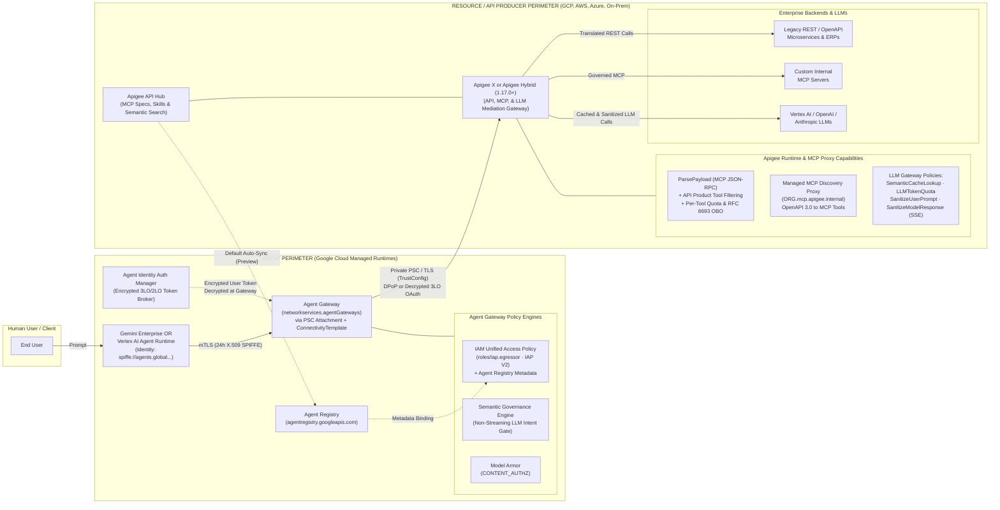

# Gemini Enterprise Agent Gateway vs. Apigee: Comparison & Dual-Gateway Integration

<div class="subnav">
  <a href="README.md">Apigee AI Gateway</a>
  <span class="current">Compare &amp; Combine: Agent Gateway</span>
  <a href="agent-gateway-architecture.md">Agent Gateway Deep Dive</a>
</div>

> **Comparison & Integration Guide (`Last Verified: November 6, 2026`):** Evidence-backed comparison and combined integration architecture for **Gemini Enterprise Agent Platform: Agent Gateway** (`networkservices.googleapis.com` / `iap.googleapis.com`) and **Apigee as an AI, LLM, MCP, and A2A Gateway** (`Apigee X` and `Apigee Hybrid`), validated against live `docs.cloud.google.com` documentation and release notes through November 5, 2026.

<details>
<summary>🔄 Verification Tags &amp; November 6, 2026 Validation Delta (Click to expand)</summary>
<div markdown="1">

* **`[VERIFIED]`:** Confirmed directly against live official documentation (`HTTP 200`) or empirical product behavior cited inline.
* **`[ASSUMPTION / INFERENCE]`:** Architectural synthesis or multi-product pattern deduced from verified component behaviors where no single end-to-end doc page states the combined claim verbatim.
* **`[CAVEAT / UNVERIFIED]`:** Documented operational boundary or Preview / Early Preview capability that is actively evolving; always consult the linked official release notes for the latest General Availability status.

**Key Updates Included in This Analysis (Through November 5, 2026):**
1. **Private CA & Self-Signed TLS on Agent Gateway:** Supported for VPC destinations via `AgentConnectivityTemplate` + Certificate Manager `TrustConfig`, provided `additionalRoots: PUBLICLY_TRUSTED_ROOTS` is configured ([Agent Gateway Deep Dive](agent-gateway-architecture.md#private-cas--self-signed-certificates-via-trustconfig-verified-correction)).
2. **Expanded Agent Gateway Deployment Models (`1 GA`, `3 Early Preview`):** Google-Managed Agent Gateway remains GA; Self-Managed GKE, Cloud Run, and Cross-Cloud Envoy are Early Preview ([Deployment Models](agent-gateway-architecture.md#3-official-agent-gateway-deployment-models-1-ga-vs-3-early-preview-verified--caveat)).
3. **VPC-SC & Multi-Model Semantic Governance:** VPC-SC support launched in Preview (Sept 25, 2026), evaluating 7 model families with custom `denialMessage` overrides, while retaining a non-streaming requirement ([Semantic Governance](agent-gateway-architecture.md#5-service-extensions-model-armor--semantic-governance)).
4. **Model Armor Streaming & Hybrid Platform Boundaries:** Apigee `<SanitizeModelResponse>` supports `<ContinuousScan>true</ContinuousScan>` over SSE streams (Apigee Hybrid `v1.17.3`, Oct 29, 2026), whereas Hybrid native Model Armor policies are supported only on GCP clusters ([Apigee AI Gateway](README.md#24-prompt-tool--streaming-sse-guardrails-model-armor--cloud-dlp)).
5. **Stateless MCP (`2026-07-28`), Basepath Independence & Default API Hub Sync:** Apigee X serves Stateless (`2026-07-28`) + Stateful MCP concurrently (`Hybrid 1.17.0+` is stateful-only), recognizes `<ProxyOperationMode>MCP</ProxyOperationMode>` on any basepath (Nov 3, 2026), and auto-syncs API Hub MCP tools to Agent Registry by default in Preview ([Apigee MCP Patterns](README.md#pattern-1-rest-to-mcp-wrapper-proxy-rest--openapi-to-mcp)).
6. **Expanded Multi-LLM Routing, 3P SaaS MCP Egress, Semantic Tool Discovery & A2A:** Validated 7 AI traffic direction modes on Apigee including PT-to-PayGo spillover (`LiteLLM` consolidation), `RFC 8693` / KVM SaaS MCP egress, Search-then-Invoke discovery, and cross-cloud/in-cluster `A2A` mediation ([Apigee AI Gateway](README.md)).
7. **Three Official Dual-Gateway Integration Topologies:** Private Southbound PSC Bridge, North-South External/Multi-Cloud Fronting, and Inline `Apigee Extension Processor` (`CONTENT_AUTHZ`) ([Section 6](#6-three-official-dual-gateway-topologies)).

</div>
</details>

<div class="toc-box" markdown="1">

**On This Page (Jump to Section)**

* [1. Executive Summary & Core Mental Model](#1-executive-summary--core-mental-model)
* [2. Visual End-to-End Architecture](#2-visual-end-to-end-architecture)
* [3. Side-by-Side Comparison Matrix (`At-a-Glance` + Expandable `A`–`C`)](#3-side-by-side-comparison-matrix)
* [4. Decision Framework & Requirements Quick Selector (`R1`–`R13`)](#4-decision-framework--requirements-quick-selector-r1r13)
* [5. Concrete Wire Scenarios (`A`–`F`)](#5-concrete-wire-scenarios-af)
* [6. Three Official Dual-Gateway Topologies](#6-three-official-dual-gateway-topologies)
  * [Topology 1: Southbound Private PSC Bridge](#topology-1-southbound-private-psc-bridge-agent-runtime---agent-gateway---apigee-x)
  * [Topology 2: North-South External Fronting](#topology-2-north-south-external-partner--non-wif-ingress-fronting-external-client---apigee---agent-gateway--runtime-assumption--inference)
  * [Topology 3: Inline `Apigee Extension Processor` (`ext_proc`)](#topology-3-official-inline-authorization-extension-agent-gateway---apigee-extension-processor-verified)
* [7. Security Partners (`agw-partners`), Confused-Deputy Prevention & FinOps](#7-security-partners-agw-partners-confused-deputy-prevention--finops)
* [8. Production Readiness Checklist, BYOC Root CA & Anti-Sprawl Org Policies](#8-production-readiness-checklist-byoc-root-ca-injection--anti-sprawl-org-policies)

**Related Pages in `/ai-gateway/`**

* [Apigee as an Enterprise AI, LLM, MCP & A2A Gateway (Main Guide) ->](README.md)
* [Agent Gateway Architecture Deep Dive (`SPIFFE`, `egressViaIAP`, `TrustConfig`, Semantic Governance) ->](agent-gateway-architecture.md)

</div>

---

## 1. Executive Summary & Core Mental Model

Both **Agent Gateway** and **Apigee (as an AI / MCP Gateway)** inspect **Model Context Protocol (MCP)** JSON-RPC 2.0 traffic (`tools/list`, `tools/call`) and integrate with **Model Armor**. However, they sit on **opposite sides of the network architecture** and solve **different architectural layers**:

* **Agent Gateway (`Gemini Enterprise Agent Platform`) — _Agent-Side Network & Identity Perimeter_:**
  Attaches directly to the VPC network interface of an agent running in **Vertex AI Agent Runtime** or **Gemini Enterprise** (GA) via a PSC Network Attachment and `AgentConnectivityTemplate`. Answers *"Who is this agent cryptographically (`spiffe://...`), which destinations may it call, how do we inject user OAuth tokens without exposing secrets to agent code, and does a proposed tool call match the user's prompt?"* ([Full Agent Gateway Deep Dive ->](agent-gateway-architecture.md)).
* **Apigee (`Apigee X` & `Apigee Hybrid`) — _Full-Spectrum AI, LLM, MCP, & A2A Mediation Gateway_:**
  Sits across model endpoints, REST/MCP backends, outbound 3P SaaS MCP destinations, cross-cloud/east-west A2A links, and inline `CONTENT_AUTHZ` callouts. Answers *"How do we unify Multi-LLM routing/PT spillover (replacing `LiteLLM`), semantic vector caching, `<LLMTokenQuota>`, Cloud DLP `FPE`, continuous SSE Model Armor, REST-to-MCP conversion, dynamic `tools/list` filtering, per-tool `<Quota>`, `RFC 8693` OBO/KVM SaaS egress, and Search-then-Invoke discovery for any client or cloud?"* ([Full Apigee AI Gateway Guide ->](README.md)).

<details>
<summary>🏢 Real-World Analogy: Corporate Laptop VPN vs. Enterprise Central Switchboard</summary>
<div markdown="1">

Think of an AI Agent as a **corporate employee on a company-issued laptop**, and your enterprise backends, SaaS tools, and foundation models as **bank vaults, partner exchanges, and shared AI compute utilities**:

* **Agent Gateway is the Secure Corporate Laptop VPN, Zero-Trust Egress Firewall, and Password Manager (1Password) attached to the employee's laptop:**
  * Issues the employee's cryptographic corporate badge (`Agent Identity` SPIFFE cert).
  * Controls which sites and MCP servers the laptop may reach (`Agent-to-Anywhere` IAM Unified Access Policies).
  * Auto-fills user OAuth tokens at the network edge so agent code never sees raw secrets (`Agent Identity Auth Manager`).
  * Watches for indirect prompt injection and blocks a compromised transfer if the boss only asked to check the calendar (`Semantic Governance Policy Engine`).
* **Apigee is the Central Switchboard, Protocol Translator, Multi-Model Traffic Controller, and Vault Gatekeeper for All AI Workloads:**
  * Serves *every* caller (Gemini Enterprise agents, VS Code / Cursor / Claude Desktop, mobile apps, B2B partners, and AWS/Azure agents).
  * Balances **LLM calls** across Vertex AI Provisioned Throughput, PayGo, Azure OpenAI, and Anthropic with automatic `429` failover, schema normalization, `<LLMTokenQuota>` FinOps caps, Cloud DLP tokenization, SSE Model Armor scanning, and `<SemanticCacheLookup>` vector caching.
  * For **MCP and A2A calls**, converts REST to MCP, brokers `RFC 8693` or KVM credentials so raw SaaS keys stay off laptops, serves entitlement-filtered semantic tool discovery, strips unauthorized tools from `tools/list`, and enforces per-tool `<Quota>` limits.

</div>
</details>

---

## 2. Visual End-to-End Architecture



---

## 3. Side-by-Side Comparison Matrix

### At-a-Glance Comparison

| Capability Axis | Gemini Enterprise Agent Gateway | Apigee AI & MCP Gateway (`X` / `Hybrid`) |
| :--- | :--- | :--- |
| **Primary Role** | **Agent-Side Network & Identity Perimeter** (agent egress forward proxy + `Agent Runtime` ingress) | **Full-Spectrum AI, LLM, MCP & A2A Mediation Gateway** (multi-LLM router, MCP hub, A2A mediator, `ext_proc`) |
| **Caller & Runtime Reach** | **GA:** `Agent Runtime` (`Ingress + Egress`) & `Gemini Enterprise` (`Egress ONLY`)<br>**Early Preview:** GKE, Cloud Run, Cross-Cloud Envoy | **GA Everywhere:** Any IDE (`VS Code`, `Cursor`, `Claude`), non-ADK agents (`LangGraph`, `Bedrock`), consumer/B2B apps, and Kubernetes clusters |
| **Identity & Token Model** | Managed `SPIFFE` (`24h` X.509 mTLS + `DPoP`) + **Auth Manager** (3LO token decrypted at gateway edge) | OAuth/OIDC/JWT (`<VerifyJWT>`), mTLS, **RFC 8693 OBO** (`sub`+`act`), **RFC 9728** discovery, Encrypted KVM / Secret Manager |
| **REST-to-MCP Translation** | **No** (passthrough proxy only) | **Yes:** Managed MCP Discovery Proxy (`Stateless 2026-07-28` + Stateful on X; Stateful on `Hybrid 1.17.0+`) & `apigee-go-gen` |
| **Authorization & Tool Filtering** | IAM UAP (`roles/iap.egressor`, `ALLOW`/`DENY`/`DRY_RUN` + CEL on MCP hints) & `authzPolicies` (`max 4` on egress) | `API Products` + `<ParsePayload>` (automatic **`tools/list` response filtering**), per-tool `<Quota>`, & gRPC **OPA** `<ExternalCallout>` |
| **AI Prompt Intent vs. Guardrails** | **Semantic Governance** multi-turn LLM intent gate across 7 model families *(unary only; skips streams)* + **Model Armor** *(skips SSE/MCP streams, `>65k` tokens)* | **No** multi-turn NLC intent gate; **Yes** to **SSE Streaming Model Armor** (`<ContinuousScan>true</ContinuousScan>`), `<FunctionResponseSource>`, **Cloud DLP `FPE`**, & 3P AI firewalls |
| **Multi-LLM Routing, Caching & FinOps** | **No** routing/spillover, semantic caching, or gateway token quotas *(passive 1s observability logging GA)* | **Yes (`LiteLLM` replacement):** PT-to-PayGo spillover, `429` failover, schema normalization, `<SemanticCacheLookup>`, `<LLMTokenQuota>`, `<PromptTokenLimit>` |
| **Hybrid / Multi-Cloud & PKI** | GA SaaS on GCP + `TrustConfig` private CAs (`additionalRoots: PUBLICLY_TRUSTED_ROOTS` required; manual PEM rotation) | **Production GA (`Hybrid 1.17.0+`):** Full `apigee-runtime` & `apigee-mcp-server` on **EKS, AKS, OpenShift, GKE, or on-prem** + full automated mTLS/PKI |

### Detailed Technical Comparison (Expandable by Domain)

<details>
<summary>📋 Matrix A: Platform Scope, APIs, Runtimes, Hybrid Execution &amp; Catalog Sync</summary>
<div markdown="1">

| Dimension | Gemini Enterprise Agent Platform: Agent Gateway | Apigee as an AI / MCP Gateway (`Apigee X` & `Apigee Hybrid`) |
| :--- | :--- | :--- |
| **Primary Architectural Role** | **Agent-Side Network & Identity Perimeter** (principally an outbound/egress forward proxy attached to an agent's runtime, plus ingress for `Agent Runtime`). | **Full-Spectrum AI, LLM, MCP, & A2A Mediation Gateway** (multi-LLM router & failover hub, inbound/outbound MCP & REST-to-MCP gateway, cross-cloud/east-west A2A mediator, semantic tool discovery front door, and inline `ext_proc` extension). |
| **Underlying GCP Service & APIs** | `networkservices.googleapis.com` (`agentGateways`, `agentConnectivityTemplates`, `authzExtensions`), `networksecurity.googleapis.com` (`authzPolicies`), `compute.googleapis.com` (`networkAttachments`), `certificatemanager.googleapis.com` (`trustConfigs`), `iap.googleapis.com`, `agentregistry.googleapis.com`. | `apigee.googleapis.com`, `apihub.googleapis.com` (Apigee API Hub with `MCP` API style, Agent Registry sync, signed skills registry, and Semantic Search), plus Apigee Message Processors (`apigee-runtime`) and `apigee-mcp-server`. |
| **Traffic Direction Modes** | 1. **`Agent-to-Anywhere` (Egress):** Agent calling outbound MCP servers, other agents (`A2A`), LLMs, or HTTP endpoints.<br>2. **`Client-to-Agent` (Ingress):** Clients calling `query` / `streamQuery` on `Agent Runtime` *(Note: `"Anywhere-to-MCP"` is not an official mode name)*. | **7 AI Traffic Modes:**<br>1. **North-South External Consumer / Partner -> Enterprise MCP or Agent** (edge WAF + OIDC -> inline `RFC 8693` replacing custom BFF code).<br>2. **Internal App / Developer IDE (`VS Code`, `Cursor`, `Claude`) -> Internal & REST-Backed MCP.**<br>3. **Outbound Egress Proxy: Agent / IDE -> External 3P SaaS MCP** (`RFC 8693`, Encrypted KVM key swap, or `RFC 9728` OAuth pass-through).<br>4. **Search-then-Invoke Semantic Tool Discovery (`/mcp/discover` -> API Hub + Vertex AI Search).**<br>5. **Cross-Cloud & In-Cluster East-West `A2A` / Agentic Workflow Mediation** (`/.well-known/agent.json` + JSON-RPC/SSE).<br>6. **Enterprise Multi-LLM & Multimodal Gateway** (PT/PayGo spillover, failover, schema normalization, DLP, caching).<br>7. **Inline `CONTENT_AUTHZ` Extension** (`Apigee Extension Processor` on Cloud Service Mesh or Agent Gateway). |
| **Supported Agent Runtimes & Deployment Models** | • **Google-Managed (GA):** `Agent Runtime` (`Agent-to-Anywhere` + `Client-to-Agent`; supports ADK/supported Python frameworks) and `Gemini Enterprise` (**`Agent-to-Anywhere` ONLY**; ingress unsupported).<br>• **Self-Managed Early Preview (`[CAVEAT]`):** Non-ADK agents (`Claude Agent SDK`, `LangGraph`) run on GKE or Cloud Run and can register in Agent Registry / bind to Early Preview GKE (ambient + SWP), Cloud Run (RXLB/RILB + SWP), or Cross-Cloud Envoy gateways. | **Runtime- & Framework-Agnostic (GA):** Works in production GA today with **any** agent framework, IDE, or HTTP/MCP/A2A client anywhere (Gemini Enterprise, Vertex AI, non-ADK Claude Agent SDK / LangGraph on GKE or Cloud Run, Cursor, Claude Desktop, AWS Bedrock, Azure OpenAI, mobile/partner apps). |
| **Hybrid & Multi-Cloud Execution** | **Google-Managed SaaS Only for GA:** Runs on Google Cloud's managed Envoy data plane in the same region as the agent *(Self-Managed GKE, Cloud Run, and Cross-Cloud Envoy for EKS/AKS/on-prem are in **Early Preview**)*. | **Production GA Anywhere (`Apigee Hybrid 1.17.0+`):** Runs the full API runtime (`apigee-runtime`) and Managed MCP Server (`apigee-mcp-server`) inside customer GKE, AWS EKS, Azure AKS, Red Hat OpenShift, or on-prem clusters. Request traffic never leaves the cluster. |
| **Catalog, Skills & Discovery Sync** | **Agent Registry (`agentregistry.googleapis.com`):** Discovers `Agent Runtime` agents, Cloud Run MCP servers, and API Hub MCP servers; allows custom endpoint registration (up to 5,000 resources per gateway). Gemini Enterprise apps bind to a single regional registry (`us-central1` for `global`/`us`, `europe-west1` for `eu`). | **Apigee API Hub (`apihub.googleapis.com`) & Developer Portal:** Catalogs REST APIs, OpenAPI specs, MCP servers (`MCP` style), and Ed25519-signed agentic `.skill` bundles (`distribute-agentic-skills`), with `/semanticSearch`. **Automatically syncs MCP tools/servers to Agent Registry by default (Preview)**. |

</div>
</details>

<details>
<summary>🔐 Matrix B: Identity, Credential Vaults, REST-to-MCP Translation &amp; Tool Authorization</summary>
<div markdown="1">

| Dimension | Gemini Enterprise Agent Platform: Agent Gateway | Apigee as an AI / MCP Gateway (`Apigee X` & `Apigee Hybrid`) |
| :--- | :--- | :--- |
| **Cryptographic Identity Model** | **Google-Managed Agent Identity (SPIFFE):**<br>`spiffe://agents.global.org-<ORG_ID>.system.id.goog/resources/<service>/<path>`<br>Uses auto-rotated 24-hour X.509 certificates, **mTLS** to the gateway, and **DPoP** (Demonstrating Proof of Possession) beyond the gateway. Requires `identity_type="AGENT_IDENTITY"` at agent creation time. | **Consumer App, Human OBO & Enterprise Identity:**<br>Validates incoming OAuth 2.0 / OIDC JWTs (`<VerifyJWT>`, `<OAuthV2>`), API Keys (`<VerifyAPIKey>`), mTLS client certs, SAML, executes **RFC 8693 OAuth 2.0 Token Exchange (OBO)**, and serves **RFC 9728** `.well-known/oauth-protected-resource` metadata. |
| **Outbound Credential Vault / Broker** | **Agent Identity Auth Manager:** Stores 3LO (user-delegated OAuth) and 2LO/API Key credentials. For Gemini Enterprise + Agent Gateway, user credentials are encrypted by Auth Manager and decrypted at the gateway so the agent never sees the raw token. | **Apigee Encrypted KVM, Secret Manager & OAuth Mediation:** Stores backend secrets in encrypted Key Value Maps (KVMs) or Secret Manager and exchanges/injects backend tokens via `<OAuthV2>`, `<AssignMessage>`, and `<ServiceCallout>`. |
| **REST-to-MCP Protocol Translation & MCP Versions** | **No Protocol Translation.** Strictly a passthrough proxy for HTTP, MCP, and A2A traffic; cannot convert a REST API into an MCP tool. | **Yes (Core Capability):**<br>1. **Managed Apigee MCP Discovery Proxy** (`<ORG>.mcp.apigee.internal`) + API Hub exposes OpenAPI 3.0.x specs as MCP tools. Supports **Stateless (`2026-07-28`) + Stateful (`2025-11-25`..`2024-11-05`)** concurrently on Apigee X, and **Stateful MCP** on Hybrid `1.17.0+`. Recognizes `<ProxyOperationMode>MCP</ProxyOperationMode>` on any basepath (`1-18-0-apigee-8`).<br>2. **`apigee-go-gen`** statically compiles OpenAPI specs into MCP proxy bundles. |
| **Deterministic Authorization Engine** | 1. **IAM Unified Access Policies (IAM v3 + IAP V2):** `iap.googleapis.com/resources.egressViaIAP` (role `roles/iap.egressor`, mandatory `iapPolicyVersion: "V2"`) with CEL on `destination.agent_registry.*` or `destination.unregistered.*`, Allow + Deny rules, and `DRY_RUN` mode.<br>2. **Network Security `authzPolicies`:** Native `httpRules.to.operations.mcp` matching (`tools/list`, `tools/call`). | 1. **API Products + `<ParsePayload>`:** Extracts `parsepayload.<name>.operation` (e.g., `tools/call/get_stock_price`) and enforces entitlement per Developer App.<br>2. **External Callout (`<ExternalCallout>`):** gRPC callout to Open Policy Agent (OPA) or custom engines for fine-grained JSON-RPC argument RBAC/ABAC. |
| **MCP Tool Annotation Awareness** | **Yes:** IAM Unified Access Policies evaluate CEL rules against MCP tool annotations (`read_only_hint`, `destructive_hint`, `idempotent_hint`, `open_world_hint`) registered in Agent Registry. | **Via Custom Policy / OPA:** Inspects arbitrary JSON-RPC payloads, OpenAPI metadata, or headers via JavaScript/Python/Java callouts or OPA `<ExternalCallout>`, though not natively bound to Agent Registry annotations. |
| **Dynamic `tools/list` Response Filtering** | **No:** Allows or denies `tools/list` or specific `tools/call` methods, but does not rewrite/filter the JSON array inside a `tools/list` response payload per consumer tier. | **Yes (Native):** When `<ParsePayload>` is paired with an API Product in Request and Response flows, Apigee automatically strips unauthorized tools from `tools/list` responses per consumer app. |

</div>
</details>

<details>
<summary>🛡️ Matrix C: Guardrails, Multi-LLM Routing, Semantic Caching, Quotas, TLS &amp; Scale Limits</summary>
<div markdown="1">

| Dimension | Gemini Enterprise Agent Platform: Agent Gateway | Apigee as an AI / MCP Gateway (`Apigee X` & `Apigee Hybrid`) |
| :--- | :--- | :--- |
| **Per-Tool Rate Limiting & LLM Token Quotas** | **No:** Does not provide per-MCP-tool rate limiting or token quota enforcement at the gateway *(GEAP added GA `Inference request metadata logging` via `x-goog-agent-platform-observability-label-` headers on Oct 30, 2026 for passive cost attribution)*. | **Yes (Native):** API Products + `<Quota>` enforce independent rate limits per MCP tool (`tools/call/<tool_name>`), while **`<LLMTokenQuota>`** (`EnforceOnly`/`CountOnly`, SSE `<EventFlow>`, excluding `<SemanticCacheLookup>` hits as of Nov 3, 2026) and **`<PromptTokenLimit>`** enforce real-time token budgets. |
| **LLM-Based "Intent Gate" (Prompt vs. Action Alignment)** | **Yes, Semantic Governance Policies (Preview):** Evaluates **Natural Language Constraints (NLC)** + user intent across **7 model families** (Gemini, Anthropic, Claude on GEAP, OpenAI, Mistral, Llama, vLLM), with VPC-SC Preview support (Sept 25, 2026) and custom `denialMessage` overrides. **Does NOT support streamed model responses (`:streamGenerateContent`, `"stream": true`)**. | **No Native Multi-Turn Intent Gate:** Apigee provides `<SanitizeUserPrompt>` (`<FunctionResponseSource>`) and `<SanitizeModelResponse>` (`<FunctionCallSource>` + `<ContinuousScan>true</ContinuousScan>` SSE streaming), plus 3P AI firewalls, but does not run a native NLC LLM engine over multi-turn chat history. |
| **Model Armor Coverage & Streaming Nuances** | • **Ingress:** Sanitizes **only `reasoningEngines.streamQuery` for ADK agents** (`asyncQuery` and non-ADK frameworks pass unsanitized).<br>• **Egress:** Sanitizes non-streaming OpenAI, MCP `tools/call` + `prompts/get`, and A2A `SendMessage`; **skips MCP `tools/list`, `resources/*`, MCP Streamable HTTP/SSE, and A2A streaming**. Payloads exceeding `65,536` tokens (`130,000` SDP; `4 MB`) return `EXECUTION_SKIPPED` and **pass through**. | • **Unary & SSE Streaming:** `<SanitizeModelResponse>` supports `<ContinuousScan>true</ContinuousScan>` inside SSE `<EventFlow>`s across Gemini, OpenAI, and Anthropic (Apigee X & Hybrid `v1.17.3+`), counting the entire stream as **1** Model Armor request with **no total response token limit** (SDP redacted text is not rewritten in streaming mode).<br>• **Hybrid Platform Caveat:** Native Model Armor policies in Apigee Hybrid are **supported only on GCP clusters** (use `<ServiceCallout>` REST API or 3P AI firewalls on EKS/AKS/on-prem). |
| **LLM Semantic Caching** | **No.** | **Yes (Native):** `<SemanticCacheLookup>` and `<SemanticCachePopulate>` generate embeddings via Vertex AI Embeddings API and query Vertex AI Vector Search (`DOT_PRODUCT_DISTANCE`, `COSINE_DISTANCE`, `SQUARED_L2_DISTANCE`, `L1_DISTANCE` over REST or PSC gRPC). |
| **Multi-LLM Routing, PT Spillover & Schema Normalization** | **No:** Passes LLM calls through to the target URL without multi-provider load balancing, `HTTP 429` Provisioned Throughput (`PT`)-to-PayGo spillover, circuit breaking, or request/response schema translation across model families. | **Yes (Replaces Custom `LiteLLM` Servers):** Conditional `RouteRules`, weighted `TargetServers`, `<GoogleAuthentication>`, and cache-backed circuit breakers route across **Vertex AI Gemini (PT -> PayGo spillover), Azure OpenAI, OpenAI, Anthropic, and AWS Bedrock** with automatic `429`/`5xx` failover and canonical OpenAI-compatible schema translation. |
| **Agent-to-Agent (`A2A`), Semantic Tool Discovery & Multimodal Payloads** | • Governs outbound/inbound `A2A` (`SendMessage` unary Model Armor; skips `SendStreamingMessage` & gRPC).<br>• No vector-ranked semantic tool discovery or Claim-Check payload mediation. | • Mediates cross-cloud & in-cluster `A2A` (`/.well-known/agent.json` caching, JSON-RPC/SSE tasks, runaway-agent circuit breakers).<br>• **Search-then-Invoke** semantic tool discovery over API Hub + Vertex AI Search prevents 50+ tool context bloat.<br>• **Cloud DLP** `FPE` tokenization + Pre-Signed URL **Claim-Check** / SSE streaming for multimodal payloads. |
| **TLS Certificate Support for Backends** | **Public CAs by Default + Private CA via `TrustConfig`:** Supports private CAs and allowlisted self-signed certs for VPC targets via `AgentConnectivityTemplate` + Certificate Manager `TrustConfig` (`tlsConfig`), **requiring `additionalRoots: PUBLICLY_TRUSTED_ROOTS`** if calling `*.googleapis.com`, manual PEM rotation, and template replacement on updates *(custom FQDN `authzExtensions` do not validate server certs)*. | **Full Enterprise PKI & Two-Way mTLS Control:** Supports custom private CA truststores, keystores, self-signed backend certs, two-way mTLS `TargetServer` definitions, SNI overrides, and automated rotation without recreating gateway bindings. |
| **Scale, Quotas & VPC-SC** | • Max **5,000** registered resources per gateway; max **4** `authzPolicies` on egress (requires multi-gateway sharding across business units); max **1** `CONTENT_AUTHZ` policy on ingress; `1,500`-byte MTU.<br>• **VPC-SC supported** for gateways created **after Sept 8, 2026** with `vpcEgress: ALL_TRAFFIC` + private DNS to `restricted.googleapis.com` (`199.36.153.4/30`). | • Up to **1,000** MCP tools per org in Apigee X (SaaS) via Managed MCP Proxy.<br>• Up to **~10,000** MCP tools per org in Apigee Hybrid `1.17.0+` (bounded by `3 MiB` OAS, `50 MiB` bundle, `10 MiB` default / `30 MiB` max `tools/list`, and `100` hostnames/envgroup), with **no 4-policy cap** across API Products or `Apigee Extension Processor`. Full **VPC-SC** support on Apigee X. |

</div>
</details>

---

## 4. Decision Framework & Requirements Quick Selector (`R1`–`R13`)

### Choose **Agent Gateway** When:
1. You deploy agents on **Vertex AI Agent Runtime** or **Gemini Enterprise** (or evaluate Early Preview GKE / Cloud Run / Cross-Cloud models) and need **cryptographic workload identity (`spiffe://...`)** with 24-hour auto-rotated X.509 certificates, mTLS, and DPoP.
2. You need **agent-centric outbound egress control (`Agent-to-Anywhere`)** using **IAM Unified Access Policies** (`egressViaIAP`, `roles/iap.egressor`) and **Agent Registry** metadata (`read_only_hint == true`).
3. You want **Semantic Governance Policies (LLM Intent Gate)** on non-streaming LLM calls to defeat indirect prompt injection against the user's prompt and natural-language business rules.
4. You want **zero-trust 3LO credential injection** via **Agent Identity Auth Manager**, where user tokens remain encrypted until decrypted at the gateway edge.

### Choose **Apigee** When:
1. You need an **Enterprise Multi-LLM & Multimodal Gateway** across Vertex AI Gemini, Azure OpenAI, OpenAI, Anthropic, and Bedrock (retiring custom `LiteLLM` proxies) with **PT-to-PayGo spillover**, `429`/`5xx` failover, schema normalization, **`<LLMTokenQuota>` / `<PromptTokenLimit>`**, **`<SemanticCacheLookup>`**, **Cloud DLP `FPE`**, streaming SSE **`<SanitizeModelResponse>`**, and Claim-Check handling.
2. You want to **convert REST / OpenAPI 3.0 services into MCP tools** (`Managed MCP Discovery Proxy` or `apigee-go-gen`), **package tools into `API Products`** with dynamic `tools/list` filtering and per-tool `<Quota>`, or add **Search-then-Invoke** semantic discovery over 50–1,000+ tools.
3. Callers include **developer IDEs (`VS Code`, `Cursor`, `Claude Desktop`), consumer/partner apps, non-ADK agents (`Claude Agent SDK`, `LangGraph`), or multi-cloud agents**, or you need **outbound 3P SaaS MCP egress** (`RFC 8693` OBO, Encrypted KVM key swap, `RFC 9728`) and **cross-cloud / east-west `A2A` mediation**.
4. You require **production GA hybrid/multi-cloud execution** (`Apigee Hybrid 1.17.0+` inside GKE, EKS, AKS, OpenShift, or on-prem), full automated PKI/two-way mTLS rotation, or inline **`Apigee Extension Processor`** without the 4-`authzPolicies` egress cap.

### The Enterprise "Better Together" Reference Pattern
In a mature Google Cloud architecture, **Agent Gateway and Apigee are complementary layers**:
* **Agent Gateway (Agent Perimeter):** Governs the Google-hosted agent's `spiffe://` identity, outbound destinations (`egressViaIAP`), zero-trust 3LO decryption, and non-streaming Semantic Governance intent alignment.
* **Apigee (Resource, LLM & Cross-Cloud Perimeter):** Receives traffic from Agent Gateway, developer IDEs, and external/multi-cloud agents; manages API Products, dynamic `tools/list` filtering, per-tool `<Quota>`, REST-to-MCP conversion, `RFC 8693` / KVM mediation, multi-LLM PT spillover, semantic caching, Cloud DLP, and full SSE Model Armor scanning.

### Requirements-by-Requirement Quick Selector (`R1` to `R13`)

| # | Requirement / Driver | Primary Fit | Agent Gateway Role | Apigee + API Hub Role | When Both Are Used | Details |
| :--- | :--- | :--- | :--- | :--- | :--- | :--- |
| **R1** | **Cryptographic Workload Identity (`spiffe://`)**<br>24h X.509 mTLS / DPoP for Vertex AI / GE agents | **Agent Gateway** | Issues/verifies managed `spiffe://` identity (`AGENT_IDENTITY`), 24h cert rotation, mTLS, and DPoP | Validates inbound mTLS/JWT at API edge; does not mint Vertex AI SPIFFE certs | Agent Gateway attaches `spiffe://` cert on egress; Apigee maps identity to an API Product | [Identity](agent-gateway-architecture.md#3-cryptographic-agent-identity-spiffe-mtls-dpop--auth-manager) |
| **R2** | **Indirect Prompt Injection Intent Gate**<br>Block tool call misaligned with multi-turn prompt | **Agent Gateway** | **Semantic Governance (`CONTENT_AUTHZ`, Preview)** across 7 model families *(unary only)* | Sees isolated JSON-RPC tool calls, not full multi-turn chat history | Agent Gateway checks unary intent alignment; Apigee enforces deterministic schema & quotas | [Scenario B](#scenario-b-poisoned-email-prompt-injection-blocking-transfer_funds) |
| **R3** | **Zero-Trust 3LO Token Injection**<br>Encrypt user token inside runtime, decrypt at edge | **Agent Gateway** | Auth Manager encrypts 3LO token; Agent Gateway decrypts and injects `Bearer` at egress | Receives decrypted token (or exchanges via RFC 8693) for backend execution | Agent Gateway hides raw token from agent code; Apigee validates JWKS or mediates backend scope | [Scenario D](#scenario-d-zero-trust-3lo-user-token-injection-without-exposing-secrets) |
| **R4** | **RFC 8693 OBO & 3P SaaS Credential Swap**<br>Corporate JWT -> OBO (`sub`+`act`) or KVM key swap | **Apigee + API Hub** | Supports Google Auth Manager 3LO for GEAP, not custom RFC 8693/KVM mediation | Native `<OAuthV2>`/`<ServiceCallout>` RFC 8693 OBO and **Encrypted KVM** key swap | Agent Gateway passes GEAP agent/user context; Apigee brokers scoped SaaS tokens | [SaaS Egress](README.md#pattern-3-outbound-third-party-saas-mcp-server-egress-proxy-agent--ide-to-external-saas-mcp) |
| **R5** | **Convert Legacy REST / OpenAPI to MCP**<br>Expose existing REST APIs without custom code | **Apigee + API Hub** | **Not supported** (passthrough proxy only) | **Managed MCP Discovery Proxy** (`Stateless 2026-07-28` + Stateful on X; Stateful on Hybrid) & `apigee-go-gen` | Apigee converts REST to MCP + syncs to Agent Registry; Agent Gateway governs GEAP egress over PSC | [Scenario A](#scenario-a-200-legacy-rest-apis-exposed-as-mcp-tools) |
| **R6** | **Tiered MCP `tools/list` Filtering & Quotas**<br>Tier-1 sees 5 tools @ `300/min`; Tier-2 sees 25 @ `10/min` | **Apigee + API Hub** | Binary IAM allow/deny + annotation CEL; no API Products, payload filtering, or `<Quota>` | `<ParsePayload>` + **API Products** strip unauthorized tools in `tools/list` & enforce per-tool `<Quota>` | Agent Gateway controls which agents reach MCP; Apigee tailors `tools/list` & throttles each tool | [Scenario C](#scenario-c-tiered-toolslist-filtering--per-tool-quotas-on-one-mcp-server) |
| **R7** | **External, IDE & Multi-Cloud Clients**<br>Cursor, Claude Desktop, AWS Bedrock, LangGraph | **Apigee + API Hub** | GA governs GEAP runtimes only (`Client-to-Agent` excludes Gemini Enterprise) | Universal client-agnostic perimeter with `RFC 9728` discovery & custom IdPs | Agent Gateway governs GEAP agents; Apigee fronts all IDE, partner, and non-Google callers | [Topology 2](#topology-2-north-south-external-partner--non-wif-ingress-fronting-external-client---apigee---agent-gateway--runtime-assumption--inference) |
| **R8** | **GA Hybrid & Multi-Cloud Execution**<br>Run gateway inside AWS EKS, Azure AKS, OpenShift | **Apigee (`Hybrid`)** | GA is Google-managed SaaS (`GKE`/`Cloud Run`/`Cross-Cloud` in Early Preview) | **Production GA (`Hybrid 1.17.0+`)** runs `apigee-runtime` & `apigee-mcp-server` locally in-cluster | Apigee Hybrid stays local inside private clusters; Agent Gateway governs GCP-hosted GEAP agents | [Hybrid Guide](README.md#5-apigee-hybrid-1170-multi-cloud-execution-hard-limits--network-hardening) |
| **R9** | **Prompt, Tool Output & SSE Guardrails**<br>Unary + streaming SSE sanitization & Cloud DLP | **Both (Defense)** | Model Armor or 15 ISVs (`agw-partners`) *(skips SSE/MCP streams & `>65k` tokens)* | `<SanitizeUserPrompt>`, **SSE `<ContinuousScan>true</ContinuousScan>`**, Cloud DLP `FPE` *(GCP-only Hybrid Model Armor)* | Agent Gateway guards agent brain on unary calls; Apigee scans full SSE streams & tokenizes PII | [Guardrails](README.md#24-prompt-tool--streaming-sse-guardrails-model-armor--cloud-dlp) |
| **R10** | **Semantic Caching & Token FinOps Caps**<br>Vector response cache & `<LLMTokenQuota>` budgets | **Apigee + API Hub** | No semantic cache or gateway token quotas *(passive 1s observability logging GA)* | `<SemanticCacheLookup>`, `<LLMTokenQuota>` (cache hits excluded), & `<PromptTokenLimit>` | Agent Gateway routes egress; Apigee serves cached hits, caps tokens & pairs with GEAP/BQAA telemetry | [FinOps](#honest-agentic-finops-llmtokenquota-vs-geap-metadata-logging-vs-adk-bqaa) |
| **R11** | **Catalog, Skills & Discovery Sync**<br>Unified registry of APIs, MCP tools, `.skill`s, agents | **Both (Federated)** | **Agent Registry** tracks live agents, endpoints, skills & MCP servers (`5,000`/gw) | **API Hub** catalogs OAS/MCP specs, signed `.skill` archives & Developer Portals (**auto-syncs to Agent Registry**) | API Hub is producer source of truth; syncs MCP specs automatically to Agent Registry for UAP binding | [API Hub Sync](README.md#pattern-1-rest-to-mcp-wrapper-proxy-rest--openapi-to-mcp) |
| **R12** | **Multi-LLM Routing, PT Spillover & Schema Norm**<br>Vertex PT->PayGo, Azure, OpenAI, Anthropic, Bedrock | **Apigee + API Hub** | **Not supported** (single-target passthrough; no failover or schema translation) | Conditional `RouteRules`, weighted `TargetServers`, PT `429`/`5xx` spillover, `<GoogleAuthentication>`, schema normalization (`LiteLLM` replacement) | Agent Gateway governs agent egress identity/intent; Apigee acts as enterprise Multi-LLM router | [Scenario E](#scenario-e-replacing-custom-litellm-proxies-with-an-enterprise-llm-gateway) |
| **R13** | **3P SaaS MCP Egress, A2A & Semantic Discovery**<br>IDE SaaS MCP, cross-cloud A2A, Search-then-Invoke `50–1,000+` tools | **Both (By Footprint)** | Governs GEAP outbound MCP & `A2A` (`4` egress policy cap); no vector tool search | 3P SaaS MCP egress (`RFC 8693`/KVM/`RFC 9728`), cross-cloud/east-west `A2A`, & Search-then-Invoke vector discovery | Agent Gateway governs GEAP egress; Apigee handles enterprise-wide SaaS MCP, A2A & semantic tool search | [Scenario F](#scenario-f-developer-ides-3p-saas-mcp-cross-cloud-a2a--300-tools) |

---

## 5. Concrete Wire Scenarios (`A`–`F`)

Expand any scenario below to trace the exact request/response behavior on the wire:

<details>
<summary id="scenario-a-200-legacy-rest-apis-exposed-as-mcp-tools">🔄 Scenario A: 200 Legacy REST APIs Exposed as MCP Tools (Apigee + API Hub)</summary>
<div markdown="1">

*"We have 200 legacy REST APIs (OpenAPI 3.0) and want our AI agents to use them as MCP tools without writing custom MCP servers."*

* **Can Agent Gateway do this?** **No.** Agent Gateway is a passthrough proxy. If your backend only speaks REST (`GET /v1/accounts/{id}`) and your agent speaks MCP (`POST /mcp` with `method: "tools/call"`), Agent Gateway cannot translate between them.
* **How Apigee solves it:** Upload the OpenAPI specs to **Apigee API Hub**, click **Configure MCP tools**, and deploy the **Managed Apigee MCP Discovery Proxy** (`<ORG>.mcp.apigee.internal`). Apigee automatically exposes all 200 REST APIs as standard MCP tools (`tools/list`, `tools/call`), syncs their metadata into **Agent Registry** by default, and translates every MCP JSON-RPC call into the corresponding backend REST request.

</div>
</details>

<details>
<summary id="scenario-b-poisoned-email-prompt-injection-blocking-transfer_funds">🛡️ Scenario B: Poisoned Email Prompt Injection Blocking <code>transfer_funds</code> (Agent Gateway)</summary>
<div markdown="1">

*"An attacker sends our user an email containing a hidden prompt injection. When the user asks their Gemini Enterprise agent to 'Summarize my unread emails', the poisoned email tricks the agent into calling `transfer_funds(amount=5000)` on an MCP server the agent is normally authorized to use."*

* **Can Apigee alone prevent this?** Apigee's `<SanitizeUserPrompt>` (`<FunctionResponseSource>`) can scan tool outputs for known prompt-injection signatures, and Apigee's `<Quota>` can rate-limit `transfer_funds` to 3 calls/minute. However, if the poisoned email evades signature detection and the agent issues a syntactically valid `tools/call` for `transfer_funds(amount=5000)`, Apigee does **not** see the agent's internal multi-turn chat history or original user prompt (`"Summarize my unread emails"`), so to Apigee it looks like a valid, authenticated tool call.
* **How Agent Gateway solves it:** Because **Agent Gateway** is attached to the agent's outbound network interface and runs the **Semantic Governance Policy Engine** (`CONTENT_AUTHZ`), it inspects all 5 runtime inputs together (**Current User Prompt** = *"Summarize my unread emails"*, **Chat History**, **Tools Manifest**, **Natural Language Constraints**, and **Suggested Tool Invocation** = `transfer_funds(5000)`). For **non-streaming** model calls across Gemini, Claude, OpenAI, Mistral, Llama, or vLLM, the Semantic Governance LLM intent gate recognizes that `transfer_funds` has zero alignment with *"Summarize my unread emails"* and blocks the outbound `tools/call` before it leaves the agent's perimeter *(remember: disable LLM streaming or pair with deterministic Apigee controls because `:streamGenerateContent` / `"stream": true` is not evaluated by Semantic Governance today)*.

</div>
</details>

<details>
<summary id="scenario-c-tiered-toolslist-filtering--per-tool-quotas-on-one-mcp-server">🎚️ Scenario C: Tiered <code>tools/list</code> Filtering &amp; Per-Tool Quotas (Apigee <code>&lt;ParsePayload&gt;</code>)</summary>
<div markdown="1">

*"We want to expose a single Financial MCP Server to 50 different internal teams and external partners, where Tier-1 apps only see 5 read-only tools at 300 calls/min, and Tier-2 apps see all 25 tools (including write tools) at 10 calls/min."*

* **Can Agent Gateway do this?** **No.** Agent Gateway has no concept of API Products, developer subscriptions, dynamic `tools/list` payload filtering, or per-tool rate limit quotas.
* **How Apigee solves it:** Place **Apigee** in front of the Financial MCP Server with `<ParsePayload>` (`<Protocol>MCP</Protocol>`), `<VerifyAPIKey>` / `<OAuthV2>`, and `<Quota>`. Create two **API Products** (`Tier-1` and `Tier-2`). When a Tier-1 client calls `tools/list`, Apigee dynamically strips the 20 write tools from the JSON response and enforces the `300 calls/min` quota on the 5 allowed tools.

</div>
</details>

<details>
<summary id="scenario-d-zero-trust-3lo-user-token-injection-without-exposing-secrets">🔑 Scenario D: Zero-Trust 3LO User Token Injection Without Exposing Secrets (Agent Gateway)</summary>
<div markdown="1">

*"Our Gemini Enterprise agent needs to call an internal MCP server using the human user's 3-legged OAuth (3LO) credentials, and we must ensure the agent's Python code can never log or exfiltrate the user's raw OAuth access token."*

* **How Agent Gateway + Agent Identity Auth Manager solves it:** Configure the OAuth provider in **Agent Identity Auth Manager** and attach **Agent Gateway** (`Agent-to-Anywhere`) to **Gemini Enterprise**. Auth Manager encrypts the end-user's OAuth token when handing it to the runtime, and **Agent Gateway decrypts the token at the outbound proxy edge** right as the request leaves the gateway. The agent's code and LLM context never see the raw user credential.

</div>
</details>

<details>
<summary id="scenario-e-replacing-custom-litellm-proxies-with-an-enterprise-llm-gateway">🔀 Scenario E: Replacing Custom <code>LiteLLM</code> Proxies with an Enterprise LLM Gateway (Apigee)</summary>
<div markdown="1">

*"Teams stood up custom `LiteLLM` proxy containers to route across Vertex AI Provisioned Throughput (`PT`), PayGo spillover, Azure OpenAI, and Anthropic, enforce department token caps, and tokenize PII before prompts leave our network. How do we standardize that on a managed enterprise gateway?"*

* **Can Agent Gateway do this?** **No.** Agent Gateway passes outbound model calls through to a single target URL without PT-to-PayGo spillover, cross-vendor schema translation, `<LLMTokenQuota>` enforcement, or inline `FPE` tokenization.
* **How Apigee solves it:** **Apigee** replaces self-managed `LiteLLM` servers with a single enterprise LLM Gateway: it normalizes incoming OpenAI-compatible payloads, runs **Cloud DLP** `FPE` tokenization and `<SemanticCacheLookup>`, checks `<PromptTokenLimit>` and `<LLMTokenQuota>`, routes primary traffic to dedicated **Vertex AI Provisioned Throughput (`PT`)** via `<GoogleAuthentication>` with automatic `HTTP 429`/`5xx` spillover to **PayGo** or secondary model providers, and scans streamed SSE completions continuously via `<SanitizeModelResponse>` (`<ContinuousScan>true</ContinuousScan>`).

</div>
</details>

<details>
<summary id="scenario-f-developer-ides-3p-saas-mcp-cross-cloud-a2a--300-tools">🌐 Scenario F: Developer IDEs, 3P SaaS MCP, Cross-Cloud A2A &amp; 300+ Tools (Apigee + API Hub)</summary>
<div markdown="1">

*"Thousands of developers in `VS Code`, `Cursor`, and `Claude Desktop` plus agents in AWS/Azure need governed access to 300+ internal MCP tools, external 3P SaaS MCP servers, and cross-cloud `A2A` agents without leaking SaaS API keys onto laptops or stuffing 300 schemas into every prompt."*

* **Can Agent Gateway alone do this?** **No.** GA Google-managed Agent Gateway governs Vertex AI Agent Runtime and Gemini Enterprise (not developer desktop IDEs), does not swap encrypted KVM keys or execute custom `RFC 8693` flows for non-Google callers, and does not provide vector-ranked tool search.
* **How Apigee + API Hub solves it:** Enterprise MDM configures developer IDEs and cross-cloud agents to route through **Apigee**:
  1. `/mcp/discover` runs entitlement-filtered **Search-then-Invoke** vector lookup over **API Hub + Vertex AI Search** so the LLM loads only the top 2 to 3 relevant tool schemas.
  2. Outbound calls to 3P SaaS MCP servers swap short-lived corporate JWTs for **Encrypted KVM** credentials or **RFC 8693** OBO tokens (returning `HTTP 200` JSON-RPC `-32000` on mid-session tool blocks so IDEs never enter infinite OAuth loops).
  3. Cross-cloud **A2A** calls (`/.well-known/agent.json`, JSON-RPC/SSE) traverse Apigee with instant API Product kill-switch control.

</div>
</details>

---

## 6. Three Official Dual-Gateway Topologies

`[VERIFIED]` Google Cloud documents **three distinct architectural topologies** for combining **Agent Gateway / Agent Runtime** with **Apigee**:

```mermaid
flowchart TB
    subgraph T1["Topology 1: Southbound Private PSC Bridge (Agent Side -> Producer Side)"]
        A1["Agent Runtime / Gemini Enterprise"] --> AG1["Agent Gateway (Egress)"]
        AG1 -->|"PSC Attachment + Private DNS\n(TrustConfig OR Internal ALB + PSC NEG)"| AP1["Apigee X / Hybrid\n(Managed MCP + API Products + SemanticCache)"]
        AP1 --> B1["Enterprise REST, MCP & LLMs"]
    end

    subgraph T2["Topology 2: North-South External & Multi-Cloud Fronting"]
        EXT["External Partner / Mobile / Bedrock Agent\n(OAuth / OIDC / API Key, Non-WIF)"] --> AP2["Apigee X / Hybrid\n(VerifyJWT + Quota + DLP + RFC 8693)"]
        AP2 -->|"Southbound PSC / WIF"| AG2["Agent Gateway (Client-to-Agent)\n+ Vertex AI Agent Runtime"]
    end

    subgraph T3["Topology 3: Inline Authorization Extension (ext_proc Callout)"]
        A3["Agent Runtime"] --> AG3["Agent Gateway (AGENT_TO_ANYWHERE)"]
        AG3 <-->|"CONTENT_AUTHZ AuthzExtension\nover PSC (No-Target Proxy Verdict)"| EP["Apigee Extension Processor\n(apigee-service-extension-enabled=true)"]
        AG3 -->|"Original Request Forwarded\nIf Verdict = ALLOW"| DEST["Target LLM / Tool / MCP Server"]
    end
```



### Topology 1: Southbound Private PSC Bridge (`Agent Runtime -> Agent Gateway -> Apigee X`)
Documented in [Access Apigee privately from Gemini Enterprise Agent Platform](https://docs.cloud.google.com/apigee/docs/api-platform/system-administration/private-access-from-agent-runtime#architecture), bridging Google-managed `Agent Runtime` to `Apigee X` over Private Service Connect without traversing the public internet:
* **How it works:** `Agent Runtime` / `Agent Gateway` egresses via a PSC `networkAttachment` (minimum `/28` subnet) and Cloud DNS peering into a consumer VPC, resolving the Apigee Environment Group hostname to a PSC Forwarding Rule targeting the Apigee instance's `serviceAttachment` (`SERVICE_PROJECT_ID` in `consumerAcceptList`).
* **Important TLS Certificate Consideration (`[VERIFIED]`):**
  > *"Note: The pattern described in this document uses a Private Service Connect endpoint directly. TLS is terminated at the Apigee instance ingress, which presents a self-signed certificate to clients that connect over the Private Service Connect endpoint. If your client requires a publicly trusted certificate on the private path, use an internal Application Load Balancer with a Private Service Connect network endpoint group (NEG) in front of the service attachment."*
  > ([Access Apigee privately from Gemini Enterprise Agent Platform](https://docs.cloud.google.com/apigee/docs/api-platform/system-administration/private-access-from-agent-runtime#overview))
* **Cross-Stack Resolution (`[ASSUMPTION / INFERENCE]`):** Either **(Option A)** place an Internal ALB + PSC NEG with a Certificate Manager / private CA certificate in front of Apigee, or **(Option B)** configure `tlsConfig.trustConfig` (with `additionalRoots: PUBLICLY_TRUSTED_ROOTS`) on the Agent Gateway's `AgentConnectivityTemplate` ([Private CA Guide](agent-gateway-architecture.md#private-cas--self-signed-certificates-via-trustconfig-verified-correction)).

### Topology 2: North-South External, Partner & Non-WIF Ingress Fronting (`External Client -> Apigee -> Agent Gateway / Runtime`) `[ASSUMPTION / INFERENCE]`
Because `Client-to-Agent` Agent Gateway requires callers to authenticate with Google Cloud IAM / Workforce Identity Federation (WIF) and is unsupported on Gemini Enterprise, external B2B partners, consumer mobile apps, and non-WIF enterprise callers should hit **Apigee** first. Apigee enforces custom OIDC/JWT validation, commercial `<Quota>`, WAF/Cloud Armor edge protection, and payload transformation before invoking `Agent Runtime` (directly over PSC or through a `Client-to-Agent` Agent Gateway).

### Topology 3: Official Inline Authorization Extension (`Agent Gateway -> Apigee Extension Processor`) (`[VERIFIED]`)
Documented in [Connect the Apigee extension processor to an Agent Gateway](https://docs.cloud.google.com/apigee/docs/api-platform/service-extensions/extension-processor-agent-gateway), Agent Gateway can invoke **Apigee synchronously inline as a `CONTENT_AUTHZ` extension** without changing the agent's target URLs.
* **How it works:** Uses an `AuthzPolicy` (`policyProfile: CONTENT_AUTHZ`, `action: CUSTOM`) + `AuthzExtension` pointing over PSC + private Cloud DNS (`apigee-extproc.<domain>`) to a **no-target proxy** in a dedicated Apigee environment (`apigee-service-extension-enabled=true`). Apigee executes policies on `request.content` and `response.content` and returns an allow/deny verdict (plus header/body mutations) while Agent Gateway forwards approved traffic.

<details>
<summary>📄 Verified <code>AuthzExtension</code> YAML &amp; Four Critical Operational Caveats (<code>[VERIFIED]</code>)</summary>
<div markdown="1">

**Verified `AuthzExtension` Configuration ([`extension-processor-agent-gateway#create-authz-ext`](https://docs.cloud.google.com/apigee/docs/api-platform/service-extensions/extension-processor-agent-gateway#create-authz-ext)):**
```yaml
name: projects/PROJECT_ID/locations/REGION/authzExtensions/apigee-authz-extension
authority: apigee-extproc.internal.example.com
service: apigee-extproc.internal.example.com
timeout: 5s
metadata:
  apigee-extension-processor: extproc-authz-proxy
  apigee-request-body: 'true'
  apigee-response-body: 'true'
```
*(Without `apigee-request-body: 'true'` and `apigee-response-body: 'true'`, `request.content` and `response.content` are empty inside Apigee.)*

**Four Critical Operational Caveats for Inline Extension Processor (`[VERIFIED]`):**
1. **Scope `httpRules` Narrowly:** Matching `prefix: "/"` sends **every** agent session and telemetry request to Apigee; scope `to.operations.paths` or CEL `when` to only the LLM/MCP traffic you intend to govern.
2. **Export Before Importing Gateway YAML:** Importing an Agent Gateway YAML **replaces the entire resource** (omitting `protocols` or `registries` deletes them; always export first).
3. **Unsupported Policies in Extension Processor Environments ([`extension-processor-overview#limitations`](https://docs.cloud.google.com/apigee/docs/api-platform/service-extensions/extension-processor-overview#limitations)):** Dedicated Extension Processor environments **do not support** `<ExternalCallout>`, `<ServiceCallout>`, `<IntegrationCallout>`, `<SetIntegrationRequest>`, `<PublishMessage>`, `<MessageLogging>`, or `<GenerateJWT>` (and max `1` environment per envgroup, max `50` proxies). Use **Topology 1 (Reverse Proxy)** if you need OPA `<ExternalCallout>`, RFC 8693 `<ServiceCallout>` token exchange, or REST-to-MCP translation.
4. **Service Extensions `ext_proc` Body Cap ([`callouts-overview#limitations_with_body_processing`](https://docs.cloud.google.com/service-extensions/docs/callouts-overview#limitations_with_body_processing)):** gRPC `ProcessingResponse` messages from `ext_proc` callouts cannot exceed **`128 kB`** (`RESOURCE_EXHAUSTED`).

</div>
</details>

---

## 7. Security Partners (`agw-partners`), Confused-Deputy Prevention & FinOps

* **15 Named Agent Gateway ISV Security Partners ([`agw-partners`](https://docs.cloud.google.com/gemini-enterprise-agent-platform/govern/gateways/agw-partners)):** Via `ext_proc` Service Extensions (`FULL_DUPLEX_STREAMED`), Agent Gateway supports validated integrations with **15 ISVs** across AI runtime security, network inspection, and identity: **Acuvity**, **Airia**, **Check Point**, **Cisco**, **CrowdStrike**, **CyberArk**, **F5**, **Fortinet**, **Lakera**, **Netskope**, **Oasis Security**, **Okta**, **Palo Alto Networks**, **Proofpoint**, and **WitnessAI**. *(Check Point, F5 AI Guardrails / CalypsoAI, Lakera, and Palo Alto Prisma AIRS can also be invoked from Apigee proxies when governing multi-cloud or Hybrid traffic).*
* **Three-Identity Confused-Deputy Prevention (`ID1` Human + `ID2` Agent + `ID3` Scoped Tool Credential) `[ASSUMPTION / INFERENCE]`:**
  Combining **Agent Gateway** and **Apigee** preserves distinct cryptographic provenance across every hop rather than relying on shared service accounts:
  1. **`ID1` (Human Principal):** Authenticated at ingress (`sub` claim in corporate OIDC / Workforce Identity).
  2. **`ID2` (Agent Workload):** Authenticated via Google-managed `spiffe://...` X.509 mTLS to Agent Gateway and DPoP downstream.
  3. **`ID3` (Downstream Tool Credential):** Either decrypted at the Agent Gateway edge via Auth Manager 3LO **or** exchanged at Apigee via **RFC 8693 OAuth 2.0 Token Exchange** (`act` claim = `spiffe://` agent, `sub` claim = human user) so backend audit logs record *both* which human initiated the request and which agent executed it.

#### Honest Agentic FinOps (`<LLMTokenQuota>` vs. GEAP Metadata Logging vs. ADK `BQAA`)
1. **Real-Time Hard Enforcement at the Model Edge (`Apigee`):** Only **Apigee** enforces synchronous token budgets (`<LLMTokenQuota>`) and token-burst smoothing (`<PromptTokenLimit>`) in-flight across Vertex AI, OpenAI, and Anthropic, while saving token spend via `<SemanticCacheLookup>` (cache hits excluded from `<LLMTokenQuota>` deduction as of Nov 3, 2026).
2. **Passive 1-Second Cloud Monitoring Attribution (`GEAP`, GA Oct 30, 2026):** Per [GEAP release notes (`#October_30_2026`)](https://docs.cloud.google.com/gemini-enterprise-agent-platform/release-notes#October_30_2026), **Inference request metadata logging** is GA, enabling custom `x-goog-agent-platform-observability-label-<key>` headers on Gemini requests to break down Provisioned Throughput (PT) and PayGo token consumption at 1-second granularity in Cloud Monitoring.
3. **Multi-Turn Workflow & Sub-Agent Attribution (`ADK BigQuery Agent Analytics` + OpenTelemetry) `[ASSUMPTION / INFERENCE]`:** Neither gateway inherently links 15 autonomous sub-agent LLM turns and tool retries back to a single business workflow ID unless correlation headers (`x-correlation-id`, W3C `traceparent`, or `x-goog-agent-platform-observability-label-*`) are propagated by the agent framework (such as ADK's BigQuery Agent Analytics plugin + OpenTelemetry) through Agent Gateway and Apigee `PostClientFlow` analytics.

---

## 8. Production Readiness Checklist, BYOC Root CA Injection & Anti-Sprawl Org Policies

Before promoting a combined **Agent Gateway + Apigee** architecture to production, verify these five controls:

1. **Enforce Anti-Sprawl Custom Organization Policies on `ReasoningEngine` ([`agent-gateway-runtime-deploy#restrict-ae`](https://docs.cloud.google.com/gemini-enterprise-agent-platform/scale/runtime/agent-gateway-runtime-deploy#restrict-ae)):** Prevent developers from deploying ungoverned `Agent Runtime` agents bypassing approved Agent Gateways on `CREATE` and `UPDATE` (up to 15 min propagation).
2. **Bake `agentGatewayCard.rootCertificates` into Custom Container (`BYOC`) Agents ([`agent-gateway-runtime-deploy#configure-byoc`](https://docs.cloud.google.com/gemini-enterprise-agent-platform/scale/runtime/agent-gateway-runtime-deploy#configure-byoc)):** Source-based deployments inject the gateway CA automatically, whereas **BYOC Dockerfiles must explicitly install `agentGatewayCard.rootCertificates`** via `update-ca-certificates` and set `SSL_CERT_FILE`, `REQUESTS_CA_BUNDLE`, and `GRPC_DEFAULT_SSL_ROOTS_FILE_PATH` to `/etc/ssl/certs/ca-certificates.crt`.
3. **Start IAP Unified Access Policies in `DRY_RUN` & Register Exact Platform Endpoints:** Prevent unintended `HTTP 498` startup blocks by auditing outbound calls in `iamEnforcementMode: "DRY_RUN"` first and registering exact standard, `.mtls.`, and `.rep.` Google API hostnames (`*.googleapis.com` wildcards do not match).
4. **Harden Apigee Hybrid `1.17.0+` MCP Clusters:** Apply `watcher_identities` before Helm upgrade, schedule the Message Processor staged canary rollout in a maintenance window, enforce the Kubernetes `NetworkPolicy` isolating TCP `443` / blocking TCP `15021` on `app=apigee-mcp-server`, and alert on `consecutive_failures >= 3`.
5. **Two-Tier SOC Emergency Kill Switch (`[ASSUMPTION / INFERENCE]`):**
   * **Compromised Agent Kill Switch (`Agent Gateway`):** Add an explicit `"Effect": "DENY"` rule for the offending `principal://agents.global...` SPIFFE ID in IAM Unified Access Policy (`egressViaIAP`) to sever all outbound access immediately without disrupting shared infrastructure.
   * **Compromised Consumer App or Backend Tool Kill Switch (`Apigee`):** Revoke the Developer App credential or remove the specific `tools/call/<tool_name>` operation from the **Apigee API Product** to halt invocations across *all* internal, IDE, and external callers simultaneously.

<details>
<summary>🛡️ Custom Organization Policy YAML: Restrict Reasoning Engine Egress to Approved Agent Gateways</summary>
<div markdown="1">

```yaml
name: organizations/ORGANIZATION_ID/customConstraints/custom.allowlistedEgressAgentGatewaysForAgentEngine
resource_types:
  - aiplatform.googleapis.com/ReasoningEngine
condition: >-
  has(resource.spec.deploymentSpec.agentGatewayConfig.agentToAnywhereConfig.agentGateway) &&
  resource.spec.deploymentSpec.agentGatewayConfig.agentToAnywhereConfig.agentGateway != '' &&
  (resource.spec.deploymentSpec.agentGatewayConfig.agentToAnywhereConfig.agentGateway in [
    'projects/GATEWAY_PROJECT_ID/locations/REGION/agentGateways/APPROVED_EGRESS_GATEWAY'
  ])
method_types:
  - CREATE
  - UPDATE
action_type: ALLOW
display_name: Restrict Reasoning Engine Egress to Approved Agent Gateways
```
*(Pair with the matching `custom.allowlistedIngressAgentGatewaysForAgentEngine` constraint on `clientToAgentConfig.agentGateway` for inbound governance).*

</div>
</details>

---

[← Back to Apigee AI Gateway](README.md) · [Next: Agent Gateway Architecture Deep Dive ->](agent-gateway-architecture.md)
