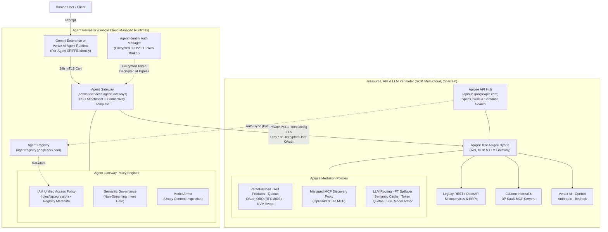

# Gemini Enterprise Agent Gateway vs. Apigee: Comparison & Dual-Gateway Integration

<div class="subnav">
  <a href="/ai-gateway/">Apigee AI Gateway</a>
  <span class="current">Compare &amp; Combine: Agent Gateway</span>
  <a href="/ai-gateway/agent-gateway-architecture">Agent Gateway Deep Dive</a>
</div>

Architectural comparison and dual-gateway integration guide for **Gemini Enterprise Agent Gateway** (`networkservices.googleapis.com` and `iap.googleapis.com`) and **Apigee X / Apigee Hybrid**, validated against official Google Cloud documentation and release notes through November 5, 2026 *(last reviewed November 6, 2026)*.

<details>
<summary>Recent Platform Updates Covered in This Analysis (Through November 5, 2026)</summary>
<div markdown="1">

1. **Private CA & self-signed TLS on Agent Gateway:** Supported for VPC targets via `AgentConnectivityTemplate` and Certificate Manager `TrustConfig`, provided `additionalRoots: PUBLICLY_TRUSTED_ROOTS` is configured ([Private CA `TrustConfig` Guide](agent-gateway-architecture.md#private-cas--self-signed-certificates-via-trustconfig)).
2. **Expanded Agent Gateway deployment models (`1 GA`, `3 Early Preview`):** Google-Managed Agent Gateway is GA; Self-Managed GKE, Cloud Run, and Cross-Cloud Envoy are Early Preview ([Deployment Models](agent-gateway-architecture.md#deployment-models-1-ga-vs-3-early-preview)).
3. **VPC-SC & multi-model Semantic Governance:** VPC-SC support launched in Preview (September 25, 2026), evaluating 7 model families with custom `denialMessage` overrides on non-streaming requests ([Semantic Governance](agent-gateway-architecture.md#5-service-extensions-model-armor--semantic-governance)).
4. **Model Armor SSE streaming & Hybrid boundary:** Apigee `<SanitizeModelResponse>` supports continuous SSE scanning on Apigee X and Apigee Hybrid (`v1.17.3+`, GCP clusters only; [AI Gateway Guardrails](README.md#24-prompt-tool--streaming-sse-guardrails)).
5. **Stateless MCP, basepath independence & API Hub sync:** Apigee X serves Stateless (`2026-07-28`) alongside Stateful MCP (Hybrid `1.17.0+` is stateful-only), supports custom MCP basepaths (`1-18-0-apigee-8`), and mirrors API Hub MCP catalogs to Agent Registry by default in Preview ([Apigee MCP Patterns](README.md#pattern-1-expose-rest-apis-as-mcp-tools)).
6. **Expanded Apigee AI traffic coverage:** Covers Multi-LLM routing with Provisioned Throughput spillover (replacing self-managed LiteLLM proxies), third-party SaaS MCP egress, semantic tool discovery, and cross-cloud/in-cluster A2A mediation ([Apigee AI Gateway](README.md)).
7. **Three official dual-gateway patterns:** Private Southbound PSC Bridge, North-South External Fronting, and inline `Apigee Extension Processor` ([Section 6](#6-three-official-dual-gateway-topologies)).

</div>
</details>

<div class="toc-box" markdown="1">

**On This Page**

* [1. Executive Summary & Core Mental Model](#1-executive-summary--core-mental-model)
* [2. End-to-End Dual-Gateway Architecture](#2-end-to-end-dual-gateway-architecture)
* [3. Side-by-Side Comparison Matrices](#3-side-by-side-comparison-matrices)
* [4. Decision Framework & Requirement Fit](#4-decision-framework--requirement-fit)
* [5. Real-World Integration Scenarios](#5-real-world-integration-scenarios)
* [6. Three Official Dual-Gateway Topologies](#6-three-official-dual-gateway-topologies)
  * [Topology 1: Southbound Private PSC Bridge](#topology-1-southbound-private-psc-bridge)
  * [Topology 2: North-South External & Multi-Cloud Fronting](#topology-2-north-south-external--multi-cloud-fronting)
  * [Topology 3: Inline Authorization Extension (`Apigee Extension Processor`)](#topology-3-inline-authorization-extension)
* [7. ISV Security Partners, End-to-End Delegation & FinOps](#7-isv-security-partners-end-to-end-delegation--finops)
* [8. Production Readiness Checklist & Organization Policies](#8-production-readiness-checklist--organization-policies)

**Related Guides**

* [Apigee as an Enterprise AI, LLM, MCP & A2A Gateway ->](README.md)
* [Agent Gateway Architecture Deep Dive ->](agent-gateway-architecture.md)

</div>

---

## 1. Executive Summary & Core Mental Model

Both **Gemini Enterprise Agent Gateway** and **Apigee** inspect Model Context Protocol (MCP) JSON-RPC calls (`tools/list`, `tools/call`) and integrate with **Model Armor**, but they sit on opposite sides of the network architecture and solve different problems.

**Agent Gateway is the agent-side network and identity perimeter.** Built on Cloud Network Services (`networkservices.googleapis.com`) and IAP (`iap.googleapis.com`), it attaches directly to the VPC network interface of an agent running in Vertex AI Agent Runtime or Gemini Enterprise via Private Service Connect. It gives each deployed agent an [un-impersonatable cryptographic identity (`SPIFFE` X.509 certificates rotated every 24 hours)](agent-gateway-architecture.md#3-cryptographic-agent-identity-spiffe-mtls-dpop--auth-manager), governs [outbound destinations via IAM Unified Access Policies](agent-gateway-architecture.md#4-iam-unified-access-policies), decrypts end-user OAuth tokens at the egress edge, and evaluates whether a [proposed tool call matches the user's prompt](agent-gateway-architecture.md#5-service-extensions-model-armor--semantic-governance).

**Apigee (Apigee X and Apigee Hybrid) is the centralized AI, LLM, MCP, and A2A mediation gateway.** It sits across model endpoints, internal REST/MCP backends, outbound third-party SaaS MCP targets, cross-cloud Agent-to-Agent (A2A) links, and inline Service Extension callouts. It serves every caller—including developer IDEs, mobile/partner apps, external agents, and Google-hosted agents—handling [multi-provider LLM routing and Provisioned Throughput spillover](README.md#21-multi-provider-routing-pt-spillover--schema-normalization), [semantic vector caching](README.md#22-semantic-response-caching), [real-time token quotas](README.md#23-real-time-token-quotas--spike-smoothing), [Cloud DLP tokenization and continuous SSE Model Armor](README.md#24-prompt-tool--streaming-sse-guardrails), [REST-to-MCP translation](README.md#pattern-1-expose-rest-apis-as-mcp-tools), [API Product `tools/list` filtering and per-tool quotas](README.md#4-per-tool-productization-dynamic-toolslist-filtering--quotas), and [On-Behalf-Of user token exchange (`RFC 8693`)](README.md#pattern-3-broker-outbound-access-to-third-party-saas-mcp-servers).

<details>
<summary>Analogy: Corporate Laptop VPN vs. Enterprise Central Switchboard</summary>
<div markdown="1">

Think of an AI agent as an employee working on a company-issued laptop, and your enterprise backends, SaaS platforms, and LLMs as vaults and shared utilities:

* **Agent Gateway acts like the laptop's hardware security chip, zero-trust VPN, and edge credential manager:**
  * Issues each agent its own rotating cryptographic badge (`SPIFFE` Agent Identity).
  * Controls which sites and MCP servers the agent may call (`Agent-to-Anywhere` IAM Unified Access Policies).
  * Injects end-user OAuth tokens at the outbound edge so agent code never handles raw secrets (`Agent Identity Auth Manager`).
  * Checks whether a proposed tool call contradicts the user's actual request (`Semantic Governance`).
* **Apigee acts like the enterprise's central switchboard, protocol translator, and API vault gatekeeper:**
  * Serves every caller (Google-hosted agents, VS Code / Cursor / Claude Desktop, consumer/B2B apps, and AWS/Azure agents).
  * Balances LLM traffic across Vertex AI Provisioned Throughput, Pay-As-You-Go, Azure OpenAI, and Anthropic with failover, canonical schema normalization, [LLM token budgets](https://docs.cloud.google.com/apigee/docs/api-platform/reference/policies/llm-token-quota-policy), [semantic caching](https://docs.cloud.google.com/apigee/docs/api-platform/reference/policies/semantic-cache-lookup-policy), [Cloud DLP tokenization](https://docs.cloud.google.com/sensitive-data-protection/docs/deidentify-sensitive-data), and [continuous SSE Model Armor](https://docs.cloud.google.com/apigee/docs/api-platform/reference/policies/sanitize-llm-response-policy#streaming-sse).
  * Exposes legacy REST APIs as MCP tools, filters `tools/list` per consumer tier, enforces per-tool rate limits, handles OAuth On-Behalf-Of exchange (`RFC 8693`) and KVM credential swaps, and powers entitlement-filtered semantic tool discovery via Apigee API Hub.

</div>
</details>

---

## 2. End-to-End Dual-Gateway Architecture



---

## 3. Side-by-Side Comparison Matrices

### At-a-Glance Comparison

| Capability Axis | Gemini Enterprise Agent Gateway | Apigee AI & MCP Gateway (`X` / `Hybrid`) |
| :--- | :--- | :--- |
| **Primary architectural role** | **Agent-side network and identity perimeter** (outbound forward proxy + `Agent Runtime` ingress) | **Enterprise API, Multi-LLM, MCP, and A2A gateway** across all callers, clouds, and backends |
| **Caller & runtime reach** | **GA:** Vertex AI `Agent Runtime` (ingress + egress) & `Gemini Enterprise` (egress only)<br>**Early Preview:** GKE, Cloud Run, Cross-Cloud Envoy | **GA everywhere:** Developer IDEs (VS Code, Cursor, Claude Desktop), non-Google agents (LangGraph, AWS Bedrock), consumer/B2B apps, Kubernetes |
| **Identity & delegation model** | [Per-agent cryptographic workload identity](agent-gateway-architecture.md#3-cryptographic-agent-identity-spiffe-mtls-dpop--auth-manager) (24h `SPIFFE` X.509 mTLS + `DPoP`) + Auth Manager zero-trust 3LO decryption | OAuth/OIDC JWTs, mTLS, API Keys, SAML, [On-Behalf-Of Token Exchange (`RFC 8693`)](README.md#pattern-3-broker-outbound-access-to-third-party-saas-mcp-servers), [OAuth metadata discovery (`RFC 9728`)](README.md#pattern-2-govern-internal--consumer-facing-mcp-servers), Encrypted KVM |
| **REST-to-MCP translation** | No (passthrough proxy only) | Yes: [Managed MCP Discovery Proxy](README.md#pattern-1-expose-rest-apis-as-mcp-tools) (Stateless + Stateful on X; Stateful on Hybrid `1.17.0+`) and `apigee-go-gen` |
| **Tool authorization & filtering** | [IAM Unified Access Policies](agent-gateway-architecture.md#4-iam-unified-access-policies) (CEL rules evaluating MCP hints) and Network Security authorization policies (`max 4` on egress) | [API Products + MCP payload parsing](https://docs.cloud.google.com/apigee/docs/api-platform/apigee-mcp/manage-mcp-tool-access#configure-parse-payload) (automatic `tools/list` filtering per consumer tier), [per-tool quotas](https://docs.cloud.google.com/apigee/docs/api-platform/apigee-mcp/manage-mcp-tool-access#per-tool-quotas), and [gRPC OPA callouts](README.md#pattern-2-govern-internal--consumer-facing-mcp-servers) |
| **Guardrails & intent checking** | [Semantic Governance intent gate](agent-gateway-architecture.md#5-service-extensions-model-armor--semantic-governance) across 7 model families (non-streaming only) + unary Model Armor (`<= 65k` tokens) | [Streaming SSE Model Armor](https://docs.cloud.google.com/apigee/docs/api-platform/reference/policies/sanitize-llm-response-policy#streaming-sse), [tool argument/output sanitization](https://docs.cloud.google.com/apigee/docs/api-platform/reference/policies/sanitize-user-prompt-policy), [Cloud DLP tokenization](https://docs.cloud.google.com/sensitive-data-protection/docs/deidentify-sensitive-data), and 3P AI firewalls |
| **Multi-LLM routing, caching & FinOps** | No routing/failover, semantic caching, or gateway token quotas (GA 1-second metadata observability headers only) | Yes (retires custom LiteLLM proxies): [Provisioned Throughput spillover](https://docs.cloud.google.com/gemini-enterprise-agent-platform/models/provisioned-throughput), failover, schema normalization, [semantic caching](https://docs.cloud.google.com/apigee/docs/api-platform/reference/policies/semantic-cache-lookup-policy), [real-time LLM token quotas](https://docs.cloud.google.com/apigee/docs/api-platform/reference/policies/llm-token-quota-policy) |
| **Hybrid / multi-cloud & PKI** | GA SaaS on GCP + [Certificate Manager `TrustConfig` private CAs](agent-gateway-architecture.md#private-cas--self-signed-certificates-via-trustconfig) (`additionalRoots: PUBLICLY_TRUSTED_ROOTS`, manual PEM rotation) | [Production GA (`Hybrid 1.17.0+`)](README.md#5-apigee-hybrid-1170-multi-cloud-execution-limits--network-hardening): runs `apigee-runtime` and `apigee-mcp-server` inside EKS, AKS, OpenShift, GKE, or on-prem with full PKI |

### Detailed Technical Comparison (Expandable by Domain)

<details>
<summary>Platform Scope, Control-Plane APIs, Hybrid Execution &amp; Catalog Sync</summary>
<div markdown="1">

| Dimension | Gemini Enterprise Agent Gateway | Apigee X & Apigee Hybrid |
| :--- | :--- | :--- |
| **Primary architectural role** | Outbound forward proxy and identity perimeter attached to an agent runtime, plus ingress for Vertex AI `Agent Runtime`. | Enterprise mediation hub for LLMs, internal/external MCP, REST-to-MCP translation, cross-cloud A2A, semantic tool discovery, and inline Service Extension callouts. |
| **Underlying GCP APIs & services** | `networkservices.googleapis.com` (`agentGateways`, `agentConnectivityTemplates`, `authzExtensions`), `networksecurity.googleapis.com` (`authzPolicies`), `compute.googleapis.com` (`networkAttachments`), `certificatemanager.googleapis.com` (`trustConfigs`), `iap.googleapis.com`, `agentregistry.googleapis.com`. | `apigee.googleapis.com`, `apihub.googleapis.com` (API Hub with `MCP` API style, Agent Registry sync, signed skills distribution, and `:searchResources`), plus `apigee-runtime` and `apigee-mcp-server`. |
| **Traffic direction modes** | 1. **`AGENT_TO_ANYWHERE` (egress):** Agents calling MCP servers, A2A agents, LLMs, or HTTP APIs.<br>2. **`CLIENT_TO_AGENT` (ingress):** Callers hitting `query` / `streamQuery` on Vertex AI `Agent Runtime` (not supported on Gemini Enterprise). | 1. External consumer/partner -> MCP or agent (WAF + OIDC + inline `RFC 8693`).<br>2. Internal app / developer IDE -> internal or REST-backed MCP.<br>3. Agent / IDE -> external SaaS MCP (key swap, OBO, or `RFC 9728`).<br>4. Search-then-Invoke discovery (API Hub + Vertex AI Search).<br>5. Cross-cloud and in-cluster A2A (`GET /.well-known/agent.json`, SSE tasks).<br>6. Multi-LLM & multimodal routing.<br>7. Inline `Apigee Extension Processor` (`ext_proc`). |
| **Supported runtimes & deployment models** | **GA:** Google-managed proxy for `Agent Runtime` (ingress + egress) and Gemini Enterprise (egress only).<br>**Early Preview:** Self-managed GKE (ambient + Secure Web Proxy), Cloud Run (RXLB/RILB + SWP), and Cross-Cloud Envoy. | **GA everywhere:** Works in production with any runtime, client, or model provider—Gemini Enterprise, ADK, LangGraph, Claude Agent SDK, developer IDEs, AWS Bedrock, Azure OpenAI, and partner apps. |
| **Hybrid & multi-cloud execution** | Google-managed SaaS in GA; self-managed Kubernetes/Cloud Run/Cross-Cloud options are Early Preview. | **Production GA (`Hybrid 1.17.0+`):** Runs both API Message Processors and the Managed MCP Server inside GKE, AWS EKS, Azure AKS, OpenShift, or on-prem clusters with zero request traffic leaving the cluster. |
| **Catalog, skills & discovery sync** | **Agent Registry (`agentregistry.googleapis.com`):** Tracks `Agent Runtime` agents, Cloud Run MCP servers, custom endpoints (up to 5,000 per gateway), and API Hub exports; Gemini Enterprise binds to one regional registry (`us-central1` or `europe-west1`). | **Apigee API Hub (`apihub.googleapis.com`):** Catalogs OpenAPI specs, MCP servers, Developer Portals, and Ed25519-signed agentic `.skill` archives; automatically mirrors MCP tools/servers to Agent Registry in Preview. |

</div>
</details>

<details>
<summary>Identity, Credential Brokers, REST-to-MCP Translation &amp; Authorization</summary>
<div markdown="1">

| Dimension | Gemini Enterprise Agent Gateway | Apigee X & Apigee Hybrid |
| :--- | :--- | :--- |
| **Cryptographic identity model** | **Per-agent `SPIFFE` identity (`AGENT_IDENTITY`):** Google-managed X.509 certificates rotated every 24h (`mTLS` to gateway, `DPoP` downstream); must be set when the agent is created (no retrofitting Service Account agents). | **Consumer, human OBO, and API-edge identity:** Validates OAuth/OIDC JWTs (`<VerifyJWT>`, `<OAuthV2>`), API Keys (`<VerifyAPIKey>`), mTLS client certs, and SAML; executes On-Behalf-Of token exchange (`RFC 8693`); serves `GET /.well-known/oauth-protected-resource` (`RFC 9728`). |
| **Credential vault / token broker** | **Agent Identity Auth Manager:** Encrypts end-user 3LO tokens (plus 2LO/API keys) so Gemini Enterprise / Agent Runtime code never handles raw credentials; Agent Gateway decrypts and injects them at egress. | **Encrypted KVM, Secret Manager & OAuth mediation:** Strips inbound corporate JWTs and injects encrypted backend API keys or exchanged OAuth tokens via `<OAuthV2>`, `<AssignMessage>`, and `<ServiceCallout>`. |
| **REST-to-MCP conversion & protocol versions** | **None:** Passthrough proxy only; cannot convert REST APIs into MCP tools. | **Managed MCP Discovery Proxy** (`<ORG>.mcp.apigee.internal`) via API Hub supports Stateless (`2026-07-28`) + Stateful (`2025-11-25`..`2024-11-05`) concurrently on Apigee X, Stateful MCP on Hybrid `1.17.0+`, and custom basepaths (`<ProxyOperationMode>MCP</ProxyOperationMode>`). **`apigee-go-gen`** also compiles OpenAPI 3.0 specs into MCP bundles for any version. |
| **Deterministic authorization engine** | 1. **IAM Unified Access Policies:** `iap.googleapis.com/resources.egressViaIAP` (`roles/iap.egressor`, `iapPolicyVersion: "V2"`) with CEL on Agent Registry metadata or unregistered hosts, Allow + Deny rules, and `DRY_RUN` audit mode.<br>2. **Network Security `authzPolicies`:** Matches MCP `tools/list` and `tools/call` operations. | 1. **API Products + `<ParsePayload>`:** Extracts `tools/call/<tool_name>` and enforces entitlements per Developer App.<br>2. **gRPC `<ExternalCallout>`:** Integrates with Open Policy Agent (OPA) or custom engines for fine-grained JSON-RPC argument authorization. |
| **MCP tool annotations & `tools/list` filtering** | Evaluates CEL rules against registered MCP tool hints (`read_only_hint`, `destructive_hint`, `idempotent_hint`, `open_world_hint`); binary allow/deny on `tools/list` rather than filtering tools out of the JSON array. | Pair `<ParsePayload>` in Request and Response flows with API Products to **automatically strip unauthorized tools from `tools/list` responses** per consumer tier; inspect arbitrary annotations via custom policy or OPA. |

</div>
</details>

<details>
<summary>Guardrails, Multi-LLM Routing, Semantic Caching, Quotas, TLS &amp; Scale</summary>
<div markdown="1">

| Dimension | Gemini Enterprise Agent Gateway | Apigee X & Apigee Hybrid |
| :--- | :--- | :--- |
| **Per-tool rate limits & token budgets** | No gateway rate limiting or token quota enforcement (passive 1-second observability metadata headers via `x-goog-agent-platform-observability-label-*` are GA for cost attribution). | Enforces independent `<Quota>` limits per MCP tool (`tools/call/<tool_name>`) alongside real-time `<LLMTokenQuota>` (excluding semantic cache hits automatically) and `<PromptTokenLimit>` burst protection. |
| **Prompt-to-action intent alignment** | **Semantic Governance Policies (Preview):** LLM evaluates Natural Language Constraints (NLC) + prompt alignment across 7 model families (Gemini, Anthropic, Claude on GEAP, OpenAI, Mistral, Llama, vLLM), with Preview VPC-SC support and custom `denialMessage`. **Non-streaming only.** | No multi-turn NLC LLM intent engine; focuses on fast payload guardrails, streaming Model Armor, Cloud DLP tokenization, and deterministic schema/OPA checks. |
| **Model Armor & streaming coverage** | **Ingress:** Only `reasoningEngines.streamQuery` on ADK agents.<br>**Egress:** Non-streaming OpenAI, MCP `tools/call` + `prompts/get`, and unary A2A `SendMessage`. Skips MCP `tools/list`, streaming MCP/A2A, and payloads over `65,536` tokens (`130,000` SDP / `4 MB`, returning `EXECUTION_SKIPPED`). | **`<SanitizeUserPrompt>` & `<SanitizeModelResponse>`:** Inspects tool args (`<FunctionCallSource>`), tool responses (`<FunctionResponseSource>`), and **continuous SSE streams (`<ContinuousScan>true</ContinuousScan>`)** as 1 Model Armor request without a total response token limit (GCP Hybrid clusters only; use `<ServiceCallout>` or 3P AI firewalls on EKS/AKS/on-prem). |
| **Semantic caching & Multi-LLM routing** | No semantic caching, provider failover, PT-to-PayGo spillover, or schema normalization. | Native `<SemanticCacheLookup>` / `<SemanticCachePopulate>` via Vertex AI Vector Search, conditional `RouteRules`, weighted `TargetServers`, `<GoogleAuthentication>`, and OpenAI-compatible schema translation—replacing standalone `LiteLLM` servers. |
| **A2A, semantic tool search & large files** | Governs A2A (`SendMessage` Model Armor only); no vector tool search or Claim-Check mediation. | Governs A2A (`GET /.well-known/agent.json`, JSON-RPC/SSE tasks), powers Search-then-Invoke tool discovery over API Hub + Vertex AI Search, and handles Cloud DLP `FPE` + pre-signed URL Claim-Check patterns. |
| **Backend TLS & private CAs** | Uses Certificate Manager `TrustConfig` (`tlsConfig.trustConfig`), requiring `additionalRoots: PUBLICLY_TRUSTED_ROOTS` so `*.googleapis.com` continues to work, manual PEM rotation, and template replacement on updates (custom FQDN `authzExtensions` do not verify server certs). | Full custom truststores/keystores, self-signed backend certs, two-way mTLS `TargetServers`, SNI overrides, and automated rotation without recreating gateway bindings. |
| **Scale, policy caps & VPC-SC** | Max **5,000** registered resources/gateway; max **4** `authzPolicies` on egress (forcing multi-gateway sharding); max **1** `CONTENT_AUTHZ` policy on ingress; `1,500`-byte MTU. **VPC-SC** requires gateways created after Sept 8, 2026 with `ALL_TRAFFIC` + private DNS to `restricted.googleapis.com`. | Fixed **1,000** Managed MCP tools/org on Apigee X; **Hybrid `1.17.0+`** lifts the count cap in favor of size bounds (**~10,000** tools typical: `3 MiB` OAS, `50 MiB` bundle per MCP Discovery Proxy, `10 MiB`/`30 MiB` `tools/list`, `100` hostnames/envgroup), with **no 4-policy cap** and full VPC-SC on Apigee X. |

</div>
</details>

---

## 4. Decision Framework & Requirement Fit

### Choose Agent Gateway When
1. Your agents run on **Vertex AI Agent Runtime** or **Gemini Enterprise** and need un-impersonatable **per-agent cryptographic identity** (24-hour rotating `SPIFFE` X.509 certificates with mTLS and DPoP) instead of shared Service Accounts.
2. You need **agent-centric outbound egress rules** (`Agent-to-Anywhere` via IAM Unified Access Policies) that evaluate Agent Registry metadata (such as `read_only_hint == true`).
3. You want **Semantic Governance (an LLM intent gate)** on non-streaming model calls to stop indirect prompt injection from triggering unauthorized tool calls.
4. You want **zero-trust 3-legged OAuth injection** via Agent Identity Auth Manager so user credentials remain encrypted until decrypted at the gateway edge.

### Choose Apigee When
1. You want an **Enterprise Multi-LLM & Multimodal Gateway** across Vertex AI Gemini, Azure OpenAI, OpenAI, Anthropic, and AWS Bedrock—retiring custom LiteLLM containers—with [Provisioned Throughput spillover](https://docs.cloud.google.com/gemini-enterprise-agent-platform/models/provisioned-throughput), failover, [real-time LLM token quotas](https://docs.cloud.google.com/apigee/docs/api-platform/reference/policies/llm-token-quota-policy), [semantic response caching](https://docs.cloud.google.com/apigee/docs/api-platform/reference/policies/semantic-cache-lookup-policy), [Cloud DLP Format-Preserving Encryption](https://docs.cloud.google.com/sensitive-data-protection/docs/deidentify-sensitive-data), and [continuous SSE Model Armor](https://docs.cloud.google.com/apigee/docs/api-platform/reference/policies/sanitize-llm-response-policy#streaming-sse).
2. You want to **convert existing REST/OpenAPI services into MCP tools** (`Managed Discovery Proxy` or `apigee-go-gen`), package tools into **API Products** with dynamic `tools/list` filtering and per-tool quotas, or add Search-then-Invoke semantic discovery across large catalogs.
3. Callers include **developer IDEs (VS Code, Cursor, Claude Desktop), partner/mobile apps, or non-Google agents**, or you need outbound SaaS MCP credential brokering (`RFC 8693` OBO, Encrypted KVM, `RFC 9728`) and cross-cloud A2A mediation.
4. You require **GA hybrid/multi-cloud execution** inside GKE, EKS, AKS, OpenShift, or on-prem clusters (`Apigee Hybrid 1.17.0+`), automated two-way mTLS rotation, or more than four authorization policies without multi-gateway sharding.

### Why Enterprises Combine Both
In a mature Google Cloud deployment, the two products form complementary layers: **Agent Gateway** locks down the Google-hosted agent's identity, outbound egress destinations, 3LO token decryption, and non-streaming intent alignment; **Apigee** receives traffic from Agent Gateway alongside developer IDEs and multi-cloud/external callers to govern API Products, MCP translation, semantic tool discovery, multi-LLM routing, token budgets, DLP tokenization, and continuous streaming guardrails.

### Requirements Quick Selector

| Requirement / Architectural Driver | Primary Fit | Agent Gateway Role | Apigee + API Hub Role | Combined Pattern |
| :--- | :--- | :--- | :--- | :--- |
| **Per-agent cryptographic workload identity** (no shared Service Accounts) | **Agent Gateway** | Provisions 24h auto-rotated `SPIFFE` X.509 mTLS + `DPoP` identity | Validates inbound mTLS or JWT at the API edge | Agent Gateway proves agent identity on egress; Apigee maps it to an API Product ([Identity](agent-gateway-architecture.md#3-cryptographic-agent-identity-spiffe-mtls-dpop--auth-manager)) |
| **Indirect prompt-injection intent gate** (align tool call to prompt) | **Agent Gateway** | [Semantic Governance LLM](agent-gateway-architecture.md#5-service-extensions-model-armor--semantic-governance) checks tool call against prompt + NLC (non-streaming) | Inspects individual payloads/tool outputs without agent chat history | Agent Gateway guards intent at runtime edge; Apigee enforces schemas and quotas ([Scenario](#scenario-blocking-prompt-injected-tool-calls)) |
| **Zero-trust 3LO token decryption** (no raw user secrets in agent code) | **Agent Gateway** | [Auth Manager](agent-gateway-architecture.md#3-cryptographic-agent-identity-spiffe-mtls-dpop--auth-manager) encrypts 3LO token; gateway decrypts into `Bearer` at egress | Receives decrypted token or exchanges it onward | Agent Gateway hides raw secret from agent code; Apigee brokers backend scope ([Scenario](#scenario-zero-trust-3lo-token-injection)) |
| **On-Behalf-Of token exchange (`RFC 8693`) & SaaS key swap** | **Apigee + API Hub** | Handles Auth Manager 3LO for Google agents; no custom OBO/KVM swap | Native OAuth and [service-callout token exchange](https://docs.cloud.google.com/apigee/docs/api-platform/reference/policies/service-callout-policy) (`sub`+`act`) and Encrypted KVM | Agent Gateway passes user/agent context; Apigee brokers scoped SaaS tokens ([SaaS Egress](README.md#pattern-3-broker-outbound-access-to-third-party-saas-mcp-servers)) |
| **Convert legacy REST / OpenAPI specs into MCP tools** | **Apigee + API Hub** | Not supported (passthrough only) | [Managed MCP Discovery Proxy + API Hub](README.md#pattern-1-expose-rest-apis-as-mcp-tools) or `apigee-go-gen` | Apigee converts REST to MCP and syncs to Agent Registry; Agent Gateway governs egress ([Scenario](#scenario-exposing-legacy-rest-apis-as-mcp-tools)) |
| **Tiered `tools/list` filtering & per-tool quotas** | **Apigee + API Hub** | Binary IAM allow/deny; does not filter tools from JSON payload or enforce per-tool quotas | [API Products and MCP payload parsing](https://docs.cloud.google.com/apigee/docs/api-platform/apigee-mcp/manage-mcp-tool-access#configure-parse-payload) strip unauthorized tools and enforce [per-tool quotas](https://docs.cloud.google.com/apigee/docs/api-platform/apigee-mcp/manage-mcp-tool-access#per-tool-quotas) | Agent Gateway controls which agents reach MCP; Apigee tailors tool visibility and rate limits ([Scenario](#scenario-tiered-toolslist-filtering-and-quotas)) |
| **External consumers, developer IDEs & multi-cloud callers** | **Apigee + API Hub** | GA covers Vertex AI / Gemini Enterprise runtimes (`Client-to-Agent` excludes GE) | Client-agnostic edge with [OAuth discovery (`RFC 9728`)](README.md#pattern-2-govern-internal--consumer-facing-mcp-servers) and custom IdPs | Agent Gateway governs Google-hosted agents; Apigee fronts IDEs, partners, and AWS/Azure workloads ([Topology 2](#topology-2-north-south-external--multi-cloud-fronting)) |
| **GA Hybrid / multi-cloud data-plane execution** | **Apigee Hybrid** | GA is Google-managed SaaS (GKE / Cloud Run / Cross-Cloud in Early Preview) | GA `Apigee Hybrid 1.17.0+` keeps API and MCP traffic inside customer clusters | Apigee Hybrid keeps regional/cluster workloads local; Agent Gateway governs GCP agents ([Hybrid Guide](README.md#5-apigee-hybrid-1170-multi-cloud-execution-limits--network-hardening)) |
| **Prompt, tool output, SSE streaming & Cloud DLP guardrails** | **Both (layered)** | Unary Model Armor or 15 ISV partners (skips SSE streams and `>65k` tokens) | [Prompt inspection](https://docs.cloud.google.com/apigee/docs/api-platform/reference/policies/sanitize-user-prompt-policy), [continuous SSE Model Armor](https://docs.cloud.google.com/apigee/docs/api-platform/reference/policies/sanitize-llm-response-policy#streaming-sse), and [Cloud DLP tokenization](https://docs.cloud.google.com/sensitive-data-protection/docs/deidentify-sensitive-data) | Agent Gateway guards unary tool calls; Apigee scans full SSE streams and tokenizes PII |
| **Semantic response caching & token FinOps limits** | **Apigee + API Hub** | Passive 1s Cloud Monitoring metadata labels only; no gateway cache or token cap | [Semantic response caching](https://docs.cloud.google.com/apigee/docs/api-platform/reference/policies/semantic-cache-lookup-policy), [real-time LLM token quotas](https://docs.cloud.google.com/apigee/docs/api-platform/reference/policies/llm-token-quota-policy), and [prompt-token spike limits](https://docs.cloud.google.com/apigee/docs/api-platform/reference/policies/prompt-token-limit-policy) | Agent Gateway emits metadata labels; Apigee enforces token budgets and serves cached responses ([FinOps](#honest-agentic-finops)) |
| **Unified API, MCP tool, `.skill` & agent catalog** | **Both (federated)** | **Agent Registry** (`agentregistry.googleapis.com`) indexes live agents & MCP endpoints | **API Hub** (`apihub.googleapis.com`) catalogs OAS/MCP specs & signed skills, syncing to Agent Registry | API Hub is producer catalog of record and feeds Agent Registry ([API Hub Sync](README.md#pattern-1-expose-rest-apis-as-mcp-tools)) |
| **Multi-LLM routing, PT spillover & schema normalization** | **Apigee + API Hub** | Single-target passthrough; no provider spillover or schema translation | Routes across [Vertex AI PT/PayGo, Azure OpenAI, Anthropic, and Bedrock](README.md#21-multi-provider-routing-pt-spillover--schema-normalization) (replaces `LiteLLM`) | Agent Gateway governs agent egress; Apigee handles resilient model routing ([Scenario](#scenario-consolidating-custom-litellm-proxies)) |
| **Cross-cloud A2A (`/.well-known/agent.json`) & semantic tool search** | **Both (by scope)** | Governs Google agent outbound A2A (`4`-policy cap); no vector tool search | Governs [cross-cloud A2A](README.md#pattern-5-cross-cloud--in-cluster-agent-to-agent-mediation) + [Search-then-Invoke discovery](README.md#pattern-4-search-then-invoke-semantic-tool-discovery) | Agent Gateway secures Google agent egress; Apigee handles wide-enterprise discovery and A2A ([Scenario](#scenario-developer-ides-saas-mcp-and-a2a)) |

---

## 5. Real-World Integration Scenarios

Expand any scenario below to see how the two gateways behave on the wire:

<details>
<summary id="scenario-exposing-legacy-rest-apis-as-mcp-tools">Exposing 200 Legacy REST APIs as MCP Tools (Apigee + API Hub)</summary>
<div markdown="1">

*"We have 200 OpenAPI 3.0 REST services and want agents to use them as MCP tools without writing custom MCP servers."*

* **Can Agent Gateway do this alone?** No. Agent Gateway is a passthrough proxy; it cannot translate an MCP `tools/call` JSON-RPC request into a backend REST call.
* **How Apigee solves it:** Register the OpenAPI specs in **Apigee API Hub**, enable **Configure MCP tools**, and deploy the **Managed MCP Discovery Proxy** (`<ORG>.mcp.apigee.internal`). Apigee exposes the REST operations as MCP tools (`tools/list`, `tools/call`), syncs them into **Agent Registry** automatically for Agent Gateway IAM bindings, and translates each tool invocation back to REST.

</div>
</details>

<details>
<summary id="scenario-blocking-prompt-injected-tool-calls">Blocking a Poisoned Email Prompt Injection (Agent Gateway)</summary>
<div markdown="1">

*"A hidden prompt injection inside an email tricks a Gemini Enterprise agent into calling `transfer_funds(amount=5000)` when the user only asked it to summarize unread emails."*

* **Can Apigee alone stop this?** Apigee's `<SanitizeUserPrompt>` (`<FunctionResponseSource>`) can scan email tool outputs for known injection signatures and `<Quota>` can rate-limit `transfer_funds`. However, if an attack evades signature detection and the agent sends an authenticated `tools/call` for `transfer_funds`, Apigee does not have the agent's multi-turn chat history or original prompt (`"Summarize my unread emails"`).
* **How Agent Gateway solves it:** Agent Gateway's **Semantic Governance Policy Engine** evaluates the original user prompt, chat history, Natural Language Constraints, tools manifest, and proposed `transfer_funds` invocation together on non-streaming model calls—catching the mismatch and blocking the call before it leaves the agent perimeter *(pair non-streaming enforcement with deterministic quotas/approvals, since streamed model responses bypass Semantic Governance today)*.

</div>
</details>

<details>
<summary id="scenario-tiered-toolslist-filtering-and-quotas">Tiered MCP Catalog Filtering &amp; Per-Tool Quotas (Apigee)</summary>
<div markdown="1">

*"We want one Financial MCP Server to serve 50 internal teams and partners—standard apps see 5 read-only tools at higher limits, while privileged apps see all 25 tools including write actions at stricter limits."*

* **Can Agent Gateway do this?** No. Agent Gateway does not model API Products, consumer tiers, JSON `tools/list` payload stripping, or per-tool rate limits.
* **How Apigee solves it:** Place **Apigee** in front of the MCP server using `<ParsePayload>` (MCP JSON-RPC mode) in both Request and Response flows, `<VerifyAPIKey>` / `<OAuthV2>`, and `<Quota>` bound to **API Products**. When a Tier-1 client requests `tools/list`, Apigee automatically strips the 20 privileged tools from the JSON payload and applies independent per-tool quotas to the 5 allowed tools.

</div>
</details>

<details>
<summary id="scenario-zero-trust-3lo-token-injection">Zero-Trust 3-Legged OAuth Injection Without Exposing Secrets (Agent Gateway)</summary>
<div markdown="1">

*"Our Gemini Enterprise agent calls internal MCP servers on the signed-in user's behalf, and the agent's Python code must never be able to inspect or log the raw user OAuth token."*

* **How Agent Gateway solves it:** Configure the OAuth provider in **Agent Identity Auth Manager** and attach Agent Gateway (`AGENT_TO_ANYWHERE`) to Gemini Enterprise. Auth Manager keeps user tokens encrypted inside the runtime, and Agent Gateway decrypts and attaches the `Bearer` credential only as the outbound request exits the gateway edge.

</div>
</details>

<details>
<summary id="scenario-consolidating-custom-litellm-proxies">Consolidating Custom LiteLLM Proxies onto an Enterprise LLM Gateway (Apigee)</summary>
<div markdown="1">

*"Product teams spun up separate `LiteLLM` containers to handle Vertex AI Provisioned Throughput spillover, Azure OpenAI/Anthropic failover, token budgets, and PII redaction. How do we standardize on one managed gateway?"*

* **Can Agent Gateway do this?** No. Agent Gateway forwards model calls to a single target URL without PT-to-PayGo spillover, schema translation, `<LLMTokenQuota>`, or inline Format-Preserving Encryption.
* **How Apigee solves it:** Apigee replaces custom `LiteLLM` servers with unified OpenAI-compatible schema translation, synchronous Cloud DLP `FPE` tokenization, `<SemanticCacheLookup>` vector caching, `<PromptTokenLimit>` + `<LLMTokenQuota>` enforcement, Vertex AI Provisioned Throughput routing via `<GoogleAuthentication>` with automatic `HTTP 429`/`5xx` spillover to PayGo or backup providers, and continuous SSE Model Armor inspection.

</div>
</details>

<details>
<summary id="scenario-developer-ides-saas-mcp-and-a2a">Developer IDEs, External SaaS MCP, Cross-Cloud A2A &amp; Large Tool Catalogs (Apigee + API Hub)</summary>
<div markdown="1">

*"Developers in VS Code, Cursor, and Claude Desktop plus AWS/Azure agents need access to hundreds of internal MCP tools, third-party SaaS MCP servers, and cross-cloud A2A agents—without storing SaaS API keys on laptops or bloating prompts with hundreds of tool schemas."*

* **Can Agent Gateway do this alone?** No. GA Agent Gateway attaches to Vertex AI Agent Runtime and Gemini Enterprise rather than developer laptops, does not swap Encrypted KVM credentials or perform custom `RFC 8693` mediation, and does not provide semantic tool discovery.
* **How Apigee + API Hub solves it:** Enterprise MDM points developer IDEs and multi-cloud agents to Apigee:
  1. **Search-then-Invoke discovery** backed by API Hub (`apihub.googleapis.com` `:searchResources`) + Vertex AI Search filters by JWT entitlements and returns only the top few relevant tool schemas.
  2. **Outbound 3P SaaS MCP mediation** swaps corporate JWTs for Encrypted KVM secrets or `RFC 8693` OBO tokens (returning `HTTP 200` JSON-RPC `-32000` errors on mid-session tool blocks so IDEs show clean policy denials rather than triggering endless OAuth re-login loops).
  3. **Cross-cloud A2A mediation** governs `GET /.well-known/agent.json` discovery and JSON-RPC/SSE tasks under central API Product kill switches.

</div>
</details>

---

## 6. Three Official Dual-Gateway Topologies

Google Cloud documents three ways to compose **Agent Gateway** and **Apigee** together:

```mermaid
flowchart TB
    subgraph T1["Topology 1: Southbound Private PSC Bridge (Agent Perimeter -> Producer Perimeter)"]
        A1["Agent Runtime / Gemini Enterprise"] --> AG1["Agent Gateway (Egress)"]
        AG1 -->|"PSC + Private DNS<br/>(TrustConfig or Internal ALB)"| AP1["Apigee X / Hybrid<br/>(Managed MCP + API Products + LLM Router)"]
        AP1 --> B1["Enterprise REST, MCP & LLMs"]
    end

    subgraph T2["Topology 2: North-South External & Multi-Cloud Fronting"]
        EXT["Partner App / Mobile / Non-WIF Agent"] --> AP2["Apigee X / Hybrid<br/>(Edge OIDC · Quota · DLP · OBO Exchange)"]
        AP2 -->|"Southbound PSC / WIF"| AG2["Agent Gateway (Ingress)<br/>+ Vertex AI Agent Runtime"]
    end

    subgraph T3["Topology 3: Inline Authorization Extension (Service Extensions ext_proc)"]
        A3["Agent Runtime"] --> AG3["Agent Gateway (Egress)"]
        AG3 <-->|"CONTENT_AUTHZ over PSC<br/>(No-Target Verdict Proxy)"| EP["Apigee Extension Processor<br/>(Dedicated Service Extension Env)"]
        AG3 -->|"Forwarded When Allowed"| DEST["Target LLM, Tool, or MCP Server"]
    end
```



### Topology 1: Southbound Private PSC Bridge

Documented in [Access Apigee privately from Gemini Enterprise Agent Platform](https://docs.cloud.google.com/apigee/docs/api-platform/system-administration/private-access-from-agent-runtime#architecture), this keeps all traffic between Google-managed `Agent Runtime` / `Agent Gateway` and `Apigee X` inside Private Service Connect:

Agent Gateway egresses through a PSC `networkAttachment` (minimum `/28` subnet) and Cloud DNS peering into a consumer VPC, resolving the Apigee Environment Group hostname to a PSC Forwarding Rule pointing at Apigee's `serviceAttachment`. Because Apigee's direct PSC endpoint presents a self-signed certificate ([`#overview`](https://docs.cloud.google.com/apigee/docs/api-platform/system-administration/private-access-from-agent-runtime#overview)), either front the PSC service attachment with an **Internal Application Load Balancer + PSC NEG** using a trusted certificate, or attach the Apigee CA via Certificate Manager `TrustConfig` (`additionalRoots: PUBLICLY_TRUSTED_ROOTS`) on the Agent Gateway connectivity template ([Private CA `TrustConfig` Guide](agent-gateway-architecture.md#private-cas--self-signed-certificates-via-trustconfig)).

### Topology 2: North-South External & Multi-Cloud Fronting

Because Agent Gateway's `CLIENT_TO_AGENT` ingress mode requires callers to present Google Cloud IAM / Workforce Identity Federation (WIF) credentials and is unsupported on Gemini Enterprise, front external B2B partners, consumer mobile apps, and multi-cloud callers with **Apigee** first. Apigee terminates Cloud Armor WAF, validates third-party OIDC tokens or API Keys, enforces commercial quotas, and bridges into Vertex AI `Agent Runtime` (either directly over PSC or through an ingress Agent Gateway).

### Topology 3: Inline Authorization Extension

Documented in [Connect the Apigee extension processor to an Agent Gateway](https://docs.cloud.google.com/apigee/docs/api-platform/service-extensions/extension-processor-agent-gateway), Agent Gateway invokes Apigee synchronously inline via `AuthzPolicy` (`policyProfile: CONTENT_AUTHZ`, `action: CUSTOM`) + `AuthzExtension` over PSC + private Cloud DNS to a **no-target proxy** inside a dedicated Apigee extension environment (`apigee-service-extension-enabled=true`). Apigee inspects `request.content` and `response.content` and returns an allow/deny verdict or body mutation without altering the agent's destination URLs.

<details>
<summary>AuthzExtension YAML &amp; Four Operational Caveats for Inline Extension Processor</summary>
<div markdown="1">

**Sample `AuthzExtension` configuration ([`extension-processor-agent-gateway#create-authz-ext`](https://docs.cloud.google.com/apigee/docs/api-platform/service-extensions/extension-processor-agent-gateway#create-authz-ext)):**
```yaml
name: projects/PROJECT_ID/locations/REGION/authzExtensions/apigee-authz-extension
authority: apigee-extproc.internal.example.com
service: apigee-extproc.internal.example.com
timeout: 5s
metadata:
  apigee-extension-processor: extproc-authz-proxy
  apigee-request-body: 'true'
  apigee-response-body: 'true'
```
*(Without `apigee-request-body: 'true'` and `apigee-response-body: 'true'`, `request.content` and `response.content` arrive empty inside Apigee.)*

**Four operational limits to account for:**
1. **Scope `httpRules` narrowly:** Matching `prefix: "/"` sends every agent session and telemetry request to Apigee; narrow `to.operations.paths` or CEL conditions strictly to target LLM/MCP calls.
2. **Export before importing Agent Gateway YAML:** Importing replaces the entire gateway resource (omitting `protocols` or `registries` deletes them).
3. **Unsupported policies in Extension Processor environments ([`extension-processor-overview#limitations`](https://docs.cloud.google.com/apigee/docs/api-platform/service-extensions/extension-processor-overview#limitations)):** Extension Processor environments disallow `<ExternalCallout>`, `<ServiceCallout>`, `<IntegrationCallout>`, `<SetIntegrationRequest>`, `<PublishMessage>`, `<MessageLogging>`, and `<GenerateJWT>` (max `1` environment per envgroup, max `50` proxies). Use **Topology 1 (Southbound Private PSC Bridge)** when you need OPA `<ExternalCallout>`, `RFC 8693` `<ServiceCallout>`, or REST-to-MCP conversion.
4. **Service Extensions payload limit ([`callouts-overview#limitations_with_body_processing`](https://docs.cloud.google.com/service-extensions/docs/callouts-overview#limitations_with_body_processing)):** gRPC `ProcessingResponse` messages from `ext_proc` extensions cannot exceed **`128 kB`** (`RESOURCE_EXHAUSTED`).

</div>
</details>

---

## 7. ISV Security Partners, End-to-End Delegation & FinOps

**15 named ISV security partners ([`agw-partners`](https://docs.cloud.google.com/gemini-enterprise-agent-platform/govern/gateways/agw-partners)):** Through `FULL_DUPLEX_STREAMED` Service Extensions, Agent Gateway supports integrations with **Acuvity**, **Airia**, **Check Point**, **Cisco**, **CrowdStrike**, **CyberArk**, **F5**, **Fortinet**, **Lakera**, **Netskope**, **Oasis Security**, **Okta**, **Palo Alto Networks**, **Proofpoint**, and **WitnessAI** *(with Check Point, F5 AI Guardrails / CalypsoAI, Lakera, and Palo Alto Prisma AIRS also available from Apigee proxies for multi-cloud and Hybrid enforcement)*.

**End-to-end confused-deputy prevention (Human + Agent + Tool Credential):** Combining Agent Gateway and Apigee preserves cryptographic provenance across every hop rather than flattening callers into one shared Service Account:
1. **Human caller:** Authenticated via corporate OIDC or Workforce Identity (`sub` claim).
2. **Agent workload:** Authenticated to Agent Gateway with its 24h `SPIFFE` X.509 certificate (`mTLS`) and bound downstream via `DPoP`.
3. **Downstream tool credential:** Either decrypted at Agent Gateway by Auth Manager 3LO, or exchanged at Apigee via OAuth On-Behalf-Of Token Exchange (`RFC 8693`, carrying both human `sub` and agent `act` claims) so backend audit logs record both *who* requested the action and *which agent* executed it.

#### Honest Agentic FinOps

1. **In-flight budget enforcement (Apigee):** Only Apigee enforces [real-time token limits](https://docs.cloud.google.com/apigee/docs/api-platform/reference/policies/llm-token-quota-policy) and [prompt burst smoothing](https://docs.cloud.google.com/apigee/docs/api-platform/reference/policies/prompt-token-limit-policy) across Vertex AI, OpenAI, and Anthropic while serving free cache hits via [semantic response caching](https://docs.cloud.google.com/apigee/docs/api-platform/reference/policies/semantic-cache-lookup-policy).
2. **Passive 1-second metadata attribution (GEAP):** [GEAP Inference request metadata logging](https://docs.cloud.google.com/gemini-enterprise-agent-platform/release-notes#October_30_2026) (GA October 30, 2026) supports `x-goog-agent-platform-observability-label-<key>` headers for 1-second Cloud Monitoring cost breakdowns across Provisioned Throughput and Pay-As-You-Go usage.
3. **Multi-turn workflow attribution (Agent Framework Telemetry):** Neither gateway automatically correlates multi-step autonomous retries across sub-agents into one business workflow ID unless correlation headers (`x-correlation-id`, W3C `traceparent`, or GEAP observability labels) are propagated by the agent runtime (such as ADK's BigQuery Agent Analytics plugin with OpenTelemetry) through both Agent Gateway and Apigee `PostClientFlow` exports.

---

## 8. Production Readiness Checklist & Organization Policies

1. **Enforce anti-sprawl Org Policies on `ReasoningEngine` ([`agent-gateway-runtime-deploy#restrict-ae`](https://docs.cloud.google.com/gemini-enterprise-agent-platform/scale/runtime/agent-gateway-runtime-deploy#restrict-ae)):** Block creation or updates of `Agent Runtime` resources that bypass your approved Agent Gateways (allow up to 15 minutes for Org Policy propagation).
2. **Install gateway CAs inside custom container (`BYOC`) agents ([`agent-gateway-runtime-deploy#configure-byoc`](https://docs.cloud.google.com/gemini-enterprise-agent-platform/scale/runtime/agent-gateway-runtime-deploy#configure-byoc)):** Source-based deployments trust Agent Gateway automatically, whereas BYOC Dockerfiles must bake `agentGatewayCard.rootCertificates` via `update-ca-certificates` and set `SSL_CERT_FILE`, `REQUESTS_CA_BUNDLE`, and `GRPC_DEFAULT_SSL_ROOTS_FILE_PATH`.
3. **Start IAP Unified Access Policies in `DRY_RUN` & register exact Google API hosts:** Avoid `HTTP 498` startup outages on logging/telemetry calls by auditing in `iamEnforcementMode: "DRY_RUN"` first and registering exact standard, `.mtls.`, and `.rep.` endpoints (`*.googleapis.com` wildcards do not match).
4. **Harden Apigee Hybrid `1.17.0+` MCP clusters:** Grant `watcher_identities` before upgrading, roll out Message Processor canary updates during maintenance windows, apply the Kubernetes `NetworkPolicy` isolating TCP `443` / blocking `15021` on `app=apigee-mcp-server`, and alert on config refresh failures.
5. **Maintain independent kill switches on both layers:** Revoke a compromised agent immediately via a `"DENY"` rule on its `principal://agents.global...` SPIFFE identity in Agent Gateway's IAP policy, and halt compromised apps or specific backend tools across *all* callers simultaneously by revoking credentials or removing the tool operation from the Apigee API Product.

<details>
<summary>Custom Organization Policy YAML: Restrict Reasoning Engine Egress to Approved Agent Gateways</summary>
<div markdown="1">

```yaml
name: organizations/ORGANIZATION_ID/customConstraints/custom.allowlistedEgressAgentGatewaysForAgentEngine
resource_types:
  - aiplatform.googleapis.com/ReasoningEngine
condition: >-
  has(resource.spec.deploymentSpec.agentGatewayConfig.agentToAnywhereConfig.agentGateway) &&
  resource.spec.deploymentSpec.agentGatewayConfig.agentToAnywhereConfig.agentGateway != '' &&
  (resource.spec.deploymentSpec.agentGatewayConfig.agentToAnywhereConfig.agentGateway in [
    'projects/GATEWAY_PROJECT_ID/locations/REGION/agentGateways/APPROVED_EGRESS_GATEWAY'
  ])
method_types:
  - CREATE
  - UPDATE
action_type: ALLOW
display_name: Restrict Reasoning Engine Egress to Approved Agent Gateways
```
*(Pair with the matching `custom.allowlistedIngressAgentGatewaysForAgentEngine` constraint on `clientToAgentConfig.agentGateway` for inbound governance.)*

</div>
</details>

---

[← Back to Apigee AI Gateway](README.md) · [Next: Agent Gateway Architecture Deep Dive ->](agent-gateway-architecture.md)
