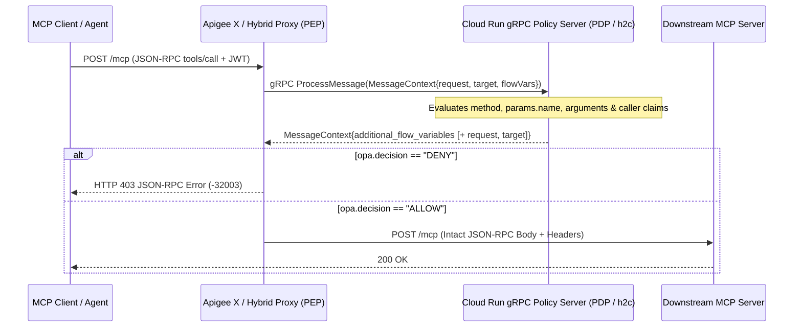

# Fine-Grained MCP Tool Authorization with Apigee + External Policy Engines (OPA)

Runnable reference architecture and implementation guide for enforcing **user-, role-, and argument-level authorization (`ABAC`)** on [Model Context Protocol (`MCP`)](https://modelcontextprotocol.io/introduction) tool calls (`tools/call`) using Apigee as the Policy Enforcement Point (PEP) and an external gRPC policy engine (OPA-style Rego logic over `<ExternalCallout>`) as the Policy Decision Point (PDP).

---

## 1. Why & When to Use This

Enterprises adopting MCP quickly hit a wall with gateway-only controls: they want Apigee to handle traffic management, identity validation, quotas, and enforcement while delegating fine-grained **user-, role-, and argument-level tool authorization** to an existing external Policy Decision Point (such as Open Policy Agent / OPA), without embedding complex business rules inside proxy JavaScript.

Unlike REST APIs where permissions map cleanly to HTTP verbs and URL paths (`GET /orders` vs. `POST /refunds`), **MCP multiplexes every tool invocation onto a single HTTP endpoint** (`POST /mcp`) carrying a JSON-RPC 2.0 body:

```json
{
  "jsonrpc": "2.0",
  "id": 2,
  "method": "tools/call",
  "params": {
    "name": "issue_refund",
    "arguments": { "order_id": "ORD-1001", "amount": 500 }
  }
}
```

### How Controls Layer Together

| Control Layer | What It Enforces | Best Tool |
| :--- | :--- | :--- |
| **App & Client Entitlements** | *"Can this registered client app see or call `issue_refund` at all, and how fast?"* | Apigee **API Products** (`<ParsePayload>` `MCP` + `payloadOperationGroup` + `<Quota>`) |
| **User, Role & Argument `ABAC`** | *"Can **Bob (`support_agent`)** call `issue_refund` for `amount = 500`, or does > `$250` require `finance_approver`?"* | **External PDP (`<ExternalCallout>` + OPA / Rego)** *(this guide)* |



---

## 2. Solution-Level Architectural Options & Tradeoffs

Integrating an external gRPC PDP into Apigee requires understanding one critical contract difference between `<ExternalCallout>` and standard HTTP callouts like `<ServiceCallout>`: **`ExternalCallout` exchanges full `MessageContext` protobuf state (`external_callout.proto`), not an isolated decision JSON payload.**

Unlike [`ServiceCallout`](https://docs.cloud.google.com/apigee/docs/api-platform/reference/policies/service-callout-policy), the [`ExternalCallout` schema](https://docs.cloud.google.com/apigee/docs/api-platform/reference/policies/external-callout-policy) does not have `<RequestVariable>` or `<ResponseVariable>`. When the gRPC server returns a `MessageContext`, Apigee merges `request`, `target`, and `additional_flow_variables` back into the active runtime context.

### The Proto3 Default Gotcha (When Integrating a Decision-Only PDP)

If a gRPC PDP returns **only** `additional_flow_variables` (`opa.decision`, `opa.reason`) and omits the `request` and `target` sub-messages in [`external_callout.proto`](grpc-service/external_callout.proto), Proto3 supplies empty default values on the response:
1. **`request.content` is wiped to `""` (`Content-Length: 0`):** Apigee merges the empty default `Request` sub-message over the live request body before forwarding to the target (unless streaming is enabled).
2. **`target.copy.pathsuffix` and `target.copy.queryparams` reset to `false`:** Empty default `Target` booleans overwrite the proxy's outbound path/query forwarding flags.
3. **`with.request.content` only controls what Apigee sends *out*:** Setting `<Property name="with.request.content">false</Property>` does not protect `request.content` from being overwritten on the return trip if the gRPC server does not handle omission safely or echoes an empty `request`.

### Choosing Between Option A (Recommended) and Option B

This repository implements **Option A** as the primary default and includes an optional header toggle for **Option B** so you can evaluate both patterns against your security team's PDP architecture:

| Option | How It Works | Proxy Footprint | Tradeoffs & Caveats | When to Choose |
| :--- | :--- | :--- | :--- | :--- |
| **Option A: Server Echoes Context** *(Primary Default · `CALLOUT_MODE=echo`)* | The gRPC server copies `incoming.request` and `incoming.target` onto the returned `MessageContext` alongside `additional_flow_variables` ([`server.py`](grpc-service/server.py)), matching [Google's official sample stubs](https://github.com/apigee/external-callout). | **Minimal (`EC-OpaPolicy` + `RF-OpaDenied`)** — zero Save/Restore policies needed. | Sends request bodies in both directions over gRPC and requires `<Property name="with.request.content">true</Property>` and `with.request.headers=true`. If `with.request.content` is `false`, `incoming.request.content` arrives empty and echoing it back still wipes the payload. | **Recommended whenever you own the gRPC PDP or run a thin adapter** in front of OPA (or intentionally mutate request headers/bodies in-flight). |
| **Option B: Gateway `AssignMessage` Backup/Restore** *(Defensive Proxy · `CALLOUT_MODE=partial` + `x-gateway-fix: backup-restore`)* | Snapshot `request.content`, `target.copy.pathsuffix`, and `target.copy.queryparams` into custom flow variables before `ExternalCallout`, then restore them immediately after via `<AssignVariable><Ref>`. | Adds `AM-BackupRequestContext` before `ExternalCallout` and `AM-RestoreTargetFlags` + `AM-RestoreRequestPayload` after. | Keeps the proxy resilient even when the gRPC server never returns `request` or `target`, works even if `with.request.content` is disabled (header/claim-only checks), and forces `Content-Length` recalculation automatically. | **Choose when integrating a third-party or security-owned decision-only PDP** whose gRPC server returns only `additional_flow_variables` and cannot be modified. |

> **How this single demo proxy covers both options:** Rather than maintaining two separate proxy bundles, [`apiproxy/proxies/default.xml`](apiproxy/proxies/default.xml) and [`server.py`](grpc-service/server.py) default to **Option A (`CALLOUT_MODE=echo`)** and support per-request overrides (`x-callout-mode: partial` and `x-gateway-fix: backup-restore`) so you can verify Option A, reproduce the decision-only overwrite behavior, and verify Option B against one deployment. When lifting **Option B** into a production SharedFlow, remove `request.header.x-gateway-fix == "backup-restore"` from the backup/restore `<Condition>` expressions (or bind them to a KVM flag).


---

## 3. Repository Structure

```text
examples/mcp-opa-callout/
├── README.md                              # This guide & deployment runbook
├── grpc-service/                          # Deployable Python HTTP/2 (h2c) gRPC server
│   ├── Dockerfile                         # Compiles external_callout.proto via grpc_tools.protoc
│   ├── external_callout.proto             # Official Apigee ExternalCalloutService contract
│   ├── requirements.txt
│   └── server.py                          # Option A (echo default) + switchable partial mode & MCP ABAC policy
└── apiproxy/                              # Sanitized Apigee proxy bundle (both Option A & Option B modes)
    ├── mcp-opa-callout.xml
    ├── policies/
    │   ├── AM-BackupRequestContext.xml
    │   ├── AM-InjectDebugHeaders.xml
    │   ├── AM-RestoreRequestPayload.xml
    │   ├── AM-RestoreTargetFlags.xml
    │   ├── AM-TargetEchoResponse.xml
    │   ├── EC-OpaPolicy.xml
    │   ├── EV-ExtractJwt.xml
    │   ├── JWT-DecodeCaller.xml
    │   └── RF-OpaDenied.xml
    ├── proxies/default.xml
    └── targets/default.xml
```

---

## 4. Quickstart: Deploy & Verify on Apigee X + Cloud Run

### Prerequisites
- An active **Apigee X** organization and environment (with [`apigee.googleapis.com`](https://docs.cloud.google.com/apigee/docs/api-platform/get-started/eval-orgs) enabled)
- **Cloud Run**, **Cloud Build**, and **Artifact Registry** APIs enabled in your GCP project (`run.googleapis.com`, `cloudbuild.googleapis.com`, `artifactregistry.googleapis.com`)
- [`gcloud` CLI](https://cloud.google.com/sdk/docs/install) authenticated (`gcloud auth login`)

```bash
export PROJECT_ID="PROJECT_ID"
export REGION="us-central1"
export APIGEE_ORG="PROJECT_ID"
export APIGEE_ENV="dev"
export APIGEE_HOST="your-apigee-hostname.example.com"
```

### Step 1: Build & Deploy the HTTP/2 (`h2c`) gRPC Service to Cloud Run

No local `protoc` installation is required—[`grpc-service/Dockerfile`](grpc-service/Dockerfile) runs `grpc_tools.protoc` during the Cloud Build step to compile [`external_callout.proto`](grpc-service/external_callout.proto).

> **Why `--use-http2` is mandatory:** By default, Cloud Run downgrades inbound HTTPS traffic to HTTP/1.1 before passing it to containers. Apigee's `<ExternalCallout>` uses native **gRPC over HTTP/2**, so you must enable end-to-end HTTP/2 (`h2c`) on Cloud Run with `--use-http2`.

```bash
gcloud run deploy mcp-opa-callout \
  --source ./grpc-service \
  --use-http2 \
  --allow-unauthenticated \
  --port=8080 \
  --memory=512Mi \
  --project="${PROJECT_ID}" \
  --region="${REGION}"
```

Retrieve the deployed Cloud Run URL and strip `https://` to obtain the bare hostname:

```bash
export GRPC_URL=$(gcloud run services describe mcp-opa-callout \
  --project="${PROJECT_ID}" \
  --region="${REGION}" \
  --format='value(status.url)')
export GRPC_HOST="${GRPC_URL#https://}"
echo "gRPC Host: ${GRPC_HOST}"
```

*(Note: `--allow-unauthenticated` keeps quickstart networking simple. In production, omit `--allow-unauthenticated` and lock down access via IAM or internal Cloud Run ingress / Private Service Connect.)*

### Step 2: Configure the Apigee `TargetServer` (`opa-grpc-server`)

Apigee's `<ExternalCallout>` resolves its backend via `<GrpcConnection><Server name="opa-grpc-server"/></GrpcConnection>`, which references an **Apigee Environment `TargetServer`** (not a KVM). Create it using the Apigee REST API with `"protocol": "GRPC"`, port `443`, and TLS enabled (Cloud Run terminates TLS on port `443` with a trusted public certificate):

```bash
ACCESS_TOKEN=$(gcloud auth print-access-token)

curl -sS -X POST \
  "https://apigee.googleapis.com/v1/organizations/${APIGEE_ORG}/environments/${APIGEE_ENV}/targetservers" \
  -H "Authorization: Bearer ${ACCESS_TOKEN}" \
  -H "Content-Type: application/json" \
  -d "{
    \"name\": \"opa-grpc-server\",
    \"host\": \"${GRPC_HOST}\",
    \"port\": 443,
    \"isEnabled\": true,
    \"protocol\": \"GRPC\",
    \"sSLInfo\": {
      \"enabled\": true
    }
  }"
```

### Step 3: Deploy the `mcp-opa-callout` API Proxy

First substitute `APIGEE_HOST` in [`apiproxy/targets/default.xml`](apiproxy/targets/default.xml) so the loopback echo target points to your Apigee ingress hostname:

```bash
sed -i.bak "s/APIGEE_HOST/${APIGEE_HOST}/g" apiproxy/targets/default.xml
```

Deploy using either **[`apigee-tf` (`apim`)](https://github.com/krisrowe/apigee-tf)** or direct zip import via `curl`:

```bash
# Option A: Using apim (inside an apigee-tf deployment workspace)
apim apis deploy mcp-opa-callout --env "${APIGEE_ENV}"

# Option B: Direct zip import + deploy via Apigee REST API
zip -rq mcp-opa-callout.zip apiproxy/
REV=$(curl -sS -X POST \
  "https://apigee.googleapis.com/v1/organizations/${APIGEE_ORG}/apis?name=mcp-opa-callout&action=import" \
  -H "Authorization: Bearer $(gcloud auth print-access-token)" \
  -F "file=@mcp-opa-callout.zip" | python3 -c "import sys,json; print(json.load(sys.stdin)['revision'])")

curl -sS -X POST \
  "https://apigee.googleapis.com/v1/organizations/${APIGEE_ORG}/environments/${APIGEE_ENV}/apis/mcp-opa-callout/revisions/${REV}/deployments" \
  -H "Authorization: Bearer $(gcloud auth print-access-token)"
```

Wait ~15–20 seconds for the revision deployment state to become `READY`.

---

## 5. Verify Every Scenario Live

`EV-ExtractJwt` strips the `Bearer ` prefix and `JWT-DecodeCaller` (`DecodeJWT`) extracts `sub` and `role` claims from any 3-segment JWT without requiring an IdP or JWKS setup for the demo (in production, replace `DecodeJWT` with `VerifyJWT` + JWKS). `EC-OpaPolicy` forwards those claims as `<FlowVariable>` entries, while requests without an `Authorization` header fall back to `x-caller-role`. On the Cloud Run gRPC server, `CALLOUT_MODE` sets the server default (`echo` or `partial`, defaulting to `echo`), and per-request `x-callout-mode` overrides it.

### 1. Verify Option A — Primary Pattern (`CALLOUT_MODE=echo` Default)
With no override headers, the gRPC server echoes `request` and `target` alongside `additional_flow_variables`. Target receives `HTTP 200` and all `112` bytes intact (`x-callout-mode: echo`):

```bash
curl -si -X POST "https://${APIGEE_HOST}/mcp-opa-callout/mcp" \
  -H "Content-Type: application/json" \
  -H "x-caller-role: support_agent" \
  -d '{"jsonrpc":"2.0","id":1,"method":"tools/call","params":{"name":"get_order","arguments":{"order_id":"ORD-1001"}}}'
```

### 2. Verify MCP Tool & Argument `ABAC` via Decoded JWT Claims (`403` vs `200`)

```bash
# Helper to build a 3-segment test JWT (Apigee DecodeJWT expects a non-empty signature segment)
make_jwt() {
  python3 -c 'import base64,json,sys
def b64(d): return base64.urlsafe_b64encode(json.dumps(d,separators=(",",":")).encode()).rstrip(b"=").decode()
print(b64({"alg":"HS256","typ":"JWT"}) + "." + b64({"sub":sys.argv[1],"role":sys.argv[2]}) + "." + base64.urlsafe_b64encode(b"demo-sig").rstrip(b"=").decode())' "$1" "$2"
}

# Denied (support_agent refund > 250) -> HTTP 403 JSON-RPC error
curl -si -X POST "https://${APIGEE_HOST}/mcp-opa-callout/mcp" \
  -H "Content-Type: application/json" \
  -H "Authorization: Bearer $(make_jwt 'alice@example.com' 'support_agent')" \
  -d '{"jsonrpc":"2.0","id":2,"method":"tools/call","params":{"name":"issue_refund","arguments":{"order_id":"ORD-1001","amount":500,"reason":"damaged"}}}'

# Allowed (finance_approver refund > 250) -> HTTP 200 w/ X-Identity-Source: jwt_flow_variable
curl -si -X POST "https://${APIGEE_HOST}/mcp-opa-callout/mcp" \
  -H "Content-Type: application/json" \
  -H "Authorization: Bearer $(make_jwt 'bob@example.com' 'finance_approver')" \
  -d '{"jsonrpc":"2.0","id":2,"method":"tools/call","params":{"name":"issue_refund","arguments":{"order_id":"ORD-1001","amount":500,"reason":"damaged"}}}'
```

### 3. Reproduce the Decision-Only Overwrite Gotcha (`x-callout-mode: partial`)
Simulate a decision-only gRPC server that inspects all `112` bytes of the MCP payload and returns **only** `additional_flow_variables`. Notice that `target_received_content_length=0` and `target_received_body=` at the target because proto3 default values overwrite `request.content`:

```bash
curl -si -X POST "https://${APIGEE_HOST}/mcp-opa-callout/mcp" \
  -H "Content-Type: application/json" \
  -H "x-callout-mode: partial" \
  -H "x-caller-role: support_agent" \
  -d '{"jsonrpc":"2.0","id":1,"method":"tools/call","params":{"name":"get_order","arguments":{"order_id":"ORD-1001"}}}'
```

### 4. Verify Option B — Defensive Proxy Save/Restore (`x-callout-mode: partial` + `x-gateway-fix: backup-restore`)
Even while the gRPC server returns only `additional_flow_variables`, `AM-BackupRequestContext` + `AM-RestoreTargetFlags` + `AM-RestoreRequestPayload` restore `request.content`, `Content-Length`, and `target.copy.*` cleanly before hitting the target:

```bash
curl -si -X POST "https://${APIGEE_HOST}/mcp-opa-callout/mcp" \
  -H "Content-Type: application/json" \
  -H "x-callout-mode: partial" \
  -H "x-gateway-fix: backup-restore" \
  -H "x-caller-role: support_agent" \
  -d '{"jsonrpc":"2.0","id":1,"method":"tools/call","params":{"name":"get_order","arguments":{"order_id":"ORD-1001"}}}'
```

---

## 6. Official References
- [Apigee `ExternalCallout` Policy Reference](https://docs.cloud.google.com/apigee/docs/api-platform/reference/policies/external-callout-policy)
- [Official `apigee/external-callout` Protobuf & Stubs Repository](https://github.com/apigee/external-callout)
- [Open Policy Agent (OPA) Documentation](https://www.openpolicyagent.org/docs/latest/)
- [Back to Apigee AI, LLM & MCP Gateway Guide ->](../../ai-gateway/README.md)
