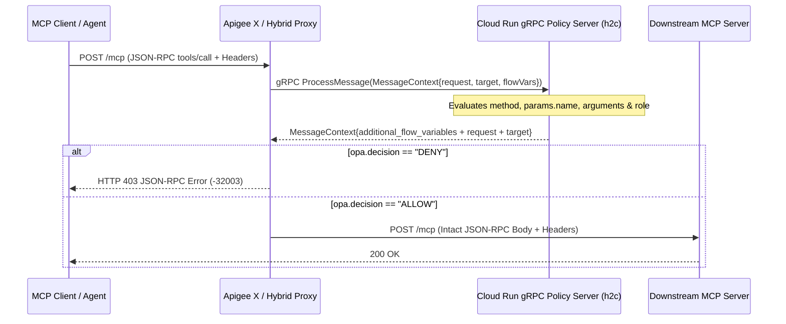

# Fine-Grained MCP Tool Authorization with Apigee `ExternalCallout` (gRPC + OPA)

Runnable reference architecture and live troubleshooting guide demonstrating how to enforce **attribute-based access control (`ABAC`)** on [Model Context Protocol (`MCP`)](https://modelcontextprotocol.io/introduction) `tools/call` payloads using Apigee's [`ExternalCallout`](https://docs.cloud.google.com/apigee/docs/api-platform/reference/policies/external-callout-policy) policy over gRPC, while avoiding a critical `MessageContext` payload-overwrite pitfall.

---

## 1. Why API Products Are Not Always Enough for MCP

Unlike REST APIs where permissions map cleanly to HTTP verbs and URL paths (`GET /orders` vs. `POST /refunds`), **MCP multiplexes every tool invocation onto a single HTTP endpoint** (`POST /mcp`) carrying a JSON-RPC 2.0 body:

```json
{
  "jsonrpc": "2.0",
  "id": 2,
  "method": "tools/call",
  "params": {
    "name": "issue_refund",
    "arguments": { "order_id": "ORD-1001", "amount": 500 }
  }
}
```

- **Apigee API Products (`payloadOperationGroup`)** handle **application-level entitlements** (*"Can this client app invoke `tools/call/issue_refund`?"*).
- **External Policy Engines (such as OPA / Rego over `ExternalCallout`)** handle **user- & argument-level `ABAC`** without embedding business rules in proxy JavaScript (for example: *"Allow `support_agent` to call `get_order`, allow `issue_refund` up to `amount <= 250`, and require `finance_approver` above `250`."*).



---

## 2. The `ExternalCallout` Overwrite Pitfall (and Both Fixes)

When integrating a custom gRPC server via [`external_callout.proto`](grpc-service/external_callout.proto), developers frequently attempt to return **only** `additional_flow_variables` (`opa.decision`, `opa.reason`) and leave `request` and `target` unset in the returned `MessageContext`.

**What happens at runtime:**
1. **`request.content` is wiped to `""`:** When the `request` sub-message is omitted from the gRPC response, Protocol Buffers supplies default values (`content = ""`), causing Apigee to overwrite the incoming HTTP request body before forwarding to the target (unless streaming is enabled on the flow).
2. **`target.copy.pathsuffix` and `target.copy.queryparams` reset to `false`:** Leaving `target` unset applies Protobuf default booleans (`false`).
3. **`<RequestVariable>` and `<ResponseVariable>` have no effect:** Unlike [`ServiceCallout`](https://docs.cloud.google.com/apigee/docs/api-platform/reference/policies/service-callout-policy), the [`ExternalCallout` schema](https://docs.cloud.google.com/apigee/docs/api-platform/reference/policies/external-callout-policy) does not define `<RequestVariable>` or `<ResponseVariable>`. Setting them on `ExternalCallout` is silently ignored, and `with.request.content` / `with.request.headers` filter **outbound** data only.

### Two Verified Solutions

| Approach | How It Works | Key Tradeoff & Caveat |
| :--- | :--- | :--- |
| **Option A: gRPC Server Echoes Context** | Return `MessageContext(request=incoming.request, target=incoming.target, additional_flow_variables=...)` ([`server.py`](grpc-service/server.py)). | **Zero proxy changes**, **but** requires keeping `<Property name="with.request.content">true</Property>` and `with.request.headers=true`. If `with.request.content` is `false`, `incoming.request.content` arrives empty and echoing it back still wipes `request.content`. |
| **Option B: Gateway `AssignMessage` Backup/Restore** | Snapshot `request.content`, `target.copy.pathsuffix`, and `target.copy.queryparams` into custom flow variables before `ExternalCallout`, then restore via `<AssignVariable><Ref>` immediately after. | **Zero dependency on the gRPC team**; safely preserves raw JSON bytes without template parsing and automatically recalculates `Content-Length`. |

---

## 3. Repository Structure

```text
examples/mcp-opa-callout/
├── README.md                              # This guide & deployment runbook
├── grpc-service/                          # Deployable Python HTTP/2 (h2c) gRPC server
│   ├── Dockerfile                         # Compiles external_callout.proto via grpc_tools.protoc
│   ├── external_callout.proto             # Official Apigee ExternalCalloutService contract
│   ├── requirements.txt
│   └── server.py                          # Switchable partial vs. echo mode + MCP ABAC policy
└── apiproxy/                              # Sanitized Apigee proxy bundle (both Fix A & Fix B modes)
    ├── mcp-opa-callout.xml
    ├── policies/
    │   ├── AM-BackupRequestContext.xml
    │   ├── AM-InjectDebugHeaders.xml
    │   ├── AM-RestoreRequestPayload.xml
    │   ├── AM-RestoreTargetFlags.xml
    │   ├── AM-TargetEchoResponse.xml
    │   ├── EC-OpaPolicy.xml
    │   └── RF-OpaDenied.xml
    ├── proxies/default.xml
    └── targets/default.xml
```

---

## 4. Quickstart: Deploy & Verify on Apigee X + Cloud Run

### Prerequisites
- An active **Apigee X** organization and environment (with [`apigee.googleapis.com`](https://docs.cloud.google.com/apigee/docs/api-platform/get-started/eval-orgs) enabled)
- **Cloud Run**, **Cloud Build**, and **Artifact Registry** APIs enabled in your GCP project (`run.googleapis.com`, `cloudbuild.googleapis.com`, `artifactregistry.googleapis.com`)
- [`gcloud` CLI](https://cloud.google.com/sdk/docs/install) authenticated (`gcloud auth login`)

```bash
export PROJECT_ID="PROJECT_ID"
export REGION="us-central1"
export APIGEE_ORG="PROJECT_ID"
export APIGEE_ENV="dev"
export APIGEE_HOST="your-apigee-hostname.example.com"
```

### Step 1: Build & Deploy the HTTP/2 (`h2c`) gRPC Service to Cloud Run

No local `protoc` installation is required—[`grpc-service/Dockerfile`](grpc-service/Dockerfile) runs `grpc_tools.protoc` during the Cloud Build step to compile [`external_callout.proto`](grpc-service/external_callout.proto).

> **Why `--use-http2` is mandatory:** By default, Cloud Run downgrades inbound HTTPS traffic to HTTP/1.1 before passing it to containers. Apigee's `<ExternalCallout>` uses native **gRPC over HTTP/2**, so you must enable end-to-end HTTP/2 (`h2c`) on Cloud Run with `--use-http2`.

```bash
gcloud run deploy mcp-opa-callout \
  --source ./grpc-service \
  --use-http2 \
  --allow-unauthenticated \
  --port=8080 \
  --memory=512Mi \
  --project="${PROJECT_ID}" \
  --region="${REGION}"
```

Retrieve the deployed Cloud Run URL and strip `https://` to obtain the bare hostname:

```bash
export GRPC_URL=$(gcloud run services describe mcp-opa-callout \
  --project="${PROJECT_ID}" \
  --region="${REGION}" \
  --format='value(status.url)')
export GRPC_HOST="${GRPC_URL#https://}"
echo "gRPC Host: ${GRPC_HOST}"
```

*(Note: `--allow-unauthenticated` keeps quickstart networking simple. In production, omit `--allow-unauthenticated` and lock down access via IAM or internal Cloud Run ingress / Private Service Connect.)*

### Step 2: Configure the Apigee `TargetServer` (`opa-grpc-server`)

Apigee's `<ExternalCallout>` resolves its backend via `<GrpcConnection><Server name="opa-grpc-server"/></GrpcConnection>`, which references an **Apigee Environment `TargetServer`** (not a KVM). Create it using the Apigee REST API with `"protocol": "GRPC"`, port `443`, and TLS enabled (Cloud Run terminates TLS on port `443` with a trusted public certificate):

```bash
ACCESS_TOKEN=$(gcloud auth print-access-token)

curl -sS -X POST \
  "https://apigee.googleapis.com/v1/organizations/${APIGEE_ORG}/environments/${APIGEE_ENV}/targetservers" \
  -H "Authorization: Bearer ${ACCESS_TOKEN}" \
  -H "Content-Type: application/json" \
  -d "{
    \"name\": \"opa-grpc-server\",
    \"host\": \"${GRPC_HOST}\",
    \"port\": 443,
    \"isEnabled\": true,
    \"protocol\": \"GRPC\",
    \"sSLInfo\": {
      \"enabled\": true
    }
  }"
```

### Step 3: Deploy the `mcp-opa-callout` API Proxy

First substitute `APIGEE_HOST` in [`apiproxy/targets/default.xml`](apiproxy/targets/default.xml) so the loopback echo target points to your Apigee ingress hostname:

```bash
sed -i.bak "s/APIGEE_HOST/${APIGEE_HOST}/g" apiproxy/targets/default.xml
```

Deploy using either **[`apigee-tf` (`apim`)](https://github.com/krisrowe/apigee-tf)** or direct zip import via `curl`:

```bash
# Option A: Using apim (inside an apigee-tf deployment workspace)
apim apis deploy mcp-opa-callout --env "${APIGEE_ENV}"

# Option B: Direct zip import + deploy via Apigee REST API
zip -rq mcp-opa-callout.zip apiproxy/
REV=$(curl -sS -X POST \
  "https://apigee.googleapis.com/v1/organizations/${APIGEE_ORG}/apis?name=mcp-opa-callout&action=import" \
  -H "Authorization: Bearer $(gcloud auth print-access-token)" \
  -F "file=@mcp-opa-callout.zip" | python3 -c "import sys,json; print(json.load(sys.stdin)['revision'])")

curl -sS -X POST \
  "https://apigee.googleapis.com/v1/organizations/${APIGEE_ORG}/environments/${APIGEE_ENV}/apis/mcp-opa-callout/revisions/${REV}/deployments" \
  -H "Authorization: Bearer $(gcloud auth print-access-token)"
```

Wait ~15–20 seconds for the revision deployment state to become `READY`.

---

## 5. Verify Every Scenario Live

### 1. Reproduce the Overwrite Bug (`x-callout-mode: partial`)
The gRPC server inspects all `112` bytes of the MCP payload and returns **only** `additional_flow_variables`. Notice that `target_received_content_length=0` and `target_received_body=` at the target:

```bash
curl -si -X POST "https://${APIGEE_HOST}/mcp-opa-callout/mcp" \
  -H "Content-Type: application/json" \
  -H "x-callout-mode: partial" \
  -H "x-caller-role: support_agent" \
  -d '{"jsonrpc":"2.0","id":1,"method":"tools/call","params":{"name":"get_order","arguments":{"order_id":"ORD-1001"}}}'
```

### 2. Verify Option A (`x-callout-mode: echo`)
The gRPC server echoes `request` and `target` alongside `additional_flow_variables`. Target receives `HTTP 200` and all `112` bytes intact:

```bash
curl -si -X POST "https://${APIGEE_HOST}/mcp-opa-callout/mcp" \
  -H "Content-Type: application/json" \
  -H "x-callout-mode: echo" \
  -H "x-caller-role: support_agent" \
  -d '{"jsonrpc":"2.0","id":1,"method":"tools/call","params":{"name":"get_order","arguments":{"order_id":"ORD-1001"}}}'
```

### 3. Verify Option B (`x-callout-mode: partial` + `x-gateway-fix: backup-restore`)
Even while the gRPC server returns only `additional_flow_variables`, `AM-BackupRequestContext` + `AM-RestoreTargetFlags` + `AM-RestoreRequestPayload` restore `request.content`, `Content-Length`, and `target.copy.*` cleanly before hitting the target:

```bash
curl -si -X POST "https://${APIGEE_HOST}/mcp-opa-callout/mcp" \
  -H "Content-Type: application/json" \
  -H "x-callout-mode: partial" \
  -H "x-gateway-fix: backup-restore" \
  -H "x-caller-role: support_agent" \
  -d '{"jsonrpc":"2.0","id":1,"method":"tools/call","params":{"name":"get_order","arguments":{"order_id":"ORD-1001"}}}'
```

### 4. Verify MCP Tool & Argument `ABAC` (`403` vs `200`)

```bash
# Denied (support_agent refund > 250) -> HTTP 403 JSON-RPC error
curl -si -X POST "https://${APIGEE_HOST}/mcp-opa-callout/mcp" \
  -H "Content-Type: application/json" \
  -H "x-callout-mode: echo" \
  -H "x-caller-role: support_agent" \
  -d '{"jsonrpc":"2.0","id":2,"method":"tools/call","params":{"name":"issue_refund","arguments":{"order_id":"ORD-1001","amount":500,"reason":"damaged"}}}'

# Allowed (finance_approver refund > 250) -> HTTP 200
curl -si -X POST "https://${APIGEE_HOST}/mcp-opa-callout/mcp" \
  -H "Content-Type: application/json" \
  -H "x-callout-mode: echo" \
  -H "x-caller-role: finance_approver" \
  -d '{"jsonrpc":"2.0","id":2,"method":"tools/call","params":{"name":"issue_refund","arguments":{"order_id":"ORD-1001","amount":500,"reason":"damaged"}}}'
```

---

## 6. Official References
- [Apigee `ExternalCallout` Policy Reference](https://docs.cloud.google.com/apigee/docs/api-platform/reference/policies/external-callout-policy)
- [Official `apigee/external-callout` Protobuf & Stubs Repository](https://github.com/apigee/external-callout)
- [Open Policy Agent (OPA) Documentation](https://www.openpolicyagent.org/docs/latest/)
- [Back to Apigee AI, LLM & MCP Gateway Guide ->](../../ai-gateway/README.md)
